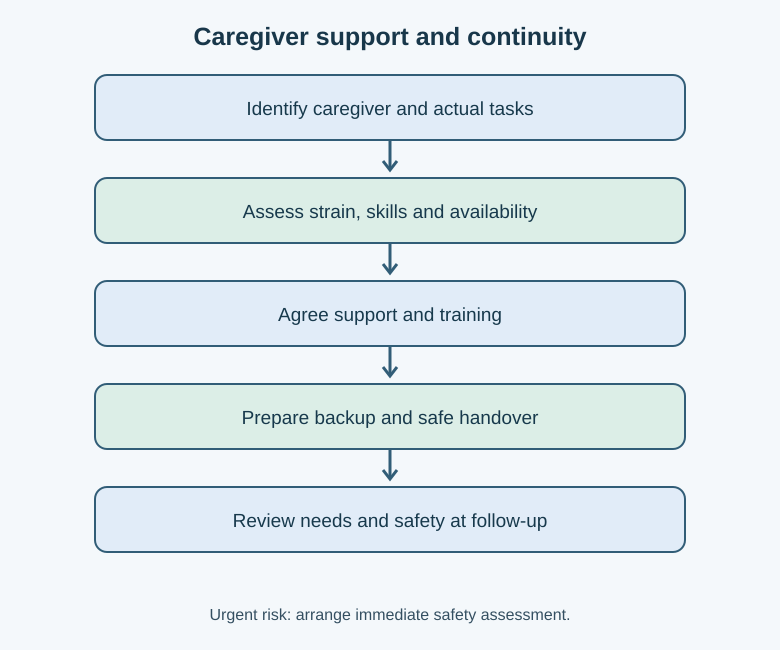

# Caregiver support and care continuity

**Candidate for review, not studied.** Original learning notes for NORCET / Staff Nurse preparation.

[20 original practice MCQs](../MCQs/09-Caregiver-Support-and-Care-Continuity-20-MCQs.md)

## 1. Identify the caregiver and assess both people

Informal caregiver family member, friend ya neighbour bhi ho sakta hai. Older person ki preferences, consent, ability aur care needs samjho. Caregiver ka actual role, willingness, availability, health, skills, financial strain aur support network separately assess karo. Sensitive concerns ke liye private discussion offer karo aur confidentiality limits explain karo.

## 2. Caregiver strain instruments

| Instrument | What it assesses | Scoring reminder |
|---|---|---|
| Zarit Burden Interview | Perceived caregiver burden | Use the specified version and its instructions |
| Original Caregiver Strain Index | Caregiver strain | 13 binary items, maximum 13 |
| Modified Caregiver Strain Index | Caregiver strain | 13 items, regularly 2, sometimes 1, no 0, maximum 26 |

Example: four regularly, five sometimes, four no = 8 + 5 = 13. Score ko diagnosis ya patient ADL score mat samjho. Individual domains aur distress explore karo. Self-harm thoughts ya immediate danger mein urgent safety assessment aur safe interim care arrange karo.

## 3. Practical support plan

Specific tasks define karo. Kaun groceries laayega, kaun agreed supervision dega, kaun medicines ke prescribed schedule mein help karega, aur uncovered periods mein kya arrangement hoga. Family ki willingness ko actual time availability mat samjho. Financial, employment, transport, training aur social support barriers assess karo. Peer support emotional aur practical help de sakta hai, individualized clinical advice replace nahi karta.

## 4. Backup and continuity

Caregiver sudden illness ya hospital admission ke liye advance backup plan useful hai. Backup person ki consent, capacity aur availability confirm karo. Patient ki consent aur appropriate confidentiality ke saath current medication instructions, routines, warning signs aur emergency contacts share karo. Training ke baad safe observed practice aur escalation knowledge assess karo.

## 5. WHO iSupport

WHO iSupport family members aur other caregivers of people with dementia ke liye learning manual hai. Five modules: Introduction to dementia, Being a caregiver, Caring for me, Providing everyday care, and Dealing with behaviour changes. Printable material offline use ho sakta hai. Local language, culture aur literacy ke according accessible format choose karo. Caring for me caregiver wellbeing par focus karta hai. Follow-up par strain, agreed task coverage aur goals reassess karo.

## Sources and video evidence

- [WHO iSupport](https://www.who.int/publications/i/item/9789241515863) — direct publication landing page checked.
- [WHO dementia information for caregivers](https://www.who.int/news-room/questions-and-answers/item/dementia-information-for-caregivers) — direct source checked.
- [Zarit Burden Interview](https://www.sralab.org/rehabilitation-measures/zarit-burden-interview) and [original CSI](https://www.sralab.org/rehabilitation-measures/caregiver-strain-index) — instrument reference pages.
- [Modified CSI scoring](https://tilda.tcd.ie/data/resource-hub/scale-docs/MCSI.html) — scoring reference page.
- [NICE NG150](https://www.nice.org.uk/guidance/ng150/chapter/Recommendations) — indexed guidance, Indian legal and service applicability not assumed.
- [Hartford Institute Modified CSI teaching video](https://www.youtube.com/watch?v=ON5186z1jHc) — metadata lead, playback and dedicated item-specific MCQ mapping pending.

Independent clinical and semantic audit pending. No historical exam provenance claimed.
