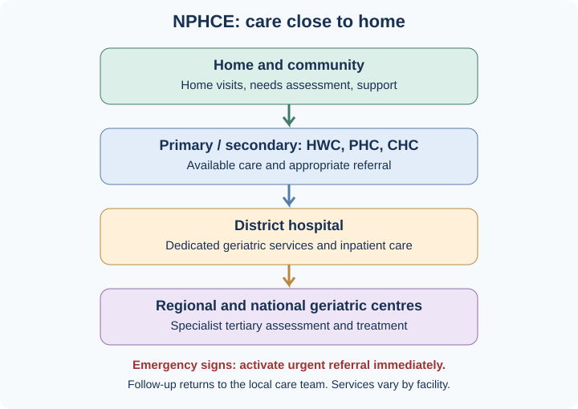

# Community Geriatric Care and NPHCE — Detailed Hinglish Notes

**Candidate, not studied.** NORCET, Staff Nurse aur CHO practice ke liye.

[Chapter](../README.md) · [20 topic-wise original MCQs](../MCQs/10-Community-Geriatric-Care-and-NPHCE-20-MCQs.md) · [Previous Year Questions research register](../Previous-Year-Questions/Geriatric-Nursing-Past-Paper-Research-Register.md)

## 1. Community geriatric care ka matlab kya hai?

Geriatric care ka matlab older people ki health aur daily life se judi needs ko samajhkar care dena hai. Har older person sick ya dependent nahi hota. Kuch log apna ghar aur daily kaam khud manage karte hain. Kuch logon ko chronic illness, kam mobility, hearing problem ya caregiver ki zaroorat ki wajah se extra support chahiye hota hai.

Community geriatric care mein nurse patient ki sirf disease nahi dekhti. Nurse yeh bhi dekhti hai ki patient ko ghar mein dawa, khana, transport aur follow-up mil raha hai ya nahi. Agar patient chal nahi sakta, toh sirf clinic ka address dene se problem solve nahi hogi. Local team ko accessible care aur zaroorat ke hisaab se referral plan karna hoga.

## 2. NPHCE kya hai?

NPHCE ka full form National Programme for the Health Care of the Elderly hai. India mein yeh programme older people ko accessible aur dedicated health services dene ke liye banaya gaya hai. Iska focus health promotion, prevention, treatment aur rehabilitation ko jodkar care dena hai.

Promotion ka matlab health ko support karna hai, jaise suitable physical activity ki advice. Prevention mein disease aur complications ka risk kam karne ke steps aate hain. Curative care mein existing illness ka diagnosis aur treatment aata hai. Rehabilitation ka matlab patient ki daily function aur independence ko jitna possible ho utna improve karna hai. Chronic condition poori tarah cure na bhi ho, tab bhi rehabilitation useful ho sakti hai.

## 3. Service levels aur referral

Community aur primary care level par trained workers local assessment aur home visits ke through patient ki needs identify kar sakte hain. PHC aur CHC par available services ke hisaab se assessment, care aur further referral hota hai. District hospital mein zyada specialised services aur national strategy ke mutabik ten-bed geriatric ward ka provision hai. Regional Geriatric Centres aur National Centres of Aging tertiary level par specialist care ke liye hain.

DGHS ke programme description ke mutabik below-district care existing primary health system mein integrate hoti hai. NHM component primary aur secondary levels se related hai. Tertiary component ka naam 2016–17 mein Rashtriya Varisth Jan Swasthya Yojana kiya gaya tha. DGHS description AIIMS New Delhi aur Madras Medical College Chennai ko National Centres of Aging ke roop mein list karta hai.

Dhyan rakho ki national service package ka matlab har facility mein exactly same service available hona nahi hai. Nurse actual local capacity aur referral arrangements check karti hai. Emergency mein routine referral ladder follow karne ke chakkar mein urgent care delay nahi honi chahiye.

## 4. Home visit aur continuity

Home visit ko domiciliary visit bhi kehte hain. Jab patient disability ya distance ki wajah se health centre nahi aa pata, toh trained worker uski needs ghar par assess kar sakta hai. Nurse patient ki permission leti hai, uski urgent symptoms aur daily care needs samajhti hai aur family caregiver ki ability bhi assess karti hai.

Agar specialist referral ki zaroorat ho toh nurse reachable facility identify karti hai. Referral ke baad yeh confirm karna bhi important hai ki patient ko care mili aur naya plan samajh aaya. Patient ya caregiver se plan apne words mein explain karwana understanding check karne mein help karta hai. Agar instruction unclear ho toh treating team se clarification lo.

Sudden facial droop, speech change ya severe breathlessness jaise emergency signs mein routine geriatric clinic ka wait nahi karna chahiye. Local emergency pathway activate karo.

## 5. WHO ICOPE aur LASI mein difference

WHO ICOPE ek clinical aur community care approach hai. Ismein older person ki abilities mein decline aur social support ki needs identify karke personalized care plan banaya jaata hai. Yeh NPHCE ka doosra naam nahi hai. Local care pathways ko WHO approach se support kiya ja sakta hai.

LASI ka full form Longitudinal Ageing Study in India hai. Yeh population-level research hai jo ageing, health, healthcare access, family aur social life, aur economic circumstances ke baare mein data collect karti hai. National survey se planning ke liye information milti hai, lekin kisi individual patient ka diagnosis confirm nahi hota.

## 6. Coverage numerical aur exam clue

Agar 240 eligible older people mein se 180 distinct people ko home visit mila, toh coverage 180 ÷ 240 × 100 = 75 percent hogi. Agar ek patient ko teen visits mili hain, toh encounter count teen hoga lekin unique recipient count ek hoga. Exam mein question dhyan se padho ki visits poochhi gayi hain ya unique people.

## Teaching video aur evidence

- [National Program for Health Care of Elderly — Hindi community health lecture](https://www.youtube.com/watch?v=1j9bMJz5QG0). Published title aur description match karte hain. Playback aur timestamps verify nahi huye hain.
- Dedicated NPHCE nursing MCQ-solving video aur item-wise coverage pending hai. Teaching lecture ko MCQ evidence ya PYQ proof nahi maana gaya hai.

## Sources

- [DGHS official NPHCE description](https://dghs.mohfw.gov.in/national-programme-for-the-health-care-of-the-elderly.php)
- [WHO ICOPE second edition, 2025](https://www.who.int/publications/i/item/9789240103726)
- [PIB government update](https://www.pib.gov.in/PressReleaseIframePage.aspx?PRID=2244485&lang=2&reg=48)

Yeh notes direct DGHS programme description aur WHO handbook landing page ke basis par likhe gaye hain. Full handbook aur operational PDF ki detailed independent verification abhi pending hai.
