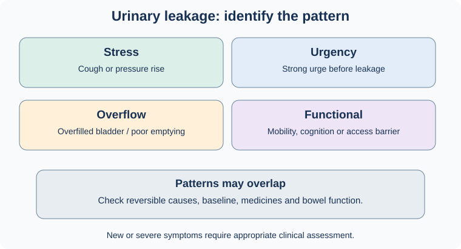

# Continence and Bowel Care in Older Adults — Detailed Hinglish Notes

**Candidate, not studied.** [Chapter](../README.md) · [20 topic-wise MCQs](../MCQs/06-Continence-and-Bowel-Care-20-MCQs.md)

## 1. Continence ka meaning aur normal function

Continence ka matlab urine aur stool ko suitable time aur place tak control kar paana hai. Kidney urine banati hai aur bladder use temporarily store karta hai. Jab bladder fill hota hai, toh nerves brain ko signal bhejti hain. Brain, bladder muscle, urethral sphincter aur pelvic floor milkar emptying control karte hain.

Umar ke saath bladder capacity aur emptying efficiency kuch logon mein kam ho sakti hain. Lekin incontinence ko normal aur unavoidable aging mat samjho. Agar patient ki leakage nayi hai ya badh rahi hai, toh underlying cause assess karo. Patient embarrassment ki wajah se khud se problem mention na kare, isliye nurse respectfully aur privately poochti hai.

## 2. Types kaise alag karte hain?

Stress incontinence mein cough, sneeze ya pressure rise ke saath leakage hoti hai. Urgency incontinence mein sudden strong urge ke baad urine leak hota hai. Overflow mein bladder adequately empty nahi hota aur overly full bladder se leakage ho sakti hai. Functional incontinence mein patient ki mobility, cognition ya environment toilet access ko affect karte hain. Mixed incontinence mein ek se zyada pattern saath ho sakte hain.

Yeh labels symptom pattern samajhne mein help karte hain. Nurse ko exact cause confirm karne ke liye clinical team ke saath assessment karna hai. Standard classification aur bladder training ke basic MCQs Foundations mein pehle se hain. Is Geriatric bank mein distinct older-adult applications cover ki gayi hain.

## 3. Reversible causes aur DIAPPERS

DIAPPERS ek memory aid hai jo reversible contributors yaad rakhne mein help karta hai. D delirium, I symptomatic infection, A atrophic urogenital changes, pehla P pharmaceuticals, doosra P psychiatric disorders, E excess urine production, R restricted mobility aur S stool impaction ko represent karta hai.

Is mnemonic ko diagnosis mat samjho. Example ke liye older patient ko pehle se stress leakage ho sakti hai aur acute illness ke dauran naya functional problem bhi aa sakta hai. Dono ka assessment karo. Menopause ke baad vaginal aur urethral tissues mein changes urgency aur irritation mein contribute kar sakte hain. Dryness alone se infection confirm nahi hoti.

## 4. Nocturia aur nocturnal polyuria

Nocturia ka matlab sleep period mein uthkar urine pass karna hai. Nocturnal polyuria mein raat ke urine production ka share disproportionately high hota hai. Older adults mein traditional threshold 24-hour urine volume ke 33 percent se zyada use hua hai, lekin guideline definitions aur clinical context vary kar sakte hain.

Agar 24-hour urine 1,800 mL hai aur appropriate diary definition ke according nocturnal urine 800 mL hai, toh ratio 800 ÷ 1,800 × 100 = 44.4 percent hai. Isse nocturnal polyuria ka clue milta hai. Yeh retention ya specific disease confirm nahi karta.

Daytime leg swelling ke baad letne par fluid circulation mein wapas aa sakta hai aur night urine production badh sakti hai. Sleep apnoea, diabetes aur other systemic contributors bhi assess karne chahiye. Desmopressin selected patients mein clinician consider karta hai. Older people mein water retention aur low serum sodium ka risk important hai, isliye suitability aur monitoring prescribed plan ke according check karo.

## 5. Management simple kaise rakhein?

Nurse patient ke leakage pattern, mobility, medicines, bowel habit aur preferences ke hisaab se team plan banati hai. Pelvic floor exercise normal urination ke dauran baar-baar stream stop karke nahi karni chahiye. Men bhi suitable supervised pelvic floor training se benefit le sakte hain. Specialist pessary selected stress leakage mein urethral support provide kar sakti hai. Intradetrusor botulinum toxin ke baad urine empty karne ki difficulty ho sakti hai, isliye patient counselling aur follow-up important hain.

Absorbent product patient ke fit, comfort, leakage aur ability ke according select karo. Wet skin ko gently clean aur protect karo. Sirf product dry rakhne ke liye unnecessary fluid restriction mat karo. Indwelling catheter routine incontinence management ka substitute nahi hai.

## 6. Faecal incontinence

Faecal incontinence ka matlab stool ka unwanted leakage hai. Older person mein constipation with loading, loose stool, reduced sensation, medicines aur mobility problems contribute kar sakte hain. Stool pattern aur warning signs assess karna zaroori hai. Severe abdominal pain, vomiting, bleeding ya systemic illness ko urgently escalate karo.

Diet ka goal manageable stool consistency aur adequate nutrition hai. Sab patients ko same fibre amount dena appropriate nahi hai. Tube-fed patient mein persistent leakage ho toh clinical aur nutrition team feed type, timing aur other causes review karti hai. Planned bowel emptying patient ki rectal sensation, stool pattern aur functional ability ke hisaab se individualize hota hai.

## Video aur source evidence

- [Level Up RN — urinary incontinence](https://www.youtube.com/watch?v=yW_HZU3Iq8w), teaching metadata.
- [Urinary Incontinence — clinical correlation and MCQs](https://www.youtube.com/watch?v=dW0Ws2VESs8), mixed USMLE-oriented metadata lead. Dedicated Indian nursing MCQ video and item-level playback pending.
- [Merck Manual professional urinary incontinence](https://www.merckmanuals.com/professional/genitourinary-disorders/voiding-disorders/urinary-incontinence-in-adults), direct HTML.
- [HIGN older-adult nursing protocol](https://hign.org/consultgeri/resources/protocols/urinary-incontinence-older-adults), direct HTML.
- [AAFP nocturia review](https://www.aafp.org/afp/2025/0600/nocturia), direct HTML.
- [NIDDK bladder control treatment](https://www.niddk.nih.gov/health-information/urologic-diseases/bladder-control-problems/treatment?sub=534018179), direct HTML.
- [NICE faecal incontinence](https://www.nice.org.uk/guidance/cg49/chapter/Recommendations), indexed recommendations.
- [NICE NG123](https://www.nice.org.uk/guidance/ng123/chapter/Recommendations), indexed guidance, direct access blocked.

Independent clinical and semantic review pending hai.
