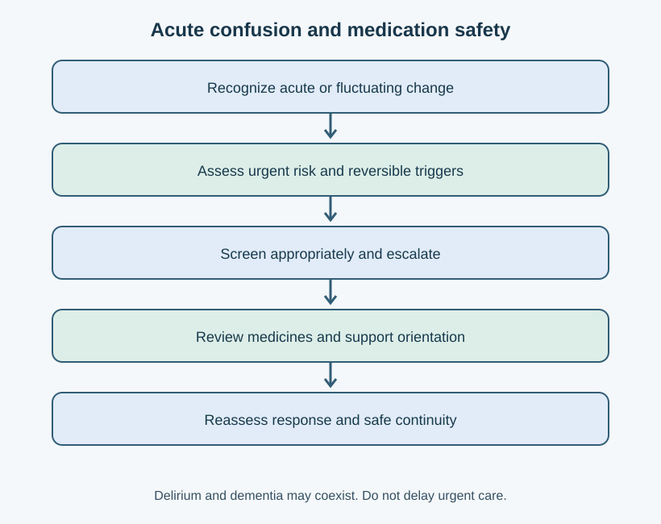

# Delirium, dementia and geriatric medication safety

**Candidate for review, not studied.** Batch 01 companion notes. Original question banks are preserved without editing.

[Delirium and dementia MCQs](../MCQs/04-Delirium-and-Dementia-20-MCQs.md) · [Polypharmacy MCQs](../MCQs/05-Polypharmacy-and-Medication-Safety-20-MCQs.md)

## 1. Delirium versus dementia

| Feature | Delirium | Dementia |
|---|---|---|
| Onset | Acute, usually hours to days | Often gradual, months to years |
| Course | Fluctuating | Usually persistent, progression depends on cause |
| Attention | Often markedly impaired | May be relatively preserved early, varies |
| Nursing priority | Identify acute triggers and urgent risks | Maintain function, safety and person-centred support |

Dono coexist kar sakte hain. Acute confusion ko dementia progression assume mat karo. Hypoactive delirium mein patient quiet, sleepy aur less interactive ho sakta hai. Infection, hypoxia, dehydration, pain, constipation, urinary retention aur medicines jaise triggers assess karo. Local protocol ke according 4AT use kiya ja sakta hai. Critical care mein CAM-ICU ya ICDSC appropriate ho sakte hain. Screening result clinical diagnosis ka substitute nahi hai. Uncertain case mein delirium ko priority do.

## 2. Delirium prevention and dementia care

Orientation cues, familiar communication, hearing and vision aids, adequate sleep, appropriate hydration, mobility, pain assessment aur medication review multicomponent prevention ka part ho sakte hain. Distress mein calm de-escalation aur underlying causes identify karo. Haloperidol routine first-line response nahi hai. Selected severe distress or risk mein clinician-specific decision aur contraindication assessment chahiye, especially Parkinson disease or Lewy body dementia mein.

Dementia mein communication short aur respectful rakho. Functional abilities, preferences aur environment match karo. Lewy body dementia mein visual hallucinations, cognitive fluctuation, parkinsonism aur REM sleep behaviour disorder ho sakte hain. Vascular cognitive impairment ka pattern variable hai. Pain expression aur swallowing difficulty assess karo. Caregiver support, meaningful activities, cognitive stimulation where suitable aur advance planning person-centred process ka part hain.

## 3. Polypharmacy and adverse drug events

Polypharmacy ko medicine count alone se harmful declare nahi karna chahiye. Indication, benefit, patient goals, dose, adverse effects, interaction, duplicate therapy aur adherence review karo. Prescribing cascade tab ho sakta hai jab adverse drug effect ko new disease maan kar additional medicine de di jaati hai. Reduced muscle mass ke wajah se serum creatinine deceptively low ho sakta hai, isliye drug-specific renal assessment important hai. Body water aur fat distribution changes medicines ki pharmacokinetics affect kar sakte hain. Pharmacodynamic sensitivity bhi differ ho sakti hai.

Anticholinergic burden confusion, constipation, dry mouth aur urinary retention ke risk mein contribute kar sakta hai. AGS Beers Criteria potentially inappropriate medication review ka aid hai, absolute prohibition list nahi. STOPP potential prescribing problems aur START potential omissions identify karne ke tools hain. Patient-specific benefits and harms assess karo. Deprescribing supervised plan hai, abruptly medicine stop karna nahi. Long-term benzodiazepine withdrawal mein clinician-led gradual taper often required hota hai.

Potassium-containing salt substitutes aur potassium-raising drugs, NSAIDs and renal or bleeding risks, hypoglycemia-prone treatments aur administration requirements ko individualized review mein include karo. Oral bisphosphonate instructions formulation-specific hain. Inhaler selection mein actual technique and ability assess karo. Medicine changes ke baad symptoms, adherence aur relevant lab/clinical outcomes follow up karo.

## Clinical sources and limits

- [NICE CG103 delirium](https://www.nice.org.uk/guidance/cg103/chapter/Recommendations) — indexed guideline checked.
- [NICE NG97 dementia](https://www.nice.org.uk/guidance/ng97/chapter/Recommendations) — indexed guideline checked.
- [2023 AGS Beers Criteria](https://pmc.ncbi.nlm.nih.gov/articles/PMC12478568/) — indexed full article checked.

Drug-specific references, STOPP/START version verification, jurisdiction-specific prescribing and legal applicability, video playback and independent clinical review remain pending. No new MCQ, mock or PYQ count.
