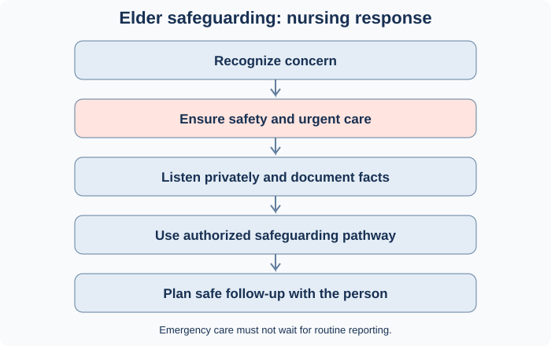

# Elder Abuse and Safeguarding — Detailed Hinglish Notes

**Candidate, not studied.** Yeh NORCET, Staff Nurse aur CHO ke liye concept guide hai.

[Chapter](../README.md) · [20 original MCQs](../MCQs/08-Elder-Abuse-and-Safeguarding-20-MCQs.md)

## 1. Elder abuse kya hota hai?

Elder abuse ka matlab aisa harmful behaviour ya zaroori care na dena hai jo older person ko harm ya distress pahunchata hai, khaaskar jab responsible person par trust ho. Abuse sirf maarne ko nahi kehte. Kisi ko dhamkana, uske paise ka bina permission use karna, unwanted sexual contact ya essential care deny karna bhi serious concern ho sakta hai.

Har older person dependent nahi hota. Dependence, cognitive difficulty aur social isolation kuch situations mein vulnerability badha sakte hain. Lekin risk factor se abuse prove nahi hota. Nurse ko actual situation carefully assess karni chahiye.

## 2. Types ko examples se samjho

Physical abuse mein force ya injury se harm hota hai. Psychological abuse mein humiliation aur threats ke through distress create ho sakta hai. Financial abuse mein paise ya property ka unauthorized use hota hai. Sexual abuse mein unwanted sexual contact ya valid consent ke bina behaviour ho sakta hai.

Neglect mein responsible caregiver essential care nahi deta. Agar patient ko adequate food, hygiene ya prescribed care repeatedly nahi milti, toh underlying reason assess karo. Caregiver resources ki kami aur deliberate deprivation ko carefully samajhna chahiye. Organisation ki unsafe routine se bhi multiple residents ki needs miss ho sakti hain.

## 3. Nurse ko kya dekhna hai?

Patient ki injuries, mood, behaviour, nutrition, hygiene aur history mein inconsistencies assess karo. Bruising ka medical cause bhi ho sakta hai, jaise anticoagulant medicine. Isliye bruise dekhkar kisi person ko automatically responsible declare mat karo. Lekin possible abuse ko ignore bhi mat karo.

Jab patient hearing problem ya communication difficulty ke saath aata hai, toh suitable aids arrange karo. Safe private conversation ka opportunity do. Alleged caregiver ko interpreter banane se pressure ya biased information ka risk ho sakta hai.

## 4. Disclosure ke baad nursing response

Patient ki baat calmly suno aur batao ki concern seriously liya ja raha hai. Sabse pehle immediate danger aur urgent medical needs assess karo. Emergency ho toh local emergency service aur clinical team activate karo. Investigation ke liye treatment delay mat karo.

Absolute secrecy ka promise mat do. Explain karo ki information ko respect ke saath handle kiya jaayega, lekin safety aur applicable duties ke liye authorised people se share karne ki need ho sakti hai. Patient ki own words aur objective findings ko separately document karo. Date, time aur actions bhi record karo.

Specific decision ke liye capacity assess karna important ho sakta hai. Sirf old age ya dementia diagnosis se automatically assume nahi karna chahiye ki patient decision nahi le sakta. Patient ki wishes aur valid consent respect karo, applicable law aur local policy ke hisaab se advice lo. Nurse ko khud punishment ya confrontation nahi karna hai.

## 5. India mein Elderline

Government ke 23 September 2026 update ke mutabik Elderline 14567 senior citizens ke liye toll-free support number hai. Yeh information, guidance, emotional support aur relevant service coordination mein help karta hai. Yeh direct cash assistance nahi deta. Local availability aur referral details verify karo. Immediate danger mein emergency response ko routine helpline referral ke liye delay mat karo.

## 6. Exam clue

Bruise clue ho sakta hai, proof nahi. Safety, treatment aur proper documentation pehle aate hain. Risk factor aur confirmed abuse mein difference samjho. Valid consent ke bina behaviour ko older age ke basis par normal mat maano. Safeguarding follow-up mein medicines, food, transport aur safe housing ki continuity bhi assess karo.

## Video aur sources

- [Level Up RN — Elder Mistreatment](https://www.youtube.com/watch?v=5yPoq7es0q0). Published description mein 00:16 risk factors, 00:41 types, 1:47 signs aur 4:02 quiz marker hain. Playback aur exact quiz items verify nahi huye hain. Dedicated standalone MCQ video pending hai.
- [WHO elder abuse fact sheet](https://www.who.int/news-room/fact-sheets/detail/abuse-of-older-people). Direct HTML retrieved.
- [NICE NG189](https://www.nice.org.uk/guidance/ng189/chapter/Recommendations). Indexed recommendations reviewed. Direct page returned 403. UK-specific statutory arrangements India par automatically apply nahi hote.
- [PIB Elderline update](https://www.pib.gov.in/PressReleaseIframePage.aspx?PRID=2314163&lang=2&reg=48). Direct HTML retrieved.

Independent clinical, legal applicability aur item-level video checks pending hain.
