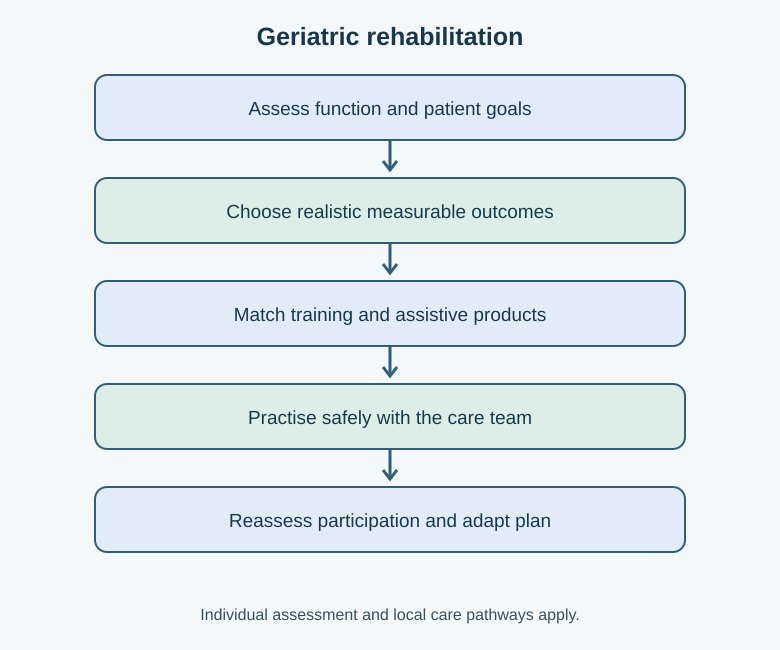

# Functional rehabilitation and assistive devices in older adults

**Candidate for review, not studied.** Original learning notes for NORCET / Staff Nurse preparation. Individual clinical assessment and local policy take priority.

[20 original practice MCQs](../MCQs/07-Functional-Rehabilitation-and-Assistive-Devices-20-MCQs.md)

## 1. Rehabilitation: function is the goal

Rehabilitation ka goal older person ko meaningful daily activities mein maximum safe independence dilana hai. Cure possible na ho tab bhi adaptive techniques, symptom management, exercises aur assistive products se function improve ho sakta hai. Restorative approach lost ability improve karne ki koshish karta hai. Compensatory approach existing ability aur environment ko use karke task complete karne ka alternative deta hai. Dono saath use ho sakte hain.

## 2. Assessment and measurable outcomes

Baseline par patient ki goals, mobility, pain, endurance, cognition, vision, hearing aur home environment assess karo. Short Physical Performance Battery (SPPB) standing balance, gait speed aur repeated chair stands assess karti hai. Standard three components 0–4 each, total 0–12. Same protocol use karo aur unsafe test force mat karo. Gait speed distance divided by time hai. Four metres in eight seconds = 0.5 m/s. A low score can guide further assessment, not diagnose an illness by itself. Floor effect means the tool may not distinguish lower levels of function well.

Goal specific hona chahiye, jaise safe assessed support ke saath dining area tak jana. Follow-up par actual performance aur patient-reported participation compare karo.

## 3. Assistive products and adaptation

Product patient ki ability, intended task, environment aur preference se match hona chahiye. Rollator seat use se pehle manufacturer guidance ke according brakes lock aur stability check karo. Wheelchair selection mein dimensions, seating, pressure management, home access aur training important hain. Long-handled reacher, adapted cutlery, dressing aids aur raised seating selected tasks mein independence improve kar sakte hain. Har device har patient ke liye suitable nahi hota. Fitting aur safe demonstration occupational therapist, physiotherapist ya trained team ke saath arrange karo.

## 4. Service and follow-up

Reablement short-term goal-oriented support ho sakta hai jo daily activities dobara practice karne mein help karta hai. Intermediate care eligibility local service criteria par depend karti hai. Device dene ke baad use, comfort, skin, falls risk, maintenance aur repair access reassess karo. New dizziness, acute pain, breathlessness ya sudden functional decline ko routine exercise progress samajhkar ignore mat karo.

## Sources and video evidence

- [WHO rehabilitation](https://www.who.int/news-room/fact-sheets/detail/rehabilitation) — direct source checked.
- [WHO assistive technology](https://www.who.int/news-room/fact-sheets/detail/assistive-technology) — direct source checked.
- [NICE intermediate care including reablement](https://www.nice.org.uk/guidance/ng74) — indexed guidance, local applicability review pending.
- [EquipMeOT rollator demonstration](https://www.youtube.com/watch?v=vctV72h_pm0) — publisher metadata, seat 2:53 and brake use 3:48. Model-specific teaching, playback not verified. Dedicated MCQ video and item mapping pending.

Independent clinical review, difficulty and semantic audit pending. No historical exam provenance claimed.
