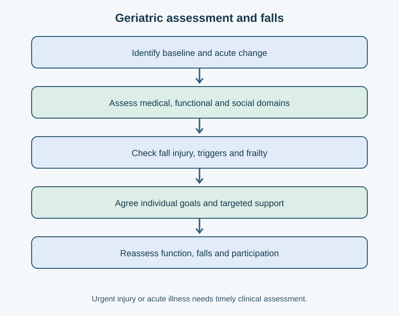

# Normal aging, comprehensive geriatric assessment, falls and frailty

**Candidate for review, not studied.** Batch 01 companion notes. Original practice banks are preserved without editing.

[Normal aging MCQs](../MCQs/01-Normal-Aging-20-MCQs.md) · [CGA MCQs](../MCQs/02-Comprehensive-Geriatric-Assessment-20-MCQs.md) · [Falls and frailty MCQs](../MCQs/03-Falls-and-Frailty-20-MCQs.md)

## 1. Normal aging and physiological reserve

Older adults mein organ reserve aur stress ke baad recovery capacity kam ho sakti hai. Lekin aging ka matlab har person mein disability ya disease hona nahi hai. Acute functional decline ko old age bolkar ignore mat karo. Lens accommodation aur low-light adaptation kam ho sakti hai. Hearing difficulty mein face-to-face clear communication aur background noise reduction helpful hai. Skin fragile ho sakti hai, isliye friction aur shear reduce karo. Temperature regulation aur body water reserve mein changes se heat, cold aur dehydration ka risk badh sakta hai.

Chest wall stiffness aur respiratory reserve changes, arterial stiffness aur maximal heart rate response mein reduction exercise tolerance ko affect kar sakte hain. Bone loss aur muscle weakness assessment aur individualized activity planning ko important banate hain. Smell, teeth aur chewing problems nutrition affect kar sakti hain. Bowel symptoms, disturbed sleep aur sudden confusion mein reversible causes assess karo. Immune response aur cognitive processing speed change ho sakte hain, lekin severe memory loss normal aging ka inevitable part nahi hai.

## 2. Comprehensive geriatric assessment (CGA)

CGA multidimensional, multidisciplinary assessment hai jiska purpose individualized coordinated care plan banana hai. Baseline function aur current decline compare karo. Medical problems, medicines, nutrition, mood, cognition, mobility, sensory ability, continence, social support aur environment review karo. Patient ki own goals ko central rakho. Katz ADL basic self-care assess karta hai, jabki Lawton IADL complex everyday tasks jaise shopping, transportation aur medication management assess karta hai. Exact scoring version follow karo. Hearing, vision, language aur education cognitive screening performance affect kar sakte hain. A screen is not a diagnosis.

WHO ICOPE person-centred approach cognition, mobility, vitality, vision, hearing aur psychological capacity ke saath social support aur caregiver needs ko consider karta hai. Home safety, caregiver reports aur patient reports mein differences milen to practical assessment se clarify karo. Team plan mein clear goals, responsibilities aur reassessment date rakho.

## 3. Falls and frailty

Fall ke baad injury, loss of consciousness, acute illness aur prolonged time on floor assess karo. Urgent risk mein immediate clinical assessment arrange karo. Recurrent falls, frailty aur gait/balance problems comprehensive assessment ki need indicate kar sakte hain. Timed Up and Go functional mobility estimate karta hai, chair stand lower limb performance, aur balance tests postural control. Safe setup aur guarding essential hai. Single test ya risk score se saari fall causes rule out nahi hoti.

Frailty reduced physiological reserve aur stressor vulnerability se related hai. Stable disability aur frailty equivalent nahi hain. Fried phenotype mein unintentional weight loss, exhaustion, weakness, slow walking aur low activity assess hote hain. Clinical Frailty Scale ko relevant baseline aur proper tool instructions ke according interpret karo. Individualized strength and balance activity, adequate nutrition, suitable footwear, home hazard modification, vision review aur medication review risk management mein useful ho sakte hain. Vitamin D ko universal standalone fall-prevention treatment mat samjho.

## Clinical sources and limits

- [WHO ICOPE second edition, 2025](https://www.who.int/publications/i/item/9789240103726) — publication indexed and landing page previously checked.
- [NICE NG249 falls assessment and prevention, 2025](https://www.nice.org.uk/guidance/ng249/chapter/Recommendations) — indexed guideline checked.
- [NICE guideline in NCBI Bookshelf](https://www.ncbi.nlm.nih.gov/books/NBK615910/) — indexed full guideline mirror.

Detailed physiological source-by-source validation, tool-specific references, video playback and independent clinical review remain pending. No new MCQ, mock or PYQ count.
