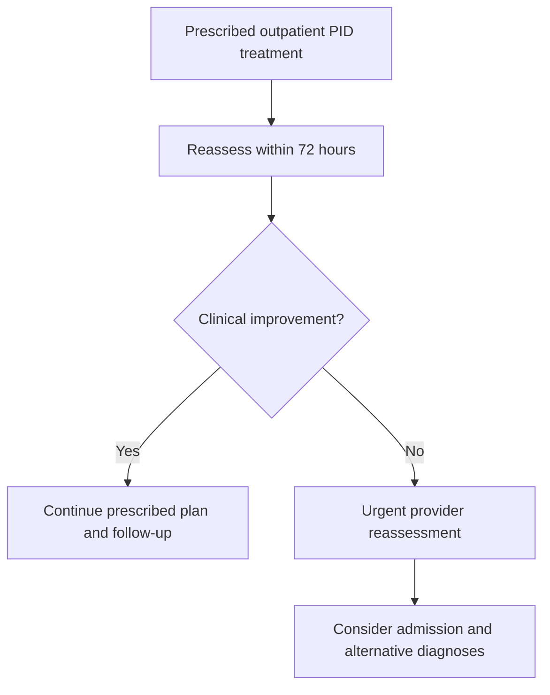

# Reproductive Tract Infections, STIs and PID — Original MCQs Q21–Q40

**Advance-preparation, unattempted.** Ye 20 new original questions hain, historical PYQs nahi. Drug questions named guidance ke context mein hain. Clinical practice mein local Indian protocol, pregnancy aur provider orders check karein.

[Chapter](../README.md) · [Q1–Q20](04-Reproductive-Tract-Infections-STIs-and-PID-20-MCQs.md) · [Topic map](../Concepts/Gynecological-and-Reproductive-Nursing-Topic-Coverage-Map.md) · [Previous Year Questions](../Previous-Year-Questions/Gynecological-and-Reproductive-Nursing-Past-Paper-Research-Register.md)

## Part 5 — Q21–Q25

### Q21. A woman treated as an outpatient for mild PID returns after 72 hours with unchanged fever and pelvic tenderness. What is the best nursing action?

**Difficulty:** 🔴 Difficult · **Priority:** 🔴 MOST IMPORTANT · **Evidence:** Original practice · **Exam focus:** NORCET / Staff Nurse / CHO

- **A.** Arrange urgent reassessment for admission and alternative diagnoses
- **B.** Continue the same plan without notifying the provider
- **C.** Stop antibiotics and recommend bed rest alone
- **D.** Reassure her that worsening fever indicates recovery

✅ Answer aur detailed A–D Hinglish explanation

**Correct: A. Arrange urgent reassessment for admission and alternative diagnoses**

- **A kyun sahi hai:** PID mein infection aur swelling kam hone par pain aur fever mein improvement aana chahiye. Teen din tak improvement na aaye toh treatment failure ya abscess jaisi complication possible hai. Nurse ko provider se urgent reassessment aur admission arrange karna chahiye.
- **B kyun galat hai:** Bina reassessment wait karne se infection badh sakta hai. Current therapy ka response check karna zaroori hai.
- **C kyun galat hai:** Antibiotic bina order band karne se infection untreated reh sakta hai. Rest infection ko khatam nahi karta.
- **D kyun galat hai:** Persistent fever recovery ka reliable sign nahi hai. Yeh ongoing infection ka warning sign hai.

**Exam clue:** PID follow-up: improvement within 72 hours.

**Visual revision (original flow, inside answer):**

Is flow ka simple meaning hai ki treatment ke response ko check karo. Improvement nahi hai toh delay mat karo.

**Clinical reference:** [CDC clinical guidance](https://www.cdc.gov/std/treatment-guidelines/pid.htm)

**YouTube MCQ practice:** Verification pending. Specific matching question-solving coverage not established.

### Q22. A patient with an existing copper IUD is diagnosed with mild PID and wishes to continue contraception. According to CDC guidance, which management is appropriate initially?

**Difficulty:** 🔴 Difficult · **Priority:** 🔴 MOST IMPORTANT · **Evidence:** Original practice · **Exam focus:** NORCET / Staff Nurse / CHO

- **A.** Remove the device immediately in every case
- **B.** Start prescribed PID treatment, retain the IUD initially and reassess in 48–72 hours
- **C.** Delay antibiotics until the device is removed
- **D.** Replace the IUD with a new one during active infection

✅ Answer aur detailed A–D Hinglish explanation

**Correct: B. Start prescribed PID treatment, retain the IUD initially and reassess in 48–72 hours**

- **A kyun galat hai:** Existing IUD ko har case mein turant remove karna zaroori nahi hai. Patient ki choice aur clinical response matter karte hain.
- **B kyun sahi hai:** Existing IUD ke saath antibiotic treatment shuru kiya ja sakta hai. Nurse follow-up 48–72 ghante mein arrange kare. Improvement na ho toh provider removal consider kar sakta hai. Yeh new insertion ki eligibility se alag rule hai.
- **C kyun galat hai:** Antibiotics delay karne se upper reproductive tract mein damage badh sakta hai.
- **D kyun galat hai:** Active PID mein naya IUD insert karna appropriate nahi hai. Existing device retain karna aur new insertion alag decisions hain.

**Exam clue:** Existing IUD with PID: treat first, reassess.

**Clinical reference:** [CDC clinical guidance](https://www.cdc.gov/contraception/hcp/usspr/intrauterine-devices-pid.html)

**YouTube MCQ practice:** Verification pending. Specific matching question-solving coverage not established.

### Q23. A woman with PID reports two asymptomatic sexual partners during the previous month. What is the appropriate partner-management plan under CDC guidance?

**Difficulty:** 🟡 Medium · **Priority:** 🟠 HIGH YIELD · **Evidence:** Original practice · **Exam focus:** NORCET / Staff Nurse / CHO

- **A.** No action because both partners feel well
- **B.** Test only the patient again after one year
- **C.** Refer both recent partners for evaluation and presumptive chlamydia and gonorrhea treatment
- **D.** Treat partners only if they develop a genital ulcer

✅ Answer aur detailed A–D Hinglish explanation

**Correct: C. Refer both recent partners for evaluation and presumptive chlamydia and gonorrhea treatment**

- **A kyun galat hai:** Chlamydia aur gonorrhea bina symptoms bhi present ho sakte hain. Asymptomatic partner reinfection ka source ban sakta hai.
- **B kyun galat hai:** Sirf patient ka future test recent partners mein infection ko address nahi karta.
- **C kyun sahi hai:** PID ke symptoms shuru hone se pehle 60 din ke partners ko evaluation, testing aur presumptive treatment ke liye refer karna hai. Local policy follow karo aur confidential counseling do.
- **D kyun galat hai:** Genital ulcer ka wait karna zaroori nahi hai. Chlamydia aur gonorrhea commonly ulcer ke bina bhi hote hain.

**Exam clue:** PID partner look-back: 60 days under CDC guidance.

**Clinical reference:** [CDC clinical guidance](https://www.cdc.gov/std/treatment-guidelines/pid.htm)

**YouTube MCQ practice:** Verification pending. Specific matching question-solving coverage not established.

### Q24. A provider orders outpatient treatment for uncomplicated mild-to-moderate PID in a nonpregnant adult without relevant drug allergies. Which drug combination matches a standard CDC 2021 regimen?

**Difficulty:** 🟡 Medium · **Priority:** 🟠 HIGH YIELD · **Evidence:** Original practice · **Exam focus:** NORCET / Staff Nurse / CHO

- **A.** Fluconazole alone
- **B.** Acyclovir and topical clotrimazole
- **C.** Benzathine penicillin alone
- **D.** Ceftriaxone, doxycycline and metronidazole

✅ Answer aur detailed A–D Hinglish explanation

**Correct: D. Ceftriaxone, doxycycline and metronidazole**

- **A kyun galat hai:** Fluconazole yeast infection ke liye antifungal hai. PID commonly multiple bacterial organisms se hota hai.
- **B kyun galat hai:** Acyclovir herpes ke liye antiviral hai aur clotrimazole antifungal hai. Yeh combination typical PID bacteria ko adequately cover nahi karta.
- **C kyun galat hai:** Benzathine penicillin syphilis ke treatment mein important hai, lekin akela standard outpatient PID coverage nahi deta.
- **D kyun sahi hai:** Ceftriaxone gonorrhea, doxycycline chlamydia aur metronidazole anaerobic bacteria ke coverage mein madad karte hain. Isliye combined regimen useful hai. Nurse prescribed course, allergy aur pregnancy status verify kare. India mein current local protocol follow karein.

**Exam clue:** PID is often polymicrobial. Match the regimen to its named guideline.

**Clinical reference:** [CDC clinical guidance](https://www.cdc.gov/std/treatment-guidelines/pid.htm)

**YouTube MCQ practice:** Verification pending. Specific matching question-solving coverage not established.

### Q25. A patient has clinical findings consistent with PID, but her cervical gonorrhea and chlamydia NAAT results are negative. Which interpretation is safest?

**Difficulty:** 🔴 Difficult · **Priority:** 🔴 MOST IMPORTANT · **Evidence:** Original practice · **Exam focus:** NORCET / Staff Nurse / CHO

- **A.** Upper genital tract infection can still be present
- **B.** PID is completely excluded
- **C.** Only fungal infection is possible
- **D.** Antibiotic treatment must always be stopped

✅ Answer aur detailed A–D Hinglish explanation

**Correct: A. Upper genital tract infection can still be present**

- **A kyun sahi hai:** Cervical sample lower tract se aata hai. Uterus aur tubes mein infection ho sakta hai even when cervical result negative ho. Clinical findings aur differential diagnosis ke basis par provider management decide karega.
- **B kyun galat hai:** Negative cervical test upper tract infection ko completely rule out nahi karta.
- **C kyun galat hai:** Negative result ka matlab Candida automatically responsible nahi hai. PID multiple bacteria se ho sakta hai.
- **D kyun galat hai:** Sirf negative cervical test ki wajah se prescribed PID treatment band karna unsafe ho sakta hai.

**Exam clue:** A negative lower-tract NAAT does not rule out PID.

**Clinical reference:** [CDC clinical guidance](https://www.cdc.gov/std/treatment-guidelines/pid.htm)

**YouTube MCQ practice:** Verification pending. Specific matching question-solving coverage not established.

## Part 6 — Q26–Q30

### Q26. A pregnant patient completes prescribed treatment for confirmed chlamydial infection. When is the recommended test of cure under CDC guidance?

**Difficulty:** 🟡 Medium · **Priority:** 🟠 HIGH YIELD · **Evidence:** Original practice · **Exam focus:** NORCET / Staff Nurse / CHO

- **A.** Within 24 hours
- **B.** Approximately four weeks after treatment completion
- **C.** Only at the next pregnancy
- **D.** Never, if symptoms disappear

✅ Answer aur detailed A–D Hinglish explanation

**Correct: B. Approximately four weeks after treatment completion**

- **A kyun galat hai:** Treatment ke turant baad genetic material detect ho sakta hai. Itni jaldi NAAT misleading positive de sakta hai.
- **B kyun sahi hai:** Pregnancy mein persistent infection mother aur baby dono ko harm kar sakta hai. Isliye treatment complete hone ke lagbhag chaar hafte baad NAAT se cure check karte hain. Teen mahine par reinfection retest bhi recommend hota hai.
- **C kyun galat hai:** Next pregnancy tak wait karne se current fetus ya newborn ka risk miss ho sakta hai.
- **D kyun galat hai:** Symptoms khatam hone se microbiological cure confirm nahi hota. Pregnancy mein test of cure important hai.

**Exam clue:** Pregnancy chlamydia: test of cure at about four weeks.

**Clinical reference:** [CDC clinical guidance](https://www.cdc.gov/std/treatment-guidelines/chlamydia.htm)

**YouTube MCQ practice:** Verification pending. Specific matching question-solving coverage not established.

### Q27. A nonpregnant patient has completed recommended chlamydia therapy with good adherence and no symptoms. What is the main purpose of a repeat test at about three months?

**Difficulty:** 🟡 Medium · **Priority:** 🟠 HIGH YIELD · **Evidence:** Original practice · **Exam focus:** NORCET / Staff Nurse / CHO

- **A.** To diagnose diabetes
- **B.** To determine ovulation timing
- **C.** To identify reinfection
- **D.** To assess renal filtration

✅ Answer aur detailed A–D Hinglish explanation

**Correct: C. To identify reinfection**

- **A kyun galat hai:** Chlamydia NAAT blood sugar measure nahi karta. Diabetes ke liye alag investigation hoti hai.
- **B kyun galat hai:** Chlamydia testing infection detect karti hai, ovulation timing nahi.
- **C kyun sahi hai:** Initial therapy ke baad partner untreated ho ya new exposure ho toh reinfection ho sakta hai. Teen mahine ka retest iska detection karne mein madad karta hai, even if symptoms nahi hain.
- **D kyun galat hai:** Kidney filtration ke liye creatinine aur eGFR jaise tests use hote hain.

**Exam clue:** Three-month retest is for reinfection, not the same as test of cure.

**Clinical reference:** [CDC clinical guidance](https://www.cdc.gov/std/treatment-guidelines/chlamydia.htm)

**YouTube MCQ practice:** Verification pending. Specific matching question-solving coverage not established.

### Q28. A patient has treated pharyngeal gonorrhea. Under CDC guidance, which follow-up is specifically recommended for this infection site?

**Difficulty:** 🔴 Difficult · **Priority:** 🔴 MOST IMPORTANT · **Evidence:** Original practice · **Exam focus:** NORCET / Staff Nurse / CHO

- **A.** No follow-up in any circumstance
- **B.** A routine Pap smear after one week
- **C.** Only a blood glucose test after treatment
- **D.** A test of cure 7–14 days after treatment

✅ Answer aur detailed A–D Hinglish explanation

**Correct: D. A test of cure 7–14 days after treatment**

- **A kyun galat hai:** Throat gonorrhea ko eradicate karna comparatively difficult ho sakta hai. Is site ke liye specific follow-up recommended hai.
- **B kyun galat hai:** Pap smear cervical screening ke liye hota hai. Throat mein gonorrhea cure check nahi karta.
- **C kyun galat hai:** Blood glucose infection clearance confirm nahi karta.
- **D kyun sahi hai:** Pharyngeal gonorrhea mein culture ya NAAT se 7–14 din mein test of cure recommend hai. Day seven par false-positive NAAT ka chance ho sakta hai, isliye result ko provider context mein interpret kare.

**Exam clue:** Gonorrhea at the pharynx has a distinct test-of-cure rule.

**Clinical reference:** [CDC clinical guidance](https://www.cdc.gov/std/treatment-guidelines/gonorrhea-adults.htm)

**YouTube MCQ practice:** Verification pending. Specific matching question-solving coverage not established.

### Q29. A patient has persistent gonorrhea symptoms after appropriate treatment and denies any new sexual exposure. Which laboratory approach is particularly important when antimicrobial resistance is suspected?

**Difficulty:** 🔴 Difficult · **Priority:** 🔴 MOST IMPORTANT · **Evidence:** Original practice · **Exam focus:** NORCET / Staff Nurse / CHO

- **A.** Culture with antimicrobial susceptibility testing
- **B.** Routine urine glucose estimation
- **C.** Pregnancy ultrasound alone
- **D.** Repeat cervical cytology alone

✅ Answer aur detailed A–D Hinglish explanation

**Correct: A. Culture with antimicrobial susceptibility testing**

- **A kyun sahi hai:** Culture organism ko grow karta hai. Susceptibility testing batati hai ki kaunsi antibiotic bacteria ke against effective ho sakti hai. Suspected treatment failure mein sample aur specialist review important hain.
- **B kyun galat hai:** Urine glucose antibiotic resistance nahi batata.
- **C kyun galat hai:** Ultrasound structural problem assess kar sakta hai, lekin bacterial sensitivity nahi batata.
- **D kyun galat hai:** Cervical cytology abnormal cervical cells detect karti hai. Antibiotic susceptibility ka test nahi hai.

**Exam clue:** Suspected resistant gonorrhea needs culture and susceptibility testing.

**Clinical reference:** [CDC clinical guidance](https://www.cdc.gov/std/treatment-guidelines/gonorrhea-adults.htm)

**YouTube MCQ practice:** Verification pending. Specific matching question-solving coverage not established.

### Q30. Six hours after starting syphilis treatment, a patient develops fever, headache and muscle aches without wheezing, urticaria or hypotension. Which reaction should the nurse consider while assessing for emergencies?

**Difficulty:** 🔴 Difficult · **Priority:** 🔴 MOST IMPORTANT · **Evidence:** Original practice · **Exam focus:** NORCET / Staff Nurse / CHO

- **A.** Immediate IgE-mediated anaphylaxis is established
- **B.** Jarisch-Herxheimer reaction
- **C.** A normal ovulatory response
- **D.** A sign of permanent infertility

✅ Answer aur detailed A–D Hinglish explanation

**Correct: B. Jarisch-Herxheimer reaction**

- **A kyun galat hai:** Anaphylaxis mein airway, breathing ya circulation ke dangerous signs ho sakte hain. In findings se anaphylaxis establish nahi hota, lekin nurse ko emergency symptoms check karte rehna chahiye.
- **B kyun sahi hai:** Syphilis ke treatment ke baad pehle 24 ghante mein inflammatory response se fever, headache aur body ache aa sakte hain. Isko Jarisch-Herxheimer reaction kehte hain. Yeh penicillin allergy ke barabar nahi hai. Pregnancy mein prompt obstetric assessment bhi important hai.
- **C kyun galat hai:** Ovulation syphilis treatment se linked acute febrile reaction explain nahi karta.
- **D kyun galat hai:** Is reaction se permanent infertility diagnose nahi hoti. Clinical assessment aur monitoring chahiye.

**Exam clue:** Jarisch-Herxheimer is treatment-related inflammation, not automatically allergy.

**Clinical reference:** [CDC clinical guidance](https://www.cdc.gov/std/treatment-guidelines/syphilis.htm)

**YouTube MCQ practice:** Verification pending. Specific matching question-solving coverage not established.

## Part 7 — Q31–Q35

### Q31. A patient recalls a painless genital sore that healed weeks ago and now has a diffuse rash involving the palms and soles. Which stage of syphilis is most consistent?

**Difficulty:** 🟡 Medium · **Priority:** 🟠 HIGH YIELD · **Evidence:** Original practice · **Exam focus:** NORCET / Staff Nurse / CHO

- **A.** Primary syphilis only
- **B.** Latent syphilis without manifestations
- **C.** Secondary syphilis
- **D.** Tertiary syphilis exclusively

✅ Answer aur detailed A–D Hinglish explanation

**Correct: C. Secondary syphilis**

- **A kyun galat hai:** Primary stage mein local chancre common hota hai. Ab systemic rash aaya hai, jo next stage ka clue hai.
- **B kyun galat hai:** Latent stage mein clinical symptoms absent hote hain. Yahan visible rash hai.
- **C kyun sahi hai:** Untreated Treponema pallidum body mein spread kar sakta hai. Secondary syphilis mein diffuse rash, including palms aur soles, classic clue hai. Serology aur clinical evaluation se diagnosis confirm karna hai.
- **D kyun galat hai:** Tertiary complications generally later develop hoti hain. Is classic early rash ko tertiary stage nahi kehte.

**Exam clue:** Painless sore followed by palm-and-sole rash suggests secondary syphilis.

**Clinical reference:** [CDC clinical guidance](https://www.cdc.gov/mmwr/volumes/73/rr/rr7301a1.htm)

**YouTube MCQ practice:** Verification pending. Specific matching question-solving coverage not established.

### Q32. A screening RPR test is reactive in a patient without a documented syphilis diagnosis. Which next test category helps establish the serologic diagnosis in the traditional algorithm?

**Difficulty:** 🟡 Medium · **Priority:** 🟠 HIGH YIELD · **Evidence:** Original practice · **Exam focus:** NORCET / Staff Nurse / CHO

- **A.** A repeat hemoglobin alone
- **B.** A stool ova test
- **C.** A fasting glucose test
- **D.** A treponemal test such as TP-PA

✅ Answer aur detailed A–D Hinglish explanation

**Correct: D. A treponemal test such as TP-PA**

- **A kyun galat hai:** Hemoglobin anemia assess karta hai. Syphilis screen ka confirmation nahi karta.
- **B kyun galat hai:** Stool ova test intestinal parasites ke liye hota hai. Syphilis antibodies detect nahi karta.
- **C kyun galat hai:** Glucose diabetes assess karta hai. Reactive RPR ko confirm nahi karta.
- **D kyun sahi hai:** RPR nontreponemal antibody test hai aur false-positive ho sakta hai. TP-PA treponemal antibody test hai. Dono test categories aur clinical history ko saath interpret karna chahiye.

**Exam clue:** Traditional syphilis algorithm: nontreponemal plus treponemal testing.

**Clinical reference:** [CDC clinical guidance](https://www.cdc.gov/std/treatment-guidelines/syphilis.htm)

**YouTube MCQ practice:** Verification pending. Specific matching question-solving coverage not established.

### Q33. A pregnant woman has symptomatic, confirmed vulvovaginal candidiasis. Which treatment category does CDC recommend during pregnancy?

**Difficulty:** 🟡 Medium · **Priority:** 🟠 HIGH YIELD · **Evidence:** Original practice · **Exam focus:** NORCET / Staff Nurse / CHO

- **A.** A seven-day topical azole course prescribed by the clinician
- **B.** Routine single-dose oral fluconazole
- **C.** Antibiotic treatment for every sexual partner
- **D.** No treatment under any circumstance

✅ Answer aur detailed A–D Hinglish explanation

**Correct: A. A seven-day topical azole course prescribed by the clinician**

- **A kyun sahi hai:** Candida ek yeast fungus hai. Pregnancy mein recommended topical azole course saat din ka hota hai. Local treatment fungal growth reduce karta hai aur pregnancy-specific guidance follow hoti hai.
- **B kyun galat hai:** CDC pregnancy mein oral fluconazole use recommend nahi karta, kyunki adverse pregnancy outcome ka concern hai.
- **C kyun galat hai:** Candidiasis usually STI nahi hoti aur routine antibiotic partner treatment appropriate nahi hai.
- **D kyun galat hai:** Symptomatic infection ka safe treatment available hai. Pregnancy treatment ko completely prohibit nahi karti.

**Exam clue:** Pregnancy VVC: topical azoles for seven days under CDC guidance.

**Clinical reference:** [CDC clinical guidance](https://www.cdc.gov/std/treatment-guidelines/candidiasis.htm)

**YouTube MCQ practice:** Verification pending. Specific matching question-solving coverage not established.

### Q34. A nonpregnant patient with no vaginal symptoms has Candida isolated incidentally from a vaginal culture. What is the most appropriate interpretation?

**Difficulty:** 🟡 Medium · **Priority:** 🟠 HIGH YIELD · **Evidence:** Original practice · **Exam focus:** NORCET / Staff Nurse / CHO

- **A.** Every positive culture proves symptomatic infection
- **B.** Asymptomatic colonization does not by itself require antifungal treatment
- **C.** The finding proves gonorrhea
- **D.** The patient needs emergency surgery

✅ Answer aur detailed A–D Hinglish explanation

**Correct: B. Asymptomatic colonization does not by itself require antifungal treatment**

- **A kyun galat hai:** Candida vaginal flora mein bina disease ke present ho sakta hai. Culture ko symptoms aur exam findings ke saath interpret karte hain.
- **B kyun sahi hai:** Colonization ka matlab organism present hai lekin symptoms ya signs nahi hain. Sirf incidental Candida culture ke basis par antifungal treatment indicated nahi hota.
- **C kyun galat hai:** Candida fungus hai aur gonorrhea bacterial infection hai. Yeh alag organisms hain.
- **D kyun galat hai:** Bina symptoms Candida isolate hone par surgery indicated nahi hai.

**Exam clue:** Colonization is different from symptomatic infection.

**Clinical reference:** [CDC clinical guidance](https://www.cdc.gov/std/treatment-guidelines/candidiasis.htm)

**YouTube MCQ practice:** Verification pending. Specific matching question-solving coverage not established.

### Q35. During evaluation of vaginal discharge, which reagent is used to elicit an amine odor in the whiff test?

**Difficulty:** 🟢 Easy · **Priority:** 🟠 HIGH YIELD · **Evidence:** Original practice · **Exam focus:** NORCET / Staff Nurse / CHO

- **A.** Normal saline only
- **B.** Gram iodine
- **C.** Ten percent potassium hydroxide
- **D.** Hydrogen peroxide

✅ Answer aur detailed A–D Hinglish explanation

**Correct: C. Ten percent potassium hydroxide**

- **A kyun galat hai:** Saline wet mount mein cells aur motile organisms examine karne mein help milti hai. Whiff test ke liye KOH use hota hai.
- **B kyun galat hai:** Gram iodine Gram staining ka reagent hai. Yeh standard amine odor test nahi karta.
- **C kyun sahi hai:** 10% KOH add karne se volatile amines release ho sakti hain aur fishy odor notice hota hai. Yeh bacterial vaginosis ke Amsel criteria mein ek finding hai. Ek test alone se final diagnosis nahi karna chahiye.
- **D kyun galat hai:** Hydrogen peroxide standard whiff test reagent nahi hai.

**Exam clue:** Whiff test = 10% KOH, interpret alongside other findings.

**Clinical reference:** [CDC clinical guidance](https://www.cdc.gov/std/treatment-guidelines/bv.htm)

**▶️ [YouTube MCQ practice — Aarogyam Prime, OBG Part 6](https://www.youtube.com/watch?v=c-OrM_mDIZQ&t=3806s)** — description chapter marker 1:03:26, clinical use of whiff test. Related topic practice only. Playback and exact question match pending.

## Part 8 — Q36–Q40

### Q36. An adult woman with confirmed trichomoniasis asks why her prescribed metronidazole course lasts seven days rather than a single dose. Which explanation matches CDC guidance for women?

**Difficulty:** 🟡 Medium · **Priority:** 🟠 HIGH YIELD · **Evidence:** Original practice · **Exam focus:** NORCET / Staff Nurse / CHO

- **A.** The drug treats a viral infection
- **B.** Longer treatment is used only for every male patient
- **C.** A seven-day course is ineffective against Trichomonas
- **D.** A seven-day oral regimen is preferred in women because it reduces repeat positive results compared with a single dose

✅ Answer aur detailed A–D Hinglish explanation

**Correct: D. A seven-day oral regimen is preferred in women because it reduces repeat positive results compared with a single dose**

- **A kyun galat hai:** Trichomonas protozoan parasite hai, virus nahi. Metronidazole ka antiprotozoal effect useful hai.
- **B kyun galat hai:** Men aur women ke regimen recommendations alag ho sakte hain. Women ke liye seven-day regimen preferred hai.
- **C kyun galat hai:** Clinical trial mein seven-day regimen effective tha. Isliye isko ineffective bolna galat hai.
- **D kyun sahi hai:** CDC guidance mein women ke liye seven-day oral metronidazole regimen recommend hai. Trial mein single dose ke comparison mein repeat positive results kam mile. Nurse prescribed course complete karne aur partner care ki importance samjhaye.

**Exam clue:** Trichomoniasis regimen depends on patient group and guideline.

**Clinical reference:** [CDC clinical guidance](https://www.cdc.gov/std/treatment-guidelines/trichomoniasis.htm)

**YouTube MCQ practice:** Verification pending. Specific matching question-solving coverage not established.

### Q37. A patient presents with fresh genital vesicles suspicious for herpes. Which specimen and test best support type-specific virological confirmation when available?

**Difficulty:** 🟡 Medium · **Priority:** 🟠 HIGH YIELD · **Evidence:** Original practice · **Exam focus:** NORCET / Staff Nurse / CHO

- **A.** A lesion swab for HSV NAAT
- **B.** A stool culture for Salmonella
- **C.** A routine cervical Pap smear
- **D.** A serum electrolyte panel

✅ Answer aur detailed A–D Hinglish explanation

**Correct: A. A lesion swab for HSV NAAT**

- **A kyun sahi hai:** Fresh lesion se sample lene par HSV ka genetic material detect kiya ja sakta hai. NAAT sensitive method hai aur HSV type identify kar sakta hai. Provider clinical findings ke saath result interpret karega.
- **B kyun galat hai:** Salmonella stool culture gastrointestinal infection detect karne ke liye hota hai.
- **C kyun galat hai:** Pap smear cervical cell changes assess karta hai. Active genital HSV lesion ko confirm karne ka preferred test nahi hai.
- **D kyun galat hai:** Electrolytes hydration aur metabolic status assess karte hain. HSV identify nahi karte.

**Exam clue:** Active HSV lesion: lesion NAAT where available.

**Clinical reference:** [CDC clinical guidance](https://www.cdc.gov/std/treatment-guidelines/herpes.htm)

**YouTube MCQ practice:** Verification pending. Specific matching question-solving coverage not established.

### Q38. At an Indian district hospital, which NACO service is specifically designated for STI and RTI assessment, counseling and treatment?

**Difficulty:** 🟢 Easy · **Priority:** 🟠 HIGH YIELD · **Evidence:** Original practice · **Exam focus:** NORCET / Staff Nurse / CHO

- **A.** An immunization-only outreach booth
- **B.** Suraksha Clinic (Designated STI/RTI Clinic)
- **C.** A blood bank donation counter
- **D.** A tuberculosis microscopy centre only

✅ Answer aur detailed A–D Hinglish explanation

**Correct: B. Suraksha Clinic (Designated STI/RTI Clinic)**

- **A kyun galat hai:** Immunization booth preventive vaccines provide karta hai, lekin dedicated STI/RTI management service nahi hai.
- **B kyun sahi hai:** NACO ki Designated STI/RTI Clinic ko Suraksha Clinic bhi kehte hain. Yahan counseling, syndromic treatment, condoms aur indicated HIV/syphilis screening referral mil sakta hai.
- **C kyun galat hai:** Blood bank donation aur transfusion services ke liye hota hai. Yeh dedicated STI treatment clinic nahi hai.
- **D kyun galat hai:** TB microscopy centre tuberculosis diagnosis ke liye hota hai. STI/RTI ke liye dedicated referral Suraksha Clinic hai.

**Exam clue:** NACO DSRC = Suraksha Clinic.

**Clinical reference:** [India NACO programme](https://naco.mohfw.gov.in/division/sti-rti-services/)

**YouTube MCQ practice:** Verification pending. Specific matching question-solving coverage not established.

### Q39. At a rural clinic without immediate organism-specific laboratory testing, what is the principle of enhanced syndromic STI/RTI management under India's programme?

**Difficulty:** 🟡 Medium · **Priority:** 🟠 HIGH YIELD · **Evidence:** Original practice · **Exam focus:** NORCET / Staff Nurse / CHO

- **A.** Give an identical drug to every patient regardless of symptoms
- **B.** Withhold all care until advanced laboratory testing is available
- **C.** Use assessed symptom/sign patterns and protocol-based treatment, with appropriate testing, counseling and referral
- **D.** Diagnose all vaginal discharge as sexually transmitted disease

✅ Answer aur detailed A–D Hinglish explanation

**Correct: C. Use assessed symptom/sign patterns and protocol-based treatment, with appropriate testing, counseling and referral**

- **A kyun galat hai:** Har symptom pattern ke possible organisms alag ho sakte hain. Sabko ek hi medicine dena inappropriate hai.
- **B kyun galat hai:** Resource-limited setting mein delay se complications ho sakti hain. Protocol-based early assessment aur treatment ka purpose timely care hai.
- **C kyun sahi hai:** Syndromic approach mein symptoms aur signs ke group ko evaluate karke guideline-based management hota hai. Pregnancy, emergency red flags, testing availability, confidentiality aur referral ko dhyan mein rakhna hai. Yeh organism-specific tests ko completely replace nahi karta.
- **D kyun galat hai:** Vaginal discharge physiological bhi ho sakta hai aur endogenous infection bhi. Har discharge STI nahi hota.

**Exam clue:** Syndromic care combines assessment, protocol, prevention and referral.

**Clinical reference:** [India NACO programme](https://pmc.ncbi.nlm.nih.gov/articles/PMC13318318/)

**YouTube MCQ practice:** Verification pending. Specific matching question-solving coverage not established.

### Q40. A reproductive tract infection develops after an improperly sterilized instrument introduces microorganisms during a procedure. Which RTI category best describes this mechanism?

**Difficulty:** 🟢 Easy · **Priority:** 🟠 HIGH YIELD · **Evidence:** Original practice · **Exam focus:** NORCET / Staff Nurse / CHO

- **A.** Endogenous overgrowth alone
- **B.** Sexually transmitted infection by definition
- **C.** Physiological vaginal discharge
- **D.** Iatrogenic infection

✅ Answer aur detailed A–D Hinglish explanation

**Correct: D. Iatrogenic infection**

- **A kyun galat hai:** Endogenous infection mein body ke existing organisms ka balance badalta hai. Yahan external procedure se organisms introduce hue hain.
- **B kyun galat hai:** Medical procedure se acquired infection automatically sexually transmitted nahi hota. Sexual transmission ke liye exposure route relevant hai.
- **C kyun galat hai:** Physiological discharge normal body secretion hota hai. Contaminated instrument se acquired infection normal secretion nahi hai.
- **D kyun sahi hai:** Iatrogenic ka matlab healthcare-related cause hai. Contaminated instrument se organisms reproductive tract mein ja sakte hain. Aseptic technique, sterilization aur infection prevention nurse ki important responsibility hai.

**Exam clue:** RTIs can be endogenous, sexually transmitted or iatrogenic.

**Clinical reference:** [WHO RTI framework](https://iris.who.int/bitstream/handle/10665/43116/9241592?sequence=1)

**YouTube MCQ practice:** Verification pending. Specific matching question-solving coverage not established.

## Verification notes

CDC topic guidance, NACO Suraksha Clinic page and 2024 India guideline summary reviewed using retrieved pages or indexed excerpts. WHO RTI framework retrieved as indexed PDF extract, not full visual review. Aarogyam video description topic marker mapped to Q35, direct playback throttled. No official historical exam claims. The original flowchart is Markdown Mermaid source, rendered GitHub view not tested. Full independent clinical, syllabus and semantic audit pending.

[Back to chapter](../README.md) · [Earlier questions](04-Reproductive-Tract-Infections-STIs-and-PID-20-MCQs.md)
