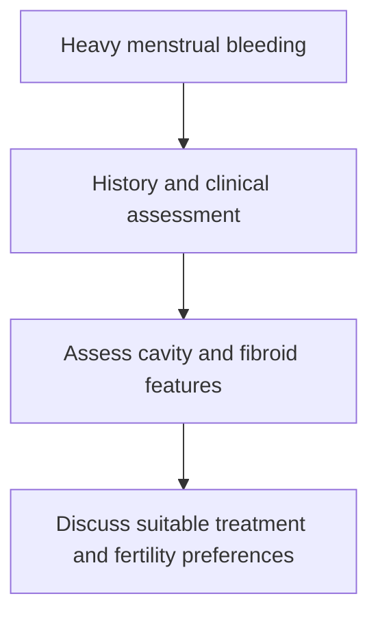

# Fibroids and Endometriosis — Original MCQs Q21–Q40

**Advance-preparation, unattempted.** Original nursing practice, not authenticated historical questions. NICE and ESHRE recommendations are identified by source. Follow local protocol for actual patient care.

[Chapter](../README.md) · [Q1–Q20](05-Fibroids-and-Endometriosis-20-MCQs.md) · [Topic map](../Concepts/Gynecological-and-Reproductive-Nursing-Topic-Coverage-Map.md) · [Previous Year Questions](../Previous-Year-Questions/Gynecological-and-Reproductive-Nursing-Past-Paper-Research-Register.md)

## Part 5 — Q21–Q25

### Q21. A woman with heavy periods and persistent bleeding between periods is suspected of having a submucosal fibroid. Which investigation provides direct visualization of the uterine cavity?

**Difficulty:** 🟡 Medium · **Priority:** 🟠 HIGH YIELD · **Evidence:** Original practice · **Exam focus:** NORCET / Staff Nurse / CHO

- **A.** Outpatient hysteroscopy
- **B.** Chest radiography
- **C.** Cervical swab culture
- **D.** Renal function testing

✅ Answer aur detailed A–D Hinglish explanation

**Correct: A. Outpatient hysteroscopy**

- **A kyun sahi hai:** Hysteroscopy mein patla camera cervix se uterus ke andar jaata hai. Isse cavity mein nikle fibroid ya polyp ko directly dekha ja sakta hai. Consent aur procedure ke discomfort ki counselling karo.
- **B kyun galat hai:** Chest X-ray lungs ko assess karta hai, uterine cavity ko nahi.
- **C kyun galat hai:** Swab infection detect karne mein help karta hai, structural lesion nahi dikhata.
- **D kyun galat hai:** Renal tests kidney function batate hain. Cavity visualize nahi karte.

**Exam clue:** Persistent intermenstrual bleeding plus suspected cavity lesion: hysteroscopy.

**Clinical reference:** [NICE guidance](https://www.nice.org.uk/guidance/ng88/chapter/recommendations)

**YouTube MCQ practice:** Topic-level lead [Uterine Disorder MCQs](https://www.youtube.com/watch?v=YzBqpVAR5qY) and [Aarogyam OBG Part 6](https://www.youtube.com/watch?v=c-OrM_mDIZQ). Indexed titles/descriptions indicate relevant practice. Exact item coverage, playback and channel of first video pending.

### Q22. A patient with heavy menstrual bleeding has had excessive bleeding since menarche and a family history of abnormal bleeding. Which additional evaluation should the nurse anticipate?

**Difficulty:** 🔴 Difficult · **Priority:** 🔴 MOST IMPORTANT · **Evidence:** Original practice · **Exam focus:** NORCET / Staff Nurse / CHO

- **A.** Routine thyroid testing regardless of symptoms
- **B.** Assessment for a coagulation disorder
- **C.** A diagnosis of fibroids without investigation
- **D.** Routine CT of the brain

✅ Answer aur detailed A–D Hinglish explanation

**Correct: B. Assessment for a coagulation disorder**

- **A kyun galat hai:** Thyroid testing symptoms ke basis par useful ho sakti hai. Family bleeding history specifically clotting disorder ka clue hai.
- **B kyun sahi hai:** Menarche se excessive bleeding aur family history inherited bleeding disorder, jaise von Willebrand disease, ka suspicion badhate hain. Provider se appropriate coagulation evaluation arrange karo.
- **C kyun galat hai:** Fibroid assume karne se bleeding disorder miss ho sakta hai. History aur exam dono chahiye.
- **D kyun galat hai:** Brain CT uterine bleeding ke cause ka routine test nahi hai.

**Exam clue:** HMB since menarche plus personal or family bleeding history: consider coagulopathy.

**Clinical reference:** [NICE guidance](https://www.nice.org.uk/guidance/ng88/chapter/recommendations)

**YouTube MCQ practice:** Topic-level lead [Uterine Disorder MCQs](https://www.youtube.com/watch?v=YzBqpVAR5qY) and [Aarogyam OBG Part 6](https://www.youtube.com/watch?v=c-OrM_mDIZQ). Indexed titles/descriptions indicate relevant practice. Exact item coverage, playback and channel of first video pending.

### Q23. A stable patient awaiting definitive treatment for fibroid-associated heavy bleeding is prescribed tranexamic acid. What is its main purpose?

**Difficulty:** 🟡 Medium · **Priority:** 🟠 HIGH YIELD · **Evidence:** Original practice · **Exam focus:** NORCET / Staff Nurse / CHO

- **A.** Destroy all fibroid tissue
- **B.** Induce ovulation
- **C.** Reduce bleeding by inhibiting fibrinolysis
- **D.** Provide permanent contraception

✅ Answer aur detailed A–D Hinglish explanation

**Correct: C. Reduce bleeding by inhibiting fibrinolysis**

- **A kyun galat hai:** Tranexamic acid fibroid ko destroy nahi karta. Yeh blood loss control ke liye hai.
- **B kyun galat hai:** Is drug ka primary purpose ovulation induce karna nahi hai.
- **C kyun sahi hai:** Fibrinolysis ka matlab blood clot ka breakdown hai. Tranexamic acid clot ke breakdown ko kam karta hai aur menstrual blood loss reduce karne mein help karta hai. Contraindications aur provider orders check karo.
- **D kyun galat hai:** Yeh contraceptive nahi hai. Pregnancy prevention alag discuss karni hoti hai.

**Exam clue:** Tranexamic acid = antifibrinolytic, not fibroid cure.

**Clinical reference:** [NICE guidance](https://www.nice.org.uk/guidance/ng88/chapter/recommendations)

**YouTube MCQ practice:** Topic-level lead [Uterine Disorder MCQs](https://www.youtube.com/watch?v=YzBqpVAR5qY) and [Aarogyam OBG Part 6](https://www.youtube.com/watch?v=c-OrM_mDIZQ). Indexed titles/descriptions indicate relevant practice. Exact item coverage, playback and channel of first video pending.

### Q24. A woman with heavy menstrual bleeding has a 2-cm fibroid that does not distort the uterine cavity. Under NICE guidance, which long-acting treatment may be considered first if suitable and acceptable?

**Difficulty:** 🔴 Difficult · **Priority:** 🔴 MOST IMPORTANT · **Evidence:** Original practice · **Exam focus:** NORCET / Staff Nurse / CHO

- **A.** Emergency hysterectomy for everyone
- **B.** Copper IUD to reduce bleeding
- **C.** Permanent sterilization
- **D.** Levonorgestrel-releasing intrauterine system

✅ Answer aur detailed A–D Hinglish explanation

**Correct: D. Levonorgestrel-releasing intrauterine system**

- **A kyun galat hai:** Stable patient mein hysterectomy sabke liye first-line nahi hai. Choice aur suitability assess karni hoti hai.
- **B kyun galat hai:** Copper IUD kuch patients mein bleeding badha sakta hai. Yeh HMB reduce karne ke liye chosen hormonal system nahi hai.
- **C kyun galat hai:** Sterilization pregnancy prevent karti hai, HMB ka direct treatment nahi.
- **D kyun sahi hai:** LNG-IUS uterus mein progestin release karke lining patli kar sakta hai aur bleeding kam karta hai. Chhota fibroid cavity distort na kare toh NICE is option ko consider karta hai, agar eligible ho.

**Exam clue:** LNG-IUS for HMB when cavity is suitable.

**Original visual revision:**

Yeh diagram individualized choice ka process dikhata hai, har patient ka treatment same nahi hota.

**Clinical reference:** [NICE guidance](https://www.nice.org.uk/guidance/ng88/chapter/recommendations)

**YouTube MCQ practice:** Topic-level lead [Uterine Disorder MCQs](https://www.youtube.com/watch?v=YzBqpVAR5qY) and [Aarogyam OBG Part 6](https://www.youtube.com/watch?v=c-OrM_mDIZQ). Indexed titles/descriptions indicate relevant practice. Exact item coverage, playback and channel of first video pending.

### Q25. A patient with symptomatic 5-cm fibroids asks whether the same treatment is suitable for every patient. Which response is best?

**Difficulty:** 🟡 Medium · **Priority:** 🟠 HIGH YIELD · **Evidence:** Original practice · **Exam focus:** NORCET / Staff Nurse / CHO

- **A.** Treatment depends on size, location, number, symptoms and reproductive preferences
- **B.** Every patient needs removal of both ovaries
- **C.** All fibroids must be treated with antibiotics
- **D.** Treatment depends only on body weight

✅ Answer aur detailed A–D Hinglish explanation

**Correct: A. Treatment depends on size, location, number, symptoms and reproductive preferences**

- **A kyun sahi hai:** Fibroid ka size, location aur number bleeding ya pressure symptoms ko affect karte hain. Future pregnancy ki preference bhi treatment choice badal sakti hai. Specialist patient ke saath options discuss karega.
- **B kyun galat hai:** Fibroid uterus ki muscle se banta hai. Ovaries ko routinely remove karna necessary nahi hai.
- **C kyun galat hai:** Fibroids bacterial infection nahi hote. Antibiotic unka routine treatment nahi hai.
- **D kyun galat hai:** Weight alone se surgery ya medicine choose nahi hoti. Full clinical assessment chahiye.

**Exam clue:** Larger symptomatic fibroids need individualized specialist discussion.

**Clinical reference:** [NICE guidance](https://www.nice.org.uk/guidance/ng88/chapter/recommendations)

**YouTube MCQ practice:** Topic-level lead [Uterine Disorder MCQs](https://www.youtube.com/watch?v=YzBqpVAR5qY) and [Aarogyam OBG Part 6](https://www.youtube.com/watch?v=c-OrM_mDIZQ). Indexed titles/descriptions indicate relevant practice. Exact item coverage, playback and channel of first video pending.

## Part 6 — Q26–Q30

### Q26. Which procedure reduces the blood supply to fibroids by blocking selected uterine arterial branches?

**Difficulty:** 🟡 Medium · **Priority:** 🟠 HIGH YIELD · **Evidence:** Original practice · **Exam focus:** NORCET / Staff Nurse / CHO

- **A.** Endometrial biopsy
- **B.** Uterine artery embolization
- **C.** Cervical cytology
- **D.** Tubal ligation

✅ Answer aur detailed A–D Hinglish explanation

**Correct: B. Uterine artery embolization**

- **A kyun galat hai:** Biopsy tissue sample leti hai. Yeh fibroid ki arterial supply block nahi karti.
- **B kyun sahi hai:** Embolization mein specialist catheter ke through selected uterine arteries ki blood supply reduce karta hai. Fibroid shrink ho sakta hai. Future fertility, complications aur alternatives pehle discuss karna important hai.
- **C kyun galat hai:** Cytology cervix ke cells examine karti hai. Uterine blood supply change nahi karti.
- **D kyun galat hai:** Tubal ligation fallopian tubes ko block karta hai, fibroid ki arteries ko nahi.

**Exam clue:** Embolization reduces fibroid blood supply.

**Clinical reference:** [NICE guidance](https://www.nice.org.uk/guidance/ng88/chapter/recommendations)

**YouTube MCQ practice:** Topic-level lead [Uterine Disorder MCQs](https://www.youtube.com/watch?v=YzBqpVAR5qY) and [Aarogyam OBG Part 6](https://www.youtube.com/watch?v=c-OrM_mDIZQ). Indexed titles/descriptions indicate relevant practice. Exact item coverage, playback and channel of first video pending.

### Q27. A woman with heavy menstrual bleeding requests endometrial ablation and also hopes for a future pregnancy. Which counseling is essential?

**Difficulty:** 🔴 Difficult · **Priority:** 🔴 MOST IMPORTANT · **Evidence:** Original practice · **Exam focus:** NORCET / Staff Nurse / CHO

- **A.** Ablation improves fertility
- **B.** Pregnancy immediately after ablation is safe
- **C.** Ablation is unsuitable for someone planning pregnancy
- **D.** Ablation is a reliable sterilization method

✅ Answer aur detailed A–D Hinglish explanation

**Correct: C. Ablation is unsuitable for someone planning pregnancy**

- **A kyun galat hai:** Ablation uterine lining ko damage ya remove karta hai. Fertility improve karne ke liye nahi hai.
- **B kyun galat hai:** Ablation ke baad pregnancy dangerous ho sakti hai. Isliye future pregnancy plan important hai.
- **C kyun sahi hai:** Future pregnancy chahiye toh ablation suitable choice nahi hai. Agar procedure ho, pregnancy avoid karne aur effective contraception ki counselling zaroori hai.
- **D kyun galat hai:** Ablation pregnancy ko reliably prevent nahi karta. Separate contraception chahiye.

**Exam clue:** Endometrial ablation is not contraception and is unsuitable for planned pregnancy.

**Clinical reference:** [NICE guidance](https://www.nice.org.uk/guidance/ng88/chapter/recommendations)

**YouTube MCQ practice:** Topic-level lead [Uterine Disorder MCQs](https://www.youtube.com/watch?v=YzBqpVAR5qY) and [Aarogyam OBG Part 6](https://www.youtube.com/watch?v=c-OrM_mDIZQ). Indexed titles/descriptions indicate relevant practice. Exact item coverage, playback and channel of first video pending.

### Q28. A patient receiving a prescribed GnRH agonist for fibroid preparation develops hot flushes. What mechanism best explains this effect during sustained therapy?

**Difficulty:** 🟡 Medium · **Priority:** 🟠 HIGH YIELD · **Evidence:** Original practice · **Exam focus:** NORCET / Staff Nurse / CHO

- **A.** Increased bacterial growth
- **B.** Increased prolactin from breastfeeding
- **C.** Permanent destruction of the ovaries
- **D.** Suppression of gonadotropins and ovarian estrogen production

✅ Answer aur detailed A–D Hinglish explanation

**Correct: D. Suppression of gonadotropins and ovarian estrogen production**

- **A kyun galat hai:** Hot flushes hormonal change se related ho sakte hain, bacterial growth se nahi.
- **B kyun galat hai:** Breastfeeding wala prolactin mechanism is medication ka main effect nahi hai.
- **C kyun galat hai:** Drug temporary hormonal suppression karta hai. Permanent ovarian destruction assume nahi karna chahiye.
- **D kyun sahi hai:** Continuous GnRH agonist therapy initial stimulation ke baad pituitary response suppress kar sakti hai. Estrogen kam hone par hot flushes aur bone loss ka concern hota hai. Provider follow-up important hai.

**Exam clue:** Sustained GnRH agonist therapy produces a low-estrogen state.

**Clinical reference:** [ESHRE endometriosis guideline](https://academic.oup.com/hropen/article/2022/2/hoac009/6537540)

**YouTube MCQ practice:** Topic-level lead [Uterine Disorder MCQs](https://www.youtube.com/watch?v=YzBqpVAR5qY) and [Aarogyam OBG Part 6](https://www.youtube.com/watch?v=c-OrM_mDIZQ). Indexed titles/descriptions indicate relevant practice. Exact item coverage, playback and channel of first video pending.

### Q29. A patient with severe menstrual pain has suspected adenomyosis. Which imaging approach does NICE prefer initially if acceptable?

**Difficulty:** 🟡 Medium · **Priority:** 🟠 HIGH YIELD · **Evidence:** Original practice · **Exam focus:** NORCET / Staff Nurse / CHO

- **A.** Transvaginal ultrasound
- **B.** Routine chest CT
- **C.** Intravenous pyelogram
- **D.** Mammography

✅ Answer aur detailed A–D Hinglish explanation

**Correct: A. Transvaginal ultrasound**

- **A kyun sahi hai:** Transvaginal ultrasound probe uterus ke close hota hai aur uterine muscle ki changes assess karne mein help karta hai. Patient ki consent aur comfort important hain.
- **B kyun galat hai:** Chest CT thoracic organs assess karta hai, adenomyosis ka initial test nahi.
- **C kyun galat hai:** Pyelogram urinary tract ke liye hai. Uterine muscle ka preferred test nahi.
- **D kyun galat hai:** Mammography breast tissue assess karti hai.

**Exam clue:** Suspected adenomyosis: transvaginal ultrasound if acceptable.

**Clinical reference:** [NICE guidance](https://www.nice.org.uk/guidance/ng88/chapter/recommendations)

**YouTube MCQ practice:** Topic-level lead [Uterine Disorder MCQs](https://www.youtube.com/watch?v=YzBqpVAR5qY) and [Aarogyam OBG Part 6](https://www.youtube.com/watch?v=c-OrM_mDIZQ). Indexed titles/descriptions indicate relevant practice. Exact item coverage, playback and channel of first video pending.

### Q30. A woman with fibroids is being prepared for myomectomy. Ultrasound does not adequately define the number and position of the masses. Which additional imaging may assist surgical planning?

**Difficulty:** 🟡 Medium · **Priority:** 🟠 HIGH YIELD · **Evidence:** Original practice · **Exam focus:** NORCET / Staff Nurse / CHO

- **A.** Dental radiograph
- **B.** MRI of the pelvis
- **C.** ECG as the only anatomical test
- **D.** Sputum microscopy

✅ Answer aur detailed A–D Hinglish explanation

**Correct: B. MRI of the pelvis**

- **A kyun galat hai:** Dental X-ray pelvic anatomy assess nahi karta.
- **B kyun sahi hai:** MRI soft tissues ko detailed view mein dikhata hai. Ultrasound se fibroid position, number ya vascularity clear na ho toh specialist MRI consider kar sakta hai.
- **C kyun galat hai:** ECG cardiac electrical activity assess karta hai. Preoperative assessment mein useful ho sakta hai, but fibroid map nahi banata.
- **D kyun galat hai:** Sputum microscopy respiratory infection ke liye hai.

**Exam clue:** MRI can assist selected complex fibroid surgical planning.

**Clinical reference:** [NICE guidance](https://www.nice.org.uk/guidance/ng88/chapter/recommendations)

**YouTube MCQ practice:** Topic-level lead [Uterine Disorder MCQs](https://www.youtube.com/watch?v=YzBqpVAR5qY) and [Aarogyam OBG Part 6](https://www.youtube.com/watch?v=c-OrM_mDIZQ). Indexed titles/descriptions indicate relevant practice. Exact item coverage, playback and channel of first video pending.

## Part 7 — Q31–Q35

### Q31. A patient has disabling cyclic pelvic pain but a normal pelvic ultrasound. Which follow-up is most appropriate?

**Difficulty:** 🔴 Difficult · **Priority:** 🔴 MOST IMPORTANT · **Evidence:** Original practice · **Exam focus:** NORCET / Staff Nurse / CHO

- **A.** Discharge because endometriosis is excluded
- **B.** Tell her the pain is imaginary
- **C.** Arrange further clinical evaluation if symptoms persist
- **D.** Diagnose ovarian cancer solely from pain

✅ Answer aur detailed A–D Hinglish explanation

**Correct: C. Arrange further clinical evaluation if symptoms persist**

- **A kyun galat hai:** Superficial endometriosis ultrasound par miss ho sakta hai. Normal scan disease ko exclude nahi karta.
- **B kyun galat hai:** Pain ko dismiss karna patient ki care delay karta hai. Symptoms genuine ho sakte hain.
- **C kyun sahi hai:** Symptoms, daily activities aur fertility concerns assess karo. Persistent symptoms par referral aur additional evaluation, including laparoscopy in selected cases, consider ho sakti hai.
- **D kyun galat hai:** Pain alone cancer diagnosis establish nahi karta. Differential diagnosis aur evidence chahiye.

**Exam clue:** Normal imaging does not exclude superficial endometriosis.

**Clinical reference:** [NICE guidance](https://www.nice.org.uk/guidance/ng73/chapter/Recommendations)

**YouTube MCQ practice:** Topic-level lead [Uterine Disorder MCQs](https://www.youtube.com/watch?v=YzBqpVAR5qY) and [Aarogyam OBG Part 6](https://www.youtube.com/watch?v=c-OrM_mDIZQ). Indexed titles/descriptions indicate relevant practice. Exact item coverage, playback and channel of first video pending.

### Q32. Which laboratory test should not be used alone to diagnose endometriosis according to NICE?

**Difficulty:** 🟡 Medium · **Priority:** 🟠 HIGH YIELD · **Evidence:** Original practice · **Exam focus:** NORCET / Staff Nurse / CHO

- **A.** Pregnancy test when clinically indicated
- **B.** Hemoglobin for heavy bleeding
- **C.** Urinalysis for relevant urinary symptoms
- **D.** Serum CA-125

✅ Answer aur detailed A–D Hinglish explanation

**Correct: D. Serum CA-125**

- **A kyun galat hai:** Pregnancy test differential diagnosis ke liye important ho sakta hai. Yeh endometriosis confirm nahi karta.
- **B kyun galat hai:** Hb blood loss aur anemia assess karta hai. Iska supportive purpose alag hai.
- **C kyun galat hai:** Urinalysis urinary symptoms ka cause assess karne mein useful ho sakti hai.
- **D kyun sahi hai:** CA-125 multiple benign aur malignant conditions mein badh sakta hai. NICE is marker ko endometriosis diagnose karne ke liye use nahi karne ko kehta hai.

**Exam clue:** CA-125 is not a diagnostic test for endometriosis.

**Clinical reference:** [NICE guidance](https://www.nice.org.uk/guidance/ng73/chapter/Recommendations)

**YouTube MCQ practice:** Topic-level lead [Uterine Disorder MCQs](https://www.youtube.com/watch?v=YzBqpVAR5qY) and [Aarogyam OBG Part 6](https://www.youtube.com/watch?v=c-OrM_mDIZQ). Indexed titles/descriptions indicate relevant practice. Exact item coverage, playback and channel of first video pending.

### Q33. A patient with suspected endometriosis reports menstrual pain and urinary symptoms that recur during each period. Which action is appropriate?

**Difficulty:** 🔴 Difficult · **Priority:** 🔴 MOST IMPORTANT · **Evidence:** Original practice · **Exam focus:** NORCET / Staff Nurse / CHO

- **A.** Refer for evaluation of possible deep disease involving the urinary tract
- **B.** Assume all symptoms are uncomplicated cystitis
- **C.** Advise long-term antibiotics without assessment
- **D.** Delay assessment until menopause

✅ Answer aur detailed A–D Hinglish explanation

**Correct: A. Refer for evaluation of possible deep disease involving the urinary tract**

- **A kyun sahi hai:** Deep endometriosis bladder ya ureter involve kar sakta hai. Cyclic urinary symptoms ke saath specialist assessment useful hai. Urinary infection aur doosre causes bhi evaluate karne hain.
- **B kyun galat hai:** Cystitis possible hai, lekin cyclic pattern ko ignore karna appropriate nahi.
- **C kyun galat hai:** Bina evidence long-term antibiotics unnecessary adverse effects aur resistance cause kar sakti hain.
- **D kyun galat hai:** Persistent urinary symptoms ko menopause tak delay karne se complication miss ho sakti hai.

**Exam clue:** Cyclic urinary symptoms can suggest deep endometriosis.

**Clinical reference:** [NICE guidance](https://www.nice.org.uk/guidance/ng73/chapter/Recommendations)

**YouTube MCQ practice:** Topic-level lead [Uterine Disorder MCQs](https://www.youtube.com/watch?v=YzBqpVAR5qY) and [Aarogyam OBG Part 6](https://www.youtube.com/watch?v=c-OrM_mDIZQ). Indexed titles/descriptions indicate relevant practice. Exact item coverage, playback and channel of first video pending.

### Q34. A patient with endometriosis is actively attempting conception. Which statement about ovarian suppression solely to improve natural pregnancy rates is accurate?

**Difficulty:** 🔴 Difficult · **Priority:** 🔴 MOST IMPORTANT · **Evidence:** Original practice · **Exam focus:** NORCET / Staff Nurse / CHO

- **A.** It always increases natural conception during treatment
- **B.** It should not be prescribed solely to improve fertility
- **C.** It guarantees pregnancy within one cycle
- **D.** It is the only fertility treatment available

✅ Answer aur detailed A–D Hinglish explanation

**Correct: B. It should not be prescribed solely to improve fertility**

- **A kyun galat hai:** Hormonal suppression ovulation ko reduce kar sakta hai. Isliye active conception ke dauran pregnancy guarantee nahi karta.
- **B kyun sahi hai:** Hormonal treatment pain manage kar sakta hai, lekin solely fertility improve karne ke liye ovarian suppression recommended nahi hai. Fertility assessment aur individualized options discuss karne hain.
- **C kyun galat hai:** Koi medicine ek cycle mein pregnancy guarantee nahi karti.
- **D kyun galat hai:** Fertility care mein assessment, selected surgery aur assisted reproduction jaise options ho sakte hain.

**Exam clue:** Pain treatment and fertility treatment have different goals.

**Clinical reference:** [ESHRE endometriosis guideline](https://academic.oup.com/hropen/article/2022/2/hoac009/6537540)

**YouTube MCQ practice:** Topic-level lead [Uterine Disorder MCQs](https://www.youtube.com/watch?v=YzBqpVAR5qY) and [Aarogyam OBG Part 6](https://www.youtube.com/watch?v=c-OrM_mDIZQ). Indexed titles/descriptions indicate relevant practice. Exact item coverage, playback and channel of first video pending.

### Q35. A patient has undergone surgery for an ovarian endometrioma and is not currently planning pregnancy. Which postoperative strategy can reduce recurrence risk when suitable?

**Difficulty:** 🟡 Medium · **Priority:** 🟠 HIGH YIELD · **Evidence:** Original practice · **Exam focus:** NORCET / Staff Nurse / CHO

- **A.** Routine long-term antibiotics for all
- **B.** Avoid all follow-up
- **C.** Discuss longer-term hormonal suppression
- **D.** Repeat surgery every month

✅ Answer aur detailed A–D Hinglish explanation

**Correct: C. Discuss longer-term hormonal suppression**

- **A kyun galat hai:** Endometrioma bacterial infection nahi hai. Long-term antibiotics routine recurrence prevention nahi hain.
- **B kyun galat hai:** Recurrence aur symptoms assess karne ke liye follow-up helpful hai.
- **C kyun sahi hai:** Hormonal suppression ovulation aur hormonal stimulation ko reduce kar sakta hai. ESHRE selected patients not seeking pregnancy mein long-term hormonal treatment consider karta hai. Risks aur preferences review karo.
- **D kyun galat hai:** Repeated surgery unnecessary tissue damage aur ovarian reserve loss ka risk badha sakti hai.

**Exam clue:** Postoperative suppression can be considered if pregnancy is not immediately desired.

**Clinical reference:** [ESHRE endometriosis guideline](https://academic.oup.com/hropen/article/2022/2/hoac009/6537540)

**YouTube MCQ practice:** Topic-level lead [Uterine Disorder MCQs](https://www.youtube.com/watch?v=YzBqpVAR5qY) and [Aarogyam OBG Part 6](https://www.youtube.com/watch?v=c-OrM_mDIZQ). Indexed titles/descriptions indicate relevant practice. Exact item coverage, playback and channel of first video pending.

## Part 8 — Q36–Q40

### Q36. A patient with an endometrioma is preparing for IVF. Which counseling reflects ESHRE guidance on routine surgery solely to improve live birth rates?

**Difficulty:** 🔴 Difficult · **Priority:** 🔴 MOST IMPORTANT · **Evidence:** Original practice · **Exam focus:** NORCET / Staff Nurse / CHO

- **A.** Surgery is mandatory before every IVF cycle
- **B.** Removal always improves ovarian reserve
- **C.** Every endometrioma must be aspirated at home
- **D.** Routine surgery solely for this purpose is not recommended

✅ Answer aur detailed A–D Hinglish explanation

**Correct: D. Routine surgery solely for this purpose is not recommended**

- **A kyun galat hai:** Surgery decision pain, follicle access aur individual factors par depend karta hai. Har IVF cycle se pehle mandatory nahi.
- **B kyun galat hai:** Ovarian surgery healthy ovarian tissue ko affect kar sakti hai. Reserve improve hona guaranteed nahi hai.
- **C kyun galat hai:** Home aspiration unsafe hai aur infection ya bleeding cause kar sakti hai.
- **D kyun sahi hai:** Evidence routine pre-IVF endometrioma surgery se live birth benefit support nahi karta. Surgery ovarian reserve reduce kar sakti hai. Individual specialist decision chahiye.

**Exam clue:** Endometrioma before ART: avoid automatic surgery.

**Clinical reference:** [ESHRE endometriosis guideline](https://academic.oup.com/hropen/article/2022/2/hoac009/6537540)

**YouTube MCQ practice:** Topic-level lead [Uterine Disorder MCQs](https://www.youtube.com/watch?v=YzBqpVAR5qY) and [Aarogyam OBG Part 6](https://www.youtube.com/watch?v=c-OrM_mDIZQ). Indexed titles/descriptions indicate relevant practice. Exact item coverage, playback and channel of first video pending.

### Q37. A patient asks why a GnRH agonist may be combined with prescribed add-back hormone therapy during endometriosis treatment. Which explanation is best?

**Difficulty:** 🟡 Medium · **Priority:** 🟠 HIGH YIELD · **Evidence:** Original practice · **Exam focus:** NORCET / Staff Nurse / CHO

- **A.** It helps reduce low-estrogen adverse effects such as bone loss
- **B.** It converts endometriosis into an infection
- **C.** It eliminates the need for clinical review
- **D.** It guarantees permanent cure

✅ Answer aur detailed A–D Hinglish explanation

**Correct: A. It helps reduce low-estrogen adverse effects such as bone loss**

- **A kyun sahi hai:** Hormone suppression se estrogen kam ho sakta hai. Add-back therapy selected hormone replacement se hot flushes aur bone loss jaise effects reduce karne mein help karti hai. Regimen clinician decide karta hai.
- **B kyun galat hai:** Add-back hormones infection create nahi karte. Endometriosis bacterial disease nahi hai.
- **C kyun galat hai:** Treatment ke benefits, adverse effects aur duration review karna ab bhi zaroori hai.
- **D kyun galat hai:** Symptoms improve ho sakte hain but permanent cure guaranteed nahi.

**Exam clue:** Add-back therapy addresses hypoestrogenic effects.

**Clinical reference:** [ESHRE endometriosis guideline](https://academic.oup.com/hropen/article/2022/2/hoac009/6537540)

**YouTube MCQ practice:** Topic-level lead [Uterine Disorder MCQs](https://www.youtube.com/watch?v=YzBqpVAR5qY) and [Aarogyam OBG Part 6](https://www.youtube.com/watch?v=c-OrM_mDIZQ). Indexed titles/descriptions indicate relevant practice. Exact item coverage, playback and channel of first video pending.

### Q38. A patient with endometriosis is unable to attend work because of recurring pain. What is a useful nursing assessment tool before referral?

**Difficulty:** 🟡 Medium · **Priority:** 🟠 HIGH YIELD · **Evidence:** Original practice · **Exam focus:** NORCET / Staff Nurse / CHO

- **A.** Ask her to ignore symptoms
- **B.** Record a symptom diary including cycle timing and functional impact
- **C.** Document only her height
- **D.** Record only a single normal temperature

✅ Answer aur detailed A–D Hinglish explanation

**Correct: B. Record a symptom diary including cycle timing and functional impact**

- **A kyun galat hai:** Symptoms ignore karne se delay aur distress badh sakta hai.
- **B kyun sahi hai:** Diary pain timing, bleeding, bowel ya urinary symptoms aur daily activity ka impact record karti hai. Isse clinician ko pattern aur treatment response samajhne mein help milti hai.
- **C kyun galat hai:** Height general assessment ka part hai, but cyclic pain pattern explain nahi karta.
- **D kyun galat hai:** Normal temperature chronic endometriosis symptoms exclude nahi karta.

**Exam clue:** Symptom diary links menstrual timing and daily function.

**Clinical reference:** [NICE guidance](https://www.nice.org.uk/guidance/ng73/chapter/Recommendations)

**YouTube MCQ practice:** Topic-level lead [Uterine Disorder MCQs](https://www.youtube.com/watch?v=YzBqpVAR5qY) and [Aarogyam OBG Part 6](https://www.youtube.com/watch?v=c-OrM_mDIZQ). Indexed titles/descriptions indicate relevant practice. Exact item coverage, playback and channel of first video pending.

### Q39. A patient with severe endometriosis symptoms asks if pain intensity always matches the surgical extent of disease. Which response is most accurate?

**Difficulty:** 🟡 Medium · **Priority:** 🟠 HIGH YIELD · **Evidence:** Original practice · **Exam focus:** NORCET / Staff Nurse / CHO

- **A.** Pain is absent in all mild disease
- **B.** Severe pain proves cancer
- **C.** Symptoms and anatomical extent do not reliably correspond
- **D.** Only the surgical stage determines treatment priorities

✅ Answer aur detailed A–D Hinglish explanation

**Correct: C. Symptoms and anatomical extent do not reliably correspond**

- **A kyun galat hai:** Limited visible disease ke saath bhi severe pain ho sakta hai.
- **B kyun galat hai:** Severe pain multiple causes se ho sakta hai. Cancer automatically prove nahi hota.
- **C kyun sahi hai:** Pain inflammation, nerves aur other factors se affect ho sakta hai. Anatomical extent se pain ka level reliably predict nahi hota. Symptoms aur quality of life ko respect karo.
- **D kyun galat hai:** Treatment symptoms, preferences, fertility goals aur clinical findings par based hota hai. Stage alone sufficient nahi.

**Exam clue:** Manage the person, not only the surgical stage.

**Clinical reference:** [NICE guidance](https://www.nice.org.uk/guidance/ng73/chapter/Recommendations)

**YouTube MCQ practice:** Topic-level lead [Uterine Disorder MCQs](https://www.youtube.com/watch?v=YzBqpVAR5qY) and [Aarogyam OBG Part 6](https://www.youtube.com/watch?v=c-OrM_mDIZQ). Indexed titles/descriptions indicate relevant practice. Exact item coverage, playback and channel of first video pending.

### Q40. A patient with endometriosis asks whether hysterectomy guarantees that all endometriosis-related pain will disappear. Which reply is appropriate?

**Difficulty:** 🔴 Difficult · **Priority:** 🔴 MOST IMPORTANT · **Evidence:** Original practice · **Exam focus:** NORCET / Staff Nurse / CHO

- **A.** Yes, without exception
- **B.** Yes, even when extrauterine lesions remain
- **C.** Yes, no further counseling is needed
- **D.** No, symptoms may persist and treatment decisions require individualized counseling

✅ Answer aur detailed A–D Hinglish explanation

**Correct: D. No, symptoms may persist and treatment decisions require individualized counseling**

- **A kyun galat hai:** Hysterectomy uterus remove karta hai, lekin endometriosis extrauterine sites par bhi ho sakti hai.
- **B kyun galat hai:** Residual lesions se symptoms persist ho sakte hain. Extrauterine disease ko ignore nahi karna chahiye.
- **C kyun galat hai:** Surgery ke risks, fertility loss, ovarian conservation aur possible ongoing symptoms discuss karna important hai.
- **D kyun sahi hai:** Hysterectomy selected patients mein useful ho sakti hai, but complete cure guarantee nahi. Specialist ko disease sites aur patient goals assess karne hain.

**Exam clue:** Hysterectomy is not a guaranteed cure for extrauterine endometriosis.

**Clinical reference:** [ESHRE endometriosis guideline](https://academic.oup.com/hropen/article/2022/2/hoac009/6537540)

**YouTube MCQ practice:** Topic-level lead [Uterine Disorder MCQs](https://www.youtube.com/watch?v=YzBqpVAR5qY) and [Aarogyam OBG Part 6](https://www.youtube.com/watch?v=c-OrM_mDIZQ). Indexed titles/descriptions indicate relevant practice. Exact item coverage, playback and channel of first video pending.

## Evidence limits

Clinical references reviewed through indexed recommendation extracts. Direct NICE retrieval returned 403 and PMC full text was blocked. No exact historical provenance claimed. Full independent question-by-question and cross-chapter semantic audit, specific video matches and rendered Mermaid review remain pending.
