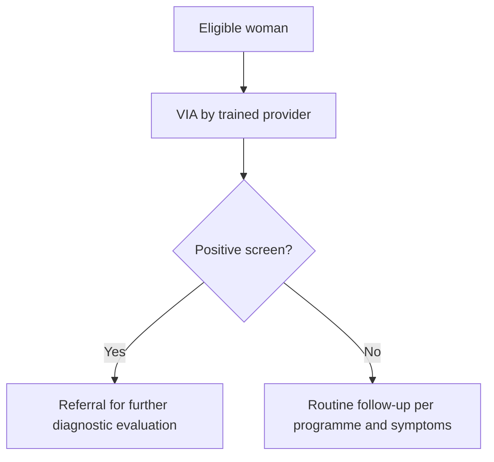

# Gynecological Cancers and Cervical Screening — Original MCQs Q21–Q40

**Advance-preparation, unattempted.** Original practice, not authenticated PYQs. India NHM programme, WHO global guidance and specialist cancer treatment are separately identified. Local protocols apply to real patients.

[Chapter](../README.md) · [Q1–Q20](06-Gynecological-Cancers-and-Cervical-Screening-20-MCQs.md) · [Topic map](../Concepts/Gynecological-and-Reproductive-Nursing-Topic-Coverage-Map.md) · [Previous Year Questions](../Previous-Year-Questions/Gynecological-and-Reproductive-Nursing-Past-Paper-Research-Register.md)

## Part 5 — Q21–Q25

### Q21. Under the Indian NHM population-based cervical cancer screening initiative described by MoHFW in July 2025, which age group is targeted for VIA at primary care facilities?

**Difficulty:** 🟢 Easy · **Priority:** 🟠 HIGH YIELD · **Evidence:** Original practice · **Exam focus:** NORCET / Staff Nurse / CHO

- **A.** Women aged 30–65 years
- **B.** Girls aged 5–9 years only
- **C.** Only women older than 80 years
- **D.** Only women currently pregnant

✅ Answer aur detailed A–D Hinglish explanation

**Correct: A. Women aged 30–65 years**

- **A kyun sahi hai:** MoHFW ke 26 July 2025 programme update mein 30 se 65 saal ki women target hain. Trained health worker VIA kar sakta hai aur positive cases ko diagnostic evaluation ke liye refer karta hai.
- **B kyun galat hai:** Chhoti bachchiyon mein cervical cancer screening ka yeh programme apply nahi hota. HPV vaccination ki age eligibility alag hai.
- **C kyun galat hai:** 80 saal se upar tak limited karne se programme ki target population miss hogi.
- **D kyun galat hai:** Yeh population-based screening initiative hai, sirf pregnancy care ka part nahi hai.

**Exam clue:** India NHM programme age group 30–65, not a universal screening rule.

**Clinical reference:** [MoHFW/PIB India](https://www.pib.gov.in/PressReleasePage.aspx?PRID=2148754&lang=2&reg=48)

**YouTube MCQ practice:** Topic-level indexed lead [Cervical Cancer MCQs for Staff Nurse / NORCET / CHO](https://www.youtube.com/watch?v=Q7S9IEkpUDM). Description identifies question practice. Creator, exact-item coverage and playback pending.

### Q22. During VIA screening, which substance helps make suspicious cervical epithelial changes visible?

**Difficulty:** 🟢 Easy · **Priority:** 🟠 HIGH YIELD · **Evidence:** Original practice · **Exam focus:** NORCET / Staff Nurse / CHO

- **A.** Concentrated sulfuric acid
- **B.** Dilute acetic acid
- **C.** Insulin solution
- **D.** Intravenous contrast only

✅ Answer aur detailed A–D Hinglish explanation

**Correct: B. Dilute acetic acid**

- **A kyun galat hai:** Concentrated sulfuric acid corrosive hai aur tissue damage kar sakta hai. VIA mein iska use nahi hota.
- **B kyun sahi hai:** Dilute acetic acid cervix par apply karne se kuch abnormal epithelium temporary white dikh sakta hai. Trained provider pattern ko assess karta hai. Positive result cancer confirm nahi karta.
- **C kyun galat hai:** Insulin blood glucose control karta hai. Cervical visual screening reagent nahi hai.
- **D kyun galat hai:** VIA direct visual examination hai. IV contrast routine requirement nahi hai.

**Exam clue:** VIA = visual inspection with acetic acid.

**Clinical reference:** [IARC VIA resource](https://www.iarc.who.int/news-events/launch-of-digital-atlas-of-visual-inspection-of-the-cervix-with-acetic-acid-for-screening-triage-and-assessment-for-treatment/)

**YouTube MCQ practice:** Topic-level indexed lead [Cervical Cancer MCQs for Staff Nurse / NORCET / CHO](https://www.youtube.com/watch?v=Q7S9IEkpUDM). Description identifies question practice. Creator, exact-item coverage and playback pending.

### Q23. At an Ayushman Arogya Mandir, a trained nurse records a positive VIA screening result. Which action follows the Indian programme pathway?

**Difficulty:** 🟡 Medium · **Priority:** 🟠 HIGH YIELD · **Evidence:** Original practice · **Exam focus:** NORCET / Staff Nurse / CHO

- **A.** Record a definitive invasive cancer diagnosis
- **B.** Provide reassurance and omit follow-up
- **C.** Arrange referral for further diagnostic evaluation
- **D.** Repeat HPV vaccination as the only action

✅ Answer aur detailed A–D Hinglish explanation

**Correct: C. Arrange referral for further diagnostic evaluation**

- **A kyun galat hai:** Positive VIA se suspicious change detect hota hai. Invasive cancer confirm karne ke liye appropriate diagnostic evaluation chahiye.
- **B kyun galat hai:** Follow-up omit karne se treatable precancer ya cancer miss ho sakta hai.
- **C kyun sahi hai:** MoHFW programme ke under VIA-positive cases higher centre refer kiye jaate hain. Nurse result clearly explain kare, referral details de aur follow-up facilitate kare.
- **D kyun galat hai:** Vaccination prevention mein useful hai, lekin existing positive screening result ka diagnostic follow-up replace nahi karti.

**Exam clue:** Positive VIA requires a completed referral pathway.

**Original visual revision — NHM referral pathway:**

Positive screen ka matlab referral hai. Symptoms ho toh negative screening ke bawajood diagnostic assessment ki zarurat ho sakti hai.

**Clinical reference:** [MoHFW/PIB India](https://www.pib.gov.in/PressReleasePage.aspx?PRID=2148754&lang=2&reg=48)

**YouTube MCQ practice:** Topic-level indexed lead [Cervical Cancer MCQs for Staff Nurse / NORCET / CHO](https://www.youtube.com/watch?v=Q7S9IEkpUDM). Description identifies question practice. Creator, exact-item coverage and playback pending.

### Q24. During a community visit, an ASHA worker wants to identify eligible residents and facilitate screening for common NCDs. Which programme tool is used for community risk assessment?

**Difficulty:** 🟢 Easy · **Priority:** 🟠 HIGH YIELD · **Evidence:** Original practice · **Exam focus:** NORCET / Staff Nurse / CHO

- **A.** A chemotherapy prescription chart
- **B.** A partograph
- **C.** A surgical instrument count sheet
- **D.** Community Based Assessment Checklist

✅ Answer aur detailed A–D Hinglish explanation

**Correct: D. Community Based Assessment Checklist**

- **A kyun galat hai:** Chemotherapy chart treatment record karta hai. Community risk identification ka standard checklist nahi hai.
- **B kyun galat hai:** Partograph labour progress record karta hai. NCD community screening ke liye use nahi hota.
- **C kyun galat hai:** Instrument count operation theatre safety ka tool hai. Community risk form nahi.
- **D kyun sahi hai:** CBAC yani Community Based Assessment Checklist se ASHA risk identification aur regular screening attendance facilitate kar sakti hai. Yeh final diagnostic test nahi hai.

**Exam clue:** ASHA and CBAC support population screening and linkage to care.

**Clinical reference:** [MoHFW/PIB India](https://www.pib.gov.in/PressReleasePage.aspx?PRID=2148754&lang=2&reg=48)

**YouTube MCQ practice:** Topic-level indexed lead [Cervical Cancer MCQs for Staff Nurse / NORCET / CHO](https://www.youtube.com/watch?v=Q7S9IEkpUDM). Description identifies question practice. Creator, exact-item coverage and playback pending.

### Q25. A woman living with HIV asks why cervical screening may start earlier than in the general population under WHO recommendations. Which explanation is best?

**Difficulty:** 🟡 Medium · **Priority:** 🟠 HIGH YIELD · **Evidence:** Original practice · **Exam focus:** NORCET / Staff Nurse / CHO

- **A.** Impaired immunity increases persistent oncogenic HPV risk
- **B.** HIV protects against cervical cancer
- **C.** Cervical screening is contraindicated in HIV
- **D.** All HPV infections become cancer immediately

✅ Answer aur detailed A–D Hinglish explanation

**Correct: A. Impaired immunity increases persistent oncogenic HPV risk**

- **A kyun sahi hai:** Immune system HPV clearance mein help karta hai. HIV ke saath persistent high-risk HPV aur cervical cancer ka risk badh sakta hai. WHO is group ke liye earlier screening recommend karta hai, commonly age 25, compared with general population age 30.
- **B kyun galat hai:** HIV cervical cancer se protect nahi karta. Risk actually zyada ho sakta hai.
- **C kyun galat hai:** HIV screening avoid karne ki reason nahi hai. Appropriate screening aur timely follow-up important hain.
- **D kyun galat hai:** Persistent high-risk infection cancer risk badhata hai, lekin har infection cancer nahi banata.

**Exam clue:** WHO uses distinct screening recommendations for women living with HIV.

**Clinical reference:** [WHO guidance](https://www.who.int/publications/i/item/9789240030961)

**YouTube MCQ practice:** Topic-level indexed lead [Cervical Cancer MCQs for Staff Nurse / NORCET / CHO](https://www.youtube.com/watch?v=Q7S9IEkpUDM). Description identifies question practice. Creator, exact-item coverage and playback pending.

## Part 6 — Q26–Q30

### Q26. A community nurse is teaching WHO cervical cancer elimination targets. Which set of milestones is correct?

**Difficulty:** 🟡 Medium · **Priority:** 🟠 HIGH YIELD · **Evidence:** Original practice · **Exam focus:** NORCET / Staff Nurse / CHO

- **A.** 50% vaccination, 50% screening and no treatment target
- **B.** 90% vaccination by age 15, 70% screening by ages 35 and 45, and 90% treatment of identified cervical disease
- **C.** 100% vaccination after age 65 only
- **D.** 90% screening of infants and 70% surgical treatment for all

✅ Answer aur detailed A–D Hinglish explanation

**Correct: B. 90% vaccination by age 15, 70% screening by ages 35 and 45, and 90% treatment of identified cervical disease**

- **A kyun galat hai:** Yeh WHO elimination milestones se match nahi karta. Treatment coverage bhi target ka important part hai.
- **B kyun sahi hai:** WHO 90–70–90 targets mein age 15 tak girls ka full vaccination, age 35 aur 45 tak women ka high-performance screening aur identified cervical disease ka appropriate treatment include hai. Yeh global programme goals hain, individual screening schedule nahi.
- **C kyun galat hai:** Vaccination childhood aur early adolescence mein preventive benefit ke liye important hai. Age 65-only target nahi hai.
- **D kyun galat hai:** Infants cervical cancer screening target nahi hain. Sabko surgery bhi required nahi hoti.

**Exam clue:** 90–70–90 = vaccination, screening, treatment.

**Clinical reference:** [WHO guidance](https://www.who.int/news-room/fact-sheets/detail/cervical-cancer)

**YouTube MCQ practice:** Topic-level indexed lead [Cervical Cancer MCQs for Staff Nurse / NORCET / CHO](https://www.youtube.com/watch?v=Q7S9IEkpUDM). Description identifies question practice. Creator, exact-item coverage and playback pending.

### Q27. A cervical cytology report states HSIL. Which interpretation should guide the nurse's counseling?

**Difficulty:** 🟡 Medium · **Priority:** 🟠 HIGH YIELD · **Evidence:** Original practice · **Exam focus:** NORCET / Staff Nurse / CHO

- **A.** The report proves metastatic ovarian cancer
- **B.** The result is always normal
- **C.** High-grade abnormal cervical cells need timely risk-based assessment
- **D.** No further evaluation is ever needed

✅ Answer aur detailed A–D Hinglish explanation

**Correct: C. High-grade abnormal cervical cells need timely risk-based assessment**

- **A kyun galat hai:** HSIL cervix ke squamous cells ka cytology finding hai. Ovarian metastasis establish nahi karta.
- **B kyun galat hai:** High-grade change normal result nahi hai. Follow-up important hai.
- **C kyun sahi hai:** HSIL ka matlab high-grade squamous intraepithelial lesion hai. Abnormal cells precancer ka concern raise karte hain. Provider previous results aur risk ke basis par colposcopy, biopsy ya other appropriate management plan karega.
- **D kyun galat hai:** High-grade result ignore karne se diagnosis aur treatment delay ho sakta hai.

**Exam clue:** HSIL is a significant cytology finding, not automatic invasive cancer.

**Clinical reference:** [NCI clinical resource](https://www.cancer.gov/types/cervical/screening/abnormal-hpv-pap-test-results)

**YouTube MCQ practice:** Topic-level indexed lead [Cervical Cancer MCQs for Staff Nurse / NORCET / CHO](https://www.youtube.com/watch?v=Q7S9IEkpUDM). Description identifies question practice. Creator, exact-item coverage and playback pending.

### Q28. A cervical screen reports ASC-US. Which explanation is most accurate?

**Difficulty:** 🟡 Medium · **Priority:** 🟠 HIGH YIELD · **Evidence:** Original practice · **Exam focus:** NORCET / Staff Nurse / CHO

- **A.** It always proves invasive cervical cancer
- **B.** It is a confirmed bacterial blood infection
- **C.** It is equivalent to a normal ovarian biopsy
- **D.** It means atypical squamous cells of uncertain significance and needs context-based follow-up

✅ Answer aur detailed A–D Hinglish explanation

**Correct: D. It means atypical squamous cells of uncertain significance and needs context-based follow-up**

- **A kyun galat hai:** ASC-US se invasive cancer confirm nahi hota. Changes ka cause clarify karna hota hai.
- **B kyun galat hai:** Cytology abnormal cervical cells report karti hai. Blood infection diagnose nahi karti.
- **C kyun galat hai:** Ovarian biopsy different organ aur diagnostic procedure hai.
- **D kyun sahi hai:** ASC-US mein squamous cells thode abnormal dikhte hain, lekin significance clear nahi. HPV result, age aur previous screening history ke hisaab se follow-up decide hota hai.

**Exam clue:** ASC-US is uncertain cytologic atypia, not a definitive cancer diagnosis.

**Clinical reference:** [NCI clinical resource](https://www.cancer.gov/types/cervical/screening/abnormal-hpv-pap-test-results)

**YouTube MCQ practice:** Topic-level indexed lead [Cervical Cancer MCQs for Staff Nurse / NORCET / CHO](https://www.youtube.com/watch?v=Q7S9IEkpUDM). Description identifies question practice. Creator, exact-item coverage and playback pending.

### Q29. Which part of the cervix is particularly important to visualize when assessing eligibility for ablative treatment of cervical precancer?

**Difficulty:** 🔴 Difficult · **Priority:** 🔴 MOST IMPORTANT · **Evidence:** Original practice · **Exam focus:** NORCET / Staff Nurse / CHO

- **A.** Transformation zone and the full extent of the lesion
- **B.** The renal pelvis
- **C.** The fallopian tube fimbria only
- **D.** The uterine fundus from outside the abdomen

✅ Answer aur detailed A–D Hinglish explanation

**Correct: A. Transformation zone and the full extent of the lesion**

- **A kyun sahi hai:** Transformation zone cervix ka area hai jahan cell types change hote hain. Lesion ki boundaries aur visibility treatment eligibility ke liye important hain. Invasive disease ka suspicion ho toh diagnostic referral chahiye.
- **B kyun galat hai:** Renal pelvis kidney ka collecting area hai. Cervical ablation assessment se related nahi.
- **C kyun galat hai:** Fimbria fallopian tube ke end par hai. Cervical lesion ka extent assess nahi karti.
- **D kyun galat hai:** Abdominal fundal assessment cervix ki epithelial lesion directly visualize nahi karta.

**Exam clue:** Cervical ablation eligibility depends on lesion and transformation-zone assessment.

**Clinical reference:** [IARC VIA resource](https://www.iarc.who.int/news-events/launch-of-digital-atlas-of-visual-inspection-of-the-cervix-with-acetic-acid-for-screening-triage-and-assessment-for-treatment/)

**YouTube MCQ practice:** Topic-level indexed lead [Cervical Cancer MCQs for Staff Nurse / NORCET / CHO](https://www.youtube.com/watch?v=Q7S9IEkpUDM). Description identifies question practice. Creator, exact-item coverage and playback pending.

### Q30. A woman has a suspicious visible cervical mass that bleeds on contact. Which diagnostic step is required to establish histologic cancer confirmation?

**Difficulty:** 🟡 Medium · **Priority:** 🟠 HIGH YIELD · **Evidence:** Original practice · **Exam focus:** NORCET / Staff Nurse / CHO

- **A.** Repeat routine vaccination
- **B.** Obtain appropriate tissue biopsy through the specialist pathway
- **C.** Use only a home pregnancy test
- **D.** Record cancer stage from a single CBC

✅ Answer aur detailed A–D Hinglish explanation

**Correct: B. Obtain appropriate tissue biopsy through the specialist pathway**

- **A kyun galat hai:** HPV vaccination existing suspicious mass ka diagnosis nahi karti.
- **B kyun sahi hai:** Biopsy mein tissue sample microscope ke liye liya jaata hai. Histopathology abnormal cells aur invasion assess karti hai. Suspicious lesion ko specialist pathway mein promptly refer karo.
- **C kyun galat hai:** Pregnancy test clinical assessment mein relevant ho sakta hai, lekin cervical cancer confirm nahi karta.
- **D kyun galat hai:** CBC anemia aur other blood findings batata hai. Cancer stage establish nahi karta.

**Exam clue:** Histology is needed for definitive diagnosis of a suspicious lesion.

**Clinical reference:** [NCI clinical resource](https://www.cancer.gov/types/cervical/hp/cervical-treatment-pdq)

**YouTube MCQ practice:** Topic-level indexed lead [Cervical Cancer MCQs for Staff Nurse / NORCET / CHO](https://www.youtube.com/watch?v=Q7S9IEkpUDM). Description identifies question practice. Creator, exact-item coverage and playback pending.

## Part 7 — Q31–Q35

### Q31. A patient receiving treatment for locally advanced cervical cancer asks why cisplatin is given with radiation in a selected treatment plan. Which explanation is best?

**Difficulty:** 🔴 Difficult · **Priority:** 🔴 MOST IMPORTANT · **Evidence:** Original practice · **Exam focus:** NORCET / Staff Nurse / CHO

- **A.** Cisplatin is a vaccine
- **B.** Radiation is used only to treat anemia
- **C.** Concurrent chemotherapy can improve the effectiveness of radiotherapy in appropriate patients
- **D.** The combination eliminates all adverse effects

✅ Answer aur detailed A–D Hinglish explanation

**Correct: C. Concurrent chemotherapy can improve the effectiveness of radiotherapy in appropriate patients**

- **A kyun galat hai:** Cisplatin cytotoxic chemotherapy drug hai. Vaccine nahi hai.
- **B kyun galat hai:** Radiotherapy tumor control ke liye use hoti hai. Anemia ka direct treatment nahi.
- **C kyun sahi hai:** Selected cervical cancer patients mein cisplatin-based chemotherapy radiation ke effect ko enhance kar sakti hai. Nurse renal function, hydration, counts aur adverse effects prescribed protocol se monitor kare.
- **D kyun galat hai:** Combination treatment se adverse effects ho sakte hain. Monitoring aur supportive care zaroori hai.

**Exam clue:** Concurrent chemoradiation is used in appropriate cervical cancer cases.

**Clinical reference:** [NCI clinical resource](https://www.cancer.gov/types/cervical/hp/cervical-treatment-pdq)

**YouTube MCQ practice:** Topic-level indexed lead [Cervical Cancer MCQs for Staff Nurse / NORCET / CHO](https://www.youtube.com/watch?v=Q7S9IEkpUDM). Description identifies question practice. Creator, exact-item coverage and playback pending.

### Q32. A patient undergoing cervical cancer radiotherapy receives brachytherapy. What distinguishes this from external-beam radiation?

**Difficulty:** 🟡 Medium · **Priority:** 🟠 HIGH YIELD · **Evidence:** Original practice · **Exam focus:** NORCET / Staff Nurse / CHO

- **A.** It is always an oral tablet
- **B.** It removes the ovaries surgically
- **C.** It is identical to diagnostic ultrasound
- **D.** The radiation source is placed in or near the tumor

✅ Answer aur detailed A–D Hinglish explanation

**Correct: D. The radiation source is placed in or near the tumor**

- **A kyun galat hai:** Brachytherapy radiation technique hai. Oral medicine nahi.
- **B kyun galat hai:** Ovary removal surgical procedure hai. Isse brachytherapy define nahi hoti.
- **C kyun galat hai:** Ultrasound imaging modality hai. Therapeutic ionizing radiation se alag hai.
- **D kyun sahi hai:** Brachytherapy mein radiation source tumor ke andar ya paas rakha jaata hai. Local target ko dose milti hai. Radiation precautions source type aur treatment phase ke according follow karo.

**Exam clue:** Brachytherapy is internal local radiotherapy.

**Clinical reference:** [NCI clinical resource](https://www.cancer.gov/about-cancer/treatment/types/radiation-therapy/brachytherapy)

**YouTube MCQ practice:** Topic-level indexed lead [Cervical Cancer MCQs for Staff Nurse / NORCET / CHO](https://www.youtube.com/watch?v=Q7S9IEkpUDM). Description identifies question practice. Creator, exact-item coverage and playback pending.

### Q33. A patient receiving chemotherapy for ovarian cancer calls with a temperature of 38.3°C and chills. Which nursing action has priority?

**Difficulty:** 🔴 Difficult · **Priority:** 🔴 MOST IMPORTANT · **Evidence:** Original practice · **Exam focus:** NORCET / Staff Nurse / CHO

- **A.** Arrange immediate oncology assessment for possible infection or febrile neutropenia
- **B.** Advise waiting until the next scheduled cycle
- **C.** Recommend masking fever with medication without contacting the team
- **D.** Reassure her that fever always indicates tumor response

✅ Answer aur detailed A–D Hinglish explanation

**Correct: A. Arrange immediate oncology assessment for possible infection or febrile neutropenia**

- **A kyun sahi hai:** Chemotherapy neutrophils ko kam kar sakti hai, jisse infection rapidly severe ho sakta hai. Fever aur chills par urgent oncology assessment chahiye. Local emergency pathway follow karo.
- **B kyun galat hai:** Next cycle tak wait karne se serious infection aur sepsis miss ho sakti hai.
- **C kyun galat hai:** Fever mask karne se assessment delay ho sakta hai. Team se contact karke instructions follow karna important hai.
- **D kyun galat hai:** Fever tumor response ka reliable proof nahi hai. Infection ko urgently evaluate karna hai.

**Exam clue:** Chemotherapy plus fever is an urgent safety concern.

**Clinical reference:** [NCI clinical resource](https://www.cancer.gov/about-cancer/treatment/side-effects/infection)

**YouTube MCQ practice:** Specific question-solving match not yet verified.

### Q34. A woman with known ovarian epithelial cancer has a previously elevated CA-125 level. What is one appropriate use of serial CA-125 measurements during care?

**Difficulty:** 🟡 Medium · **Priority:** 🟠 HIGH YIELD · **Evidence:** Original practice · **Exam focus:** NORCET / Staff Nurse / CHO

- **A.** Prove cure with one normal value
- **B.** Help assess treatment response alongside clinical findings and imaging
- **C.** Replace histology for every ovarian mass
- **D.** Screen every healthy woman as a standalone test

✅ Answer aur detailed A–D Hinglish explanation

**Correct: B. Help assess treatment response alongside clinical findings and imaging**

- **A kyun galat hai:** Single normal value se cure guarantee nahi hota. Disease assessment mein other information bhi chahiye.
- **B kyun sahi hai:** CA-125 trend selected ovarian cancer patients mein disease course aur treatment response assess karne mein help kar sakta hai. Symptoms aur imaging ke saath interpret karo.
- **C kyun galat hai:** CA-125 benign conditions mein bhi elevated ho sakta hai. Histology ka universal replacement nahi hai.
- **D kyun galat hai:** Average-risk asymptomatic women mein standalone population screening ke liye CA-125 reliable nahi hai.

**Exam clue:** CA-125 monitoring is distinct from population screening.

**Clinical reference:** [NCI clinical resource](https://www.cancer.gov/types/ovarian/hp/ovarian-epithelial-treatment-pdq)

**YouTube MCQ practice:** Specific question-solving match not yet verified.

### Q35. A woman with benign endometriosis has a mildly elevated CA-125. Which interpretation is safest?

**Difficulty:** 🟡 Medium · **Priority:** 🟠 HIGH YIELD · **Evidence:** Original practice · **Exam focus:** NORCET / Staff Nurse / CHO

- **A.** The value definitively proves ovarian cancer
- **B.** The value confirms cervical HPV infection
- **C.** CA-125 is nonspecific and requires clinical interpretation
- **D.** The value proves that the patient is pregnant

✅ Answer aur detailed A–D Hinglish explanation

**Correct: C. CA-125 is nonspecific and requires clinical interpretation**

- **A kyun galat hai:** CA-125 elevation ovarian cancer ke alawa benign conditions mein bhi ho sakta hai. Marker alone definitive diagnosis nahi hai.
- **B kyun galat hai:** HPV infection assess karne ke liye specific HPV testing use hoti hai. CA-125 uska test nahi hai.
- **C kyun sahi hai:** Endometriosis mein marker elevated ho sakta hai. Patient ke symptoms, imaging aur specialist assessment ko saath interpret karna hai.
- **D kyun galat hai:** Pregnancy confirm karne ke liye hCG test use hota hai, CA-125 nahi.

**Exam clue:** CA-125 elevation alone cannot establish malignancy.

**Clinical reference:** [NCI clinical resource](https://www.cancer.gov/types/ovarian/patient/ovarian-epithelial-treatment-pdq)

**YouTube MCQ practice:** Specific question-solving match not yet verified.

## Part 8 — Q36–Q40

### Q36. Which treatment combination is commonly used in appropriate patients with epithelial ovarian cancer?

**Difficulty:** 🟡 Medium · **Priority:** 🟠 HIGH YIELD · **Evidence:** Original practice · **Exam focus:** NORCET / Staff Nurse / CHO

- **A.** Antifungal cream alone
- **B.** Routine cervical vaccination alone
- **C.** Long-term iron alone
- **D.** Surgery and platinum-based chemotherapy

✅ Answer aur detailed A–D Hinglish explanation

**Correct: D. Surgery and platinum-based chemotherapy**

- **A kyun galat hai:** Antifungal cream yeast infection treat karti hai. Epithelial cancer treatment nahi hai.
- **B kyun galat hai:** HPV vaccination cervical cancer prevention mein relevant hai. Ovarian epithelial cancer treat nahi karti.
- **C kyun galat hai:** Iron deficiency correct karne mein help karta hai. Tumor-directed treatment nahi.
- **D kyun sahi hai:** Epithelial ovarian cancer mein surgery aur platinum-based chemotherapy commonly use hoti hain. Sequence, extent aur additional treatment stage aur patient condition par depend karte hain.

**Exam clue:** Ovarian epithelial cancer often needs combined oncologic treatment.

**Clinical reference:** [NCI clinical resource](https://www.cancer.gov/types/ovarian/hp/ovarian-epithelial-treatment-pdq)

**YouTube MCQ practice:** Specific question-solving match not yet verified.

### Q37. A woman taking tamoxifen reports new postmenopausal bleeding. Which response is appropriate?

**Difficulty:** 🔴 Difficult · **Priority:** 🔴 MOST IMPORTANT · **Evidence:** Original practice · **Exam focus:** NORCET / Staff Nurse / CHO

- **A.** Arrange prompt evaluation because tamoxifen can increase endometrial cancer risk
- **B.** Tell her to discontinue all treatment permanently without consultation
- **C.** Reassure her that bleeding is always expected and harmless
- **D.** Wait for the next cervical vaccination visit

✅ Answer aur detailed A–D Hinglish explanation

**Correct: A. Arrange prompt evaluation because tamoxifen can increase endometrial cancer risk**

- **A kyun sahi hai:** Tamoxifen breast cancer treatment mein useful ho sakta hai, lekin endometrium par estrogen-like effect se endometrial cancer risk badh sakta hai. New bleeding ka prompt assessment zaroori hai.
- **B kyun galat hai:** Prescribed oncology treatment independently stop nahi karna chahiye. Prescriber se discuss karo.
- **C kyun galat hai:** Postmenopausal bleeding ko harmless assume karna unsafe hai. Multiple causes possible hain, including malignancy.
- **D kyun galat hai:** Vaccination visit endometrial bleeding evaluation ka replacement nahi hai.

**Exam clue:** Tamoxifen history plus new postmenopausal bleeding warrants assessment.

**Clinical reference:** [NCI clinical resource](https://www.cancer.gov/types/uterine/hp/endometrial-screening-pdq)

**YouTube MCQ practice:** Specific question-solving match not yet verified.

### Q38. A woman has a persistent suspicious vulvar lesion. Which test provides the most direct tissue evidence of vulvar malignancy?

**Difficulty:** 🟡 Medium · **Priority:** 🟠 HIGH YIELD · **Evidence:** Original practice · **Exam focus:** NORCET / Staff Nurse / CHO

- **A.** Fasting blood glucose
- **B.** Biopsy of the lesion
- **C.** Routine chest auscultation
- **D.** Urine ketone test

✅ Answer aur detailed A–D Hinglish explanation

**Correct: B. Biopsy of the lesion**

- **A kyun galat hai:** Glucose diabetes assess karta hai. Vulvar tissue ke abnormal cells identify nahi karta.
- **B kyun sahi hai:** Lesion biopsy mein affected tissue microscope ke liye sample liya jaata hai. Histopathology malignancy establish karne mein help karti hai. Nurse privacy aur informed consent support kare.
- **C kyun galat hai:** Chest auscultation respiratory assessment hai. Vulvar lesion histology nahi batata.
- **D kyun galat hai:** Ketones metabolic state assess karte hain. Vulvar malignancy confirm nahi karte.

**Exam clue:** Persistent suspicious vulvar lesion: tissue assessment.

**Clinical reference:** [NCI clinical resource](https://www.cancer.gov/types/vulvar/diagnosis-prognosis)

**YouTube MCQ practice:** Specific question-solving match not yet verified.

### Q39. Which histological category accounts for most primary vaginal cancers according to NCI?

**Difficulty:** 🟢 Easy · **Priority:** 🟠 HIGH YIELD · **Evidence:** Original practice · **Exam focus:** NORCET / Staff Nurse / CHO

- **A.** Osteosarcoma
- **B.** Renal cell carcinoma
- **C.** Squamous cell carcinoma
- **D.** Hepatocellular carcinoma

✅ Answer aur detailed A–D Hinglish explanation

**Correct: C. Squamous cell carcinoma**

- **A kyun galat hai:** Osteosarcoma bone-forming malignant tumor hai. Most primary vaginal cancers ka type nahi hai.
- **B kyun galat hai:** Renal cell carcinoma kidney se arise karta hai.
- **C kyun sahi hai:** Vagina squamous epithelium se lined hoti hai. NCI ke according primary vaginal cancer mein squamous cell carcinoma most common category hai.
- **D kyun galat hai:** Hepatocellular carcinoma liver cells se arise karta hai.

**Exam clue:** Most primary vaginal cancers are squamous cell carcinomas.

**Clinical reference:** [NCI clinical resource](https://www.cancer.gov/types/vaginal/hp/vaginal-treatment-pdq)

**YouTube MCQ practice:** Specific question-solving match not yet verified.

### Q40. Following pelvic lymph-node surgery for gynecologic cancer, a patient develops new persistent leg swelling. Which nursing response is best?

**Difficulty:** 🔴 Difficult · **Priority:** 🔴 MOST IMPORTANT · **Evidence:** Original practice · **Exam focus:** NORCET / Staff Nurse / CHO

- **A.** Assume it is normal and ignore it
- **B.** Massage the leg vigorously before assessment
- **C.** Diagnose every case as recurrent cancer
- **D.** Arrange assessment for lymphedema and other causes, including thrombosis when indicated

✅ Answer aur detailed A–D Hinglish explanation

**Correct: D. Arrange assessment for lymphedema and other causes, including thrombosis when indicated**

- **A kyun galat hai:** Lymphatic drainage disturb hone se swelling ho sakti hai, but new swelling ko assess karna zaroori hai.
- **B kyun galat hai:** Cause clear hone se pehle vigorous massage unsafe ho sakti hai, especially agar thrombosis concern ho.
- **C kyun galat hai:** Swelling se recurrent cancer automatically diagnose nahi hota. Several causes possible hain.
- **D kyun sahi hai:** Lymph-node treatment ke baad lymphedema possible hai. Nurse onset, pain, redness aur other symptoms assess karke appropriate referral kare. Acute unilateral swelling ya breathing symptoms mein urgent evaluation chahiye.

**Exam clue:** New leg swelling after pelvic treatment requires assessment, not automatic attribution.

**Clinical reference:** [NCI clinical resource](https://www.cancer.gov/about-cancer/treatment/side-effects/lymphedema)

**YouTube MCQ practice:** Specific question-solving match not yet verified.

## Evidence limits

Clinical sources: MoHFW/PIB July 2025 directly retrieved, WHO/IARC and NCI indexed excerpts. No official historical question or answer key is claimed. Video description-level lead only. Exact-question and independent comprehensive clinical, semantic and rendered Mermaid review remain pending.
