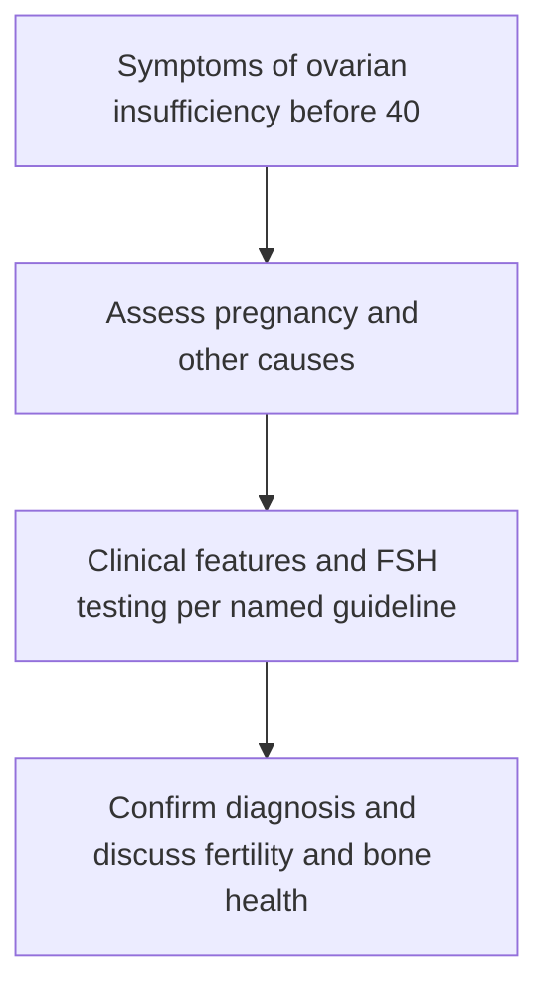

# Menopause and Perimenopause — Original MCQs Q21–Q40

**Advance-preparation, unattempted.** Original nursing practice, not authenticated historical questions. Named NICE, Indian Menopause Society and other guidance applies to the question context. Individual treatment requires clinical assessment and local protocol.

[Chapter](../README.md) · [Q1–Q20](07-Menopause-and-Perimenopause-20-MCQs.md) · [Topic map](../Concepts/Gynecological-and-Reproductive-Nursing-Topic-Coverage-Map.md) · [Previous Year Questions](../Previous-Year-Questions/Gynecological-and-Reproductive-Nursing-Past-Paper-Research-Register.md)

## Part 5 — Q21–Q25

### Q21. A healthy 49-year-old has new hot flushes and increasingly irregular cycles. She is not using hormonal contraception and has no features suggesting another illness. Under NICE NG23, which diagnostic approach is appropriate?

**Difficulty:** 🟡 Medium · **Priority:** 🟠 HIGH YIELD · **Evidence:** Original practice · **Exam focus:** NORCET / Staff Nurse / CHO

- **A.** Identify perimenopause clinically without routine hormone testing
- **B.** Require a single estradiol measurement before any counselling
- **C.** Require pelvic MRI to confirm ovarian aging
- **D.** Measure AMH routinely as a mandatory test

✅ Answer aur detailed A–D Hinglish explanation

**Correct: A. Identify perimenopause clinically without routine hormone testing**

- **A kyun sahi hai:** 45 saal ya usse zyada age mein typical hot flushes aur cycle changes se perimenopause clinically identify kar sakte hain. Routine hormonal test ki zarurat nahi hoti. Atypical symptoms ho toh alag assessment chahiye.
- **B kyun galat hai:** Estradiol transition mein fluctuate karta hai. Ek value se diagnosis reliably establish nahi hota.
- **C kyun galat hai:** MRI structural pelvic problems ke liye useful ho sakta hai, lekin typical menopausal transition confirm karne ka routine test nahi hai.
- **D kyun galat hai:** AMH ovarian reserve se related hai. NICE typical menopause identify karne ke liye routine AMH recommend nahi karta.

**Exam clue:** 45 or older plus typical symptoms: clinical identification.

**Clinical reference:** [NICE NG23](https://www.nice.org.uk/guidance/ng23/chapter/recommendations)

**YouTube MCQ practice:** Exact matching video verification pending. [Menopause Gynecology MCQ question practice — indexed topic lead](https://www.youtube.com/watch?v=Gvp062WOhGo). Title and description retrieved, channel and question-level playback not verified.

### Q22. A 48-year-old using combined hormonal contraception requests an FSH test to decide whether to stop contraception. Which explanation follows NICE guidance?

**Difficulty:** 🔴 Difficult · **Priority:** 🔴 MOST IMPORTANT · **Evidence:** Original practice · **Exam focus:** NORCET / Staff Nurse / CHO

- **A.** A low FSH proves permanent infertility
- **B.** FSH is unreliable for identifying menopause during combined hormonal contraception
- **C.** A high FSH always establishes menopause regardless of medication
- **D.** An LH result alone determines contraceptive eligibility

✅ Answer aur detailed A–D Hinglish explanation

**Correct: B. FSH is unreliable for identifying menopause during combined hormonal contraception**

- **A kyun galat hai:** Combined pill pituitary hormones suppress kar sakti hai. Low FSH permanent infertility establish nahi karta.
- **B kyun sahi hai:** Combined estrogen-progestogen contraception natural FSH pattern ko alter karti hai. Isliye FSH se menopause diagnose nahi karna chahiye. Safe contraception plan age, history aur method ke hisaab se review karo.
- **C kyun galat hai:** Medication ke effect ko ignore karke ek high result se final decision lena safe nahi hai.
- **D kyun galat hai:** LH bhi hormone therapy se affect ho sakta hai. Sirf ek result contraceptive eligibility decide nahi karta.

**Exam clue:** Do not interpret FSH for menopause while using combined contraception.

**Clinical reference:** [NICE NG23](https://www.nice.org.uk/guidance/ng23/chapter/recommendations)

**YouTube MCQ practice:** Exact matching video verification pending. [Menopause Gynecology MCQ question practice — indexed topic lead](https://www.youtube.com/watch?v=Gvp062WOhGo). Title and description retrieved, channel and question-level playback not verified.

### Q23. A 39-year-old has persistent absent periods and symptoms of estrogen deficiency. Pregnancy and other common causes are being assessed. Under NICE NG23, which approach supports diagnosis of premature ovarian insufficiency?

**Difficulty:** 🔴 Difficult · **Priority:** 🔴 MOST IMPORTANT · **Evidence:** Original practice · **Exam focus:** NORCET / Staff Nurse / CHO

- **A.** One low serum prolactin result
- **B.** One elevated FSH result regardless of history
- **C.** Elevated FSH on two samples taken four to six weeks apart, with compatible clinical features
- **D.** An isolated normal pelvic ultrasound

✅ Answer aur detailed A–D Hinglish explanation

**Correct: C. Elevated FSH on two samples taken four to six weeks apart, with compatible clinical features**

- **A kyun galat hai:** Prolactin amenorrhea evaluation mein useful ho sakta hai, lekin low prolactin POI ka diagnostic criterion nahi hai.
- **B kyun galat hai:** NICE POI diagnose karne ke liye ek single FSH result par depend nahi karta. Different international guidelines ka approach differ kar sakta hai.
- **C kyun sahi hai:** POI ka matlab 40 saal se pehle ovaries ki function kam hona hai. NICE compatible symptoms aur 4–6 weeks ke gap se do elevated FSH samples use karta hai. Provider other causes bhi evaluate karega.
- **D kyun galat hai:** Normal ultrasound hormone function normal hone ka proof nahi hai. Isse POI exclude nahi hoti.

**Exam clue:** NICE-specific POI diagnosis: history plus two FSH samples.

**Original visual revision:**

Age aur other causes check kiye bina single lab result se diagnosis nahi karna hai.

**Clinical reference:** [NICE NG23](https://www.nice.org.uk/guidance/ng23/chapter/recommendations)

**YouTube MCQ practice:** Exact matching video verification pending. [Menopause Gynecology MCQ question practice — indexed topic lead](https://www.youtube.com/watch?v=Gvp062WOhGo). Title and description retrieved, channel and question-level playback not verified.

### Q24. A patient experiences natural menopause at age 42. Which classification is most appropriate?

**Difficulty:** 🟢 Easy · **Priority:** 🟠 HIGH YIELD · **Evidence:** Original practice · **Exam focus:** NORCET / Staff Nurse / CHO

- **A.** Premature ovarian insufficiency by age definition
- **B.** Usual-age menopause without any additional considerations
- **C.** Delayed menopause
- **D.** Early menopause

✅ Answer aur detailed A–D Hinglish explanation

**Correct: D. Early menopause**

- **A kyun galat hai:** POI generally 40 saal se pehle ovarian function loss ko describe karta hai. Age 42 is definition se bahar hai.
- **B kyun galat hai:** 42 ki age natural menopause ke liye early hai. Bone health aur individual treatment discussion relevant hain.
- **C kyun galat hai:** Delayed menopause ka matlab later-than-expected transition hota hai. Yahan age kam hai.
- **D kyun sahi hai:** 40–44 years mein menopause ko early menopause kaha jaata hai. Risks aur benefits ko age-specific context mein discuss karna chahiye.

**Exam clue:** POI before 40, early menopause at 40–44.

**Clinical reference:** [NICE NG23](https://www.nice.org.uk/guidance/ng23/chapter/recommendations)

**YouTube MCQ practice:** Exact matching video verification pending. [Menopause Gynecology MCQ question practice — indexed topic lead](https://www.youtube.com/watch?v=Gvp062WOhGo). Title and description retrieved, channel and question-level playback not verified.

### Q25. A 35-year-old with confirmed POI has no contraindication to hormone replacement. Which long-term counseling is most appropriate under NICE and Indian Menopause Society guidance?

**Difficulty:** 🔴 Difficult · **Priority:** 🔴 MOST IMPORTANT · **Evidence:** Original practice · **Exam focus:** NORCET / Staff Nurse / CHO

- **A.** Discuss hormone replacement until around the usual age of natural menopause, with ongoing review
- **B.** Stop all treatment as soon as hot flushes settle
- **C.** Use treatment only if she develops a fracture
- **D.** Assume hormone replacement provides reliable contraception

✅ Answer aur detailed A–D Hinglish explanation

**Correct: A. Discuss hormone replacement until around the usual age of natural menopause, with ongoing review**

- **A kyun sahi hai:** Young age mein estrogen deficiency ka effect bones aur other systems par pad sakta hai. Suitable hormone replacement ya combined hormonal contraception ko usual menopause age tak consider karte hain, with regular review. HRT khud contraception nahi hai.
- **B kyun galat hai:** Symptoms settle hone ka matlab low estrogen ke long-term effects khatam nahi hote.
- **C kyun galat hai:** Fracture hone tak wait karna preventive care ka benefit miss kar sakta hai.
- **D kyun galat hai:** Standard HRT ovulation reliably suppress nahi karti. Pregnancy prevention ki need alag assess karo.

**Exam clue:** POI replacement is not just symptom control.

**Clinical reference:** [Indian Menopause Society 2026](https://pmc.ncbi.nlm.nih.gov/articles/PMC12948155/)

**YouTube MCQ practice:** Exact matching video verification pending. [Menopause Gynecology MCQ question practice — indexed topic lead](https://www.youtube.com/watch?v=Gvp062WOhGo). Title and description retrieved, channel and question-level playback not verified.

## Part 6 — Q26–Q30

### Q26. A 51-year-old had a hysterectomy with ovarian conservation several years ago and now reports new hot flushes. Why is menstrual history alone insufficient to date her menopause?

**Difficulty:** 🟡 Medium · **Priority:** 🟠 HIGH YIELD · **Evidence:** Original practice · **Exam focus:** NORCET / Staff Nurse / CHO

- **A.** Her ovaries must have been removed with the uterus
- **B.** Removal of the uterus prevents menstrual bleeding even while ovaries function
- **C.** Hysterectomy always increases estradiol permanently
- **D.** The cervix determines ovarian hormone production

✅ Answer aur detailed A–D Hinglish explanation

**Correct: B. Removal of the uterus prevents menstrual bleeding even while ovaries function**

- **A kyun galat hai:** Hysterectomy mein uterus remove hota hai. Ovaries retain ho sakti hain, jaise is case mein hua hai.
- **B kyun sahi hai:** Uterus na hone se bleeding nahi hoti, even if ovaries hormones bana rahi hain. Symptoms aur clinical history se menopause assess karna padta hai, especially age 45 ya usse zyada mein.
- **C kyun galat hai:** Hysterectomy ke baad estrogen hamesha high nahi hota. Ovarian function age aur individual factors se change hoti hai.
- **D kyun galat hai:** Cervix lower uterine part hai. Main ovarian hormones ovaries se aate hain.

**Exam clue:** No uterus means no periods, not necessarily immediate menopause.

**Clinical reference:** [NICE NG23](https://www.nice.org.uk/guidance/ng23/chapter/recommendations)

**YouTube MCQ practice:** Exact matching video verification pending. [Menopause Gynecology MCQ question practice — indexed topic lead](https://www.youtube.com/watch?v=Gvp062WOhGo). Title and description retrieved, channel and question-level playback not verified.

### Q27. A suitable patient with troublesome vasomotor symptoms has obesity and increased venous thromboembolism risk. If HRT is considered after individualized assessment, which estrogen route is generally preferred under NICE?

**Difficulty:** 🔴 Difficult · **Priority:** 🔴 MOST IMPORTANT · **Evidence:** Original practice · **Exam focus:** NORCET / Staff Nurse / CHO

- **A.** Oral estrogen because it has no clotting effects
- **B.** Intramuscular estrogen regardless of formulation
- **C.** Transdermal estrogen rather than oral estrogen
- **D.** Vaginal estrogen alone to reliably treat systemic hot flushes

✅ Answer aur detailed A–D Hinglish explanation

**Correct: C. Transdermal estrogen rather than oral estrogen**

- **A kyun galat hai:** Oral estrogen liver se first pass hota hai aur clotting risk par effect kar sakta hai. No-risk statement accurate nahi hai.
- **B kyun galat hai:** Injection ko automatically safer nahi maana ja sakta. Formulation aur evidence important hain.
- **C kyun sahi hai:** Transdermal ka matlab skin ke through patch ya gel se estrogen dena hai. NICE increased VTE risk mein oral ke bajay transdermal consider karta hai. High-risk history mein specialist review bhi zaroori ho sakta hai.
- **D kyun galat hai:** Low-dose vaginal estrogen mainly local GSM symptoms ke liye hota hai. Systemic hot flushes ke liye reliable replacement nahi hai.

**Exam clue:** Consider route-specific VTE risk, not blanket hormone eligibility.

**Clinical reference:** [NICE NG23](https://www.nice.org.uk/guidance/ng23/chapter/recommendations)

**YouTube MCQ practice:** Exact matching video verification pending. [Menopause Gynecology MCQ question practice — indexed topic lead](https://www.youtube.com/watch?v=Gvp062WOhGo). Title and description retrieved, channel and question-level playback not verified.

### Q28. A patient with an intact uterus is using prescribed sequential combined HRT. Which expected pattern distinguishes this regimen from continuous combined HRT?

**Difficulty:** 🟡 Medium · **Priority:** 🟠 HIGH YIELD · **Evidence:** Original practice · **Exam focus:** NORCET / Staff Nurse / CHO

- **A.** Both hormones are taken only once a year
- **B.** Estrogen is omitted throughout the cycle
- **C.** Progestogen is never used
- **D.** Estrogen is given throughout the cycle with progestogen for a defined part, often producing withdrawal bleeding

✅ Answer aur detailed A–D Hinglish explanation

**Correct: D. Estrogen is given throughout the cycle with progestogen for a defined part, often producing withdrawal bleeding**

- **A kyun galat hai:** Yearly use standard sequential combined schedule nahi hai. Prescribed regimen regularly follow karna hota hai.
- **B kyun galat hai:** Estrogen menopausal symptoms ko manage karne ka main hormone hai. Sequential combined regimen mein estrogen regularly diya jaata hai.
- **C kyun galat hai:** Uterus present ho toh systemic estrogen ke saath endometrial protection important hai.
- **D kyun sahi hai:** Sequential regimen mein estrogen continuously aur progestogen cycle ke kuch din diya jaata hai. Progestogen stop hone ke baad withdrawal bleed aa sakta hai. Unexpected bleeding ka assessment alag hota hai.

**Exam clue:** Sequential HRT can produce a scheduled withdrawal bleed.

**Clinical reference:** [NHS HRT types](https://www.nhs.uk/medicines/hormone-replacement-therapy-hrt/types-of-hormone-replacement-therapy-hrt/)

**YouTube MCQ practice:** Exact matching video verification pending. [Menopause Gynecology MCQ question practice — indexed topic lead](https://www.youtube.com/watch?v=Gvp062WOhGo). Title and description retrieved, channel and question-level playback not verified.

### Q29. A 58-year-old with established menopause is prescribed continuous combined HRT. Which regimen feature should the nurse explain?

**Difficulty:** 🟡 Medium · **Priority:** 🟠 HIGH YIELD · **Evidence:** Original practice · **Exam focus:** NORCET / Staff Nurse / CHO

- **A.** Both estrogen and progestogen are taken continuously, with the aim of no scheduled monthly bleed
- **B.** Estrogen is taken only during menstrual bleeding
- **C.** Progestogen is permanently omitted despite an intact uterus
- **D.** Contraceptive protection is guaranteed

✅ Answer aur detailed A–D Hinglish explanation

**Correct: A. Both estrogen and progestogen are taken continuously, with the aim of no scheduled monthly bleed**

- **A kyun sahi hai:** Continuous combined HRT mein dono hormones regular daily schedule par diye jaate hain. Aim scheduled withdrawal bleeding na hona hai. Early spotting ho sakti hai, lekin persistent ya unexpected bleeding report karni hai.
- **B kyun galat hai:** Established menopause mein natural monthly periods nahi hote. Is regimen ka schedule bleeding par dependent nahi hai.
- **C kyun galat hai:** Uterus present ho toh systemic estrogen se lining protect karne ke liye adequate progestogen chahiye.
- **D kyun galat hai:** Continuous combined HRT contraceptive regimen nahi hai. Pregnancy prevention ka assessment separately hota hai.

**Exam clue:** Continuous combined HRT has no planned monthly withdrawal bleed.

**Clinical reference:** [NHS HRT types](https://www.nhs.uk/medicines/hormone-replacement-therapy-hrt/types-of-hormone-replacement-therapy-hrt/)

**YouTube MCQ practice:** Exact matching video verification pending. [Menopause Gynecology MCQ question practice — indexed topic lead](https://www.youtube.com/watch?v=Gvp062WOhGo). Title and description retrieved, channel and question-level playback not verified.

### Q30. A woman on stable continuous combined HRT for more than one year develops new vaginal bleeding. Which action is most appropriate?

**Difficulty:** 🔴 Difficult · **Priority:** 🔴 MOST IMPORTANT · **Evidence:** Original practice · **Exam focus:** NORCET / Staff Nurse / CHO

- **A.** Reassure her that all bleeding is expected indefinitely
- **B.** Arrange prompt clinical assessment of unscheduled bleeding
- **C.** Advise doubling estrogen without review
- **D.** Assume the bleeding is due to infection and prescribe antibiotics

✅ Answer aur detailed A–D Hinglish explanation

**Correct: B. Arrange prompt clinical assessment of unscheduled bleeding**

- **A kyun galat hai:** New bleeding ko routine side effect bolkar ignore karna unsafe hai. Timing aur risk factors matter karte hain.
- **B kyun sahi hai:** Stable regimen ke baad new bleeding mein endometrial pathology aur other causes assess karna zaroori hai. Nurse prompt review arrange kare, especially heavy bleeding ya concerning symptoms mein.
- **C kyun galat hai:** Dose change bina assessment cause ko mask kar sakta hai. Prescriber decision karega.
- **D kyun galat hai:** Infection possible cause hai, but bleeding se infection prove nahi hota. Assessment chahiye.

**Exam clue:** New unscheduled bleeding on established HRT needs assessment.

**Clinical reference:** [British Menopause Society](https://thebms.org.uk/publications/bms-guidelines/management-of-unscheduled-bleeding-on-hormone-replacement-therapy-hrt/)

**YouTube MCQ practice:** Exact matching video verification pending. [Menopause Gynecology MCQ question practice — indexed topic lead](https://www.youtube.com/watch?v=Gvp062WOhGo). Title and description retrieved, channel and question-level playback not verified.

## Part 7 — Q31–Q35

### Q31. A patient using effective systemic HRT still has significant vaginal dryness and discomfort. Which additional option can be discussed according to NICE?

**Difficulty:** 🟡 Medium · **Priority:** 🟠 HIGH YIELD · **Evidence:** Original practice · **Exam focus:** NORCET / Staff Nurse / CHO

- **A.** Stop every prescribed hormone without review
- **B.** Increase systemic estrogen automatically until all symptoms resolve
- **C.** Consider prescribed local vaginal estrogen if suitable
- **D.** Use routine antibiotics despite no evidence of infection

✅ Answer aur detailed A–D Hinglish explanation

**Correct: C. Consider prescribed local vaginal estrogen if suitable**

- **A kyun galat hai:** Systemic HRT hot flushes control kar rahi ho toh abruptly stop karna zaroori nahi hai. Local symptoms ka separate treatment ho sakta hai.
- **B kyun galat hai:** Systemic dose increase se unnecessary exposure badh sakta hai. Local vaginal symptoms ke liye targeted option consider karna useful hai.
- **C kyun sahi hai:** Low-dose vaginal estrogen vaginal tissues mein estrogen effect improve kar sakta hai. NICE ise systemic HRT users mein bhi consider karta hai. Individual risks aur preferences review karein.
- **D kyun galat hai:** Dryness estrogen deficiency se ho sakti hai, bacteria se zaroori nahi. Antibiotic bina indication appropriate nahi.

**Exam clue:** Persistent GSM can need local therapy even with systemic HRT.

**Clinical reference:** [NICE NG23](https://www.nice.org.uk/guidance/ng23/chapter/recommendations)

**YouTube MCQ practice:** Exact matching video verification pending. [Menopause Gynecology MCQ question practice — indexed topic lead](https://www.youtube.com/watch?v=Gvp062WOhGo). Title and description retrieved, channel and question-level playback not verified.

### Q32. A breast cancer survivor taking an aromatase inhibitor has severe genitourinary symptoms despite nonhormonal moisturizers. What is the safest next nursing step?

**Difficulty:** 🔴 Difficult · **Priority:** 🔴 MOST IMPORTANT · **Evidence:** Original practice · **Exam focus:** NORCET / Staff Nurse / CHO

- **A.** Start high-dose systemic estrogen independently
- **B.** Advise stopping the aromatase inhibitor
- **C.** Dismiss the symptoms as unavoidable
- **D.** Arrange shared specialist discussion before considering vaginal estrogen

✅ Answer aur detailed A–D Hinglish explanation

**Correct: D. Arrange shared specialist discussion before considering vaginal estrogen**

- **A kyun galat hai:** Hormone-sensitive cancer history mein systemic estrogen ka decision specialist-led hona chahiye. Nurse independently start nahi kare.
- **B kyun galat hai:** Aromatase inhibitor cancer treatment ka important part ho sakta hai. Bina oncology review stop nahi karna chahiye.
- **C kyun galat hai:** Symptoms quality of life affect kar sakte hain. Safe treatment options discuss karne chahiye.
- **D kyun sahi hai:** Nonhormonal treatment insufficient ho toh local estrogen ke benefits aur uncertain recurrence risk par menopause aur oncology team ke saath shared decision zaroori hai, especially aromatase inhibitor users mein.

**Exam clue:** Breast cancer plus aromatase inhibitor: specialist discussion for local hormones.

**Clinical reference:** [NICE NG23](https://www.nice.org.uk/guidance/ng23/chapter/recommendations)

**YouTube MCQ practice:** Exact matching video verification pending. [Menopause Gynecology MCQ question practice — indexed topic lead](https://www.youtube.com/watch?v=Gvp062WOhGo). Title and description retrieved, channel and question-level playback not verified.

### Q33. A healthy postmenopausal patient without bothersome symptoms asks to begin systemic HRT solely to prevent dementia. Which reply follows NICE guidance?

**Difficulty:** 🟡 Medium · **Priority:** 🟠 HIGH YIELD · **Evidence:** Original practice · **Exam focus:** NORCET / Staff Nurse / CHO

- **A.** HRT should not be initiated specifically for dementia prevention
- **B.** HRT guarantees prevention of Alzheimer disease
- **C.** Only high-dose estrogen prevents dementia
- **D.** Every postmenopausal patient requires HRT for brain protection

✅ Answer aur detailed A–D Hinglish explanation

**Correct: A. HRT should not be initiated specifically for dementia prevention**

- **A kyun sahi hai:** NICE HRT ko dementia prevention ke purpose se offer nahi karta. Symptom management ya other valid indications ke liye benefits aur risks separately assess karte hain.
- **B kyun galat hai:** Dementia multiple causes aur risk factors se related hai. HRT guarantee nahi deti.
- **C kyun galat hai:** High dose estrogen ka dementia prevention benefit established nahi hai aur risks ho sakte hain.
- **D kyun galat hai:** Har woman ko HRT dena appropriate nahi. Individual indication aur preferences matter karte hain.

**Exam clue:** HRT is not a dementia-prevention prescription.

**Clinical reference:** [NICE NG23](https://www.nice.org.uk/guidance/ng23/chapter/recommendations)

**YouTube MCQ practice:** Exact matching video verification pending. [Menopause Gynecology MCQ question practice — indexed topic lead](https://www.youtube.com/watch?v=Gvp062WOhGo). Title and description retrieved, channel and question-level playback not verified.

### Q34. A 62-year-old asks for systemic HRT solely to prevent a first heart attack. Which counseling is best under NICE guidance?

**Difficulty:** 🟡 Medium · **Priority:** 🟠 HIGH YIELD · **Evidence:** Original practice · **Exam focus:** NORCET / Staff Nurse / CHO

- **A.** Prescribe HRT in place of blood pressure treatment
- **B.** Do not use HRT specifically for cardiovascular prevention and assess standard risk factors
- **C.** Stop statins whenever HRT is used
- **D.** Use estrogen as emergency treatment for chest pain

✅ Answer aur detailed A–D Hinglish explanation

**Correct: B. Do not use HRT specifically for cardiovascular prevention and assess standard risk factors**

- **A kyun galat hai:** HRT hypertension treatment ka replacement nahi hai. BP control ke liye appropriate plan chahiye.
- **B kyun sahi hai:** NICE primary ya secondary cardiovascular prevention ke liye HRT offer nahi karta. Smoking, BP, lipids, diabetes aur physical activity assess karna important hai.
- **C kyun galat hai:** Statin ka indication cardiovascular risk se decide hota hai. HRT ke basis par independently stop nahi karna chahiye.
- **D kyun galat hai:** Chest pain possible cardiac emergency hai. Estrogen emergency treatment nahi hai.

**Exam clue:** CVD prevention is different from menopause symptom treatment.

**Clinical reference:** [NICE NG23](https://www.nice.org.uk/guidance/ng23/chapter/recommendations)

**YouTube MCQ practice:** Exact matching video verification pending. [Menopause Gynecology MCQ question practice — indexed topic lead](https://www.youtube.com/watch?v=Gvp062WOhGo). Title and description retrieved, channel and question-level playback not verified.

### Q35. A 50-year-old with menopausal hot flushes prefers a structured non-drug approach and asks about cognitive behavioural therapy. What can the nurse explain?

**Difficulty:** 🟡 Medium · **Priority:** 🟠 HIGH YIELD · **Evidence:** Original practice · **Exam focus:** NORCET / Staff Nurse / CHO

- **A.** CBT restores ovarian follicles
- **B.** CBT is useful only when hormone blood tests are normal
- **C.** Menopause-specific CBT may help manage symptom impact and associated sleep problems
- **D.** CBT replaces assessment of every medical cause of insomnia

✅ Answer aur detailed A–D Hinglish explanation

**Correct: C. Menopause-specific CBT may help manage symptom impact and associated sleep problems**

- **A kyun galat hai:** CBT ek psychological approach hai. Yeh ovarian reserve restore nahi karti.
- **B kyun galat hai:** Iska use hormone test normal hone par dependent nahi hai.
- **C kyun sahi hai:** CBT thoughts, coping aur behaviour patterns par kaam karti hai. Menopause-specific approach hot flushes ka daily impact aur sleep difficulty manage karne mein help kar sakti hai.
- **D kyun galat hai:** Insomnia ke other causes bhi assess karne hain. CBT appropriate clinical assessment ka replacement nahi hai.

**Exam clue:** CBT helps symptom coping and sleep, not ovarian restoration.

**Clinical reference:** [NICE NG23](https://www.nice.org.uk/guidance/ng23/chapter/recommendations)

**YouTube MCQ practice:** Exact matching video verification pending. [Menopause Gynecology MCQ question practice — indexed topic lead](https://www.youtube.com/watch?v=Gvp062WOhGo). Title and description retrieved, channel and question-level playback not verified.

## Part 8 — Q36–Q40

### Q36. A 46-year-old with untreated premature menopause and a low-trauma wrist fracture asks about bone health. Which next step is most appropriate?

**Difficulty:** 🔴 Difficult · **Priority:** 🔴 MOST IMPORTANT · **Evidence:** Original practice · **Exam focus:** NORCET / Staff Nurse / CHO

- **A.** Wait until age 65 in every case
- **B.** Measure only serum calcium and exclude osteoporosis if normal
- **C.** Start vigorous exercise despite the new fracture
- **D.** Arrange fracture risk and bone health assessment without waiting for routine age-based screening

✅ Answer aur detailed A–D Hinglish explanation

**Correct: D. Arrange fracture risk and bone health assessment without waiting for routine age-based screening**

- **A kyun galat hai:** Young age ke bawajood premature estrogen loss aur low-trauma fracture important risk factors hain. Routine age cutoff ka wait nahi karna chahiye.
- **B kyun galat hai:** Serum calcium normal hone se bone density normal prove nahi hoti. Fracture risk assessment alag hoti hai.
- **C kyun galat hai:** Acute fracture ke baad exercise plan safety aur rehabilitation guidance ke hisaab se hona chahiye.
- **D kyun sahi hai:** Minor trauma se fracture fragility ka clue ho sakta hai. Provider risk history, bone density testing when appropriate aur secondary causes evaluate karega.

**Exam clue:** Fragility fracture and premature menopause justify early assessment.

**Clinical reference:** [NICE fracture risk](https://www.nice.org.uk/guidance/cg146/chapter/Recommendations)

**YouTube MCQ practice:** Exact matching video verification pending. [Menopause Gynecology MCQ question practice — indexed topic lead](https://www.youtube.com/watch?v=Gvp062WOhGo). Title and description retrieved, channel and question-level playback not verified.

### Q37. A clinician requests a test to quantify bone mineral density at the hip and lumbar spine in a postmenopausal patient. Which investigation is appropriate?

**Difficulty:** 🟢 Easy · **Priority:** 🟠 HIGH YIELD · **Evidence:** Original practice · **Exam focus:** NORCET / Staff Nurse / CHO

- **A.** Dual-energy X-ray absorptiometry
- **B.** Serum FSH alone
- **C.** Cervical cytology
- **D.** Transvaginal ultrasound

✅ Answer aur detailed A–D Hinglish explanation

**Correct: A. Dual-energy X-ray absorptiometry**

- **A kyun sahi hai:** DXA low-dose X-ray technique se bone mineral density measure karti hai. Result aur risk factors saath interpret karke fracture prevention plan banaya jaata hai.
- **B kyun galat hai:** FSH reproductive hormones se related hai. Bone mineral density directly measure nahi karta.
- **C kyun galat hai:** Cervical cytology cervix ke cells assess karti hai, bones nahi.
- **D kyun galat hai:** Transvaginal ultrasound pelvic organs examine karta hai. Standard hip aur spine bone density test nahi hai.

**Exam clue:** DXA measures bone mineral density.

**Clinical reference:** [NICE fracture risk](https://www.nice.org.uk/guidance/cg146/chapter/Recommendations)

**YouTube MCQ practice:** Exact matching video verification pending. [Menopause Gynecology MCQ question practice — indexed topic lead](https://www.youtube.com/watch?v=Gvp062WOhGo). Title and description retrieved, channel and question-level playback not verified.

### Q38. A postmenopausal patient has recurrent urinary burning and vaginal dryness. Which assessment approach is most appropriate?

**Difficulty:** 🟡 Medium · **Priority:** 🟠 HIGH YIELD · **Evidence:** Original practice · **Exam focus:** NORCET / Staff Nurse / CHO

- **A.** Assume every episode is an STI
- **B.** Evaluate for urinary infection and genitourinary syndrome rather than automatically attributing symptoms to either
- **C.** Prescribe antibiotics indefinitely without assessment
- **D.** Assume symptoms cannot be related to estrogen deficiency

✅ Answer aur detailed A–D Hinglish explanation

**Correct: B. Evaluate for urinary infection and genitourinary syndrome rather than automatically attributing symptoms to either**

- **A kyun galat hai:** STI differential mein ho sakti hai based on risk, lekin har urinary symptom STI nahi hai.
- **B kyun sahi hai:** GSM mein low estrogen se vaginal aur urinary tissues affect ho sakte hain. UTI bhi possible hai. Symptoms, urine tests when indicated aur clinical examination se cause assess karo.
- **C kyun galat hai:** Indefinite antibiotics bina diagnosis resistance aur adverse effects badha sakti hain.
- **D kyun galat hai:** Estrogen deficiency urinary burning aur recurrent urinary problems se related ho sakti hai. Is possibility ko consider karo.

**Exam clue:** GSM and UTI may coexist or mimic each other.

**Clinical reference:** [NICE NG23](https://www.nice.org.uk/guidance/ng23/chapter/recommendations)

**YouTube MCQ practice:** Exact matching video verification pending. [Menopause Gynecology MCQ question practice — indexed topic lead](https://www.youtube.com/watch?v=Gvp062WOhGo). Title and description retrieved, channel and question-level playback not verified.

### Q39. A patient starts prescribed HRT and asks when benefits, adverse effects and ongoing suitability will be reviewed. Which plan reflects NICE routine follow-up guidance?

**Difficulty:** 🟡 Medium · **Priority:** 🟠 HIGH YIELD · **Evidence:** Original practice · **Exam focus:** NORCET / Staff Nurse / CHO

- **A.** Review only if she requests treatment after ten years
- **B.** No review is needed when symptoms improve
- **C.** Review at about three months and annually thereafter, or earlier if concerns arise
- **D.** Repeat pelvic surgery at each follow-up

✅ Answer aur detailed A–D Hinglish explanation

**Correct: C. Review at about three months and annually thereafter, or earlier if concerns arise**

- **A kyun galat hai:** Ten years ka delay adverse effects aur changing health risks miss kar sakta hai.
- **B kyun galat hai:** Symptom improvement ke baad bhi dose, bleeding aur ongoing suitability review karni chahiye.
- **C kyun sahi hai:** Initial review around three months mein effectiveness aur tolerability assess karte hain. Annual review ongoing indication aur risks check karta hai. Concerning symptoms par pehle contact karna chahiye.
- **D kyun galat hai:** Routine review clinical discussion aur indicated assessment hai. Surgery mandatory nahi hai.

**Exam clue:** HRT review: approximately 3 months, then annually.

**Clinical reference:** [NICE NG23](https://www.nice.org.uk/guidance/ng23/chapter/recommendations)

**YouTube MCQ practice:** Exact matching video verification pending. [Menopause Gynecology MCQ question practice — indexed topic lead](https://www.youtube.com/watch?v=Gvp062WOhGo). Title and description retrieved, channel and question-level playback not verified.

### Q40. A patient wants a compounded hormone product because it is advertised as safer than regulated HRT. Which counseling is most appropriate?

**Difficulty:** 🟡 Medium · **Priority:** 🟠 HIGH YIELD · **Evidence:** Original practice · **Exam focus:** NORCET / Staff Nurse / CHO

- **A.** Every compounded product is guaranteed safer
- **B.** Compounded products never have adverse effects
- **C.** No product needs quality or dose assessment
- **D.** Prefer regulated approved preparations when appropriate and explain that compounded products lack established comparative safety

✅ Answer aur detailed A–D Hinglish explanation

**Correct: D. Prefer regulated approved preparations when appropriate and explain that compounded products lack established comparative safety**

- **A kyun galat hai:** Natural ya compounded label se safety guarantee nahi hoti. Formulation quality aur clinical evidence important hain.
- **B kyun galat hai:** Hormonal product ke adverse effects ho sakte hain regardless of marketing label.
- **C kyun galat hai:** Dose consistency, purity, contraindications aur monitoring assess karna zaroori hai.
- **D kyun sahi hai:** ACOG regulated approved preparations ko compounded hormone therapy par prefer karta hai when suitable. Provider ke saath evidence-based options discuss karo. Local approval status check karna bhi zaroori hai.

**Exam clue:** Bioidentical marketing is not proof of superior safety.

**Clinical reference:** [ACOG](https://www.acog.org/womens-health/faqs/hormone-therapy-for-menopause)

**YouTube MCQ practice:** Exact matching video verification pending. [Menopause Gynecology MCQ question practice — indexed topic lead](https://www.youtube.com/watch?v=Gvp062WOhGo). Title and description retrieved, channel and question-level playback not verified.

## Evidence status

NICE NG23 and Indian Menopause Society 2026 indexed extracts reviewed, direct NICE page returned 403 and PMC full text challenge. NHS, ACOG, BMS and NICE fracture-risk indexed material reviewed. No verified exact question-level video or official historical exam claim. Original Mermaid source included, rendered view not checked. Comprehensive independent clinical and semantic audit pending.
