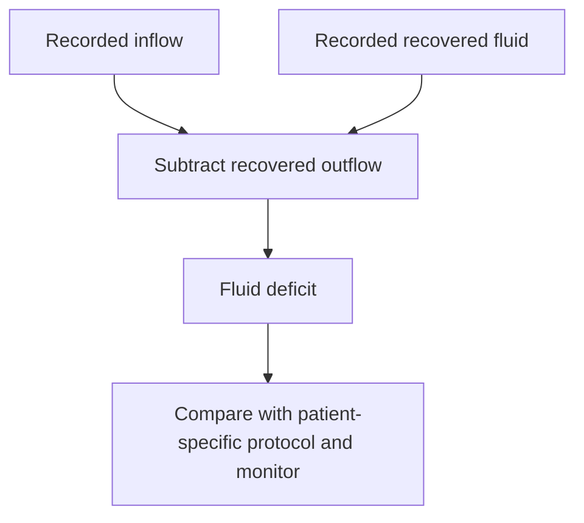

# Gynecological Procedures, Postoperative Care and Nursing Responsibilities — Original MCQs Q21–Q40

**Advance-preparation, unattempted.** Original clinical questions, not historical PYQs. Local clinical protocols and trained-provider instructions apply to patient care.

[Chapter](../README.md) · [Q1–Q20](08-Gynecological-Procedures-Postoperative-Care-and-Nursing-Responsibilities-20-MCQs.md) · [Topic map](../Concepts/Gynecological-and-Reproductive-Nursing-Topic-Coverage-Map.md) · [Previous Year Questions](../Previous-Year-Questions/Gynecological-and-Reproductive-Nursing-Past-Paper-Research-Register.md)

## Part 5 — Q21–Q25

### Q21. A woman scheduled for elective hysteroscopy reports a missed period after unprotected intercourse. What should the nurse do before proceeding?

**Difficulty:** 🟡 Medium · **Priority:** 🟠 HIGH YIELD · **Evidence:** Original practice · **Exam focus:** NORCET / Staff Nurse / CHO

- **A.** Inform the procedural team and arrange pregnancy assessment according to protocol
- **B.** Proceed because hysteroscopy cannot affect pregnancy
- **C.** Administer a uterine stimulant without assessment
- **D.** Ask the patient to conceal the missed period

✅ Answer aur detailed A–D Hinglish explanation

**Correct: A. Inform the procedural team and arrange pregnancy assessment according to protocol**

- **A kyun sahi hai:** Hysteroscopy mein instrument uterus ke andar jaata hai. Possible pregnancy mein elective procedure se pehle pregnancy exclude karna important hai. Team ko inform karo aur appropriate test arrange karo.
- **B kyun galat hai:** Intrauterine instrumentation pregnancy ko harm kar sakti hai. Risk ignore nahi karna chahiye.
- **C kyun galat hai:** Uterine stimulant bina indication aur assessment unsafe hai.
- **D kyun galat hai:** Missed period clinically relevant history hai. Team se conceal karne se patient safety compromise hoti hai.

**Exam clue:** Before elective hysteroscopy, exclude pregnancy when relevant.

**Clinical reference:** [RCOG clinical information](https://www.rcog.org.uk/outpatient-hysteroscopy)

**YouTube MCQ practice:** [Aarogyam Infinity OBG Part 14](https://www.youtube.com/watch?v=IvUiBPbtFNw) is an indexed hysterectomy-related MCQ lead. Specific question mapping and playback pending.

### Q22. During outpatient hysteroscopy a patient explicitly asks the clinician to stop because of intolerable pain. Which response is appropriate?

**Difficulty:** 🟡 Medium · **Priority:** 🟠 HIGH YIELD · **Evidence:** Original practice · **Exam focus:** NORCET / Staff Nurse / CHO

- **A.** Continue because initial consent cannot be withdrawn
- **B.** Stop the procedure safely and reassess pain, preferences and alternatives
- **C.** Tell her severe pain must always be accepted
- **D.** Give an unprescribed sedative and continue

✅ Answer aur detailed A–D Hinglish explanation

**Correct: B. Stop the procedure safely and reassess pain, preferences and alternatives**

- **A kyun galat hai:** Consent ongoing process hai. Patient procedure ke beech mein bhi consent withdraw kar sakti hai.
- **B kyun sahi hai:** Procedure safely stop karna aur pain assess karna patient ki autonomy aur safety respect karta hai. Alternative pain relief ya another setting discuss ki ja sakti hai.
- **C kyun galat hai:** Pain experience individual hota hai. Severe pain ko dismiss nahi karna chahiye.
- **D kyun galat hai:** Sedation ke liye appropriate order, monitoring aur trained staff chahiye. Consent withdrawal ko override nahi kar sakte.

**Exam clue:** Consent can be withdrawn during a procedure.

**Clinical reference:** [RCOG clinical information](https://www.rcog.org.uk/outpatient-hysteroscopy)

**YouTube MCQ practice:** [Aarogyam Infinity OBG Part 14](https://www.youtube.com/watch?v=IvUiBPbtFNw) is an indexed hysterectomy-related MCQ lead. Specific question mapping and playback pending.

### Q23. During office hysteroscopy a patient becomes pale, sweaty and nauseated, with bradycardia and falling blood pressure after cervical manipulation. Which initial response is most appropriate?

**Difficulty:** 🔴 Difficult · **Priority:** 🔴 MOST IMPORTANT · **Evidence:** Original practice · **Exam focus:** NORCET / Staff Nurse / CHO

- **A.** Continue instrumentation because this proves adequate analgesia
- **B.** Give oral fluids while the patient is actively fainting
- **C.** Stop stimulation, summon help, assess ABC and position safely while monitoring vital signs
- **D.** Ask her to stand immediately

✅ Answer aur detailed A–D Hinglish explanation

**Correct: C. Stop stimulation, summon help, assess ABC and position safely while monitoring vital signs**

- **A kyun galat hai:** Cervical manipulation vasovagal response trigger kar sakti hai. Bradycardia aur hypotension warning signs hain, procedure continue nahi karna chahiye.
- **B kyun galat hai:** Fainting patient ko oral fluid dene se aspiration ka risk hai.
- **C kyun sahi hai:** Stimulation stop karo, airway, breathing aur circulation assess karo, patient ko safe supine position mein monitor karo aur clinical help lo. Bleeding ya other serious causes bhi exclude karne hain.
- **D kyun galat hai:** Standing se cerebral blood flow aur kam ho sakta hai aur fall ka risk badhta hai.

**Exam clue:** Pallor plus bradycardia after cervical manipulation suggests vasovagal reaction, but assess urgently.

**Clinical reference:** [RCOG clinical information](https://www.rcog.org.uk/outpatient-hysteroscopy)

**YouTube MCQ practice:** [Aarogyam Infinity OBG Part 14](https://www.youtube.com/watch?v=IvUiBPbtFNw) is an indexed hysterectomy-related MCQ lead. Specific question mapping and playback pending.

### Q24. During operative hysteroscopy 3,200 mL of distension fluid has entered and 2,650 mL has been recovered. What is the recorded fluid deficit before accounting for measurement error?

**Difficulty:** 🟡 Medium · **Priority:** 🟠 HIGH YIELD · **Evidence:** Original practice · **Exam focus:** NORCET / Staff Nurse / CHO

- **A.** 250 mL
- **B.** 850 mL
- **C.** 5,850 mL
- **D.** 550 mL

✅ Answer aur detailed A–D Hinglish explanation

**Correct: D. 550 mL**

- **A kyun galat hai:** 250 mL subtraction ka correct result nahi hai. Inflow aur recovered outflow check karo.
- **B kyun galat hai:** 850 mL bhi given volumes ka difference nahi hai.
- **C kyun galat hai:** 5,850 mL dono values ka sum hai, deficit nahi.
- **D kyun sahi hai:** Fluid deficit = inflow minus outflow. 3,200 − 2,650 = 550 mL. Unrecovered fluid body mein absorb ya outside collection spill ho sakta hai. Team threshold aur fluid type ke hisaab se action leti hai.

**Exam clue:** Fluid deficit = inflow − measured outflow.

**Original visual revision:**

Deficit ko true absorption ke barabar automatically assume nahi karna hai.

**Clinical reference:** [ACOG](https://www.acog.org/clinical/clinical-guidance/committee-opinion/articles/2020/03/the-use-of-hysteroscopy-for-the-diagnosis-and-treatment-of-intrauterine-pathology)

**YouTube MCQ practice:** [Aarogyam Infinity OBG Part 14](https://www.youtube.com/watch?v=IvUiBPbtFNw) is an indexed hysterectomy-related MCQ lead. Specific question mapping and playback pending.

### Q25. A patient undergoing operative hysteroscopy with an electrolyte-free hypotonic distension medium develops confusion and a large fluid deficit. Which complication should the team urgently assess?

**Difficulty:** 🔴 Difficult · **Priority:** 🔴 MOST IMPORTANT · **Evidence:** Original practice · **Exam focus:** NORCET / Staff Nurse / CHO

- **A.** Dilutional hyponatremia and fluid overload
- **B.** Isolated chronic hypercalcemia
- **C.** Iron deficiency from menopause alone
- **D.** A normal expected cognitive response

✅ Answer aur detailed A–D Hinglish explanation

**Correct: A. Dilutional hyponatremia and fluid overload**

- **A kyun sahi hai:** Hypotonic fluid circulation mein absorb ho toh serum sodium dilute ho sakta hai. Confusion neurological warning sign hai. Procedure stop karne aur electrolytes, respiratory aur cardiovascular status assess karne ke liye urgent team action chahiye.
- **B kyun galat hai:** Hypercalcemia is fluid absorption ka expected primary mechanism nahi hai.
- **C kyun galat hai:** Chronic iron deficiency sudden confusion aur large fluid deficit ko adequately explain nahi karti.
- **D kyun galat hai:** New confusion ko normal bolkar ignore karna dangerous hai. Acute electrolyte disturbance ya other emergency evaluate karo.

**Exam clue:** Hypotonic distension fluid absorption can cause hyponatremia.

**Clinical reference:** [ACOG](https://www.acog.org/clinical/clinical-guidance/committee-opinion/articles/2020/03/the-use-of-hysteroscopy-for-the-diagnosis-and-treatment-of-intrauterine-pathology)

**YouTube MCQ practice:** [Aarogyam Infinity OBG Part 14](https://www.youtube.com/watch?v=IvUiBPbtFNw) is an indexed hysterectomy-related MCQ lead. Specific question mapping and playback pending.

## Part 6 — Q26–Q30

### Q26. Normal saline is used as a distension medium during operative hysteroscopy. Which statement about a rapidly rising fluid deficit is correct?

**Difficulty:** 🔴 Difficult · **Priority:** 🔴 MOST IMPORTANT · **Evidence:** Original practice · **Exam focus:** NORCET / Staff Nurse / CHO

- **A.** It is harmless because saline contains sodium
- **B.** It can still produce intravascular volume overload and pulmonary edema
- **C.** It always causes the same dilutional hyponatremia as electrolyte-free hypotonic fluid
- **D.** Fluid monitoring is unnecessary with isotonic media

✅ Answer aur detailed A–D Hinglish explanation

**Correct: B. It can still produce intravascular volume overload and pulmonary edema**

- **A kyun galat hai:** Isotonic saline sodium-related risk ko reduce kar sakta hai, lekin excess volume heart aur lungs par stress daal sakta hai.
- **B kyun sahi hai:** Large saline absorption circulating volume badha sakti hai. Pulmonary edema aur breathing difficulty possible hain. Deficit aur patient status monitor karo.
- **C kyun galat hai:** Electrolyte-free hypotonic medium ka dilutional sodium effect different hota hai. Saline ke saath volume overload phir bhi serious hai.
- **D kyun galat hai:** Har distension fluid type mein accurate monitoring chahiye. Stop thresholds patient condition aur protocol se decide hote hain.

**Exam clue:** Isotonic fluid does not eliminate fluid overload risk.

**Clinical reference:** [ACOG](https://www.acog.org/clinical/clinical-guidance/committee-opinion/articles/2020/03/the-use-of-hysteroscopy-for-the-diagnosis-and-treatment-of-intrauterine-pathology)

**YouTube MCQ practice:** [Aarogyam Infinity OBG Part 14](https://www.youtube.com/watch?v=IvUiBPbtFNw) is an indexed hysterectomy-related MCQ lead. Specific question mapping and playback pending.

### Q27. After a cervical precancer assessment, the clinician plans an excisional LEEP rather than an ablative procedure. Which feature distinguishes LEEP?

**Difficulty:** 🟡 Medium · **Priority:** 🟠 HIGH YIELD · **Evidence:** Original practice · **Exam focus:** NORCET / Staff Nurse / CHO

- **A.** It destroys tissue without obtaining a specimen in every case
- **B.** It removes the entire uterus
- **C.** It removes abnormal cervical tissue with an electrically energized wire loop for histological assessment
- **D.** It treats ovarian cysts through the abdominal wall

✅ Answer aur detailed A–D Hinglish explanation

**Correct: C. It removes abnormal cervical tissue with an electrically energized wire loop for histological assessment**

- **A kyun galat hai:** Ablation tissue destroy kar sakti hai, jabki excisional LEEP se tissue specimen mil sakta hai.
- **B kyun galat hai:** LEEP cervix ke selected abnormal area ka procedure hai. Total hysterectomy nahi hai.
- **C kyun sahi hai:** LEEP mein thin wire loop electrical energy use karke cervical tissue excise karta hai. Sample histology ke liye bheja ja sakta hai. Nurse labeling aur follow-up ensure kare.
- **D kyun galat hai:** Ovarian cyst different anatomical site ka problem hai. LEEP ka target cervix hai.

**Exam clue:** LEEP = cervical excision, with tissue for pathology.

**Clinical reference:** [ACOG](https://www.acog.org/womens-health/faqs/loop-electrosurgical-excision-procedure)

**YouTube MCQ practice:** [Aarogyam Infinity OBG Part 14](https://www.youtube.com/watch?v=IvUiBPbtFNw) is an indexed hysterectomy-related MCQ lead. Specific question mapping and playback pending.

### Q28. A patient returns for discharge counseling after LEEP. Which instruction best supports cervical healing?

**Difficulty:** 🟡 Medium · **Priority:** 🟠 HIGH YIELD · **Evidence:** Original practice · **Exam focus:** NORCET / Staff Nurse / CHO

- **A.** Use tampons daily to absorb discharge until healing
- **B.** Resume vaginal intercourse immediately regardless of symptoms
- **C.** Perform vaginal douching to clean the wound
- **D.** Avoid inserting products or intercourse for the clinician-advised healing period and report concerning bleeding or infection signs

✅ Answer aur detailed A–D Hinglish explanation

**Correct: D. Avoid inserting products or intercourse for the clinician-advised healing period and report concerning bleeding or infection signs**

- **A kyun galat hai:** Tampons healing tissue irritate kar sakte hain. Pads commonly preferred hote hain during recovery.
- **B kyun galat hai:** Immediate intercourse healing area disturb kar sakta hai. Individual clinician ki timing follow karo.
- **C kyun galat hai:** Douching local tissue irritation aur infection risk badha sakti hai.
- **D kyun sahi hai:** Cervix ko heal hone ka time chahiye. Vaginal insertion aur intercourse restrictions, expected discharge aur warning signs clearly samjhao. Heavy bleeding, fever ya severe pain par medical review chahiye.

**Exam clue:** LEEP aftercare protects the healing cervix.

**Clinical reference:** [ACOG](https://www.acog.org/womens-health/faqs/loop-electrosurgical-excision-procedure)

**YouTube MCQ practice:** [Aarogyam Infinity OBG Part 14](https://www.youtube.com/watch?v=IvUiBPbtFNw) is an indexed hysterectomy-related MCQ lead. Specific question mapping and playback pending.

### Q29. Before dilation and curettage, the nurse checks the instruments with the operating team. What is the purpose of a cervical dilator?

**Difficulty:** 🟢 Easy · **Priority:** 🟠 HIGH YIELD · **Evidence:** Original practice · **Exam focus:** NORCET / Staff Nurse / CHO

- **A.** Gradually open the cervical canal to permit indicated uterine instrumentation
- **B.** Excise the entire cervix
- **C.** Measure ovarian reserve
- **D.** Seal the fallopian tubes permanently

✅ Answer aur detailed A–D Hinglish explanation

**Correct: A. Gradually open the cervical canal to permit indicated uterine instrumentation**

- **A kyun sahi hai:** Dilator cervix ke opening ko controlled way mein widen karne mein madad karta hai. Trained clinician procedure karta hai, nurse appropriate instrument aur safety checks assist karti hai.
- **B kyun galat hai:** Cervix remove karna dilator ka purpose nahi hai.
- **C kyun galat hai:** Ovarian reserve tests ovaries ki function assess karte hain. Cervical dilation se reserve measure nahi hota.
- **D kyun galat hai:** Tubal occlusion permanent contraception ka alag procedure hai.

**Exam clue:** Dilation opens the cervix, curettage removes selected uterine contents or tissue.

**Clinical reference:** [ACOG](https://www.acog.org/womens-health/faqs/dilation-and-curettage)

**YouTube MCQ practice:** [Aarogyam Infinity OBG Part 14](https://www.youtube.com/watch?v=IvUiBPbtFNw) is an indexed hysterectomy-related MCQ lead. Specific question mapping and playback pending.

### Q30. During uterine instrumentation the operator suspects that an instrument has passed through the uterine wall. Which action should the nurse anticipate?

**Difficulty:** 🔴 Difficult · **Priority:** 🔴 MOST IMPORTANT · **Evidence:** Original practice · **Exam focus:** NORCET / Staff Nurse / CHO

- **A.** Continue routine curettage without reassessment
- **B.** Stop instrumentation and assist urgent assessment for uterine perforation and bleeding
- **C.** Discharge the patient before checking vital signs
- **D.** Treat the finding as evidence of successful cervical screening

✅ Answer aur detailed A–D Hinglish explanation

**Correct: B. Stop instrumentation and assist urgent assessment for uterine perforation and bleeding**

- **A kyun galat hai:** Suspected perforation mein continue karne se nearby organ injury ya bleeding ka risk badh sakta hai.
- **B kyun sahi hai:** Uterine perforation ka matlab instrument uterine wall ko breach kar sakta hai. Team procedure stop karke hemodynamic status aur possible organ injury assess karegi. Nurse monitoring aur escalation assist kare.
- **C kyun galat hai:** Vital signs aur symptoms check kiye bina discharge unsafe hai.
- **D kyun galat hai:** Cervical screening abnormal cells detect karti hai. Uterine wall breach complication hai, success sign nahi.

**Exam clue:** Suspected uterine perforation requires prompt procedural reassessment.

**Clinical reference:** [ACOG](https://www.acog.org/womens-health/faqs/dilation-and-curettage)

**YouTube MCQ practice:** [Aarogyam Infinity OBG Part 14](https://www.youtube.com/watch?v=IvUiBPbtFNw) is an indexed hysterectomy-related MCQ lead. Specific question mapping and playback pending.

## Part 7 — Q31–Q35

### Q31. A woman aged 44 had a subtotal hysterectomy for a benign condition and retains her cervix. Which follow-up advice is appropriate?

**Difficulty:** 🟡 Medium · **Priority:** 🟠 HIGH YIELD · **Evidence:** Original practice · **Exam focus:** NORCET / Staff Nurse / CHO

- **A.** She never needs cervical screening again
- **B.** Only ovarian ultrasound replaces cervical screening
- **C.** Continue appropriate cervical screening based on age, history and local recommendations
- **D.** Screen the removed uterine body with a Pap smear

✅ Answer aur detailed A–D Hinglish explanation

**Correct: C. Continue appropriate cervical screening based on age, history and local recommendations**

- **A kyun galat hai:** Subtotal hysterectomy ke baad cervix present hai. Cervical disease risk completely eliminate nahi hota.
- **B kyun galat hai:** Ultrasound cervical epithelial screening ka replacement nahi hai.
- **C kyun sahi hai:** Cervix retain hone par eligible patient ko local screening programme ke according follow-up chahiye. Previous abnormal results bhi plan affect karte hain.
- **D kyun galat hai:** Uterine body remove ho chuka hai. Pap sample cervical cells se related hai, removed uterus se nahi.

**Exam clue:** Subtotal hysterectomy retains the cervix.

**Clinical reference:** [NHS hysterectomy](https://www.nhs.uk/tests-and-treatments/hysterectomy/what-happens/)

**YouTube MCQ practice:** [Aarogyam Infinity OBG Part 14](https://www.youtube.com/watch?v=IvUiBPbtFNw) is an indexed hysterectomy-related MCQ lead. Specific question mapping and playback pending.

### Q32. A patient is scheduled for radical hysterectomy for selected cervical cancer. Which tissue removal pattern best distinguishes it from a simple total hysterectomy?

**Difficulty:** 🟡 Medium · **Priority:** 🟠 HIGH YIELD · **Evidence:** Original practice · **Exam focus:** NORCET / Staff Nurse / CHO

- **A.** Removal of the fallopian tubes alone
- **B.** Removal of both ovaries without the uterus
- **C.** Removal of the uterine body while preserving the cervix
- **D.** Removal of uterus and cervix with adjacent parametrial tissue and part of the upper vagina

✅ Answer aur detailed A–D Hinglish explanation

**Correct: D. Removal of uterus and cervix with adjacent parametrial tissue and part of the upper vagina**

- **A kyun galat hai:** Fallopian tubes remove karna salpingectomy hai, radical hysterectomy nahi.
- **B kyun galat hai:** Oophorectomy ovaries remove karti hai. Radical hysterectomy mein uterus aur cervix central structures hain.
- **C kyun galat hai:** Cervix retain karna subtotal hysterectomy ka feature hai.
- **D kyun sahi hai:** Radical surgery mein uterus, cervix aur surrounding tissue ka wider removal hota hai. Exact extent aur lymph-node assessment cancer stage aur plan ke hisaab se vary karte hain.

**Exam clue:** Radical hysterectomy includes surrounding tissue, not just uterus and cervix.

**Clinical reference:** [NHS hysterectomy](https://www.nhs.uk/tests-and-treatments/hysterectomy/what-happens/)

**YouTube MCQ practice:** [Aarogyam Infinity OBG Part 14](https://www.youtube.com/watch?v=IvUiBPbtFNw) is an indexed hysterectomy-related MCQ lead. Specific question mapping and playback pending.

### Q33. At transfer from the operating room after vaginal surgery, a vaginal pack is documented as still in situ. Which nursing action is most important?

**Difficulty:** 🔴 Difficult · **Priority:** 🔴 MOST IMPORTANT · **Evidence:** Original practice · **Exam focus:** NORCET / Staff Nurse / CHO

- **A.** Reconcile the pack status, document it in handover and confirm the authorized removal plan
- **B.** Assume it was removed because the operation ended
- **C.** Remove it without checking instructions
- **D.** Omit it from the record unless symptoms occur

✅ Answer aur detailed A–D Hinglish explanation

**Correct: A. Reconcile the pack status, document it in handover and confirm the authorized removal plan**

- **A kyun sahi hai:** Intentional retained vaginal pack ka clear handover essential hai. Record mein presence, count aur removal plan confirm karo, taaki pack accidentally retained na rahe aur premature removal bhi na ho.
- **B kyun galat hai:** Operation finish hone ka matlab har intentionally placed pack remove ho gaya, aisa assume nahi karna chahiye.
- **C kyun galat hai:** Removal timing surgical plan par depend karti hai. Bina authorization remove karne se bleeding ya tissue damage risk ho sakta hai.
- **D kyun galat hai:** Documentation missing hone se next team pack status nahi jaan paayegi. Patient safety ke liye timely handover chahiye.

**Exam clue:** Intentional packing must be accounted for and handed over.

**Clinical reference:** [WHO surgical safety](https://www.who.int/teams/integrated-health-services/quality-of-care-and-patient-safety/patient-safety-guidance-and-tools/safe-surgery/tool-and-resources)

**YouTube MCQ practice:** [Aarogyam Infinity OBG Part 15](https://www.youtube.com/watch?v=2y2aaH9jNZo) has a description marker 03:07 for post-hysterectomy thrombophlebitis. Related postoperative practice lead only, not an exact match for this item. Specific item verification pending.

### Q34. After an uncomplicated hysterectomy the patient no longer has a clinical indication for an indwelling urinary catheter. Which plan reduces CAUTI risk under CDC guidance?

**Difficulty:** 🟡 Medium · **Priority:** 🟠 HIGH YIELD · **Evidence:** Original practice · **Exam focus:** NORCET / Staff Nurse / CHO

- **A.** Keep it routinely until discharge several days later
- **B.** Remove it as soon as appropriate, preferably within 24 hours postoperatively unless continued use is indicated
- **C.** Disconnect the closed drainage system repeatedly
- **D.** Administer antibiotics solely because a catheter remains

✅ Answer aur detailed A–D Hinglish explanation

**Correct: B. Remove it as soon as appropriate, preferably within 24 hours postoperatively unless continued use is indicated**

- **A kyun galat hai:** Unnecessary catheter duration infection ka risk badhati hai. Discharge tak routine retention appropriate nahi hai.
- **B kyun sahi hai:** Catheter ke through bacteria bladder mein pahunch sakte hain. CDC appropriate cases mein early removal prefer karta hai. Bladder repair, retention ya other indications mein plan different ho sakta hai.
- **C kyun galat hai:** Closed system disconnect karne se contamination risk badhta hai. System integrity maintain karo.
- **D kyun galat hai:** Routine antibiotic prophylaxis catheter ke liye generally recommended nahi hai. Infection indication aur clinician order chahiye.

**Exam clue:** Remove catheter promptly when indication ends.

**Clinical reference:** [CDC CAUTI](https://www.cdc.gov/infection-control/hcp/cauti/summary-of-recommendations.html)

**YouTube MCQ practice:** [Aarogyam Infinity OBG Part 15](https://www.youtube.com/watch?v=2y2aaH9jNZo) has a description marker 03:07 for post-hysterectomy thrombophlebitis. Related postoperative practice lead only, not an exact match for this item. Specific item verification pending.

### Q35. After removal of a postoperative catheter, a woman cannot void and reports suprapubic fullness. Which next assessment is most useful?

**Difficulty:** 🔴 Difficult · **Priority:** 🔴 MOST IMPORTANT · **Evidence:** Original practice · **Exam focus:** NORCET / Staff Nurse / CHO

- **A.** Assume low renal production without checking the bladder
- **B.** Encourage repeated large fluid boluses without assessment
- **C.** Assess bladder volume with a bladder scanner when available and follow the retention protocol
- **D.** Restart catheterization indefinitely without review

✅ Answer aur detailed A–D Hinglish explanation

**Correct: C. Assess bladder volume with a bladder scanner when available and follow the retention protocol**

- **A kyun galat hai:** Fullness urinary retention ka clue ho sakti hai. Kidney urine bana rahi ho lekin bladder empty nahi ho raha, yeh possibility check karo.
- **B kyun galat hai:** Extra fluids already full bladder ko aur distend kar sakte hain. Fluid status aur bladder assessment pehle chahiye.
- **C kyun sahi hai:** Bladder scan noninvasive way mein retained urine estimate karta hai. Findings ke according provider ya protocol se intermittent catheterization ya other care decide hoti hai.
- **D kyun galat hai:** Indefinite catheterization infection risk badhati hai. Reassessment aur clear indication zaroori hai.

**Exam clue:** Post-catheter inability to void plus fullness suggests retention assessment.

**Clinical reference:** [CDC CAUTI](https://www.cdc.gov/infection-control/hcp/cauti/summary-of-recommendations.html)

**YouTube MCQ practice:** [Aarogyam Infinity OBG Part 15](https://www.youtube.com/watch?v=2y2aaH9jNZo) has a description marker 03:07 for post-hysterectomy thrombophlebitis. Related postoperative practice lead only, not an exact match for this item. Specific item verification pending.

## Part 8 — Q36–Q40

### Q36. A patient recovering at home after hysterectomy reports constipation while taking prescribed opioid analgesia. Which supportive advice is most appropriate if no red flags or fluid restrictions are present?

**Difficulty:** 🟡 Medium · **Priority:** 🟠 HIGH YIELD · **Evidence:** Original practice · **Exam focus:** NORCET / Staff Nurse / CHO

- **A.** Avoid all fluids and fiber
- **B.** Remain in bed to suppress bowel activity
- **C.** Use repeated forceful straining
- **D.** Discuss adequate fluids, dietary fiber, gentle mobilization and prescribed bowel medication if needed

✅ Answer aur detailed A–D Hinglish explanation

**Correct: D. Discuss adequate fluids, dietary fiber, gentle mobilization and prescribed bowel medication if needed**

- **A kyun galat hai:** Dehydration aur low fiber stool hard kar sakte hain. Individual fluid restriction ho toh provider instructions follow karo.
- **B kyun galat hai:** Immobility bowel motility slow kar sakti hai. Safe gentle activity recovery mein help karti hai.
- **C kyun galat hai:** Forceful straining pelvic healing tissues par pressure badha sakti hai. Isko avoid karna useful hai.
- **D kyun sahi hai:** Opioids bowel motility reduce kar sakte hain. Fiber, fluids, gentle activity aur clinician-advised laxative help kar sakte hain. Severe pain, vomiting ya distension par urgent assessment chahiye.

**Exam clue:** Prevent constipation and straining during pelvic recovery.

**Clinical reference:** [RCOG clinical information](https://www.rcog.org.uk/for-the-public/browse-our-patient-information/laparoscopic-hysterectomy-recovering-well)

**YouTube MCQ practice:** [Aarogyam Infinity OBG Part 15](https://www.youtube.com/watch?v=2y2aaH9jNZo) has a description marker 03:07 for post-hysterectomy thrombophlebitis. Related postoperative practice lead only, not an exact match for this item. Specific item verification pending.

### Q37. On postoperative day one after an uncomplicated laparoscopic hysterectomy, a stable patient tolerates fluids and asks about eating. Which approach is generally consistent with enhanced recovery?

**Difficulty:** 🟡 Medium · **Priority:** 🟠 HIGH YIELD · **Evidence:** Original practice · **Exam focus:** NORCET / Staff Nurse / CHO

- **A.** Resume oral intake as tolerated and according to the surgical plan
- **B.** Wait for a fixed seven-day fasting period in every patient
- **C.** Keep fasting solely until all bowel sounds become loud
- **D.** Give a large meal despite active vomiting

✅ Answer aur detailed A–D Hinglish explanation

**Correct: A. Resume oral intake as tolerated and according to the surgical plan**

- **A kyun sahi hai:** Enhanced recovery mein stable patients ko appropriate early intake support kar sakte hain. Tolerance, nausea aur operation-specific instructions assess karo.
- **B kyun galat hai:** Routine seven-day fasting unnecessary hai aur nutrition delay kar sakta hai.
- **C kyun galat hai:** Bowel sounds alone har patient ke feeding decision ka complete basis nahi hain. Clinical status aur protocol matter karte hain.
- **D kyun galat hai:** Active vomiting aspiration ya bowel complication ka concern raise kar sakti hai. Force feeding nahi karna chahiye.

**Exam clue:** Enhanced recovery supports individualized early oral intake.

**Clinical reference:** [RCOG clinical information](https://www.rcog.org.uk/for-the-public/browse-our-patient-information/laparoscopic-hysterectomy-recovering-well)

**YouTube MCQ practice:** [Aarogyam Infinity OBG Part 15](https://www.youtube.com/watch?v=2y2aaH9jNZo) has a description marker 03:07 for post-hysterectomy thrombophlebitis. Related postoperative practice lead only, not an exact match for this item. Specific item verification pending.

### Q38. Several days after laparoscopic hysterectomy a woman has worsening abdominal pain, repeated vomiting, fever and loss of appetite. Which response is safest?

**Difficulty:** 🔴 Difficult · **Priority:** 🔴 MOST IMPORTANT · **Evidence:** Original practice · **Exam focus:** NORCET / Staff Nurse / CHO

- **A.** Reassure her that this is normal residual carbon dioxide discomfort
- **B.** Arrange urgent surgical assessment for possible bowel or bladder injury or another serious complication
- **C.** Recommend increasing exercise until pain resolves
- **D.** Treat only constipation without examining her

✅ Answer aur detailed A–D Hinglish explanation

**Correct: B. Arrange urgent surgical assessment for possible bowel or bladder injury or another serious complication**

- **A kyun galat hai:** Residual gas discomfort generally improve hota hai. Progressive pain, vomiting aur fever red flags hain.
- **B kyun sahi hai:** Delayed organ injury ya infection serious complication ho sakti hai. Urgent surgical assessment arrange karo aur hemodynamic status monitor karo. Diagnosis sirf symptoms se final nahi hota.
- **C kyun galat hai:** Exercise acute concerning symptoms ka treatment nahi hai. Assessment delay ho sakta hai.
- **D kyun galat hai:** Constipation possible hai, lekin fever aur progressive symptoms ko simple constipation assume karna unsafe hai.

**Exam clue:** Worsening pain plus fever and vomiting after pelvic surgery needs urgent evaluation.

**Clinical reference:** [RCOG clinical information](https://www.rcog.org.uk/for-the-public/browse-our-patient-information/laparoscopic-hysterectomy-recovering-well)

**YouTube MCQ practice:** [Aarogyam Infinity OBG Part 15](https://www.youtube.com/watch?v=2y2aaH9jNZo) has a description marker 03:07 for post-hysterectomy thrombophlebitis. Related postoperative practice lead only, not an exact match for this item. Specific item verification pending.

### Q39. During gynecologic surgery, two tissue specimens have been collected from different anatomical sites. What should the nurse verify before sending them to pathology?

**Difficulty:** 🟡 Medium · **Priority:** 🟠 HIGH YIELD · **Evidence:** Original practice · **Exam focus:** NORCET / Staff Nurse / CHO

- **A.** Place both in an unlabeled container
- **B.** Use only the patient's bed number without site information
- **C.** Confirm separate correctly labeled specimens, patient identifiers and anatomical sites with the team
- **D.** Wait for pathology to guess the collection sites

✅ Answer aur detailed A–D Hinglish explanation

**Correct: C. Confirm separate correctly labeled specimens, patient identifiers and anatomical sites with the team**

- **A kyun galat hai:** Different sites ko mix karne se pathology interpretation aur treatment planning inaccurate ho sakti hai.
- **B kyun galat hai:** Bed number patient ka stable unique identifier nahi hai. Correct identifiers aur specimen site verify karo.
- **C kyun sahi hai:** Specimen traceability wrong-patient ya wrong-site result prevent karne mein help karti hai. Team ke saath label, container aur requisition reconcile karo according to local policy.
- **D kyun galat hai:** Pathologist ko accurate site information chahiye. Guessing patient safety compromise karti hai.

**Exam clue:** WHO surgical sign-out includes specimen identification checks.

**Clinical reference:** [WHO surgical safety](https://www.who.int/teams/integrated-health-services/quality-of-care-and-patient-safety/patient-safety-guidance-and-tools/safe-surgery/tool-and-resources)

**YouTube MCQ practice:** [Aarogyam Infinity OBG Part 15](https://www.youtube.com/watch?v=2y2aaH9jNZo) has a description marker 03:07 for post-hysterectomy thrombophlebitis. Related postoperative practice lead only, not an exact match for this item. Specific item verification pending.

### Q40. A woman preparing for discharge after hysterectomy has persistent dizziness on standing and cannot independently mobilize safely. Which action is appropriate?

**Difficulty:** 🔴 Difficult · **Priority:** 🔴 MOST IMPORTANT · **Evidence:** Original practice · **Exam focus:** NORCET / Staff Nurse / CHO

- **A.** Discharge because the planned date has arrived
- **B.** Ask her to walk alone until dizziness stops
- **C.** Ignore the finding if the wound looks normal
- **D.** Reassess causes and delay discharge until safe individualized criteria are met

✅ Answer aur detailed A–D Hinglish explanation

**Correct: D. Reassess causes and delay discharge until safe individualized criteria are met**

- **A kyun galat hai:** Discharge date se zyada patient ki clinical readiness important hai. Fall ya other complication ka risk assess karo.
- **B kyun galat hai:** Dizziness ke saath independent walking se fall ho sakta hai. Assisted mobilization aur assessment chahiye.
- **C kyun galat hai:** Normal wound se anemia, hypotension, dehydration ya medication-related dizziness exclude nahi hoti.
- **D kyun sahi hai:** Safe mobilization, oral intake, symptom control aur follow-up readiness evaluate karo. Persistent dizziness mein cause assess karke clinician se discharge plan review karna chahiye.

**Exam clue:** Discharge is based on readiness, not a fixed calendar date.

**Clinical reference:** [RCOG clinical information](https://www.rcog.org.uk/for-the-public/browse-our-patient-information/laparoscopic-hysterectomy-recovering-well)

**YouTube MCQ practice:** [Aarogyam Infinity OBG Part 15](https://www.youtube.com/watch?v=2y2aaH9jNZo) has a description marker 03:07 for post-hysterectomy thrombophlebitis. Related postoperative practice lead only, not an exact match for this item. Specific item verification pending.

## Evidence status

RCOG laparoscopic recovery page retrieved directly. ACOG hysteroscopy/D&C/LEEP, RCOG outpatient hysteroscopy, WHO safety, NHS hysterectomy and CDC CAUTI recommendation excerpts reviewed. No official historical question claims. Video playback throttled and specific item mappings pending. Original Mermaid source included, rendered view not checked. Comprehensive clinical and semantic audit pending.
