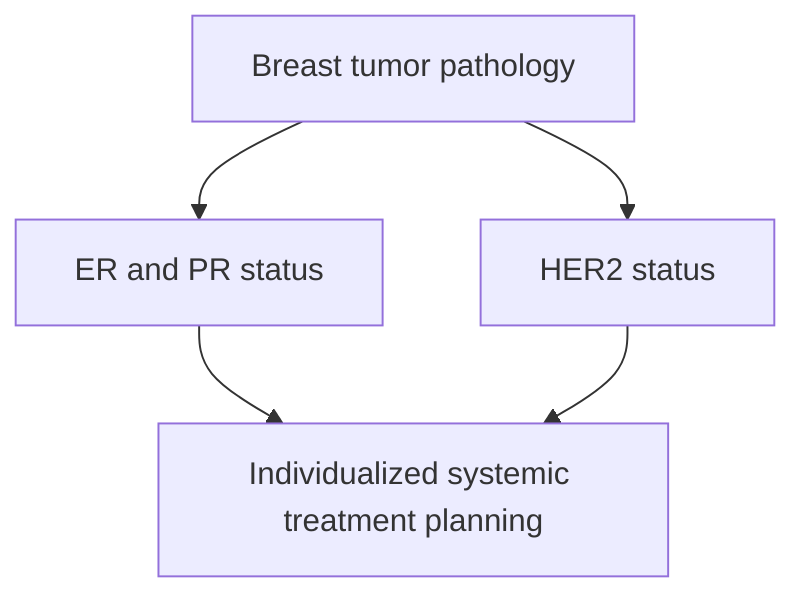

# Breast Disorders, Cancer Screening and Nursing Responsibilities — Original MCQs Q21–Q40

**Advance-preparation, unattempted.** Original practice, not authenticated PYQs. Indian programme and international clinical guidance are distinguished.

[Chapter](../README.md) · [Q1–Q20](09-Breast-Disorders-Cancer-Screening-and-Nursing-Responsibilities-20-MCQs.md) · [PYQ research](../Previous-Year-Questions/Gynecological-and-Reproductive-Nursing-Past-Paper-Research-Register.md)

## Part 5 — Q21–Q25

### Q21. A healthy 38-year-old attends an Indian NHM population-based breast screening camp. According to the cited medical officer training module, which routine method and interval apply to eligible women aged 30–65?

**Difficulty:** 🟡 Medium · **Priority:** 🟠 HIGH YIELD · **Evidence:** Original practice · **Exam focus:** NORCET / Staff Nurse / CHO

- **A.** Annual breast MRI for everyone
- **B.** Routine yearly bilateral biopsy
- **C.** Clinical breast examination every five years
- **D.** Monthly mammography for every beneficiary

✅ Answer aur detailed A–D Hinglish explanation

**Correct: C. Clinical breast examination every five years**

- **A kyun galat hai:** MRI selected high-risk ya diagnostic cases mein use hota hai, cited programme mein sabke liye nahi.
- **B kyun galat hai:** Biopsy suspicious tissue ko diagnose karti hai. Healthy women ka routine bilateral biopsy programme nahi hai.
- **C kyun sahi hai:** CBE mein trained health worker inspection aur palpation se breast changes check karta hai. NHM module mein 30–65 years ke liye five-year interval diya hai. Symptoms ho toh routine screening date ka wait mat karo.
- **D kyun galat hai:** Monthly mammography cited Indian primary-care screening schedule nahi hai.

**Exam clue:** India programme CBE differs from mammography programmes.

**Clinical reference:** [NHM India training module](https://nhm.gov.in/New-Update-2025-26/Whats-new/NCD-Medical-Officers.pdf)

**YouTube MCQ practice:** Verification pending. No specific question-solving video established.

### Q22. At an Indian primary health facility a nurse finds a suspicious breast mass during screening. Which programme action is appropriate?

**Difficulty:** 🟡 Medium · **Priority:** 🟠 HIGH YIELD · **Evidence:** Original practice · **Exam focus:** NORCET / Staff Nurse / CHO

- **A.** Refer for diagnostic assessment and track completion
- **B.** Repeat routine screening after five years only
- **C.** Declare metastatic cancer immediately
- **D.** Start chemotherapy before diagnosis

✅ Answer aur detailed A–D Hinglish explanation

**Correct: A. Refer for diagnostic assessment and track completion**

- **A kyun sahi hai:** Positive CBE se suspicion hota hai, confirmation nahi. Linked facility indicated ultrasound aur tissue biopsy arrange kar sakti hai. Nurse referral aur follow-up facilitate kare.
- **B kyun galat hai:** Suspicious finding ko routine interval tak delay karna unsafe ho sakta hai.
- **C kyun galat hai:** Metastasis confirm karne ke liye appropriate diagnosis aur staging chahiye.
- **D kyun galat hai:** Chemotherapy pathology aur specialist treatment plan ke baad select hoti hai.

**Exam clue:** Positive screen is a referral trigger, not a diagnosis.

**Clinical reference:** [NHM India training module](https://nhm.gov.in/New-Update-2025-26/Whats-new/NCD-Medical-Officers.pdf)

**YouTube MCQ practice:** Verification pending. No specific question-solving video established.

### Q23. A core biopsy reports ductal carcinoma in situ (DCIS). What distinguishes this from invasive ductal carcinoma?

**Difficulty:** 🟡 Medium · **Priority:** 🟠 HIGH YIELD · **Evidence:** Original practice · **Exam focus:** NORCET / Staff Nurse / CHO

- **A.** Distant metastasis is always present
- **B.** Only benign inflammation is present
- **C.** DCIS means the tumor is HER2-positive
- **D.** Abnormal cells remain confined to ducts without stromal invasion

✅ Answer aur detailed A–D Hinglish explanation

**Correct: D. Abnormal cells remain confined to ducts without stromal invasion**

- **A kyun galat hai:** Distant metastasis ka meaning remote organ spread hai. DCIS iski definition nahi hai.
- **B kyun galat hai:** DCIS abnormal neoplastic cells ka finding hai, simple inflammation nahi.
- **C kyun galat hai:** HER2 status separate biomarker hai. DCIS word se HER2 positivity determine nahi hoti.
- **D kyun sahi hai:** In situ ka matlab cells original duct ke andar limited hain. Surrounding stroma invade nahi hua hai. Management specialist disease features se decide karta hai.

**Exam clue:** In situ = no invasion beyond the duct.

**Clinical reference:** [NCI breast cancer guidance](https://www.cancer.gov/types/breast/hp/breast-treatment-pdq)

**YouTube MCQ practice:** Verification pending. [Breast Cancer Nursing MCQ — indexed topic lead](https://www.youtube.com/watch?v=6S-iTJzWKyw). Exact item, channel and playback not verified.

### Q24. Why are ER, PR and HER2 results included in an invasive breast cancer pathology report?

**Difficulty:** 🟡 Medium · **Priority:** 🟠 HIGH YIELD · **Evidence:** Original practice · **Exam focus:** NORCET / Staff Nurse / CHO

- **A.** To measure renal filtration
- **B.** To characterize the tumor and guide systemic treatment
- **C.** To replace all staging investigations
- **D.** To determine ABO blood group

✅ Answer aur detailed A–D Hinglish explanation

**Correct: B. To characterize the tumor and guide systemic treatment**

- **A kyun galat hai:** Kidney filtration creatinine aur eGFR se assess hoti hai.
- **B kyun sahi hai:** ER aur PR hormone receptors hain, HER2 growth-related protein hai. Inki status se endocrine aur targeted treatment select karne mein help milti hai. Stage aur patient factors bhi matter karte hain.
- **C kyun galat hai:** Biomarkers clinical assessment aur staging ke complementary hain, replacement nahi.
- **D kyun galat hai:** ABO blood group alag blood testing se determine hota hai.

**Exam clue:** Biomarkers guide individualized treatment.

Stage aur clinical factors bhi treatment selection mein important hain.

**Clinical reference:** [NCI breast cancer guidance](https://www.cancer.gov/types/breast/diagnosis/breast-cancer-biomarker-tests)

**YouTube MCQ practice:** Verification pending. [Breast Cancer Nursing MCQ — indexed topic lead](https://www.youtube.com/watch?v=6S-iTJzWKyw). Exact item, channel and playback not verified.

### Q25. A patient with ER-positive breast cancer is prescribed endocrine therapy. What is its therapeutic rationale?

**Difficulty:** 🟡 Medium · **Priority:** 🟠 HIGH YIELD · **Evidence:** Original practice · **Exam focus:** NORCET / Staff Nurse / CHO

- **A.** Destroy bacteria within tumor tissue
- **B.** Reduce estrogen signaling that can stimulate susceptible cancer cells
- **C.** Increase estrogen stimulation of tumor cells
- **D.** Replace surgery at every stage

✅ Answer aur detailed A–D Hinglish explanation

**Correct: B. Reduce estrogen signaling that can stimulate susceptible cancer cells**

- **A kyun galat hai:** Cancer bacterial infection nahi hai. Endocrine therapy antibiotic mechanism se kaam nahi karti.
- **B kyun sahi hai:** ER-positive cells estrogen signal se grow kar sakti hain. Endocrine treatment estrogen action ya production kam karke growth control mein help karti hai. Regimen individual patient par depend karta hai.
- **C kyun galat hai:** Estrogen stimulation badhana is treatment ka goal nahi hai.
- **D kyun galat hai:** Endocrine therapy surgery ko automatically har case mein replace nahi karti.

**Exam clue:** ER positivity may predict endocrine treatment benefit.

**Clinical reference:** [NCI breast cancer guidance](https://www.cancer.gov/types/breast/diagnosis/breast-cancer-biomarker-tests)

**YouTube MCQ practice:** Verification pending. [Breast Cancer Nursing MCQ — indexed topic lead](https://www.youtube.com/watch?v=6S-iTJzWKyw). Exact item, channel and playback not verified.

## Part 6 — Q26–Q30

### Q26. A woman has HER2-positive invasive breast cancer. Which treatment class specifically addresses this biomarker?

**Difficulty:** 🟡 Medium · **Priority:** 🟠 HIGH YIELD · **Evidence:** Original practice · **Exam focus:** NORCET / Staff Nurse / CHO

- **A.** Antifungal monotherapy
- **B.** Iron alone
- **C.** Antihistamine monotherapy
- **D.** HER2-directed targeted treatment if clinically indicated

✅ Answer aur detailed A–D Hinglish explanation

**Correct: D. HER2-directed targeted treatment if clinically indicated**

- **A kyun galat hai:** Antifungal medicines fungal infection treat karti hain, HER2 signaling nahi.
- **B kyun galat hai:** Iron anemia treat kar sakta hai, cancer biomarker ko target nahi karta.
- **C kyun galat hai:** Antihistamine allergy symptoms ke liye hai, HER2 treatment nahi.
- **D kyun sahi hai:** HER2-related growth signaling ko target karne wali medicines, jaise suitable cases mein trastuzumab, tumor control mein help kar sakti hain. Prescribed cardiac monitoring bhi important ho sakti hai.

**Exam clue:** HER2 status can guide targeted therapy.

**Clinical reference:** [NCI breast cancer guidance](https://www.cancer.gov/types/breast/hp/breast-treatment-pdq)

**YouTube MCQ practice:** Verification pending. [Breast Cancer Nursing MCQ — indexed topic lead](https://www.youtube.com/watch?v=6S-iTJzWKyw). Exact item, channel and playback not verified.

### Q27. A tumor tests negative for ER, PR and HER2. Which classification applies?

**Difficulty:** 🟢 Easy · **Priority:** 🟠 HIGH YIELD · **Evidence:** Original practice · **Exam focus:** NORCET / Staff Nurse / CHO

- **A.** Triple-negative breast cancer
- **B.** Hormone receptor-positive breast cancer
- **C.** HER2-amplified breast cancer
- **D.** Duct ectasia

✅ Answer aur detailed A–D Hinglish explanation

**Correct: A. Triple-negative breast cancer**

- **A kyun sahi hai:** Triple-negative mein teen standard biomarkers ER, PR aur HER2 negative hote hain. Stage aur other biomarkers treatment decide karte hain.
- **B kyun galat hai:** ER aur PR dono negative hain, so hormone receptor-positive classification fit nahi karti.
- **C kyun galat hai:** HER2 negative finding HER2 amplification establish nahi karti.
- **D kyun galat hai:** Duct ectasia benign duct disorder hai, tumor biomarker classification nahi.

**Exam clue:** Triple negative = ER−, PR−, HER2−.

**Clinical reference:** [NCI breast cancer guidance](https://www.cancer.gov/types/breast/diagnosis/breast-cancer-biomarker-tests)

**YouTube MCQ practice:** Verification pending. [Breast Cancer Nursing MCQ — indexed topic lead](https://www.youtube.com/watch?v=6S-iTJzWKyw). Exact item, channel and playback not verified.

### Q28. A patient with clinically node-negative invasive breast cancer is scheduled for sentinel lymph node biopsy. What is its main purpose?

**Difficulty:** 🟡 Medium · **Priority:** 🟠 HIGH YIELD · **Evidence:** Original practice · **Exam focus:** NORCET / Staff Nurse / CHO

- **A.** Remove all axillary nodes in every patient
- **B.** Measure breast milk production
- **C.** Sample the first draining nodes to assess regional spread
- **D.** Treat distant metastasis alone

✅ Answer aur detailed A–D Hinglish explanation

**Correct: C. Sample the first draining nodes to assess regional spread**

- **A kyun galat hai:** Sentinel biopsy selected nodes sample karti hai. Complete axillary dissection alag procedure hai.
- **B kyun galat hai:** Milk production lymph node biopsy se measure nahi hoti.
- **C kyun sahi hai:** Tumor se lymph pehle kuch regional nodes tak drain hoti hai. In sentinel nodes ki pathology regional spread aur further treatment decisions mein help karti hai.
- **D kyun galat hai:** Regional sampling systemic treatment ka replacement nahi.

**Exam clue:** Sentinel node = first draining node or nodes.

**Clinical reference:** [NCI breast cancer guidance](https://www.cancer.gov/about-cancer/diagnosis-staging/staging/sentinel-node-biopsy-fact-sheet)

**YouTube MCQ practice:** Verification pending. [Breast Cancer Nursing MCQ — indexed topic lead](https://www.youtube.com/watch?v=6S-iTJzWKyw). Exact item, channel and playback not verified.

### Q29. When sentinel node biopsy is appropriate rather than full axillary dissection, what potential benefit should be explained?

**Difficulty:** 🔴 Difficult · **Priority:** 🔴 MOST IMPORTANT · **Evidence:** Original practice · **Exam focus:** NORCET / Staff Nurse / CHO

- **A.** Guaranteed absence of lymphedema
- **B.** Proof that distant organs are disease-free
- **C.** Absence of all surgical risks
- **D.** Less morbidity from extensive lymph node removal

✅ Answer aur detailed A–D Hinglish explanation

**Correct: D. Less morbidity from extensive lymph node removal**

- **A kyun galat hai:** Lymphedema ka risk kam ho sakta hai lekin zero nahi.
- **B kyun galat hai:** Regional nodes ki sampling distant metastasis exclude nahi karti.
- **C kyun galat hai:** Infection, bleeding aur other procedural risks possible hain.
- **D kyun sahi hai:** Fewer nodes remove karne se lymphatic drainage disruption aur arm-related morbidity kam ho sakti hai. Suitability tumor aur nodal findings se decide hoti hai.

**Exam clue:** Less extensive axillary surgery can reduce morbidity.

**Clinical reference:** [NCI breast cancer guidance](https://www.cancer.gov/about-cancer/diagnosis-staging/staging/sentinel-node-biopsy-fact-sheet)

**YouTube MCQ practice:** Verification pending. [Breast Cancer Nursing MCQ — indexed topic lead](https://www.youtube.com/watch?v=6S-iTJzWKyw). Exact item, channel and playback not verified.

### Q30. After breast-conserving surgery, why may adjuvant radiotherapy be recommended?

**Difficulty:** 🟡 Medium · **Priority:** 🟠 HIGH YIELD · **Evidence:** Original practice · **Exam focus:** NORCET / Staff Nurse / CHO

- **A.** Reduce recurrence in the treated breast or regional area
- **B.** Improve milk production
- **C.** Replace pathology assessment
- **D.** Prevent all distant metastases by itself

✅ Answer aur detailed A–D Hinglish explanation

**Correct: A. Reduce recurrence in the treated breast or regional area**

- **A kyun sahi hai:** Radiation microscopic residual tumor cells ko target karke local recurrence ka risk kam karti hai. Indication multidisciplinary team decide karti hai.
- **B kyun galat hai:** Radiotherapy ka goal lactation improve karna nahi.
- **C kyun galat hai:** Pathology se margins aur tumor features assess hote hain. Radiation report replace nahi karti.
- **D kyun galat hai:** Local radiation distant disease ke systemic treatment ka substitute nahi.

**Exam clue:** Adjuvant radiation improves local control.

**Clinical reference:** [NCI breast cancer guidance](https://www.cancer.gov/types/breast/treatment/radiation)

**YouTube MCQ practice:** Verification pending. [Breast Cancer Nursing MCQ — indexed topic lead](https://www.youtube.com/watch?v=6S-iTJzWKyw). Exact item, channel and playback not verified.

## Part 7 — Q31–Q35

### Q31. A woman receives systemic chemotherapy before planned breast cancer surgery. What is this treatment timing called?

**Difficulty:** 🟢 Easy · **Priority:** 🟠 HIGH YIELD · **Evidence:** Original practice · **Exam focus:** NORCET / Staff Nurse / CHO

- **A.** Adjuvant therapy after surgery
- **B.** Maintenance screening
- **C.** Neoadjuvant therapy
- **D.** Palliative treatment by definition

✅ Answer aur detailed A–D Hinglish explanation

**Correct: C. Neoadjuvant therapy**

- **A kyun galat hai:** Adjuvant treatment primary surgery ke baad diya jaata hai.
- **B kyun galat hai:** Screening asymptomatic disease detect karti hai. Chemotherapy treatment hai.
- **C kyun sahi hai:** Neoadjuvant treatment operation se pehle diya jaata hai. Selected tumors shrink ho sakte hain aur treatment response assess ho sakta hai.
- **D kyun galat hai:** Preoperative therapy necessarily palliative nahi hoti. Intent stage aur plan se decide hota hai.

**Exam clue:** Neoadjuvant = before primary surgery.

**Clinical reference:** [NCI breast cancer guidance](https://www.cancer.gov/types/breast/hp/breast-treatment-pdq)

**YouTube MCQ practice:** Verification pending. [Breast Cancer Nursing MCQ — indexed topic lead](https://www.youtube.com/watch?v=6S-iTJzWKyw). Exact item, channel and playback not verified.

### Q32. Invasive tumor cells are present at an inked surgical margin after breast-conserving surgery. What does this finding require?

**Difficulty:** 🔴 Difficult · **Priority:** 🔴 MOST IMPORTANT · **Evidence:** Original practice · **Exam focus:** NORCET / Staff Nurse / CHO

- **A.** Declaration that the specimen is benign
- **B.** Surgical team assessment of whether further local treatment is needed
- **C.** Confirmation of stage IV cancer
- **D.** Reassurance that recurrence is impossible

✅ Answer aur detailed A–D Hinglish explanation

**Correct: B. Surgical team assessment of whether further local treatment is needed**

- **A kyun galat hai:** Invasive cells benign finding nahi hain.
- **B kyun sahi hai:** Inked margin specimen ki cut boundary hai. Tumor edge par milne se residual local disease ka concern hota hai. Surgeon re-excision ya other management individual context mein consider karega.
- **C kyun galat hai:** Positive margin distant metastasis establish nahi karta.
- **D kyun galat hai:** Positive margin ke baad permanent cure guarantee nahi kar sakte.

**Exam clue:** Positive margin affects local treatment planning.

**Clinical reference:** [NCI breast cancer guidance](https://www.cancer.gov/types/breast/hp/breast-treatment-pdq)

**YouTube MCQ practice:** Verification pending. [Breast Cancer Nursing MCQ — indexed topic lead](https://www.youtube.com/watch?v=6S-iTJzWKyw). Exact item, channel and playback not verified.

### Q33. After routine external-beam breast radiotherapy, what should a nurse explain about radiation exposure to family members?

**Difficulty:** 🟡 Medium · **Priority:** 🟠 HIGH YIELD · **Evidence:** Original practice · **Exam focus:** NORCET / Staff Nurse / CHO

- **A.** The patient does not retain a radioactive source from external-beam treatment
- **B.** Permanent isolation from children is required
- **C.** Lead shielding at home is required for life
- **D.** All family contact must be avoided for six months

✅ Answer aur detailed A–D Hinglish explanation

**Correct: A. The patient does not retain a radioactive source from external-beam treatment**

- **A kyun sahi hai:** External machine treatment ke time radiation deliver karti hai. Session ke baad radioactive source patient ke andar nahi rehta. Internal radiation procedures ki precautions different ho sakti hain.
- **B kyun galat hai:** External-beam therapy ke reason se permanent isolation required nahi.
- **C kyun galat hai:** Lifetime home shielding routine instruction nahi hai.
- **D kyun galat hai:** External-beam treatment ke baad six-month family restriction standard nahi hai.

**Exam clue:** External beam does not make the patient radioactive.

**Clinical reference:** [NCI breast cancer guidance](https://www.cancer.gov/types/breast/treatment/radiation)

**YouTube MCQ practice:** Verification pending. [Breast Cancer Nursing MCQ — indexed topic lead](https://www.youtube.com/watch?v=6S-iTJzWKyw). Exact item, channel and playback not verified.

### Q34. Mild erythema develops in the treated breast skin during radiotherapy. Which nursing instruction is appropriate?

**Difficulty:** 🟡 Medium · **Priority:** 🟠 HIGH YIELD · **Evidence:** Original practice · **Exam focus:** NORCET / Staff Nurse / CHO

- **A.** Scrub the area with an abrasive brush
- **B.** Apply an unapproved caustic agent
- **C.** Stop all cancer treatment without notifying the team
- **D.** Follow gentle skin-care instructions and report worsening breakdown

✅ Answer aur detailed A–D Hinglish explanation

**Correct: D. Follow gentle skin-care instructions and report worsening breakdown**

- **A kyun galat hai:** Vigorous scrubbing irritation worsen kar sakti hai.
- **B kyun galat hai:** Caustic agent skin injury badha sakta hai.
- **C kyun galat hai:** Treatment adjustment oncology team ke saath discuss karna chahiye.
- **D kyun sahi hai:** Irradiated skin sensitive ho sakti hai. Gentle cleansing aur prescribed skin care barrier protect karte hain. Worsening pain, open moist skin ya infection concern report karein.

**Exam clue:** Use protocol-based gentle skin care.

**Clinical reference:** [NCI breast cancer guidance](https://www.cancer.gov/types/breast/treatment/radiation)

**YouTube MCQ practice:** Verification pending. [Breast Cancer Nursing MCQ — indexed topic lead](https://www.youtube.com/watch?v=6S-iTJzWKyw). Exact item, channel and playback not verified.

### Q35. Why may core needle biopsy be preferred over aspiration cytology alone for a suspicious solid breast lesion?

**Difficulty:** 🟡 Medium · **Priority:** 🟠 HIGH YIELD · **Evidence:** Original practice · **Exam focus:** NORCET / Staff Nurse / CHO

- **A.** Core biopsy never requires pathology
- **B.** Core biopsy provides tissue architecture for histological assessment
- **C.** Aspiration always provides complete architecture
- **D.** Core biopsy determines full stage alone

✅ Answer aur detailed A–D Hinglish explanation

**Correct: B. Core biopsy provides tissue architecture for histological assessment**

- **A kyun galat hai:** Core sample pathology evaluation ke liye hi bheja jaata hai.
- **B kyun sahi hai:** Core sample mein tissue ke small cylinders milte hain. Pathologist cell arrangement, invasion aur indicated biomarkers assess kar sakta hai.
- **C kyun galat hai:** Fine needle aspiration mainly cells collect karti hai. Full tissue architecture hamesha available nahi.
- **D kyun galat hai:** Diagnosis ke baad staging ke liye other clinical data bhi chahiye.

**Exam clue:** Core biopsy preserves tissue architecture.

**Clinical reference:** [NCI breast cancer guidance](https://www.cancer.gov/types/breast/diagnosis)

**YouTube MCQ practice:** Verification pending. [Breast Cancer Nursing MCQ — indexed topic lead](https://www.youtube.com/watch?v=6S-iTJzWKyw). Exact item, channel and playback not verified.

## Part 8 — Q36–Q40

### Q36. A woman reports bilateral milky nipple discharge only on expression, without a mass. Which initial assessment is most appropriate?

**Difficulty:** 🔴 Difficult · **Priority:** 🔴 MOST IMPORTANT · **Evidence:** Original practice · **Exam focus:** NORCET / Staff Nurse / CHO

- **A.** Diagnose cancer solely from discharge colour
- **B.** Recommend repeated squeezing throughout the day
- **C.** Review pregnancy, lactation, medicines and other relevant causes
- **D.** Arrange immediate surgery for every case

✅ Answer aur detailed A–D Hinglish explanation

**Correct: C. Review pregnancy, lactation, medicines and other relevant causes**

- **A kyun galat hai:** Colour alone cancer establish nahi karta.
- **B kyun galat hai:** Repeated nipple stimulation discharge maintain kar sakti hai.
- **C kyun sahi hai:** Milky discharge pregnancy, lactation, prolactin-related disorders aur medicines se ho sakti hai. Pattern aur associated symptoms assess karke tests decide karo.
- **D kyun galat hai:** Physiologic ya endocrine discharge mein surgery routine first step nahi.

**Exam clue:** Discharge assessment depends on pattern and context.

**Clinical reference:** [ACR discharge evaluation](https://acsearch.acr.org/docs/3099312/Narrative/)

**YouTube MCQ practice:** Verification pending. No specific question-solving video established.

### Q37. A breastfeeding mother with inflammatory breast swelling asks whether vigorous massage will break up a blockage. Which advice is safer?

**Difficulty:** 🔴 Difficult · **Priority:** 🔴 MOST IMPORTANT · **Evidence:** Original practice · **Exam focus:** NORCET / Staff Nurse / CHO

- **A.** Press until bruising develops
- **B.** Pump excessively to empty every last drop
- **C.** Avoid deep aggressive massage and discuss gentle supportive care
- **D.** Ignore worsening symptoms

✅ Answer aur detailed A–D Hinglish explanation

**Correct: C. Avoid deep aggressive massage and discuss gentle supportive care**

- **A kyun galat hai:** Bruising tissue damage ka sign hai, goal nahi.
- **B kyun galat hai:** Excessive pumping supply aur swelling worsen kar sakti hai. Individual feeding advice chahiye.
- **C kyun sahi hai:** Mastitis spectrum mein inflammation aur tissue edema ho sakte hain. Deep pressure injury aur swelling worsen kar sakta hai. Gentle care aur clinical review appropriate hain.
- **D kyun galat hai:** Persistent fever, worsening pain ya mass par medical review important hai.

**Exam clue:** Avoid aggressive massage with inflammatory mastitis.

**Clinical reference:** [ABM protocol 36 directory](https://www.breastfeedingmedicine.com/protocols)

**YouTube MCQ practice:** Verification pending. No specific question-solving video established.

### Q38. A lactating patient has a confirmed breast abscess with prescribed drainage and antibiotics. What should the nurse emphasize?

**Difficulty:** 🔴 Difficult · **Priority:** 🔴 MOST IMPORTANT · **Evidence:** Original practice · **Exam focus:** NORCET / Staff Nurse / CHO

- **A.** Antibiotics alone always eliminate every abscess
- **B.** Follow the drainage plan and support feeding as clinically appropriate
- **C.** Squeeze the abscess at home
- **D.** Ignore persistent fever after drainage

✅ Answer aur detailed A–D Hinglish explanation

**Correct: B. Follow the drainage plan and support feeding as clinically appropriate**

- **A kyun galat hai:** Pus collection mein antibiotics alone sufficient nahi ho sakti.
- **B kyun sahi hai:** Abscess mein pus collect hota hai. Trained provider drainage se source control karta hai. Feeding often continue ho sakti hai if infant infected drainage se contact na kare aur team advice follow ho.
- **C kyun galat hai:** Home squeezing injury aur infection worsen kar sakti hai.
- **D kyun galat hai:** Persistent fever treatment failure ya complication ka sign ho sakta hai.

**Exam clue:** Abscess often needs drainage and individualized lactation support.

**Clinical reference:** [ABM protocol 36 directory](https://www.breastfeedingmedicine.com/protocols)

**YouTube MCQ practice:** Verification pending. No specific question-solving video established.

### Q39. Diffuse breast redness and swelling progress despite appropriate treatment for suspected infection. What is the priority?

**Difficulty:** 🔴 Difficult · **Priority:** 🔴 MOST IMPORTANT · **Evidence:** Original practice · **Exam focus:** NORCET / Staff Nurse / CHO

- **A.** Repeat empirical antibiotics indefinitely
- **B.** Reassure because there is no distinct palpable lump
- **C.** Diagnose uncomplicated cyclical mastalgia
- **D.** Prompt specialist assessment for inflammatory breast cancer or other causes

✅ Answer aur detailed A–D Hinglish explanation

**Correct: D. Prompt specialist assessment for inflammatory breast cancer or other causes**

- **A kyun galat hai:** Bina reassessment repeated antibiotics diagnosis delay kar sakti hain.
- **B kyun galat hai:** No lump does not exclude inflammatory breast cancer.
- **C kyun galat hai:** Cyclical mastalgia menstrual pattern follow karti hai, progressive skin edema ko adequately explain nahi karti.
- **D kyun sahi hai:** Rapid inflammatory changes aur treatment failure concerning hain. Inflammatory cancer lump ke bina bhi present ho sakta hai. Specialist imaging aur indicated biopsy decide karega.

**Exam clue:** Nonresolving inflammatory changes require diagnostic reassessment.

**Clinical reference:** [NCI breast cancer guidance](https://www.cancer.gov/types/breast/symptoms)

**YouTube MCQ practice:** Verification pending. No specific question-solving video established.

### Q40. A newly diagnosed breast cancer has high histological grade. Does this alone establish distant metastasis?

**Difficulty:** 🟡 Medium · **Priority:** 🟠 HIGH YIELD · **Evidence:** Original practice · **Exam focus:** NORCET / Staff Nurse / CHO

- **A.** No. Grade describes tumor cell features, while stage describes extent using relevant criteria
- **B.** Yes. Grade and stage are identical
- **C.** Yes. Grade measures breast size
- **D.** Yes. Every high-grade tumor is stage IV

✅ Answer aur detailed A–D Hinglish explanation

**Correct: A. No. Grade describes tumor cell features, while stage describes extent using relevant criteria**

- **A kyun sahi hai:** Grade microscope par cells ki abnormal appearance aur growth-related features describe karta hai. Stage extent, regional nodes, distant spread aur relevant staging criteria se determine hoti hai.
- **B kyun galat hai:** Grade aur stage alag information dete hain.
- **C kyun galat hai:** Grade breast size ka measurement nahi.
- **D kyun galat hai:** High grade aggressive biology suggest kar sakta hai, but distant metastasis prove nahi karta.

**Exam clue:** Grade is not stage.

**Clinical reference:** [NCI breast cancer guidance](https://www.cancer.gov/types/breast/diagnosis)

**YouTube MCQ practice:** Verification pending. No specific question-solving video established.

## Evidence notes

NCI and ACR search excerpts and NHM training module indexed text reviewed. ABM protocol directory identifies protocol 36. Full NHM and ABM PDF visual inspection pending. No official PYQ claimed. Exact item video verification, independent clinical and semantic audit, and Mermaid rendering pending.
