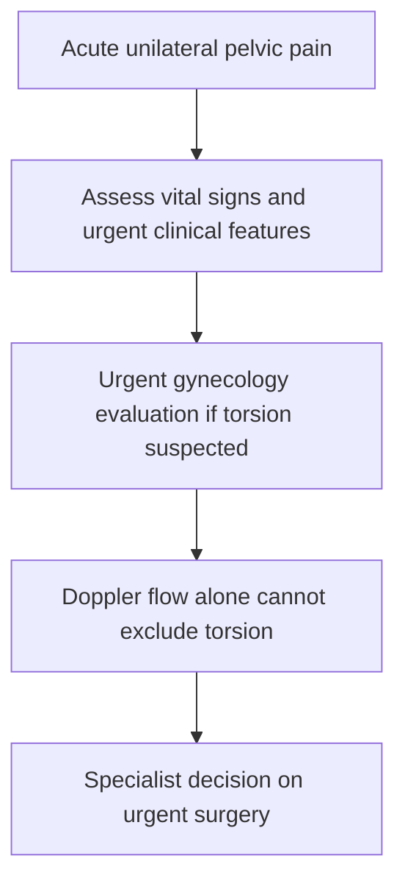

# PCOS, Ovarian Cysts and Hormonal Disorders — Original MCQs Q21–Q40

**Advance-preparation, unattempted.** Original practice, not authenticated historical questions. Named international guidelines and update dates apply to the questions. Clinical decisions require local protocols and individual review.

[Chapter](../README.md) · [Q1–Q20](10-PCOS-Ovarian-Cysts-and-Hormonal-Disorders-20-MCQs.md) · [Previous Year Questions research](../Previous-Year-Questions/Gynecological-and-Reproductive-Nursing-Past-Paper-Research-Register.md)

## Part 5 — Q21–Q25

### Q21. A 13-year-old had menarche eight months ago and reports variable cycle lengths without clinical androgen excess or other concerning findings. Under the 2023 international PCOS guideline, what is the most appropriate interpretation?

**Difficulty:** 🟡 Medium · **Priority:** 🟠 HIGH YIELD · **Evidence:** Original practice · **Exam focus:** NORCET / Staff Nurse / CHO

- **A.** Irregularity alone establishes PCOS
- **B.** Cycle irregularity can be physiological during the first year after menarche
- **C.** A single ovarian cyst establishes PCOS
- **D.** Begin fertility drugs solely because cycles are variable

✅ Answer aur detailed A–D Hinglish explanation

**Correct: B. Cycle irregularity can be physiological during the first year after menarche**

- **A kyun galat hai:** Irregular cycles alone diagnosis ke liye sufficient nahi hain. Adolescent assessment ke specific criteria hain.
- **B kyun sahi hai:** Menarche pehli menstrual bleeding ko kehte hain. Pehle saal brain aur ovarian hormonal coordination mature ho rahi hoti hai, isliye cycles irregular ho sakte hain. Symptoms aur red flags assess karo, bina criteria complete hue PCOS label mat lagao.
- **C kyun galat hai:** Ek cyst PCOS ki diagnostic definition nahi hai. Other features aur differential causes assess hote hain.
- **D kyun galat hai:** Fertility drugs ka indication adolescent irregularity alone se establish nahi hota.

**Exam clue:** First year after menarche has a distinct physiological context.

**Clinical reference:** [2023 international PCOS guideline via ASRM](https://integration.asrm.org/practice-guidance/practice-committee-documents/recommendations-from-the-2023-international-evidence-based-guideline-for-the-assessment-and-management-of-polycystic-ovary-syndrome/)

**YouTube MCQ practice:** Specific question-solving coverage not verified. Pending.

### Q22. An adolescent two years after menarche has repeated 55-day cycles. Which action is supported by the 2023 PCOS guideline?

**Difficulty:** 🔴 Difficult · **Priority:** 🔴 MOST IMPORTANT · **Evidence:** Original practice · **Exam focus:** NORCET / Staff Nurse / CHO

- **A.** Assume the finding is normal until age 30
- **B.** Confirm PCOS solely from one ultrasound
- **C.** Give a permanent infertility diagnosis
- **D.** Assess persistent cycle irregularity and possible causes, including PCOS, without diagnosing it from cycle length alone

✅ Answer aur detailed A–D Hinglish explanation

**Correct: D. Assess persistent cycle irregularity and possible causes, including PCOS, without diagnosing it from cycle length alone**

- **A kyun galat hai:** Is age group mein persistent prolonged cycles ko indefinitely ignore nahi karna chahiye.
- **B kyun galat hai:** Adolescent ultrasound appearance PCOS diagnosis ke liye reliable criterion nahi hai.
- **C kyun galat hai:** Irregular ovulation future fertility ko affect kar sakti hai, lekin permanent infertility prove nahi karti.
- **D kyun sahi hai:** Menarche ke 1–3 years baad 45 days se longer cycles irregularity ka criterion hain. Persistent 55-day cycles assessment justify karte hain. Androgen excess, pregnancy where relevant aur other causes evaluate karo.

**Exam clue:** At 1 to under 3 years postmenarche, cycles over 45 days merit assessment.

**Clinical reference:** [2023 international PCOS guideline via ASRM](https://integration.asrm.org/practice-guidance/practice-committee-documents/recommendations-from-the-2023-international-evidence-based-guideline-for-the-assessment-and-management-of-polycystic-ovary-syndrome/)

**YouTube MCQ practice:** Specific question-solving coverage not verified. Pending.

### Q23. An adult has persistent ovulatory dysfunction and clear clinical hyperandrogenism after exclusion of alternative causes. Which further test is not necessarily required solely to establish PCOS?

**Difficulty:** 🔴 Difficult · **Priority:** 🔴 MOST IMPORTANT · **Evidence:** Original practice · **Exam focus:** NORCET / Staff Nurse / CHO

- **A.** Ovarian morphology assessment by ultrasound or AMH
- **B.** Appropriate pregnancy assessment when relevant
- **C.** Evaluation of suspected alternative endocrine causes
- **D.** Clinical review of relevant medical history

✅ Answer aur detailed A–D Hinglish explanation

**Correct: A. Ovarian morphology assessment by ultrasound or AMH**

- **A kyun sahi hai:** Adult diagnostic algorithm mein irregular cycles aur androgen excess dono criteria present hon toh ultrasound ya AMH se third feature establish karna necessary nahi. Other causes exclude karna ab bhi important hai.
- **B kyun galat hai:** Pregnancy possible ho toh menstrual irregularity ka assessment karte waqt pregnancy status clinically relevant hai.
- **C kyun galat hai:** Thyroid, prolactin aur other disorders PCOS jaisi features de sakte hain. Indicated assessment omit nahi karna.
- **D kyun galat hai:** Medicine use, cycle pattern aur symptoms diagnostic reasoning ka part hain.

**Exam clue:** Two qualifying adult features can suffice after exclusion of mimics.

**Clinical reference:** [2023 international PCOS guideline via ASRM](https://integration.asrm.org/practice-guidance/practice-committee-documents/recommendations-from-the-2023-international-evidence-based-guideline-for-the-assessment-and-management-of-polycystic-ovary-syndrome/)

**YouTube MCQ practice:** Specific question-solving coverage not verified. Pending.

### Q24. A woman asks whether an elevated anti-Müllerian hormone (AMH) result by itself confirms PCOS. Which explanation is correct?

**Difficulty:** 🔴 Difficult · **Priority:** 🔴 MOST IMPORTANT · **Evidence:** Original practice · **Exam focus:** NORCET / Staff Nurse / CHO

- **A.** Any elevated AMH confirms PCOS in every age group
- **B.** AMH directly proves insulin resistance
- **C.** AMH may help assess polycystic ovarian morphology in adults but is not a standalone diagnostic test
- **D.** AMH and ultrasound must both be performed in every patient

✅ Answer aur detailed A–D Hinglish explanation

**Correct: C. AMH may help assess polycystic ovarian morphology in adults but is not a standalone diagnostic test**

- **A kyun galat hai:** Age aur assay ke hisaab se AMH vary karta hai. Har elevated value PCOS nahi hai.
- **B kyun galat hai:** Insulin resistance glucose handling se related process hai. AMH iska direct diagnostic test nahi hai.
- **C kyun sahi hai:** AMH ovarian follicles se related hormone hai. Adult diagnostic algorithm mein morphology assessment ke alternative ke roop mein use ho sakta hai, lekin single result se PCOS confirm nahi hota. Adolescents mein diagnostic use recommended nahi.
- **D kyun galat hai:** Guideline unnecessary dual morphology testing se overdiagnosis avoid karne ko kehti hai.

**Exam clue:** AMH is not an independent PCOS diagnostic test.

**Clinical reference:** [2023 international PCOS guideline via ASRM](https://integration.asrm.org/practice-guidance/practice-committee-documents/recommendations-from-the-2023-international-evidence-based-guideline-for-the-assessment-and-management-of-polycystic-ovary-syndrome/)

**YouTube MCQ practice:** Specific question-solving coverage not verified. Pending.

### Q25. An adult with confirmed PCOS has a BMI in the healthy range and no known cardiovascular disease. Which baseline investigation is recommended for lipid risk assessment in the 2023 guideline?

**Difficulty:** 🟡 Medium · **Priority:** 🟠 HIGH YIELD · **Evidence:** Original practice · **Exam focus:** NORCET / Staff Nurse / CHO

- **A.** Lipid testing only if BMI exceeds 40
- **B.** Routine coronary angiography for every patient
- **C.** No cardiovascular risk assessment before menopause
- **D.** Lipid profile even at a healthy BMI

✅ Answer aur detailed A–D Hinglish explanation

**Correct: D. Lipid profile even at a healthy BMI**

- **A kyun galat hai:** BMI alone metabolic risk exclude nahi karta. High BMI ka wait karna recommended nahi.
- **B kyun galat hai:** Angiography invasive cardiac test hai. Asymptomatic patient mein routine PCOS baseline investigation nahi.
- **C kyun galat hai:** Cardiometabolic prevention reproductive age se relevant hai, menopause ka wait nahi.
- **D kyun sahi hai:** PCOS metabolic risk healthy BMI ke saath bhi ho sakta hai. Diagnosis par cholesterol, LDL, HDL aur triglycerides assess karna useful hai. Repeat frequency individual cardiovascular risk se decide hoti hai.

**Exam clue:** Baseline lipid assessment is not limited to obesity.

**Clinical reference:** [2023 international PCOS guideline via ASRM](https://integration.asrm.org/practice-guidance/practice-committee-documents/recommendations-from-the-2023-international-evidence-based-guideline-for-the-assessment-and-management-of-polycystic-ovary-syndrome/)

**YouTube MCQ practice:** Specific question-solving coverage not verified. Pending.

## Part 6 — Q26–Q30

### Q26. A woman with PCOS had normal glucose assessment at diagnosis and asks whether it ever needs repeating. What interval does the 2023 guideline recommend for reassessment based on individual risk?

**Difficulty:** 🟡 Medium · **Priority:** 🟠 HIGH YIELD · **Evidence:** Original practice · **Exam focus:** NORCET / Staff Nurse / CHO

- **A.** Only once in her lifetime
- **B.** Every one to three years
- **C.** Every hour indefinitely
- **D.** Only after menopause

✅ Answer aur detailed A–D Hinglish explanation

**Correct: B. Every one to three years**

- **A kyun galat hai:** Normal baseline result lifetime protection guarantee nahi karta.
- **B kyun sahi hai:** PCOS mein diabetes ka risk time ke saath change ho sakta hai. Guideline individual risk ke hisaab se glycemic status 1–3 years mein reassess karne ko kehti hai. Pregnancy planning ya symptoms par earlier assessment relevant ho sakta hai.
- **C kyun galat hai:** Hourly glucose testing routine asymptomatic screening schedule nahi hai.
- **D kyun galat hai:** Diabetes risk menopause se pehle bhi present hota hai.

**Exam clue:** Reassess glycemic status at risk-based intervals.

**Clinical reference:** [2023 international PCOS guideline via ASRM](https://integration.asrm.org/practice-guidance/practice-committee-documents/recommendations-from-the-2023-international-evidence-based-guideline-for-the-assessment-and-management-of-polycystic-ovary-syndrome/)

**YouTube MCQ practice:** Specific question-solving coverage not verified. Pending.

### Q27. A woman with PCOS and no known diabetes plans pregnancy. Her previous routine fasting glucose was normal. Which assessment should be discussed before fertility treatment?

**Difficulty:** 🔴 Difficult · **Priority:** 🔴 MOST IMPORTANT · **Evidence:** Original practice · **Exam focus:** NORCET / Staff Nurse / CHO

- **A.** No glucose assessment because fasting glucose was once normal
- **B.** Routine insulin injection to prevent gestational diabetes
- **C.** A 75-g oral glucose tolerance test according to the international PCOS guideline
- **D.** Urinary ketones as the sole screening test

✅ Answer aur detailed A–D Hinglish explanation

**Correct: C. A 75-g oral glucose tolerance test according to the international PCOS guideline**

- **A kyun galat hai:** Normal previous fasting glucose impaired glucose tolerance ko completely exclude nahi karta.
- **B kyun galat hai:** Bina diabetes diagnosis insulin routine prevention ke liye nahi diya jaata.
- **C kyun sahi hai:** OGTT mein glucose load ke baad body glucose kaise handle karti hai assess hota hai. PCOS pregnancy mein hyperglycemia risk badh sakta hai, isliye preconception OGTT consider karna important hai. Pregnancy mein prescribed repeat schedule alag hai.
- **D kyun galat hai:** Urine ketones glycemic tolerance ka recommended sole test nahi hain.

**Exam clue:** Preconception OGTT is a separate risk-assessment decision.

**Clinical reference:** [2023 international PCOS guideline via ASRM](https://integration.asrm.org/practice-guidance/practice-committee-documents/recommendations-from-the-2023-international-evidence-based-guideline-for-the-assessment-and-management-of-polycystic-ovary-syndrome/)

**YouTube MCQ practice:** Specific question-solving coverage not verified. Pending.

### Q28. A patient with PCOS wants fasting insulin measured monthly to guide all treatment decisions. What should the nurse explain?

**Difficulty:** 🟡 Medium · **Priority:** 🟠 HIGH YIELD · **Evidence:** Original practice · **Exam focus:** NORCET / Staff Nurse / CHO

- **A.** Routine insulin assays have limited clinical usefulness and are not recommended for routine PCOS care
- **B.** Fasting insulin alone establishes every PCOS diagnosis
- **C.** Insulin testing replaces lipid and glucose assessment
- **D.** Monthly insulin tests directly measure ovarian reserve

✅ Answer aur detailed A–D Hinglish explanation

**Correct: A. Routine insulin assays have limited clinical usefulness and are not recommended for routine PCOS care**

- **A kyun sahi hai:** Insulin resistance PCOS mein important ho sakti hai, lekin routine available insulin assays ki clinical utility limited hai. Glucose status aur cardiovascular risk ki recommended assessment zyada useful hai.
- **B kyun galat hai:** PCOS diagnosis multiple clinical features aur exclusion criteria se hota hai, insulin alone se nahi.
- **C kyun galat hai:** Lipid aur glucose tests distinct risk assess karte hain. Insulin measurement unhe replace nahi karta.
- **D kyun galat hai:** Ovarian reserve follicles se related hai. Fasting insulin directly reserve measure nahi karta.

**Exam clue:** Insulin resistance can matter without routine insulin assay monitoring.

**Clinical reference:** [2023 international PCOS guideline via ASRM](https://integration.asrm.org/practice-guidance/practice-committee-documents/recommendations-from-the-2023-international-evidence-based-guideline-for-the-assessment-and-management-of-polycystic-ovary-syndrome/)

**YouTube MCQ practice:** Specific question-solving coverage not verified. Pending.

### Q29. A woman taking long-term prescribed metformin for PCOS follows a strict vegan diet and develops tingling in her feet. Which nutritional deficiency merits assessment?

**Difficulty:** 🔴 Difficult · **Priority:** 🔴 MOST IMPORTANT · **Evidence:** Original practice · **Exam focus:** NORCET / Staff Nurse / CHO

- **A.** Vitamin C toxicity in every case
- **B.** Vitamin K excess as the only explanation
- **C.** Vitamin B12 deficiency
- **D.** Iodine excess established by tingling

✅ Answer aur detailed A–D Hinglish explanation

**Correct: C. Vitamin B12 deficiency**

- **A kyun galat hai:** Vitamin C toxicity is specific risk pattern ko adequately explain nahi karti.
- **B kyun galat hai:** Vitamin K blood clotting se related hai. Excess ko symptoms se diagnose nahi kar sakte.
- **C kyun sahi hai:** Metformin low B12 levels se associated ho sakta hai, aur vegan diet se B12 intake low ho sakta hai. Tingling neuropathy ka symptom hai. Clinician B12 aur other causes assess karega, medicine independently stop nahi karni hai.
- **D kyun galat hai:** Tingling ke many causes hain. Iodine excess establish nahi hota.

**Exam clue:** Long-term metformin plus B12 risk factors warrants review.

**Clinical reference:** [2023 international PCOS guideline via ASRM](https://integration.asrm.org/practice-guidance/practice-committee-documents/recommendations-from-the-2023-international-evidence-based-guideline-for-the-assessment-and-management-of-polycystic-ovary-syndrome/)

**YouTube MCQ practice:** Specific question-solving coverage not verified. Pending.

### Q30. A woman prescribed letrozole for ovulation induction reports a late period before beginning the next course. What is the priority before administering it?

**Difficulty:** 🔴 Difficult · **Priority:** 🔴 MOST IMPORTANT · **Evidence:** Original practice · **Exam focus:** NORCET / Staff Nurse / CHO

- **A.** Double the dose to induce bleeding
- **B.** Administer it regardless of pregnancy status
- **C.** Assume PCOS prevents spontaneous pregnancy
- **D.** Exclude a possible existing pregnancy according to the fertility protocol

✅ Answer aur detailed A–D Hinglish explanation

**Correct: D. Exclude a possible existing pregnancy according to the fertility protocol**

- **A kyun galat hai:** Double dose safe correction nahi hai. Prescriber schedule aur pregnancy status review kare.
- **B kyun galat hai:** Possible pregnancy ko ignore karna guideline ke against hai.
- **C kyun galat hai:** PCOS permanent contraception nahi hai. Spontaneous ovulation aur conception possible hain.
- **D kyun sahi hai:** Ovulation irregular ho sakti hai, lekin PCOS patient naturally pregnant ho sakti hai. Letrozole existing pregnancy possible ho toh administer nahi karna chahiye. Fertility team ko inform karke pregnancy assess karo.

**Exam clue:** Check pregnancy possibility before an ovulation-induction course.

**Clinical reference:** [2023 international PCOS guideline via ASRM](https://integration.asrm.org/practice-guidance/practice-committee-documents/recommendations-from-the-2023-international-evidence-based-guideline-for-the-assessment-and-management-of-polycystic-ovary-syndrome/)

**▶️ [YouTube MCQ practice — Aarogyam Prime OBG Part 6, PCOS management](https://www.youtube.com/watch?v=c-OrM_mDIZQ&t=4334s). Published description marks 1:12:14 as PCOS management homework. Related topic only, exact item and playback pending.

## Part 7 — Q31–Q35

### Q31. A woman taking clomiphene for anovulatory infertility asks why ultrasound monitoring may be needed. Which explanation is best?

**Difficulty:** 🔴 Difficult · **Priority:** 🔴 MOST IMPORTANT · **Evidence:** Original practice · **Exam focus:** NORCET / Staff Nurse / CHO

- **A.** Clomiphene guarantees only one follicle
- **B.** Clomiphene can stimulate multiple follicles and increase multiple-pregnancy risk
- **C.** Ultrasound directly detects all genetic disorders
- **D.** Clomiphene is a contraceptive and monitoring confirms sterilization

✅ Answer aur detailed A–D Hinglish explanation

**Correct: B. Clomiphene can stimulate multiple follicles and increase multiple-pregnancy risk**

- **A kyun galat hai:** Single follicle development guarantee nahi kiya ja sakta.
- **B kyun sahi hai:** Ovulation-induction medicine ek se zyada follicles stimulate kar sakti hai. Monitoring follicular response assess karne mein help karti hai aur clinician excessive response par protocol adjust kar sakta hai.
- **C kyun galat hai:** Ultrasound follicle development assess karta hai, every genetic disorder detect nahi karta.
- **D kyun galat hai:** Clomiphene ovulation induction ke liye hai, sterilization ke liye nahi.

**Exam clue:** Monitor ovarian response and counsel about multiple pregnancy.

**Clinical reference:** [2023 international PCOS guideline via ASRM](https://integration.asrm.org/practice-guidance/practice-committee-documents/recommendations-from-the-2023-international-evidence-based-guideline-for-the-assessment-and-management-of-polycystic-ovary-syndrome/)

**▶️ [YouTube MCQ practice — Aarogyam Prime OBG Part 6, PCOS management](https://www.youtube.com/watch?v=c-OrM_mDIZQ&t=4334s). Published description marks 1:12:14 as PCOS management homework. Related topic only, exact item and playback pending.

### Q32. A woman with PCOS asks whether metformin can replace usual antenatal screening because it guarantees prevention of gestational diabetes. Which response is accurate?

**Difficulty:** 🔴 Difficult · **Priority:** 🔴 MOST IMPORTANT · **Evidence:** Original practice · **Exam focus:** NORCET / Staff Nurse / CHO

- **A.** Metformin in PCOS pregnancy has not been shown to prevent gestational diabetes, so indicated screening remains important
- **B.** Metformin guarantees prevention of every pregnancy complication
- **C.** All prescribed metformin must be stopped immediately without clinician review
- **D.** No pregnancy risk assessment is needed in PCOS

✅ Answer aur detailed A–D Hinglish explanation

**Correct: A. Metformin in PCOS pregnancy has not been shown to prevent gestational diabetes, so indicated screening remains important**

- **A kyun sahi hai:** Metformin glucose metabolism par effect karta hai, lekin guideline PCOS pregnancy mein GDM prevention ka established benefit nahi batati. Antenatal glucose assessment aur individualized medication plan zaroori hain.
- **B kyun galat hai:** Pregnancy complications multiple factors se related hain. Medicine universal guarantee nahi deti.
- **C kyun galat hai:** Medicine ka indication prescriber review kare. Independent discontinuation appropriate nahi.
- **D kyun galat hai:** PCOS pregnancy mein metabolic aur hypertensive risk assessment important hai.

**Exam clue:** Metformin is not a replacement for GDM screening.

**Clinical reference:** [2023 international PCOS guideline via ASRM](https://integration.asrm.org/practice-guidance/practice-committee-documents/recommendations-from-the-2023-international-evidence-based-guideline-for-the-assessment-and-management-of-polycystic-ovary-syndrome/)

**YouTube MCQ practice:** Specific question-solving coverage not verified. Pending.

### Q33. An asymptomatic woman with PCOS asks whether every patient should have a routine endometrial cancer screening biopsy. What is the appropriate counseling?

**Difficulty:** 🔴 Difficult · **Priority:** 🔴 MOST IMPORTANT · **Evidence:** Original practice · **Exam focus:** NORCET / Staff Nurse / CHO

- **A.** Every patient requires yearly endometrial biopsy
- **B.** PCOS removes all endometrial cancer risk
- **C.** A normal cervical smear excludes endometrial pathology
- **D.** Routine screening is not recommended solely for PCOS, but abnormal bleeding and individual risk need assessment

✅ Answer aur detailed A–D Hinglish explanation

**Correct: D. Routine screening is not recommended solely for PCOS, but abnormal bleeding and individual risk need assessment**

- **A kyun galat hai:** Biopsy invasive assessment hai. Annual biopsy every asymptomatic patient ka standard nahi.
- **B kyun galat hai:** PCOS risk increase kar sakta hai, eliminate nahi.
- **C kyun galat hai:** Cervical smear cervix assess karti hai. Uterine lining pathology reliably exclude nahi karti.
- **D kyun sahi hai:** Chronic anovulation se progesterone protection kam ho sakti hai aur endometrial hyperplasia risk badh sakta hai. Overall cancer chance low rehne ke karan routine screening sabke liye recommend nahi hoti. Abnormal bleeding, prolonged amenorrhea aur other risk factors ka review karo.

**Exam clue:** Risk counseling and symptom evaluation differ from routine biopsy screening.

**Clinical reference:** [2023 international PCOS guideline via ASRM](https://integration.asrm.org/practice-guidance/practice-committee-documents/recommendations-from-the-2023-international-evidence-based-guideline-for-the-assessment-and-management-of-polycystic-ovary-syndrome/)

**YouTube MCQ practice:** Specific question-solving coverage not verified. Pending.

### Q34. A stable premenopausal woman has an incidentally found 3-cm simple ovarian cyst and no symptoms. Under the cited RCOG patient guidance, which plan is usually appropriate?

**Difficulty:** 🟡 Medium · **Priority:** 🟠 HIGH YIELD · **Evidence:** Original practice · **Exam focus:** NORCET / Staff Nurse / CHO

- **A.** Mandatory removal of both ovaries
- **B.** Urgent chemotherapy for all simple cysts
- **C.** Expectant management without routine treatment if other findings are reassuring
- **D.** Routine monthly aspiration for life

✅ Answer aur detailed A–D Hinglish explanation

**Correct: C. Expectant management without routine treatment if other findings are reassuring**

- **A kyun galat hai:** Bilateral ovary removal reproductive function aur hormones ko affect karta hai. Small reassuring cyst mein routine indication nahi.
- **B kyun galat hai:** Simple cyst cancer establish nahi karti. Chemotherapy appropriate default nahi.
- **C kyun sahi hai:** Simple small cysts aksar functional aur self-resolving hoti hain. RCOG cited guidance mein under 5 cm asymptomatic simple cyst generally treatment ya follow-up require nahi karti. Symptoms ya suspicious findings plan change kar sakte hain.
- **D kyun galat hai:** Aspiration se cyst refill ho sakti hai. Lifelong monthly drainage recommended nahi.

**Exam clue:** Size guidance applies to asymptomatic simple cysts, not all adnexal masses.

**Clinical reference:** [RCOG premenopausal cyst guidance](https://www.rcog.org.uk/for-the-public/browse-our-patient-information/ovarian-cysts-before-the-menopause/)

**YouTube MCQ practice:** Specific question-solving coverage not verified. Pending.

### Q35. A woman with an asymptomatic simple premenopausal ovarian cyst measures 6 cm. According to the cited RCOG patient information, which approach is generally offered?

**Difficulty:** 🟡 Medium · **Priority:** 🟠 HIGH YIELD · **Evidence:** Original practice · **Exam focus:** NORCET / Staff Nurse / CHO

- **A.** Follow-up imaging, commonly ultrasound after about one year
- **B.** No review ever regardless of growth or symptoms
- **C.** Immediate bilateral oophorectomy in every case
- **D.** Radiotherapy without histological evidence

✅ Answer aur detailed A–D Hinglish explanation

**Correct: A. Follow-up imaging, commonly ultrasound after about one year**

- **A kyun sahi hai:** Cited RCOG information 5–7 cm simple cyst mein follow-up ultrasound suggest karti hai, commonly one year later. Actual plan symptoms, imaging and local protocol ke according individualize hota hai.
- **B kyun galat hai:** New pain ya growth ho toh earlier assessment needed ho sakta hai. No review ever safe blanket advice nahi.
- **C kyun galat hai:** Bilateral oophorectomy every simple cyst ka treatment nahi hai.
- **D kyun galat hai:** Radiotherapy benign-appearing simple cyst ka routine treatment nahi.

**Exam clue:** Named guidance: simple 5–7 cm cyst warrants follow-up.

**Clinical reference:** [RCOG premenopausal cyst guidance](https://www.rcog.org.uk/for-the-public/browse-our-patient-information/ovarian-cysts-before-the-menopause/)

**YouTube MCQ practice:** Specific question-solving coverage not verified. Pending.

## Part 8 — Q36–Q40

### Q36. An asymptomatic postmenopausal woman has a unilateral, unilocular simple 2.5-cm ovarian cyst on imaging. What does the December 2025 RCOG update state for such cysts?

**Difficulty:** 🔴 Difficult · **Priority:** 🔴 MOST IMPORTANT · **Evidence:** Original practice · **Exam focus:** NORCET / Staff Nurse / CHO

- **A.** Immediate surgery is mandatory for every postmenopausal cyst
- **B.** Routine follow-up is not required when the specified simple-cyst criteria are met
- **C.** Monthly CT is required indefinitely
- **D.** The cyst must be assumed to be ovarian cancer

✅ Answer aur detailed A–D Hinglish explanation

**Correct: B. Routine follow-up is not required when the specified simple-cyst criteria are met**

- **A kyun galat hai:** Menopause ke baad cyst assessment important hai, but every small simple cyst mandatory surgery nahi maangti.
- **B kyun sahi hai:** RCOG updated recommendation 3 cm ya smaller unilateral, unilocular simple cyst mein routine follow-up require nahi karti. Clinician symptoms aur complete imaging features verify kare. Complex ya symptomatic cyst ka pathway different hai.
- **C kyun galat hai:** Monthly CT routine follow-up nahi aur unnecessary radiation exposure ho sakta hai.
- **D kyun galat hai:** Simple cyst ka morphology low malignancy risk suggest kar sakta hai. Cancer automatically diagnose nahi hota.

**Exam clue:** December 2025 RCOG update distinguishes small simple postmenopausal cysts.

**Clinical reference:** [RCOG Green-top 34 December 2025 update](https://www.rcog.org.uk/guidance/browse-all-guidance/green-top-guidelines/ovarian-cysts-in-postmenopausal-women-green-top-guideline-no-34/)

**YouTube MCQ practice:** Specific question-solving coverage not verified. Pending.

### Q37. A premenopausal woman asks whether a combined oral contraceptive pill will make her existing simple ovarian cyst disappear faster. Which answer is appropriate?

**Difficulty:** 🟡 Medium · **Priority:** 🟠 HIGH YIELD · **Evidence:** Original practice · **Exam focus:** NORCET / Staff Nurse / CHO

- **A.** It dissolves every cyst within 24 hours
- **B.** It does not hasten resolution of an existing simple cyst, although it may reduce new functional cyst formation
- **C.** It eliminates all future ovarian cancer risk
- **D.** It replaces evaluation of new severe pelvic pain

✅ Answer aur detailed A–D Hinglish explanation

**Correct: B. It does not hasten resolution of an existing simple cyst, although it may reduce new functional cyst formation**

- **A kyun galat hai:** 24 hours mein all cyst dissolve hone ki guarantee nahi hai.
- **B kyun sahi hai:** Combined pill ovulation suppress kar sakti hai, jis se some new functional cysts kam develop ho sakti hain. Existing simple cyst ki resolution accelerate karna established nahi hai. Management imaging aur symptoms par based hai.
- **C kyun galat hai:** Cancer risk multiple factors se related hai. Pill complete protection nahi deti.
- **D kyun galat hai:** Severe new pain torsion ya bleeding ka sign ho sakta hai. Urgent assessment ki need pill se eliminate nahi hoti.

**Exam clue:** Prevention of new functional cysts is different from treating an existing cyst.

**Clinical reference:** [RCOG premenopausal cyst guidance](https://www.rcog.org.uk/for-the-public/browse-our-patient-information/ovarian-cysts-before-the-menopause/)

**YouTube MCQ practice:** Specific question-solving coverage not verified. Pending.

### Q38. A teenage patient has sudden severe unilateral pelvic pain and vomiting. Doppler ultrasound shows arterial flow in the symptomatic ovary, but torsion remains clinically suspected. What should the nurse do?

**Difficulty:** 🔴 Difficult · **Priority:** 🔴 MOST IMPORTANT · **Evidence:** Original practice · **Exam focus:** NORCET / Staff Nurse / CHO

- **A.** Escalate urgently because preserved Doppler flow does not exclude adnexal torsion
- **B.** Discharge because Doppler flow rules out torsion
- **C.** Schedule routine review in one year
- **D.** Encourage strenuous activity to relieve pain

✅ Answer aur detailed A–D Hinglish explanation

**Correct: A. Escalate urgently because preserved Doppler flow does not exclude adnexal torsion**

- **A kyun sahi hai:** Torsion mein ovary twist hoti hai aur blood supply compromise ho sakti hai. Dual blood supply ya intermittent twisting ke karan Doppler flow present reh sakta hai. Clinical suspicion ho toh urgent gynecology assessment chahiye.
- **B kyun galat hai:** Normal arterial flow torsion rule out nahi karti. Delay ovarian viability ko affect kar sakta hai.
- **C kyun galat hai:** Acute suspected torsion time-sensitive emergency hai. Routine annual review appropriate nahi.
- **D kyun galat hai:** Strenuous activity underlying twist ka reliable treatment nahi hai.

**Exam clue:** Preserved arterial flow does not rule out torsion.

Yeh original nursing escalation flow hai, definitive diagnosis ka substitute nahi.

**Clinical reference:** [ACOG adolescent adnexal torsion guidance](https://www.acog.org/clinical/clinical-guidance/committee-opinion/articles/2019/08/adnexal-torsion-in-adolescents)

**YouTube MCQ practice:** Specific question-solving coverage not verified. Pending.

### Q39. At surgery for suspected adnexal torsion in an adolescent, a dark-appearing ovary is found. Which principle does ACOG emphasize for ovarian preservation when feasible?

**Difficulty:** 🔴 Difficult · **Priority:** 🔴 MOST IMPORTANT · **Evidence:** Original practice · **Exam focus:** NORCET / Staff Nurse / CHO

- **A.** Remove both ovaries solely because one appears dark
- **B.** Avoid detorsion in every adolescent
- **C.** Treat torsion only with oral antibiotics
- **D.** Detorsion and preservation unless removal is unavoidable

✅ Answer aur detailed A–D Hinglish explanation

**Correct: D. Detorsion and preservation unless removal is unavoidable**

- **A kyun galat hai:** Contralateral normal ovary remove karna is finding se justified nahi hai. Unnecessary removal fertility aur hormonal function affect karega.
- **B kyun galat hai:** Detorsion blood flow restore karne mein help kar sakti hai. Blanket avoidance appropriate nahi.
- **C kyun galat hai:** Mechanical twisting antibiotics se correct nahi hoti. Surgical assessment necessary hai.
- **D kyun sahi hai:** Torsion mein reduced perfusion se ovary dark dikh sakti hai, lekin visual appearance alone recovery potential reliably predict nahi karti. ACOG detorsion aur preservation recommend karta hai unless removal unavoidable ho.

**Exam clue:** Ovarian colour alone is not a reason for automatic removal.

**Clinical reference:** [ACOG adolescent adnexal torsion guidance](https://www.acog.org/clinical/clinical-guidance/committee-opinion/articles/2019/08/adnexal-torsion-in-adolescents)

**YouTube MCQ practice:** Specific question-solving coverage not verified. Pending.

### Q40. A woman with a persistent benign-appearing ovarian cyst needs surgery and wishes to preserve fertility. Which operation removes the cyst while retaining ovarian tissue when feasible?

**Difficulty:** 🟡 Medium · **Priority:** 🟠 HIGH YIELD · **Evidence:** Original practice · **Exam focus:** NORCET / Staff Nurse / CHO

- **A.** Bilateral salpingo-oophorectomy
- **B.** Total hysterectomy
- **C.** Ovarian cystectomy
- **D.** Endometrial ablation

✅ Answer aur detailed A–D Hinglish explanation

**Correct: C. Ovarian cystectomy**

- **A kyun galat hai:** Bilateral salpingo-oophorectomy dono ovaries aur tubes remove karti hai, so ovarian preservation nahi hoti.
- **B kyun galat hai:** Hysterectomy uterus remove karti hai, ovarian cyst removal ka specific term nahi.
- **C kyun sahi hai:** Cystectomy mein surgeon cyst remove karne ki koshish karta hai aur healthy ovarian tissue preserve karta hai. Feasibility cyst size, tissue aur malignancy concern par depend karti hai. Fertility goals consent discussion mein important hain.
- **D kyun galat hai:** Endometrial ablation uterine lining treat karti hai, ovarian cyst nahi.

**Exam clue:** Cystectomy preserves ovarian tissue where feasible.

**Clinical reference:** [RCOG premenopausal cyst guidance](https://www.rcog.org.uk/for-the-public/browse-our-patient-information/ovarian-cysts-before-the-menopause/)

**YouTube MCQ practice:** Specific question-solving coverage not verified. Pending.

## Evidence notes

ASRM guideline page and RCOG premenopausal and updated postmenopausal cyst pages retrieved directly. ACOG torsion indexed recommendations reviewed. Aarogyam Prime description marker mapped at topic level only, not playback or question-level authentication. No official historical PYQ claimed. Independent comprehensive semantic and clinical audit and Mermaid rendering pending.
