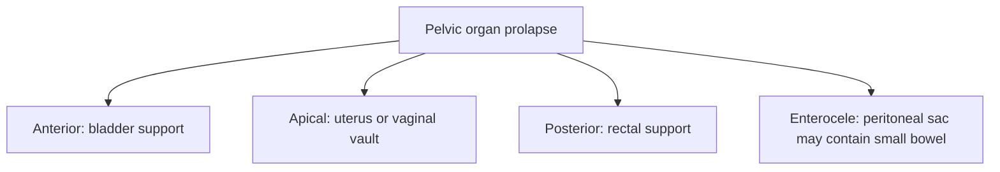

# Pelvic Floor Disorders and Uterine Prolapse — 30 Original MCQs

**Advance-preparation, unattempted.** Original practice questions, not historical PYQs. Apply local protocols and individual clinical assessment.

[Chapter](../README.md) · [Topic map](../Concepts/Gynecological-and-Reproductive-Nursing-Topic-Coverage-Map.md)

## Part 1 — Q1–Q5

### Q1. A woman reports a vaginal bulge that becomes more noticeable after standing all day and improves when she lies down. Which interpretation is most appropriate?

**Difficulty:** 🟡 Medium · **Priority:** 🟠 HIGH YIELD · **Evidence:** Original practice · **Exam focus:** NORCET / Staff Nurse / CHO

- **A.** Suspect a pelvic support disorder and arrange examination
- **B.** Diagnose cervical cancer from this history alone
- **C.** Assume acute cystitis without examination
- **D.** Exclude prolapse because symptoms fluctuate

✅ Answer aur detailed A–D Hinglish explanation

**Correct: A. Suspect a pelvic support disorder and arrange examination**

- **A kyun sahi hai:** Gravity aur activity se weak pelvic support par pressure badhta hai. Bulge ka positional pattern prolapse suggest karta hai, lekin examination se compartment confirm karna hai.
- **B kyun galat hai:** Cancer ke liye history aur examination chahiye. Positional bulge akela diagnostic nahi hai.
- **C kyun galat hai:** Cystitis mein dysuria aur frequency common hain. Bulge ka assessment alag zaroori hai.
- **D kyun galat hai:** Prolapse ke symptoms posture ke saath badal sakte hain.

**Exam clue:** Positional bulge is a common prolapse presentation.

**Clinical reference:** [RCOG pelvic organ prolapse](https://www.rcog.org.uk/for-the-public/browse-our-patient-information/pelvic-organ-prolapse/)

**YouTube MCQ practice:** Question-specific relevant practice video not independently verified. Pending.

### Q2. During a routine examination a woman has mild pelvic organ descent but no symptoms. What is the best initial management discussion?

**Difficulty:** 🟡 Medium · **Priority:** 🟠 HIGH YIELD · **Evidence:** Original practice · **Exam focus:** NORCET / Staff Nurse / CHO

- **A.** Immediate reconstructive surgery for every patient
- **B.** Observation and advice with review if symptoms become troublesome
- **C.** Mandatory lifelong pessary insertion
- **D.** Complete bed rest to prevent progression

✅ Answer aur detailed A–D Hinglish explanation

**Correct: B. Observation and advice with review if symptoms become troublesome**

- **A kyun galat hai:** Surgery symptomatic burden aur patient preference par depend karti hai.
- **B kyun sahi hai:** Asymptomatic mild descent mein no treatment bhi reasonable option hai. Symptoms develop hon to reassessment karayein.
- **C kyun galat hai:** Pessary symptom relief ka option hai, compulsory treatment nahi.
- **D kyun galat hai:** Bed rest routine treatment nahi aur mobility kam kar sakta hai.

**Exam clue:** Treat the woman’s symptoms and goals, not the examination finding alone.

**Clinical reference:** [RCOG pelvic organ prolapse](https://www.rcog.org.uk/for-the-public/browse-our-patient-information/pelvic-organ-prolapse/)

**YouTube MCQ practice:** Question-specific relevant practice video not independently verified. Pending.

### Q3. Which obstetric history most strongly suggests acquired pelvic floor support injury?

**Difficulty:** 🟢 Easy · **Priority:** 🟠 HIGH YIELD · **Evidence:** Original practice · **Exam focus:** NORCET / Staff Nurse / CHO

- **A.** A normal uncomplicated early miscarriage
- **B.** Use of oral iron during pregnancy
- **C.** Previous vaginal birth with major perineal trauma
- **D.** A routine antenatal ultrasound

✅ Answer aur detailed A–D Hinglish explanation

**Correct: C. Previous vaginal birth with major perineal trauma**

- **A kyun galat hai:** Early miscarriage ko major pelvic floor injury ke barabar nahi maana jaata.
- **B kyun galat hai:** Iron therapy pelvic support ko mechanically injure nahi karti.
- **C kyun sahi hai:** Vaginal birth mein levator muscles aur connective tissue stretch ya injure ho sakte hain. Major perineal trauma risk assessment mein important hai.
- **D kyun galat hai:** Diagnostic ultrasound pelvic support injury ka established cause nahi.

**Exam clue:** Childbirth-related support injury is a relevant risk factor.

**Clinical reference:** [RCOG pelvic organ prolapse](https://www.rcog.org.uk/for-the-public/browse-our-patient-information/pelvic-organ-prolapse/)

**YouTube MCQ practice:** Question-specific relevant practice video not independently verified. Pending.

### Q4. A patient with symptomatic prolapse has chronic constipation and repeatedly strains to defecate. Which advice addresses a modifiable aggravating factor?

**Difficulty:** 🟡 Medium · **Priority:** 🟠 HIGH YIELD · **Evidence:** Original practice · **Exam focus:** NORCET / Staff Nurse / CHO

- **A.** Restrict dietary fibre permanently
- **B.** Use prolonged straining to empty the bowel
- **C.** Avoid every form of activity
- **D.** Improve stool consistency and bowel habits to reduce straining

✅ Answer aur detailed A–D Hinglish explanation

**Correct: D. Improve stool consistency and bowel habits to reduce straining**

- **A kyun galat hai:** Fibre restriction constipation worsen kar sakti hai unless specific medical indication ho.
- **B kyun galat hai:** Repeated straining intra-abdominal pressure badhata hai.
- **C kyun galat hai:** All activity avoid karna necessary nahi. Individual advice suitable hai.
- **D kyun sahi hai:** Adequate fluid, suitable fibre, activity aur clinician-directed constipation management se repeated straining kam ho sakti hai.

**Exam clue:** Address constipation and excessive straining.

**Clinical reference:** [NICE NG123](https://www.nice.org.uk/guidance/ng123/chapter/recommendations)

**YouTube MCQ practice:** Question-specific relevant practice video not independently verified. Pending.

### Q5. A patient describes a significant vaginal bulge but the initial supine examination does not reproduce it. What is the appropriate next examination strategy?

**Difficulty:** 🔴 Difficult · **Priority:** 🔴 MOST IMPORTANT · **Evidence:** Original practice · **Exam focus:** NORCET / Staff Nurse / CHO

- **A.** Repeat assessment while standing or squatting when appropriate
- **B.** Discharge because a supine examination is always definitive
- **C.** Order routine CT before any further examination
- **D.** Ask the patient to suppress all straining during assessment

✅ Answer aur detailed A–D Hinglish explanation

**Correct: A. Repeat assessment while standing or squatting when appropriate**

- **A kyun sahi hai:** Standing ya squatting se symptomatic descent reproduce ho sakta hai. NICE unexplained symptoms mein alternate position consider karta hai.
- **B kyun galat hai:** Supine findings kabhi symptoms ki severity explain nahi karte.
- **C kyun galat hai:** Routine imaging needed nahi if clinical examination can establish prolapse.
- **D kyun galat hai:** Controlled bearing down examination ka useful part ho sakta hai.

**Exam clue:** If symptoms and supine findings disagree, consider repeat positional examination.

**Clinical reference:** [NICE NG123](https://www.nice.org.uk/guidance/ng123/chapter/recommendations)

**YouTube MCQ practice:** Question-specific relevant practice video not independently verified. Pending.

## Part 2 — Q6–Q10

### Q6. A woman with an anterior vaginal wall bulge reports incomplete bladder emptying. Which displaced organ is most commonly involved in this compartment?

**Difficulty:** 🟢 Easy · **Priority:** 🟠 HIGH YIELD · **Evidence:** Original practice · **Exam focus:** NORCET / Staff Nurse / CHO

- **A.** Rectum
- **B.** Urinary bladder
- **C.** Small bowel only
- **D.** Ovary

✅ Answer aur detailed A–D Hinglish explanation

**Correct: B. Urinary bladder**

- **A kyun galat hai:** Rectum posterior vaginal compartment se related hai.
- **B kyun sahi hai:** Anterior vaginal wall support weak hone par bladder descend kar sakta hai. Isko commonly cystocele kehte hain.
- **C kyun galat hai:** Enterocele mein peritoneal sac aur often small bowel involved hote hain.
- **D kyun galat hai:** Ovary typical anterior vaginal wall prolapse ka organ nahi.

**Exam clue:** Anterior compartment is commonly associated with bladder descent.

**Clinical reference:** [RCOG pelvic organ prolapse](https://www.rcog.org.uk/for-the-public/browse-our-patient-information/pelvic-organ-prolapse/)

**YouTube MCQ practice:** Question-specific relevant practice video not independently verified. Pending.

### Q7. A woman needs to press on the posterior vaginal wall to assist bowel emptying. Which prolapse should be considered?

**Difficulty:** 🟡 Medium · **Priority:** 🟠 HIGH YIELD · **Evidence:** Original practice · **Exam focus:** NORCET / Staff Nurse / CHO

- **A.** Cystocele
- **B.** Isolated urethral prolapse
- **C.** Rectocele
- **D.** Cervical ectropion

✅ Answer aur detailed A–D Hinglish explanation

**Correct: C. Rectocele**

- **A kyun galat hai:** Cystocele anterior compartment aur urinary complaints se associated ho sakta hai.
- **B kyun galat hai:** Urethral prolapse urethral opening ka problem hai, posterior support defect nahi.
- **C kyun sahi hai:** Rectocele mein rectum posterior vaginal wall ki taraf bulge karta hai. Splinting aur difficult evacuation relevant symptoms hain.
- **D kyun galat hai:** Cervical ectropion cervical epithelium ka finding hai, obstructed defecation ka support defect nahi.

**Exam clue:** Posterior wall bulge and vaginal splinting suggest rectocele.

**Clinical reference:** [RCOG pelvic organ prolapse](https://www.rcog.org.uk/for-the-public/browse-our-patient-information/pelvic-organ-prolapse/)

**YouTube MCQ practice:** Question-specific relevant practice video not independently verified. Pending.

### Q8. Which structure is characteristically involved in an enterocele?

**Difficulty:** 🟢 Easy · **Priority:** 🟠 HIGH YIELD · **Evidence:** Original practice · **Exam focus:** NORCET / Staff Nurse / CHO

- **A.** Bladder neck only
- **B.** Cervical epithelium
- **C.** Ovarian follicle
- **D.** Peritoneal sac that may contain small bowel

✅ Answer aur detailed A–D Hinglish explanation

**Correct: D. Peritoneal sac that may contain small bowel**

- **A kyun galat hai:** Bladder neck anterior urinary support se related hai.
- **B kyun galat hai:** Cervical epithelium enterocele ki definition nahi.
- **C kyun galat hai:** Ovarian follicle ovarian physiology ka structure hai.
- **D kyun sahi hai:** Enterocele mein peritoneal sac upper posterior vaginal region ki taraf descend karta hai, often small bowel ke saath.

**Exam clue:** Enterocele differs anatomically from rectocele.

**Clinical reference:** [MSD Manual POP overview](https://www.msdmanuals.com/professional/gynecology-and-obstetrics/pelvic-organ-prolapse-pop/overview-of-pelvic-organ-prolapse-pop)

**YouTube MCQ practice:** Question-specific relevant practice video not independently verified. Pending.

### Q9. In a woman with an intact uterus, the cervix and uterus descend because apical support is weakened. Which compartment is primarily affected?

**Difficulty:** 🟢 Easy · **Priority:** 🟠 HIGH YIELD · **Evidence:** Original practice · **Exam focus:** NORCET / Staff Nurse / CHO

- **A.** Apical compartment
- **B.** Anterior compartment alone
- **C.** Posterior compartment alone
- **D.** Vulvar skin only

✅ Answer aur detailed A–D Hinglish explanation

**Correct: A. Apical compartment**

- **A kyun sahi hai:** Uterus aur cervix ka downward displacement apical support defect ko indicate karta hai. Other compartments bhi coexist kar sakte hain.
- **B kyun galat hai:** Anterior wall defect mainly bladder-side support se related hai.
- **C kyun galat hai:** Posterior defect rectal-side support se related hota hai.
- **D kyun galat hai:** Vulvar skin disease uterine apical descent ki definition nahi.

**Exam clue:** Uterine descent is an apical support disorder.

**Clinical reference:** [RCOG pelvic organ prolapse](https://www.rcog.org.uk/for-the-public/browse-our-patient-information/pelvic-organ-prolapse/)

**YouTube MCQ practice:** Question-specific relevant practice video not independently verified. Pending.

### Q10. A woman who previously underwent hysterectomy develops descent of the top of the vagina. Which diagnosis is most appropriate?

**Difficulty:** 🟡 Medium · **Priority:** 🟠 HIGH YIELD · **Evidence:** Original practice · **Exam focus:** NORCET / Staff Nurse / CHO

- **A.** Uterine inversion
- **B.** Vaginal vault prolapse
- **C.** Placenta previa
- **D.** Cervical insufficiency

✅ Answer aur detailed A–D Hinglish explanation

**Correct: B. Vaginal vault prolapse**

- **A kyun galat hai:** Uterine inversion mein uterus invert hota hai. Yahan uterus already removed hai.
- **B kyun sahi hai:** Hysterectomy ke baad vaginal apex descend kar sakta hai, jise vault prolapse kehte hain.
- **C kyun galat hai:** Placenta previa pregnancy-related placental location hai.
- **D kyun galat hai:** Cervical insufficiency pregnancy mein cervical support problem hai.

**Exam clue:** After hysterectomy, the vaginal apex can prolapse.

**Clinical reference:** [RCOG pelvic organ prolapse](https://www.rcog.org.uk/for-the-public/browse-our-patient-information/pelvic-organ-prolapse/)

**YouTube MCQ practice:** Question-specific relevant practice video not independently verified. Pending.

## Part 3 — Q11–Q15

### Q11. In the POP-Q system, which anatomical landmark is assigned zero centimetres?

**Difficulty:** 🟡 Medium · **Priority:** 🟠 HIGH YIELD · **Evidence:** Original practice · **Exam focus:** NORCET / Staff Nurse / CHO

- **A.** Cervical os
- **B.** Pubic symphysis
- **C.** Hymenal plane
- **D.** Perineal skin incision

✅ Answer aur detailed A–D Hinglish explanation

**Correct: C. Hymenal plane**

- **A kyun galat hai:** Cervix ka location measurement mein record ho sakta hai but zero reference nahi.
- **B kyun galat hai:** Pubic symphysis bony landmark hai, POP-Q zero nahi.
- **C kyun sahi hai:** Hymen reference plane hai. Above hymen negative aur beyond hymen positive values use hoti hain.
- **D kyun galat hai:** Incision POP-Q reference landmark nahi.

**Exam clue:** POP-Q uses the hymen as the zero reference.

**Clinical reference:** [MSD Manual POP overview](https://www.msdmanuals.com/professional/gynecology-and-obstetrics/pelvic-organ-prolapse-pop/overview-of-pelvic-organ-prolapse-pop)

**YouTube MCQ practice:** Question-specific relevant practice video not independently verified. Pending.

### Q12. The most distal prolapse point measures +0.5 cm relative to the hymen. Which POP-Q stage is consistent with this measurement?

**Difficulty:** 🔴 Difficult · **Priority:** 🔴 MOST IMPORTANT · **Evidence:** Original practice · **Exam focus:** NORCET / Staff Nurse / CHO

- **A.** Stage 0
- **B.** Stage 1
- **C.** Stage 4
- **D.** Stage 2

✅ Answer aur detailed A–D Hinglish explanation

**Correct: D. Stage 2**

- **A kyun galat hai:** Stage 0 mein prolapse absent hota hai.
- **B kyun galat hai:** Stage 1 mein leading edge hymen se more than 1 cm above hota hai.
- **C kyun galat hai:** Stage 4 near-complete vaginal eversion ko indicate karta hai.
- **D kyun sahi hai:** Stage 2 ka leading edge hymen se 1 cm above se 1 cm below tak hota hai. +0.5 cm is range mein hai.

**Exam clue:** Stage 2 range is −1 to +1 cm.

**Clinical reference:** [MSD Manual POP overview](https://www.msdmanuals.com/professional/gynecology-and-obstetrics/pelvic-organ-prolapse-pop/overview-of-pelvic-organ-prolapse-pop)

**YouTube MCQ practice:** Question-specific relevant practice video not independently verified. Pending.

### Q13. A patient has a total vaginal length of 9 cm and the leading prolapse edge is +3 cm. Which POP-Q stage fits these findings?

**Difficulty:** 🔴 Difficult · **Priority:** 🔴 MOST IMPORTANT · **Evidence:** Original practice · **Exam focus:** NORCET / Staff Nurse / CHO

- **A.** Stage 3
- **B.** Stage 0
- **C.** Stage 1
- **D.** Stage 4

✅ Answer aur detailed A–D Hinglish explanation

**Correct: A. Stage 3**

- **A kyun sahi hai:** Stage 3 mein leading edge +1 cm se beyond hota hai but TVL minus 2 cm se less. Yahan TVL−2 = 7 cm aur +3 is range mein hai.
- **B kyun galat hai:** Stage 0 mein prolapse absent hota hai.
- **C kyun galat hai:** Stage 1 hymen se above hota hai.
- **D kyun galat hai:** Stage 4 ke liye descent near-complete eversion, typically at least TVL−2, hona chahiye.

**Exam clue:** Calculate TVL minus 2 before identifying stage 3 versus stage 4.

**Clinical reference:** [MSD Manual POP overview](https://www.msdmanuals.com/professional/gynecology-and-obstetrics/pelvic-organ-prolapse-pop/overview-of-pelvic-organ-prolapse-pop)

**YouTube MCQ practice:** Question-specific relevant practice video not independently verified. Pending.

### Q14. For symptomatic POP-Q stage 1 or 2 prolapse, which initial supervised pelvic floor muscle training duration is recommended for consideration by NICE?

**Difficulty:** 🟡 Medium · **Priority:** 🟠 HIGH YIELD · **Evidence:** Original practice · **Exam focus:** NORCET / Staff Nurse / CHO

- **A.** One day only
- **B.** At least 16 weeks
- **C.** Only during menstruation
- **D.** No training until surgery

✅ Answer aur detailed A–D Hinglish explanation

**Correct: B. At least 16 weeks**

- **A kyun galat hai:** Muscle coordination aur strength improve karne ke liye repeated training chahiye.
- **B kyun sahi hai:** NICE symptomatic stage 1 or 2 prolapse mein supervised PFMT for at least 16 weeks first option consider karta hai.
- **C kyun galat hai:** Training menstrual days tak limited nahi.
- **D kyun galat hai:** Suitable patient mein conservative training surgery se pehle consider ki ja sakti hai.

**Exam clue:** Prolapse-specific supervised PFMT: at least 16 weeks.

**Clinical reference:** [NICE NG123](https://www.nice.org.uk/guidance/ng123/chapter/recommendations)

**YouTube MCQ practice:** Question-specific relevant practice video not independently verified. Pending.

### Q15. During pelvic floor muscle exercise teaching, which instruction demonstrates correct basic technique?

**Difficulty:** 🟡 Medium · **Priority:** 🟠 HIGH YIELD · **Evidence:** Original practice · **Exam focus:** NORCET / Staff Nurse / CHO

- **A.** Hold the breath and force the abdomen downward
- **B.** Tighten only the buttocks with each contraction
- **C.** Squeeze and lift the pelvic floor, breathe normally, and release between contractions
- **D.** Maintain maximal contraction continuously throughout the day

✅ Answer aur detailed A–D Hinglish explanation

**Correct: C. Squeeze and lift the pelvic floor, breathe normally, and release between contractions**

- **A kyun galat hai:** Breath holding aur downward bearing can increase abdominal pressure.
- **B kyun galat hai:** Buttock-only contraction target pelvic floor activation nahi hai.
- **C kyun sahi hai:** Correct contraction mein squeeze aur lift feel hota hai. Normal breathing aur relaxation between contractions muscle control improve karte hain.
- **D kyun galat hai:** Continuous maximal effort fatigue aur inappropriate muscle tension cause kar sakta hai.

**Exam clue:** Teach both contraction and relaxation with normal breathing.

**Clinical reference:** [NICE NG210](https://www.nice.org.uk/guidance/ng210/chapter/recommendations)

**YouTube MCQ practice:** Question-specific relevant practice video not independently verified. Pending.

## Part 4 — Q16–Q20

### Q16. A woman has stress urinary leakage when coughing. Which pelvic floor technique may help during this predictable trigger?

**Difficulty:** 🟡 Medium · **Priority:** 🟠 HIGH YIELD · **Evidence:** Original practice · **Exam focus:** NORCET / Staff Nurse / CHO

- **A.** Bear down just before coughing
- **B.** Stop breathing for several minutes
- **C.** Drink less than a medically safe amount of fluid
- **D.** Contract the pelvic floor just before and during the cough

✅ Answer aur detailed A–D Hinglish explanation

**Correct: D. Contract the pelvic floor just before and during the cough**

- **A kyun galat hai:** Bearing down urinary support ko challenge kar sakta hai.
- **B kyun galat hai:** Prolonged breath holding safe preventive method nahi.
- **C kyun galat hai:** Extreme fluid restriction dehydration risk create kar sakti hai.
- **D kyun sahi hai:** Anticipatory pelvic floor contraction, sometimes called the Knack, urethral support improve kar sakta hai during sudden pressure rise.

**Exam clue:** A timed pelvic floor contraction can support continence during coughing.

**Clinical reference:** [NICE NG210](https://www.nice.org.uk/guidance/ng210/chapter/recommendations)

**YouTube MCQ practice:** Question-specific relevant practice video not independently verified. Pending.

### Q17. A patient asks whether she should repeatedly interrupt her urine stream as her regular pelvic floor exercise routine. What should the nurse advise?

**Difficulty:** 🟡 Medium · **Priority:** 🟠 HIGH YIELD · **Evidence:** Original practice · **Exam focus:** NORCET / Staff Nurse / CHO

- **A.** Practise pelvic floor exercises separately rather than repeatedly stopping urine flow
- **B.** Interrupt every void as the preferred lifelong exercise
- **C.** Avoid all exercises until menopause
- **D.** Use straining to strengthen the pelvic floor

✅ Answer aur detailed A–D Hinglish explanation

**Correct: A. Practise pelvic floor exercises separately rather than repeatedly stopping urine flow**

- **A kyun sahi hai:** Routine exercises bladder emptying se separate karni chahiye. Repeated stop-start voiding normal emptying disturb kar sakta hai.
- **B kyun galat hai:** Har void interrupt karna recommended exercise routine nahi.
- **C kyun galat hai:** Suitable exercises age ya menopause tak postpone nahi karni hoti.
- **D kyun galat hai:** Straining pelvic floor squeeze ka opposite action hai.

**Exam clue:** Do not use repeated interruption of urine flow as routine PFMT.

**Clinical reference:** [NICE NG210](https://www.nice.org.uk/guidance/ng210/chapter/recommendations)

**YouTube MCQ practice:** Question-specific relevant practice video not independently verified. Pending.

### Q18. A woman with symptomatic prolapse chooses a vaginal pessary instead of surgery. Which expectation should be explained?

**Difficulty:** 🟡 Medium · **Priority:** 🟠 HIGH YIELD · **Evidence:** Original practice · **Exam focus:** NORCET / Staff Nurse / CHO

- **A.** One size always fits every patient
- **B.** More than one fitting attempt may be required
- **C.** Pessary permanently restores every damaged ligament
- **D.** Follow-up is never needed after fitting

✅ Answer aur detailed A–D Hinglish explanation

**Correct: B. More than one fitting attempt may be required**

- **A kyun galat hai:** Vaginal anatomy aur device fit individuals mein different hota hai.
- **B kyun sahi hai:** Comfort aur support ke liye different sizes ya types try karne pad sakte hain. Skilled fitting aur follow-up important hain.
- **C kyun galat hai:** Pessary organs ko mechanical support deta hai but permanent ligament repair guarantee nahi karta.
- **D kyun galat hai:** Follow-up se fit, symptoms aur complications review hote hain.

**Exam clue:** Pessary fitting is individualized and may need more than one attempt.

**Clinical reference:** [NICE NG123](https://www.nice.org.uk/guidance/ng123/chapter/recommendations)

**YouTube MCQ practice:** Question-specific relevant practice video not independently verified. Pending.

### Q19. A woman has a vaginal pessary and cannot independently manage its removal. Under NICE guidance, what minimum removal interval should be discussed to reduce serious complications?

**Difficulty:** 🔴 Difficult · **Priority:** 🔴 MOST IMPORTANT · **Evidence:** Original practice · **Exam focus:** NORCET / Staff Nurse / CHO

- **A.** Once every five years
- **B.** Only after severe bleeding develops
- **C.** At least once every six months
- **D.** Never remove a comfortable device

✅ Answer aur detailed A–D Hinglish explanation

**Correct: C. At least once every six months**

- **A kyun galat hai:** Five-year interval neglect-related complications ka risk badha sakta hai.
- **B kyun galat hai:** Symptoms ka wait karna preventive follow-up ko replace nahi karta.
- **C kyun sahi hai:** NICE advises pessary removal at least once every six months. Patient ke risk aur local pathway ke according clinic follow-up arrange karein.
- **D kyun galat hai:** Comfort alone mucosal injury ya other complications exclude nahi karta.

**Exam clue:** NICE: remove pessary at least once every six months.

**Clinical reference:** [NICE NG123](https://www.nice.org.uk/guidance/ng123/chapter/recommendations)

**YouTube MCQ practice:** Question-specific relevant practice video not independently verified. Pending.

### Q20. A pessary user develops new vaginal bleeding and discomfort. What is the safest nursing response?

**Difficulty:** 🔴 Difficult · **Priority:** 🔴 MOST IMPORTANT · **Evidence:** Original practice · **Exam focus:** NORCET / Staff Nurse / CHO

- **A.** Increase the pessary size without examination
- **B.** Reassure her that all bleeding is normal
- **C.** Give antibiotics indefinitely without assessment
- **D.** Arrange clinical review for mucosal injury, fit problems and other causes of bleeding

✅ Answer aur detailed A–D Hinglish explanation

**Correct: D. Arrange clinical review for mucosal injury, fit problems and other causes of bleeding**

- **A kyun galat hai:** Larger device pressure injury worsen kar sakta hai.
- **B kyun galat hai:** Bleeding assessment zaroori hai, especially postmenopausal bleeding.
- **C kyun galat hai:** Antibiotics every cause ko address nahi karte.
- **D kyun sahi hai:** Pessary pressure se erosion ya ulceration possible hai. Clinician ko fit aur vaginal tissue assess karna hai aur other causes bhi consider karne hain.

**Exam clue:** New bleeding during pessary use needs assessment.

**Clinical reference:** [RCOG pelvic organ prolapse](https://www.rcog.org.uk/for-the-public/browse-our-patient-information/pelvic-organ-prolapse/)

**YouTube MCQ practice:** Question-specific relevant practice video not independently verified. Pending.

## Part 5 — Q21–Q25

### Q21. A woman with advanced prolapse suddenly cannot pass urine and has painful suprapubic fullness. What should the nurse prioritize?

**Difficulty:** 🔴 Difficult · **Priority:** 🔴 MOST IMPORTANT · **Evidence:** Original practice · **Exam focus:** NORCET / Staff Nurse / CHO

- **A.** Urgent clinical assessment for urinary retention and bladder drainage as indicated
- **B.** Delay assessment until a routine annual review
- **C.** Ask her to keep straining until urine passes
- **D.** Start pelvic exercises as the only immediate intervention

✅ Answer aur detailed A–D Hinglish explanation

**Correct: A. Urgent clinical assessment for urinary retention and bladder drainage as indicated**

- **A kyun sahi hai:** Painful inability to void acute retention suggest karti hai. Prompt bladder assessment aur clinician-directed drainage appropriate hai.
- **B kyun galat hai:** Delay bladder overdistension aur complications ka risk badhata hai.
- **C kyun galat hai:** Forceful straining safe treatment nahi.
- **D kyun galat hai:** PFMT longer-term option hai, acute retention resolve karne ka substitute nahi.

**Exam clue:** Acute painful urinary retention requires prompt evaluation.

**Clinical reference:** [NICE NG123](https://www.nice.org.uk/guidance/ng123/chapter/recommendations)

**YouTube MCQ practice:** Question-specific relevant practice video not independently verified. Pending.

### Q22. A postmenopausal woman with prolapse has symptomatic vaginal dryness and atrophic tissue. Which adjunct may be considered after individual assessment?

**Difficulty:** 🟡 Medium · **Priority:** 🟠 HIGH YIELD · **Evidence:** Original practice · **Exam focus:** NORCET / Staff Nurse / CHO

- **A.** Routine high-dose systemic estrogen for every woman
- **B.** Local vaginal estrogen if clinically appropriate
- **C.** Immediate hysterectomy solely for dryness
- **D.** Permanent antibiotic prophylaxis

✅ Answer aur detailed A–D Hinglish explanation

**Correct: B. Local vaginal estrogen if clinically appropriate**

- **A kyun galat hai:** Systemic hormone therapy har patient ke liye indicated nahi.
- **B kyun sahi hai:** Local vaginal estrogen menopausal genitourinary symptoms mein helpful ho sakta hai. History, contraindications aur preferences review karni hain.
- **C kyun galat hai:** Dryness alone hysterectomy indication nahi.
- **D kyun galat hai:** Antibiotics atrophic tissue ko restore nahi karte.

**Exam clue:** Consider local estrogen for menopause-associated genitourinary symptoms.

**Clinical reference:** [NICE NG123](https://www.nice.org.uk/guidance/ng123/chapter/recommendations)

**YouTube MCQ practice:** Question-specific relevant practice video not independently verified. Pending.

### Q23. A woman considering prolapse surgery strongly wishes to retain her uterus. What is the most appropriate counseling?

**Difficulty:** 🟡 Medium · **Priority:** 🟠 HIGH YIELD · **Evidence:** Original practice · **Exam focus:** NORCET / Staff Nurse / CHO

- **A.** Tell her hysterectomy is the only possible operation
- **B.** Promise surgery will never affect future fertility
- **C.** Discuss suitable uterine-preserving options and individual reproductive goals with the specialist
- **D.** Exclude her from all treatment

✅ Answer aur detailed A–D Hinglish explanation

**Correct: C. Discuss suitable uterine-preserving options and individual reproductive goals with the specialist**

- **A kyun galat hai:** Selected patients mein uterine-preserving operations available ho sakte hain.
- **B kyun galat hai:** Fertility aur future pregnancy outcome guarantee nahi kiye ja sakte.
- **C kyun sahi hai:** Shared decision-making mein uterus preservation, surgical risks, recurrence aur pregnancy wishes discuss karni chahiye.
- **D kyun galat hai:** Patient preference conservative ya surgical options discuss karne se nahi rokti.

**Exam clue:** Uterine preservation can be discussed as part of individualized surgery planning.

**Clinical reference:** [NICE NG123](https://www.nice.org.uk/guidance/ng123/chapter/recommendations)

**YouTube MCQ practice:** Question-specific relevant practice video not independently verified. Pending.

### Q24. Which procedure supports the vaginal apex by attaching it toward the sacrum, usually using a graft or mesh?

**Difficulty:** 🟡 Medium · **Priority:** 🟠 HIGH YIELD · **Evidence:** Original practice · **Exam focus:** NORCET / Staff Nurse / CHO

- **A.** Cervical punch biopsy
- **B.** Endometrial ablation
- **C.** Tubal ligation
- **D.** Sacrocolpopexy

✅ Answer aur detailed A–D Hinglish explanation

**Correct: D. Sacrocolpopexy**

- **A kyun galat hai:** Biopsy diagnostic tissue sampling hai.
- **B kyun galat hai:** Ablation endometrial lining treat karta hai.
- **C kyun galat hai:** Tubal ligation contraception procedure hai.
- **D kyun sahi hai:** Sacrocolpopexy vaginal apex ko sacral region se support deta hai. Approach, mesh-related risks and alternatives specialist counseling ka part hain.

**Exam clue:** Sacrocolpopexy is an apical suspension operation.

**Clinical reference:** [RCOG pelvic organ prolapse](https://www.rcog.org.uk/for-the-public/browse-our-patient-information/pelvic-organ-prolapse/)

**YouTube MCQ practice:** Question-specific relevant practice video not independently verified. Pending.

### Q25. Which operation uses the sacrospinous ligament for vaginal apical support?

**Difficulty:** 🟡 Medium · **Priority:** 🟠 HIGH YIELD · **Evidence:** Original practice · **Exam focus:** NORCET / Staff Nurse / CHO

- **A.** Sacrospinous fixation
- **B.** LEEP
- **C.** Marsupialization of Bartholin cyst
- **D.** Dilatation and curettage

✅ Answer aur detailed A–D Hinglish explanation

**Correct: A. Sacrospinous fixation**

- **A kyun sahi hai:** Sacrospinous fixation vaginal apex ko sacrospinous ligament se suspend karne ka surgical option hai.
- **B kyun galat hai:** LEEP cervical transformation-zone excision hai.
- **C kyun galat hai:** Marsupialization Bartholin cyst drainage pathway create karti hai.
- **D kyun galat hai:** Dilatation and curettage uterine cavity procedure hai.

**Exam clue:** Sacrospinous fixation is distinct from sacrocolpopexy.

**Clinical reference:** [RCOG pelvic organ prolapse](https://www.rcog.org.uk/for-the-public/browse-our-patient-information/pelvic-organ-prolapse/)

**YouTube MCQ practice:** Question-specific relevant practice video not independently verified. Pending.

## Part 6 — Q26–Q30

### Q26. Before colpocleisis for severe prolapse, which consequence is essential to explain?

**Difficulty:** 🔴 Difficult · **Priority:** 🔴 MOST IMPORTANT · **Evidence:** Original practice · **Exam focus:** NORCET / Staff Nurse / CHO

- **A.** Normal vaginal intercourse is guaranteed after surgery
- **B.** Vaginal closure prevents future penetrative vaginal intercourse
- **C.** The procedure is temporary contraception only
- **D.** All pelvic floor symptoms are guaranteed to disappear

✅ Answer aur detailed A–D Hinglish explanation

**Correct: B. Vaginal closure prevents future penetrative vaginal intercourse**

- **A kyun galat hai:** Colpocleisis vaginal canal ko close or substantially obliterate karta hai, so this assurance incorrect hai.
- **B kyun sahi hai:** Patient ko permanent loss of penetrative vaginal intercourse ke baare mein informed counseling chahiye. Preferences aur alternatives discuss karein.
- **C kyun galat hai:** Ye prolapse operation hai, temporary contraception nahi.
- **D kyun galat hai:** No surgery guarantees relief of all symptoms.

**Exam clue:** Colpocleisis is an obliterative procedure requiring explicit counseling.

**Clinical reference:** [NICE NG123](https://www.nice.org.uk/guidance/ng123/chapter/recommendations)

**YouTube MCQ practice:** Question-specific relevant practice video not independently verified. Pending.

### Q27. A woman leaks urine during laughing and lifting but reports no preceding urgent desire to void. Which symptom pattern is most consistent?

**Difficulty:** 🟢 Easy · **Priority:** 🟠 HIGH YIELD · **Evidence:** Original practice · **Exam focus:** NORCET / Staff Nurse / CHO

- **A.** Overflow incontinence only
- **B.** Continuous fistula leakage
- **C.** Stress urinary incontinence
- **D.** Nocturnal enuresis only

✅ Answer aur detailed A–D Hinglish explanation

**Correct: C. Stress urinary incontinence**

- **A kyun galat hai:** Overflow mein incomplete emptying aur retention features ho sakte hain.
- **B kyun galat hai:** Fistula-related leakage often continuous ho sakti hai, not limited to pressure triggers.
- **C kyun sahi hai:** Coughing, lifting or laughing abdominal pressure raise karte hain. Leakage without urgency stress pattern suggest karta hai.
- **D kyun galat hai:** Nocturnal enuresis sleep-related leakage hai.

**Exam clue:** Stress leakage occurs with effort, exertion or coughing.

**Clinical reference:** [NICE NG123](https://www.nice.org.uk/guidance/ng123/chapter/recommendations)

**YouTube MCQ practice:** Question-specific relevant practice video not independently verified. Pending.

### Q28. A woman leaks urine when she suddenly experiences a compelling desire to void and cannot reach the toilet in time. Which symptom pattern is most likely?

**Difficulty:** 🟢 Easy · **Priority:** 🟠 HIGH YIELD · **Evidence:** Original practice · **Exam focus:** NORCET / Staff Nurse / CHO

- **A.** Stress incontinence alone
- **B.** Normal continence
- **C.** Vaginal vault prolapse by definition
- **D.** Urgency urinary incontinence

✅ Answer aur detailed A–D Hinglish explanation

**Correct: D. Urgency urinary incontinence**

- **A kyun galat hai:** Stress leakage physical exertion se associated hoti hai without necessary urgency.
- **B kyun galat hai:** Involuntary leakage normal continence nahi.
- **C kyun galat hai:** Vault prolapse anatomical diagnosis hai, urgency symptom alone se confirm nahi hota.
- **D kyun sahi hai:** Sudden difficult-to-defer urge followed by leakage urgency urinary incontinence ka characteristic pattern hai.

**Exam clue:** Urgency is the key preceding symptom.

**Clinical reference:** [NICE NG123](https://www.nice.org.uk/guidance/ng123/chapter/recommendations)

**YouTube MCQ practice:** Question-specific relevant practice video not independently verified. Pending.

### Q29. For a woman with urgency-predominant or mixed urinary incontinence, which first-line bladder training duration does NICE recommend?

**Difficulty:** 🟡 Medium · **Priority:** 🟠 HIGH YIELD · **Evidence:** Original practice · **Exam focus:** NORCET / Staff Nurse / CHO

- **A.** At least six weeks
- **B.** One void only
- **C.** Six hours of complete fluid deprivation
- **D.** Routine immediate surgery

✅ Answer aur detailed A–D Hinglish explanation

**Correct: A. At least six weeks**

- **A kyun sahi hai:** Bladder training gradual behavioural technique hai. NICE urgency or mixed incontinence mein minimum six weeks recommend karta hai.
- **B kyun galat hai:** One void se sustained behavioural change establish nahi hota.
- **C kyun galat hai:** Fluid deprivation unsafe hai aur bladder training ka definition nahi.
- **D kyun galat hai:** Surgery every urgency patient ka initial treatment nahi.

**Exam clue:** Bladder training for urgency or mixed incontinence: minimum six weeks.

**Clinical reference:** [NICE NG123](https://www.nice.org.uk/guidance/ng123/chapter/recommendations)

**YouTube MCQ practice:** Question-specific relevant practice video not independently verified. Pending.

### Q30. A woman with prolapse has recurrent urinary infections and reports incomplete emptying. Which measurement helps assess retained urine after voiding?

**Difficulty:** 🟡 Medium · **Priority:** 🟠 HIGH YIELD · **Evidence:** Original practice · **Exam focus:** NORCET / Staff Nurse / CHO

- **A.** Serum estrogen alone
- **B.** Post-void residual urine volume
- **C.** Cervical cytology result
- **D.** Menstrual blood loss score

✅ Answer aur detailed A–D Hinglish explanation

**Correct: B. Post-void residual urine volume**

- **A kyun galat hai:** Estrogen level directly retained bladder urine measure nahi karta.
- **B kyun sahi hai:** Post-void residual bladder mein voiding ke baad bacha urine estimate karta hai. Bladder scan preferred non-invasive method ho sakta hai.
- **C kyun galat hai:** Cytology cervical cells assess karta hai.
- **D kyun galat hai:** Menstrual blood loss score bladder emptying assess nahi karta.

**Exam clue:** Use post-void residual assessment for suspected voiding dysfunction.

**Clinical reference:** [NICE NG123](https://www.nice.org.uk/guidance/ng123/chapter/recommendations)

**YouTube MCQ practice:** Question-specific relevant practice video not independently verified. Pending.

