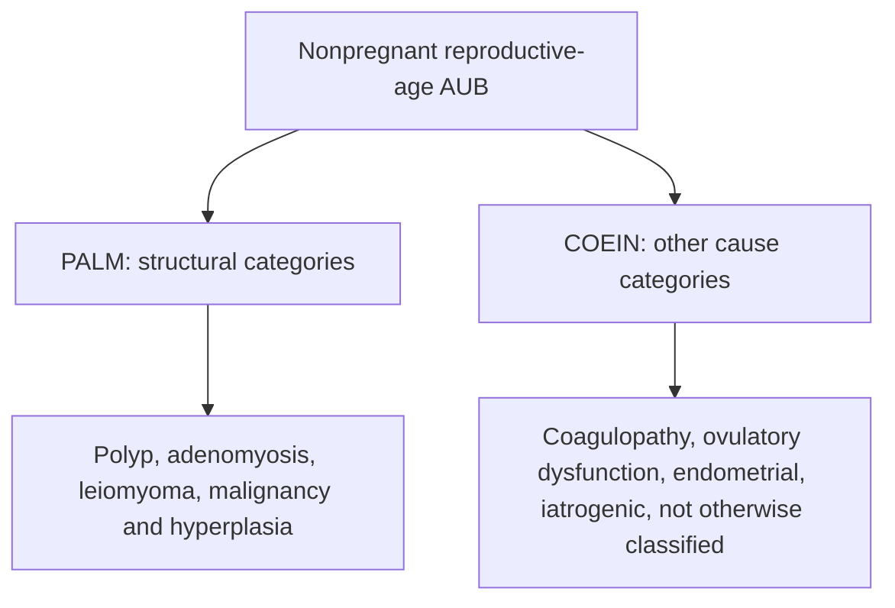

# Abnormal Uterine Bleeding — 30 Original MCQs

**Advance-preparation, unattempted.** Yeh questions original exam-style practice ke liye banaye gaye hain. Inhe official previous-year questions mat samjho. FIGO terminology aur named guideline context ko dhyan se padho. Actual patient care mein local clinical protocol aur individual assessment follow karna zaroori hai.

[Chapter](../README.md) · [Menstrual cycle bank](01-Menstrual-Cycle-and-Ovulation-20-MCQs.md) · [Previous Year Questions research](../Previous-Year-Questions/Gynecological-and-Reproductive-Nursing-Past-Paper-Research-Register.md)

## Part 1 — Q1–Q5

### Q1. A patient says her last period started 18 days after the preceding one began. According to FIGO System 1, which bleeding parameter is abnormal?

**Difficulty:** 🟡 Medium · **Priority:** 🟠 HIGH YIELD · **Evidence:** Original practice

- **A.** Menstrual duration
- **B.** Menstrual frequency
- **C.** Menstrual volume alone
- **D.** Cycle regularity proven from two dates

✅ Answer aur detailed A–D Hinglish explanation

**Correct: B. Menstrual frequency**

- **A kyun galat hai:** Duration ka matlab ek period mein kitne consecutive days tak bleeding hui. Yahan bleeding kitne din chali, yeh nahi bataya gaya.
- **B kyun sahi hai:** Dekho, frequency ka matlab ek period ke first day se next period ke first day tak ka gap hai. FIGO mein adult reproductive age ke liye 24 se 38 days ka gap usual range hai. Isliye 18 days ka interval frequent menstruation kehlata hai.
- **C kyun galat hai:** Volume ka matlab blood loss ki amount aur uska daily life par effect hai. Sirf do start dates se volume pata nahi chalta.
- **D kyun galat hai:** Regularity assess karne ke liye multiple cycles ki lengths compare karni padti hain. Do start dates se sirf ek cycle interval milta hai.

**Exam clue:** Frequency ko cycle interval se assess karna hai.

**Clinical reference:** [FIGO contemporary evaluation](https://obgyn.onlinelibrary.wiley.com/doi/10.1002/ijgo.14946)

**YouTube MCQ practice:** Specific item coverage not verified. [Aarogyam Prime OBG Part 6 — gynecological MCQs](https://www.youtube.com/watch?v=c-OrM_mDIZQ) is a description-level lead for menstrual disorders. Exact topic segment and playback remain pending.

### Q2. A nonpregnant 30-year-old has menstrual bleeding for ten consecutive days each cycle. Which FIGO System 1 descriptor best fits this information?

**Difficulty:** 🟡 Medium · **Priority:** 🟠 HIGH YIELD · **Evidence:** Original practice

- **A.** Infrequent menstruation
- **B.** Intermenstrual bleeding
- **C.** Amenorrhea
- **D.** Prolonged menstrual bleeding

✅ Answer aur detailed A–D Hinglish explanation

**Correct: D. Prolonged menstrual bleeding**

- **A kyun galat hai:** Infrequent menstruation mein cycle start dates ka gap usual range se lamba hota hai. Yahan cycle interval nahi diya hai.
- **B kyun galat hai:** Intermenstrual bleeding expected periods ke beech hoti hai. Yahan ek hi period ki duration long hai.
- **C kyun galat hai:** Amenorrhea mein periods absent hote hain. Yahan bleeding present hai.
- **D kyun sahi hai:** FIGO mein menstrual bleeding eight days se zyada chale toh use prolonged kehte hain. Yahan ten days tak consecutive bleeding ho rahi hai. Nurse ko amount aur symptoms bhi assess karne hain.

**Exam clue:** Bleeding duration aur cycle length ko alag rakho.

**Clinical reference:** [FIGO contemporary evaluation](https://obgyn.onlinelibrary.wiley.com/doi/10.1002/ijgo.14946)

**YouTube MCQ practice:** Specific item coverage not verified. [Aarogyam Prime OBG Part 6 — gynecological MCQs](https://www.youtube.com/watch?v=c-OrM_mDIZQ) is a description-level lead for menstrual disorders. Exact topic segment and playback remain pending.

### Q3. A 32-year-old records cycle lengths of 25, 30, 33 and 34 days. Under FIGO age-specific regularity criteria, which description is most accurate?

**Difficulty:** 🔴 Difficult · **Priority:** 🔴 MOST IMPORTANT · **Evidence:** Original practice

- **A.** Cycle frequency is within range, but cycle-length variability is increased
- **B.** Both frequency and regularity are normal because no cycle exceeds 38 days
- **C.** All cycles are infrequent
- **D.** The woman has amenorrhea

✅ Answer aur detailed A–D Hinglish explanation

**Correct: A. Cycle frequency is within range, but cycle-length variability is increased**

- **A kyun sahi hai:** Shortest cycle 25 aur longest 34 days ki hai. Difference 9 days hai. Age 26–41 mein FIGO up to 7 days variation ko normal maanta hai. Isliye individual intervals normal range mein hone par bhi regularity abnormal hai.
- **B kyun galat hai:** 24–38 days frequency ki range hai. Regularity ke liye longest aur shortest cycle ka difference alag se assess karte hain.
- **C kyun galat hai:** Infrequent cycles 38 days se longer hote hain. Di hui lengths mein aisa interval nahi hai.
- **D kyun galat hai:** Amenorrhea mein menstrual bleeding absent hoti hai, jabki patient ne multiple periods record kiye hain.

**Exam clue:** Normal frequency se normal regularity automatically prove nahi hoti.

**Clinical reference:** [FIGO contemporary evaluation](https://obgyn.onlinelibrary.wiley.com/doi/10.1002/ijgo.14946)

**YouTube MCQ practice:** Specific item coverage not verified. [Aarogyam Prime OBG Part 6 — gynecological MCQs](https://www.youtube.com/watch?v=c-OrM_mDIZQ) is a description-level lead for menstrual disorders. Exact topic segment and playback remain pending.

### Q4. A woman reports needing to change menstrual protection repeatedly at work, avoiding travel and missing activities, although the exact blood loss is unknown. Which approach best reflects the clinical definition of heavy menstrual bleeding?

**Difficulty:** 🟡 Medium · **Priority:** 🟠 HIGH YIELD · **Evidence:** Original practice

- **A.** Exclude heavy menstrual bleeding unless laboratory measurement exceeds 80 mL
- **B.** Diagnose anemia solely from pad use
- **C.** Assess the impact of excessive menstrual bleeding on quality of life without requiring measured millilitres
- **D.** Assess bleeding only if cycles are irregular

✅ Answer aur detailed A–D Hinglish explanation

**Correct: C. Assess the impact of excessive menstrual bleeding on quality of life without requiring measured millilitres**

- **A kyun galat hai:** 80 mL historical research threshold raha hai, lekin clinical assessment ke liye exact volume compulsory nahi hai.
- **B kyun galat hai:** Pad use bleeding severity ka clue hai, lekin anemia confirm karne ke liye Hb aur appropriate assessment chahiye.
- **C kyun sahi hai:** Heavy menstrual bleeding ko patient ke physical, emotional aur daily life impact se assess kiya jaata hai. Exact blood volume ghar par measure karna difficult hota hai. Isliye symptoms aur activities par impact ko seriously lena chahiye.
- **D kyun galat hai:** Heavy bleeding regular ovulatory cycles mein bhi ho sakti hai. Irregularity zaroori condition nahi hai.

**Exam clue:** HMB ka clinical assessment patient-centered hota hai.

**Clinical reference:** [NICE NG88](https://www.nice.org.uk/guidance/ng88/chapter/recommendations)

**YouTube MCQ practice:** Specific item coverage not verified. [Aarogyam Prime OBG Part 6 — gynecological MCQs](https://www.youtube.com/watch?v=c-OrM_mDIZQ) is a description-level lead for menstrual disorders. Exact topic segment and playback remain pending.

### Q5. A patient has an endometrial polyp that is considered responsible for abnormal uterine bleeding. Which FIGO System 2 category applies?

**Difficulty:** 🟡 Medium · **Priority:** 🟠 HIGH YIELD · **Evidence:** Original practice

- **A.** AUB-O
- **B.** AUB-C
- **C.** AUB-P
- **D.** AUB-I

✅ Answer aur detailed A–D Hinglish explanation

**Correct: C. AUB-P**

- **A kyun galat hai:** O ovulatory dysfunction ke liye hai, jab ovulation ka normal pattern disturb ho. Yahan diagnosed structural lesion polyp hai.
- **B kyun galat hai:** C coagulopathy ke liye hai, jab clotting disorder bleeding mein contribute kare. Polyp clotting disorder nahi hai.
- **C kyun sahi hai:** PALM-COEIN mein P ka matlab polyp hai. Polyp uterine lining ka localized growth hota hai jo bleeding ka structural cause ban sakta hai.
- **D kyun galat hai:** I iatrogenic cause ke liye hai, jaise medicine ya device-related bleeding. Yahan polyp ko cause maana gaya hai.

**Exam clue:** PALM structural causes aur COEIN nonstructural categories ko organize karte hain.

**Original visual revision:**

Is diagram mein categories ko organize kiya gaya hai. Ek patient mein multiple causes bhi coexist kar sakte hain, isliye classification clinical evaluation ka substitute nahi hai.

**Clinical reference:** [FIGO contemporary evaluation](https://obgyn.onlinelibrary.wiley.com/doi/10.1002/ijgo.14946)

**YouTube MCQ practice:** Specific item coverage not verified. [Aarogyam Prime OBG Part 6 — gynecological MCQs](https://www.youtube.com/watch?v=c-OrM_mDIZQ) is a description-level lead for menstrual disorders. Exact topic segment and playback remain pending.

## Part 2 — Q6–Q10

### Q6. A woman with abnormal bleeding has confirmed adenomyosis. Which PALM-COEIN label describes the attributed structural cause?

**Difficulty:** 🟡 Medium · **Priority:** 🟠 HIGH YIELD · **Evidence:** Original practice

- **A.** AUB-A
- **B.** AUB-E
- **C.** AUB-N
- **D.** AUB-O

✅ Answer aur detailed A–D Hinglish explanation

**Correct: A. AUB-A**

- **A kyun sahi hai:** Adenomyosis mein endometrial glands aur stroma myometrium yani uterus ki muscular wall mein present hote hain. FIGO category A is structural condition ke liye hai.
- **B kyun galat hai:** E primary endometrial hemostatic dysfunction ko describe karta hai jab other explanations absent hon. Adenomyosis ka separate label A hai.
- **C kyun galat hai:** N un causes ke liye hai jo existing named categories mein classify nahi hote. Adenomyosis already named category hai.
- **D kyun galat hai:** O ovulation disturbance ke liye hai. Adenomyosis uterus ki muscle wall se related structural disorder hai.

**Exam clue:** AUB-A ka A adenomyosis ko denote karta hai.

**Clinical reference:** [FIGO contemporary evaluation](https://obgyn.onlinelibrary.wiley.com/doi/10.1002/ijgo.14946)

**YouTube MCQ practice:** Specific item coverage not verified. [Aarogyam Prime OBG Part 6 — gynecological MCQs](https://www.youtube.com/watch?v=c-OrM_mDIZQ) is a description-level lead for menstrual disorders. Exact topic segment and playback remain pending.

### Q7. A woman with heavy menstrual bleeding has biopsy-confirmed endometrial atypical hyperplasia. Which FIGO cause category includes this finding?

**Difficulty:** 🟡 Medium · **Priority:** 🟠 HIGH YIELD · **Evidence:** Original practice

- **A.** AUB-L
- **B.** AUB-C
- **C.** AUB-P
- **D.** AUB-M

✅ Answer aur detailed A–D Hinglish explanation

**Correct: D. AUB-M**

- **A kyun galat hai:** L leiomyoma yani fibroid ke liye hai, jo smooth muscle ka growth hai. Hyperplasia lining ke cells ka problem hai.
- **B kyun galat hai:** C systemic clotting disorders ke liye hai. Biopsy mein atypical lining ka finding coagulopathy nahi batata.
- **C kyun galat hai:** P localized polyp ke liye hai. Endometrial hyperplasia aur polyp different pathological entities hain.
- **D kyun sahi hai:** M malignancy aur hyperplasia category hai. Atypical hyperplasia mein uterine lining ke cells abnormal proliferate karte hain aur specialist evaluation zaroori hoti hai. Yeh leiomyoma ya clotting disorder nahi hai.

**Exam clue:** M category hyperplasia ko bhi include karti hai.

**Clinical reference:** [FIGO contemporary evaluation](https://obgyn.onlinelibrary.wiley.com/doi/10.1002/ijgo.14946)

**YouTube MCQ practice:** Specific item coverage not verified. [Aarogyam Prime OBG Part 6 — gynecological MCQs](https://www.youtube.com/watch?v=c-OrM_mDIZQ) is a description-level lead for menstrual disorders. Exact topic segment and playback remain pending.

### Q8. A patient has heavy menstrual bleeding primarily attributed to diagnosed von Willebrand disease. Which FIGO cause category should be recorded?

**Difficulty:** 🟡 Medium · **Priority:** 🟠 HIGH YIELD · **Evidence:** Original practice

- **A.** AUB-P
- **B.** AUB-C
- **C.** AUB-E
- **D.** AUB-A

✅ Answer aur detailed A–D Hinglish explanation

**Correct: B. AUB-C**

- **A kyun galat hai:** Polyp uterus ki lining ka structural growth hota hai. Von Willebrand disease usse different hai.
- **B kyun sahi hai:** Von Willebrand disease mein normal platelet adhesion aur clotting process affect ho sakti hai. Yeh systemic bleeding disorder hai, isliye AUB-C yani coagulopathy mein classify hota hai.
- **C kyun galat hai:** AUB-E local endometrial hemostatic problem ke liye hai. Confirmed systemic coagulopathy present ho toh C category relevant hai.
- **D kyun galat hai:** Adenomyosis muscular wall se related disorder hai, inherited clotting disorder nahi.

**Exam clue:** Systemic hemostatic disorders AUB-C mein aate hain.

**Clinical reference:** [FIGO contemporary evaluation](https://obgyn.onlinelibrary.wiley.com/doi/10.1002/ijgo.14946)

**YouTube MCQ practice:** Specific item coverage not verified. [Aarogyam Prime OBG Part 6 — gynecological MCQs](https://www.youtube.com/watch?v=c-OrM_mDIZQ) is a description-level lead for menstrual disorders. Exact topic segment and playback remain pending.

### Q9. A patient has unpredictable bleeding after several missed ovulatory cycles, with no structural lesion found. Which mechanism best accounts for AUB-O?

**Difficulty:** 🔴 Difficult · **Priority:** 🔴 MOST IMPORTANT · **Evidence:** Original practice

- **A.** Inconsistent progesterone exposure allows irregular growth and shedding of the endometrium
- **B.** Each missed ovulation produces a normal corpus luteum with constant progesterone
- **C.** The vaginal epithelium becomes the primary source of all menstrual bleeding
- **D.** A uterine polyp must be present whenever a cycle is anovulatory

✅ Answer aur detailed A–D Hinglish explanation

**Correct: A. Inconsistent progesterone exposure allows irregular growth and shedding of the endometrium**

- **A kyun sahi hai:** Normally ovulation ke baad corpus luteum progesterone banata hai. Jab ovulation nahi hoti toh progesterone exposure predictable nahi rehta. Estrogen ke effect mein lining irregularly grow aur shed kar sakti hai, jis se unpredictable bleeding hoti hai.
- **B kyun galat hai:** Corpus luteum ovulation ke baad banta hai. Missed ovulation mein usual luteal progesterone pattern nahi milta.
- **C kyun galat hai:** Menstrual bleeding mainly uterine endometrium se hoti hai. Vaginal bleeding source alag se evaluate ho sakta hai.
- **D kyun galat hai:** Anovulation nonstructural cause ho sakta hai. Polyp ka hona compulsory nahi hai.

**Exam clue:** Anovulatory bleeding mein hormone exposure ka pattern disturb hota hai.

**Clinical reference:** [Merck Manual AUB](https://www.merckmanuals.com/professional/gynecology-and-obstetrics/abnormal-uterine-bleeding/abnormal-uterine-bleeding)

**YouTube MCQ practice:** Specific item coverage not verified. [Aarogyam Prime OBG Part 6 — gynecological MCQs](https://www.youtube.com/watch?v=c-OrM_mDIZQ) is a description-level lead for menstrual disorders. Exact topic segment and playback remain pending.

### Q10. A woman with apparently ovulatory cycles has heavy bleeding. Evaluation excludes structural lesions, systemic coagulopathy and other recognized causes. Which FIGO category may describe a primary local endometrial hemostatic disorder?

**Difficulty:** 🔴 Difficult · **Priority:** 🔴 MOST IMPORTANT · **Evidence:** Original practice

- **A.** AUB-C
- **B.** AUB-I
- **C.** AUB-E
- **D.** AUB-L

✅ Answer aur detailed A–D Hinglish explanation

**Correct: C. AUB-E**

- **A kyun galat hai:** AUB-C systemic clotting disorders describe karta hai, jo question mein exclude kiye gaye hain.
- **B kyun galat hai:** AUB-I medicine ya intervention-related cause ke liye hai. Yahan aisa exposure established nahi hai.
- **C kyun sahi hai:** AUB-E mein endometrium ke local bleeding-control mechanisms disturb ho sakte hain, even when ovulation regular ho. Yeh generally diagnosis of exclusion hota hai. Isliye other causes evaluate karna important hai.
- **D kyun galat hai:** AUB-L leiomyoma ke liye hai, jab fibroid bleeding mein contribute kare. Yahan structural lesion excluded hai.

**Exam clue:** AUB-E is generally considered after excluding other causes.

**Clinical reference:** [FIGO contemporary evaluation](https://obgyn.onlinelibrary.wiley.com/doi/10.1002/ijgo.14946)

**YouTube MCQ practice:** Specific item coverage not verified. [Aarogyam Prime OBG Part 6 — gynecological MCQs](https://www.youtube.com/watch?v=c-OrM_mDIZQ) is a description-level lead for menstrual disorders. Exact topic segment and playback remain pending.

## Part 3 — Q11–Q15

### Q11. A patient develops heavy periods after initiation of an anticoagulant and the clinician attributes the bleeding to medication effect. Which FIGO category includes this cause?

**Difficulty:** 🟡 Medium · **Priority:** 🟠 HIGH YIELD · **Evidence:** Original practice

- **A.** AUB-P
- **B.** AUB-I
- **C.** AUB-A
- **D.** AUB-M

✅ Answer aur detailed A–D Hinglish explanation

**Correct: B. AUB-I**

- **A kyun galat hai:** Polyp ek localized structural growth hai. Medicine-related bleeding ko P label nahi diya jaata.
- **B kyun sahi hai:** Iatrogenic ka matlab treatment ya healthcare-related cause hai. Anticoagulant clot formation ko affect kar sakta hai aur menstrual blood loss badha sakta hai. Clinician underlying causes bhi assess karega.
- **C kyun galat hai:** Adenomyosis muscular uterine wall ka disorder hai. Anticoagulant uski diagnostic definition nahi.
- **D kyun galat hai:** M malignancy aur hyperplasia category hai. Medicine effect se malignancy automatically diagnose nahi hoti.

**Exam clue:** Medication-related bleeding AUB-I mein classify ho sakti hai.

**Clinical reference:** [FIGO contemporary evaluation](https://obgyn.onlinelibrary.wiley.com/doi/10.1002/ijgo.14946)

**YouTube MCQ practice:** Specific item coverage not verified. [Aarogyam Prime OBG Part 6 — gynecological MCQs](https://www.youtube.com/watch?v=c-OrM_mDIZQ) is a description-level lead for menstrual disorders. Exact topic segment and playback remain pending.

### Q12. A woman has persistent postmenstrual spotting and a specialist identifies a cesarean scar niche that retains menstrual blood. Which FIGO category can include this scar-related cause?

**Difficulty:** 🔴 Difficult · **Priority:** 🔴 MOST IMPORTANT · **Evidence:** Original practice

- **A.** AUB-C
- **B.** AUB-O
- **C.** AUB-M
- **D.** AUB-N

✅ Answer aur detailed A–D Hinglish explanation

**Correct: D. AUB-N**

- **A kyun galat hai:** C systemic hemostatic disorders ko describe karta hai. Scar defect mechanical anatomical problem hai.
- **B kyun galat hai:** O ovulation disorder hai. Retained blood ka scar-related mechanism ovulation disturbance se different hai.
- **C kyun galat hai:** M malignancy ya hyperplasia ko include karta hai. Scar niche se cancer automatically establish nahi hota.
- **D kyun sahi hai:** Cesarean scar niche uterus ke healed incision par ek defect ya pouch ho sakta hai. Ismein menstrual blood retain hokar baad mein spotting ke roop mein aa sakta hai. FIGO is cause ko N yani not otherwise classified mein include kar sakta hai.

**Exam clue:** AUB-N mein recognized uncommon causes bhi aa sakte hain.

**Clinical reference:** [FIGO contemporary evaluation](https://obgyn.onlinelibrary.wiley.com/doi/10.1002/ijgo.14946)

**YouTube MCQ practice:** Specific item coverage not verified. [Aarogyam Prime OBG Part 6 — gynecological MCQs](https://www.youtube.com/watch?v=c-OrM_mDIZQ) is a description-level lead for menstrual disorders. Exact topic segment and playback remain pending.

### Q13. Imaging shows a small intramural fibroid in a woman with abnormal bleeding, but the clinician also suspects ovulatory dysfunction. What is the best principle of FIGO classification?

**Difficulty:** 🔴 Difficult · **Priority:** 🔴 MOST IMPORTANT · **Evidence:** Original practice

- **A.** Every fibroid automatically explains every bleeding episode
- **B.** A structural diagnosis excludes all nonstructural causes
- **C.** FIGO permits only one cause regardless of findings
- **D.** Multiple contributors can coexist and the fibroid may be incidental

✅ Answer aur detailed A–D Hinglish explanation

**Correct: D. Multiple contributors can coexist and the fibroid may be incidental**

- **A kyun galat hai:** Small fibroid incidental ho sakta hai. Causation size, position aur clinical context se judge karte hain.
- **B kyun galat hai:** Structural aur nonstructural causes same patient mein coexist kar sakte hain.
- **C kyun galat hai:** FIGO multiple contributors ko record karne deta hai. Ek label select karke other important findings ignore nahi karni chahiye.
- **D kyun sahi hai:** AUB ke ek se zyada causes ho sakte hain. Fibroid imaging par dikhe toh bhi woh har bleeding episode ka actual cause ho, zaroori nahi. History aur investigations se structural aur hormonal contributors separately assess hote hain.

**Exam clue:** Finding a lesion is not the same as proving causation.

**Clinical reference:** [FIGO contemporary evaluation](https://obgyn.onlinelibrary.wiley.com/doi/10.1002/ijgo.14946)

**YouTube MCQ practice:** Specific item coverage not verified. [Aarogyam Prime OBG Part 6 — gynecological MCQs](https://www.youtube.com/watch?v=c-OrM_mDIZQ) is a description-level lead for menstrual disorders. Exact topic segment and playback remain pending.

### Q14. A 27-year-old with unexpected uterine bleeding reports inconsistent contraceptive use. Before using a nonpregnant AUB treatment pathway, which investigation is essential when pregnancy is possible?

**Difficulty:** 🟡 Medium · **Priority:** 🟠 HIGH YIELD · **Evidence:** Original practice

- **A.** Routine bone-density scan
- **B.** Pregnancy test
- **C.** Serum cholesterol only
- **D.** Mammography

✅ Answer aur detailed A–D Hinglish explanation

**Correct: B. Pregnancy test**

- **A kyun galat hai:** Bone density scan skeletal health assess karta hai. Acute reproductive tract bleeding ka initial pregnancy assessment replace nahi karta.
- **B kyun sahi hai:** Pregnancy-related bleeding ke causes, jaise miscarriage ya ectopic pregnancy, nonpregnant PALM-COEIN pathway se different hote hain. Isliye pregnancy possible ho toh hCG test aur appropriate clinical assessment pehle chahiye.
- **C kyun galat hai:** Cholesterol cardiovascular risk assess karta hai. Pregnancy possibility ko exclude nahi karta.
- **D kyun galat hai:** Mammography breast imaging hai. Uterine bleeding ki pregnancy-related evaluation se directly related nahi.

**Exam clue:** Pregnancy ko exclude kiye bina nonpregnant AUB pathway assume mat karo.

**Clinical reference:** [Merck Manual AUB](https://www.merckmanuals.com/professional/gynecology-and-obstetrics/abnormal-uterine-bleeding/abnormal-uterine-bleeding)

**YouTube MCQ practice:** Specific item coverage not verified. [Aarogyam Prime OBG Part 6 — gynecological MCQs](https://www.youtube.com/watch?v=c-OrM_mDIZQ) is a description-level lead for menstrual disorders. Exact topic segment and playback remain pending.

### Q15. A woman presents with acute heavy bleeding and unstable vital signs. The team has already begun emergency assessment and intravenous access. Which blood-bank preparation may be needed if significant ongoing blood loss is suspected?

**Difficulty:** 🔴 Difficult · **Priority:** 🔴 MOST IMPORTANT · **Evidence:** Original practice

- **A.** Wait for serum FSH before preparing blood
- **B.** Routine lipid testing before resuscitation
- **C.** Blood grouping and compatibility testing according to hemorrhage protocol
- **D.** Delay blood-bank communication until the bleeding has stopped

✅ Answer aur detailed A–D Hinglish explanation

**Correct: C. Blood grouping and compatibility testing according to hemorrhage protocol**

- **A kyun galat hai:** FSH ovarian hormone function assess kar sakta hai, lekin unstable hemorrhage mein blood preparation ka prerequisite nahi hai.
- **B kyun galat hai:** Lipid profile acute blood loss ko manage nahi karti. Emergency circulation support priority hai.
- **C kyun sahi hai:** Major hemorrhage mein circulating volume aur oxygen-carrying capacity dono affect ho sakti hain. Blood group aur compatibility testing team ko safe transfusion prepare karne mein help karte hain. Emergency protocol ke hisaab se resuscitation delay nahi karna hai.
- **D kyun galat hai:** Blood loss ongoing ho toh timely blood-bank communication important hai. Bleeding stop hone ka wait dangerous ho sakta hai.

**Exam clue:** Severe bleeding mein resuscitation aur blood-bank readiness parallel hoti hain.

**Clinical reference:** [ACOG acute AUB](https://www.acog.org/clinical/clinical-guidance/committee-opinion/articles/2013/04/management-of-acute-abnormal-uterine-bleeding-in-nonpregnant-reproductive-aged-women)

**YouTube MCQ practice:** Specific item coverage not verified. [Aarogyam Prime OBG Part 6 — gynecological MCQs](https://www.youtube.com/watch?v=c-OrM_mDIZQ) is a description-level lead for menstrual disorders. Exact topic segment and playback remain pending.

## Part 4 — Q16–Q20

### Q16. A woman with prolonged heavy periods reports exertional breathlessness, fatigue and pallor. Which investigation does NICE recommend for all patients with HMB, even while treatment is being offered?

**Difficulty:** 🟡 Medium · **Priority:** 🟠 HIGH YIELD · **Evidence:** Original practice

- **A.** Full blood count
- **B.** Routine serum CA-125 for everyone
- **C.** Routine MRI of the brain
- **D.** Routine ovarian reserve testing

✅ Answer aur detailed A–D Hinglish explanation

**Correct: A. Full blood count**

- **A kyun sahi hai:** Repeated menstrual blood loss se iron depletion aur anemia ho sakti hai. Full blood count hemoglobin aur red-cell indices assess karta hai. NICE HMB treatment ke saath parallel FBC recommend karta hai.
- **B kyun galat hai:** CA-125 ovarian conditions mein selected use rakhta hai. HMB mein sabke liye routine marker nahi hai.
- **C kyun galat hai:** Brain MRI uterine blood loss se related anemia ka screening test nahi hai.
- **D kyun galat hai:** Ovarian reserve test follicles ke baare mein information deta hai. Blood loss aur anemia quantify nahi karta.

**Exam clue:** HMB evaluation mein FBC treatment ke saath bhi karaya ja sakta hai.

**Clinical reference:** [NICE NG88](https://www.nice.org.uk/guidance/ng88/chapter/recommendations)

**YouTube MCQ practice:** Specific item coverage not verified. [Aarogyam Prime OBG Part 6 — gynecological MCQs](https://www.youtube.com/watch?v=c-OrM_mDIZQ) is a description-level lead for menstrual disorders. Exact topic segment and playback remain pending.

### Q17. A patient taking oral anticoagulation for a mechanical heart valve develops heavy menstrual bleeding. Which nursing action is safest?

**Difficulty:** 🔴 Difficult · **Priority:** 🔴 MOST IMPORTANT · **Evidence:** Original practice

- **A.** Tell her to permanently stop anticoagulation at once
- **B.** Arrange prompt coordinated review without independently stopping prescribed anticoagulation
- **C.** Advise an extra dose of anticoagulant to stop bleeding
- **D.** Ignore the bleeding because medicine-related bleeding cannot cause anemia

✅ Answer aur detailed A–D Hinglish explanation

**Correct: B. Arrange prompt coordinated review without independently stopping prescribed anticoagulation**

- **A kyun galat hai:** Bina prescriber review permanent discontinuation serious thrombotic risk create kar sakti hai.
- **B kyun sahi hai:** Anticoagulant blood loss badha sakta hai, lekin mechanical valve mein treatment stop karne se dangerous clot risk ho sakta hai. Nurse severity assess kare aur treating teams ke coordinated plan ko facilitate kare. Unstable symptoms mein emergency escalation chahiye.
- **C kyun galat hai:** Extra anticoagulant clotting aur bleeding risk ko worsen kar sakta hai. Dose change clinician decide karega.
- **D kyun galat hai:** Medicine-related bleeding bhi clinically significant anemia cause kar sakti hai. Patient symptoms aur blood count assess karne hain.

**Exam clue:** Bleeding risk aur thrombosis risk dono manage karne hain.

**Clinical reference:** [ACOG AUB patient information](https://www.acog.org/womens-health/faqs/abnormal-uterine-bleeding)

**YouTube MCQ practice:** Specific item coverage not verified. [Aarogyam Prime OBG Part 6 — gynecological MCQs](https://www.youtube.com/watch?v=c-OrM_mDIZQ) is a description-level lead for menstrual disorders. Exact topic segment and playback remain pending.

### Q18. A stable woman with heavy menstrual bleeding has no symptoms suggesting thyroid disease. Under NICE NG88, what is the approach to routine thyroid hormone testing?

**Difficulty:** 🟡 Medium · **Priority:** 🟠 HIGH YIELD · **Evidence:** Original practice

- **A.** Perform thyroid testing every day during menstruation
- **B.** Diagnose hypothyroidism from HMB alone
- **C.** Replace all uterine assessment with a thyroid ultrasound
- **D.** Do not routinely test thyroid hormones unless other signs or symptoms suggest thyroid disease

✅ Answer aur detailed A–D Hinglish explanation

**Correct: D. Do not routinely test thyroid hormones unless other signs or symptoms suggest thyroid disease**

- **A kyun galat hai:** Daily hormone testing routine HMB assessment nahi hai. Test indication clinical findings se decide hota hai.
- **B kyun galat hai:** HMB ke multiple causes hain. Sirf heavy bleeding se hypothyroidism establish nahi hota.
- **C kyun galat hai:** Thyroid ultrasound gland ki structure assess karta hai. Uterine bleeding cause evaluation ka replacement nahi hai.
- **D kyun sahi hai:** Thyroid dysfunction menstrual changes cause kar sakti hai, lekin NICE every HMB patient mein routine thyroid test recommend nahi karta unless symptoms ya signs suggest karein. Isse unnecessary investigations avoid hoti hain.

**Exam clue:** Named NICE guidance mein thyroid tests symptom-driven hain.

**Clinical reference:** [NICE NG88](https://www.nice.org.uk/guidance/ng88/chapter/recommendations)

**YouTube MCQ practice:** Specific item coverage not verified. [Aarogyam Prime OBG Part 6 — gynecological MCQs](https://www.youtube.com/watch?v=c-OrM_mDIZQ) is a description-level lead for menstrual disorders. Exact topic segment and playback remain pending.

### Q19. A 47-year-old with persistent AUB asks why endometrial sampling has been recommended despite a nonconcerning ultrasound. Which rationale matches the cited ACOG approach?

**Difficulty:** 🔴 Difficult · **Priority:** 🔴 MOST IMPORTANT · **Evidence:** Original practice

- **A.** Age over 45 with AUB warrants endometrial tissue assessment as a first-line test in that guidance
- **B.** A normal ultrasound always excludes every form of endometrial disease
- **C.** Biopsy is a treatment for ovarian torsion
- **D.** Endometrial sampling directly measures serum progesterone

✅ Answer aur detailed A–D Hinglish explanation

**Correct: A. Age over 45 with AUB warrants endometrial tissue assessment as a first-line test in that guidance**

- **A kyun sahi hai:** Endometrial sampling lining ke cells ko microscope par assess karta hai. ACOG cited guidance mein AUB aur age over 45 first-line sampling ka indication hai. NICE ka HMB pathway high-risk patients mein hysteroscopy-associated biopsy ko prefer karta hai, isliye named guideline matter karti hai.
- **B kyun galat hai:** Ultrasound structural findings assess kar sakta hai, lekin every microscopic lining abnormality exclude nahi karta.
- **C kyun galat hai:** Ovarian torsion ovary twist hone ki emergency hai. Endometrial sampling uska treatment nahi.
- **D kyun galat hai:** Serum progesterone blood test se measure hota hai. Biopsy tissue pathology ke liye hai.

**Exam clue:** Age and guideline context matter for endometrial sampling.

**Clinical reference:** [ACOG acute AUB](https://www.acog.org/clinical/clinical-guidance/committee-opinion/articles/2013/04/management-of-acute-abnormal-uterine-bleeding-in-nonpregnant-reproductive-aged-women)

**YouTube MCQ practice:** Specific item coverage not verified. [Aarogyam Prime OBG Part 6 — gynecological MCQs](https://www.youtube.com/watch?v=c-OrM_mDIZQ) is a description-level lead for menstrual disorders. Exact topic segment and playback remain pending.

### Q20. A young woman with HMB asks whether a blind endometrial biopsy is routinely offered under NICE NG88. Which explanation is accurate?

**Difficulty:** 🔴 Difficult · **Priority:** 🔴 MOST IMPORTANT · **Evidence:** Original practice

- **A.** Blind biopsy is mandatory for every patient with heavy periods
- **B.** Endometrial biopsy is never performed under any circumstances
- **C.** Biopsy is considered during hysteroscopy for patients at high risk of endometrial pathology
- **D.** Cervical screening substitutes for endometrial biopsy

✅ Answer aur detailed A–D Hinglish explanation

**Correct: C. Biopsy is considered during hysteroscopy for patients at high risk of endometrial pathology**

- **A kyun galat hai:** Har HMB patient ko invasive blind sampling dena NICE recommendation nahi hai. Unnecessary painful procedure avoid karna chahiye.
- **B kyun galat hai:** Indicated tissue assessment important ho sakti hai. Biopsy ko universally prohibit nahi kiya jaata.
- **C kyun sahi hai:** NICE HMB guidance mein high-risk patients ke liye hysteroscopy ke time biopsy consider karte hain. Direct cavity assessment focal lesions ko identify karne mein help karta hai. Individual risk aur symptoms se decision hota hai.
- **D kyun galat hai:** Cervical screening cervix ki abnormalities assess karti hai. Uterine lining ki histology alag evaluation hai.

**Exam clue:** NICE HMB biopsy pathway ko ACOG age-based approach se confuse mat karo.

**Clinical reference:** [NICE NG88](https://www.nice.org.uk/guidance/ng88/chapter/recommendations)

**YouTube MCQ practice:** Specific item coverage not verified. [Aarogyam Prime OBG Part 6 — gynecological MCQs](https://www.youtube.com/watch?v=c-OrM_mDIZQ) is a description-level lead for menstrual disorders. Exact topic segment and playback remain pending.

## Part 5 — Q21–Q25

### Q21. A woman with HMB declines a recommended hysteroscopy after receiving information about the procedure. Under NICE, which action respects her choice while continuing assessment?

**Difficulty:** 🔴 Difficult · **Priority:** 🔴 MOST IMPORTANT · **Evidence:** Original practice

- **A.** Offer pelvic ultrasound if appropriate and explain its limitations for detecting uterine cavity causes
- **B.** Perform hysteroscopy without consent
- **C.** Discharge without discussing alternative assessment
- **D.** Tell her that ultrasound detects every intracavitary lesion with certainty

✅ Answer aur detailed A–D Hinglish explanation

**Correct: A. Offer pelvic ultrasound if appropriate and explain its limitations for detecting uterine cavity causes**

- **A kyun sahi hai:** Patient ki informed choice respect karni chahiye. NICE hysteroscopy decline karne par pelvic ultrasound consider karta hai, saath mein explain karna hai ki cavity lesions miss ho sakte hain. Persistent symptoms mein follow-up important hai.
- **B kyun galat hai:** Consent ke bina elective invasive procedure karna patient autonomy violate karta hai.
- **C kyun galat hai:** Alternative options discuss karne se diagnostic care continue reh sakti hai. Refusal ka matlab no care nahi hai.
- **D kyun galat hai:** Ultrasound useful hai lekin small polyps ya submucosal lesions detect karne mein limitations ho sakti hain.

**Exam clue:** Respect refusal, offer an appropriate alternative and explain limitations.

**Clinical reference:** [NICE NG88](https://www.nice.org.uk/guidance/ng88/chapter/recommendations)

**YouTube MCQ practice:** Specific item coverage not verified. [Aarogyam Prime OBG Part 6 — gynecological MCQs](https://www.youtube.com/watch?v=c-OrM_mDIZQ) is a description-level lead for menstrual disorders. Exact topic segment and playback remain pending.

### Q22. A woman with HMB is offered an LNG-IUS and asks how long she should wait to assess benefit if she tolerates the treatment. What counseling is recommended by NICE?

**Difficulty:** 🟡 Medium · **Priority:** 🟠 HIGH YIELD · **Evidence:** Original practice

- **A.** Guarantee that all bleeding stops on the first day
- **B.** Remove it automatically after one episode of mild spotting
- **C.** Advise that new severe symptoms should always be ignored
- **D.** Explain that bleeding changes can occur initially and benefits may require at least six cycles

✅ Answer aur detailed A–D Hinglish explanation

**Correct: D. Explain that bleeding changes can occur initially and benefits may require at least six cycles**

- **A kyun galat hai:** Endometrial response gradual ho sakta hai. Immediate complete amenorrhea guaranteed nahi.
- **B kyun galat hai:** Mild early spotting expected ho sakti hai. Removal automatic nahi, patient preference aur clinical assessment important hain.
- **C kyun galat hai:** Severe pain, heavy bleeding ya other concerning symptoms ko expected adjustment samajhkar ignore nahi karna chahiye.
- **D kyun sahi hai:** LNG-IUS progestogen release karke uterine lining ko gradually thin karta hai. Initial months mein irregular bleeding ho sakti hai. NICE at least six cycles tak benefit assess karne ki counseling deta hai if suitable. Concerning symptoms alag se evaluate hote hain.

**Exam clue:** LNG-IUS benefits can take several cycles to develop.

**Clinical reference:** [NICE NG88](https://www.nice.org.uk/guidance/ng88/chapter/recommendations)

**YouTube MCQ practice:** Specific item coverage not verified. [Aarogyam Prime OBG Part 6 — gynecological MCQs](https://www.youtube.com/watch?v=c-OrM_mDIZQ) is a description-level lead for menstrual disorders. Exact topic segment and playback remain pending.

### Q23. A patient with HMB prefers a nonhormonal option and has no contraindications. Which description distinguishes prescribed tranexamic acid use from a continuous contraceptive regimen?

**Difficulty:** 🟡 Medium · **Priority:** 🟠 HIGH YIELD · **Evidence:** Original practice

- **A.** It must be taken daily for life to suppress ovulation
- **B.** It is generally used during heavy bleeding days and does not provide contraception
- **C.** It is an estrogen-containing contraceptive
- **D.** It guarantees treatment of the underlying structural cause

✅ Answer aur detailed A–D Hinglish explanation

**Correct: B. It is generally used during heavy bleeding days and does not provide contraception**

- **A kyun galat hai:** Is medicine ka purpose lifelong ovulation suppression nahi hai. Dose aur duration clinician ke instructions se follow hote hain.
- **B kyun sahi hai:** Tranexamic acid blood clots ke breakdown ko reduce karta hai. HMB mein prescribed course bleeding days ke dauran use hota hai. Yeh ovulation suppress nahi karta, isliye pregnancy prevention ki need alag discuss karni hai.
- **C kyun galat hai:** Tranexamic acid nonhormonal antifibrinolytic hai. Estrogen-containing pill different class hai.
- **D kyun galat hai:** Blood loss kam ho sakta hai, lekin polyp ya other structural lesion automatically remove nahi hota.

**Exam clue:** Nonhormonal bleeding control is not contraception.

**Clinical reference:** [ACOG AUB patient information](https://www.acog.org/womens-health/faqs/abnormal-uterine-bleeding)

**YouTube MCQ practice:** Specific item coverage not verified. [Aarogyam Prime OBG Part 6 — gynecological MCQs](https://www.youtube.com/watch?v=c-OrM_mDIZQ) is a description-level lead for menstrual disorders. Exact topic segment and playback remain pending.

### Q24. A patient with HMB and menstrual cramps is considering an NSAID but reports previous gastrointestinal bleeding from NSAIDs. What is the safest nursing response?

**Difficulty:** 🔴 Difficult · **Priority:** 🔴 MOST IMPORTANT · **Evidence:** Original practice

- **A.** Recommend taking twice the usual dose with food
- **B.** Assume all NSAIDs are harmless during menstruation
- **C.** Notify the prescriber and discuss a safer individualized option before administration
- **D.** Administer two different NSAIDs together to reduce gastric risk

✅ Answer aur detailed A–D Hinglish explanation

**Correct: C. Notify the prescriber and discuss a safer individualized option before administration**

- **A kyun galat hai:** Food se mild stomach discomfort kam ho sakta hai, lekin dose double karna bleeding risk reduce nahi karta.
- **B kyun galat hai:** Menstruation NSAID-related gastric ulcer aur bleeding risk ko eliminate nahi karti.
- **C kyun sahi hai:** NSAIDs prostaglandins ko reduce karke menstrual pain aur blood loss mein help kar sakte hain. Lekin previous gastrointestinal bleeding important risk factor hai. Nurse history verify kare aur prescriber se suitable alternative discuss kare.
- **D kyun galat hai:** Do NSAIDs combine karne se toxicity badh sakti hai. Gastric protection ke liye yeh safe strategy nahi hai.

**Exam clue:** NSAID benefits must be weighed against individual bleeding and GI risks.

**Clinical reference:** [ACOG AUB patient information](https://www.acog.org/womens-health/faqs/abnormal-uterine-bleeding)

**YouTube MCQ practice:** Specific item coverage not verified. [Aarogyam Prime OBG Part 6 — gynecological MCQs](https://www.youtube.com/watch?v=c-OrM_mDIZQ) is a description-level lead for menstrual disorders. Exact topic segment and playback remain pending.

### Q25. A woman with prolonged heavy bleeding has a low hemoglobin and reduced iron stores. She is prescribed iron and separate therapy to reduce menstrual bleeding. Why are both approaches needed?

**Difficulty:** 🟡 Medium · **Priority:** 🟠 HIGH YIELD · **Evidence:** Original practice

- **A.** Iron immediately stops uterine bleeding
- **B.** Bleeding treatment always restores iron stores without replacement
- **C.** Iron replenishes depleted stores while bleeding treatment addresses ongoing loss
- **D.** Iron treats every underlying uterine lesion

✅ Answer aur detailed A–D Hinglish explanation

**Correct: C. Iron replenishes depleted stores while bleeding treatment addresses ongoing loss**

- **A kyun galat hai:** Iron hemoglobin synthesis support karta hai, lekin acute uterine bleeding stop karne wali medicine nahi hai.
- **B kyun galat hai:** Blood loss kam hone ke baad bhi depleted iron stores ko recover karne mein time aur indicated replacement chahiye ho sakta hai.
- **C kyun sahi hai:** Repeated blood loss se body ka stored iron kam hota hai, aur hemoglobin banane mein problem ho sakti hai. Iron replacement deficit ko correct karne mein help karti hai. Bleeding control ongoing loss ko reduce karta hai, isliye dono problems address karni hain.
- **D kyun galat hai:** Iron deficiency treat karta hai. Fibroid, polyp ya hormone disorder ka specific treatment nahi hai.

**Exam clue:** Treat the consequence and the source of blood loss.

**Clinical reference:** [Merck Manual AUB](https://www.merckmanuals.com/professional/gynecology-and-obstetrics/abnormal-uterine-bleeding/abnormal-uterine-bleeding)

**YouTube MCQ practice:** Specific item coverage not verified. [Aarogyam Prime OBG Part 6 — gynecological MCQs](https://www.youtube.com/watch?v=c-OrM_mDIZQ) is a description-level lead for menstrual disorders. Exact topic segment and playback remain pending.

## Part 6 — Q26–Q30

### Q26. During follow-up after starting HMB treatment, a patient says she still misses two workdays per cycle despite modestly reduced pad use. What is the best outcome assessment?

**Difficulty:** 🟡 Medium · **Priority:** 🟠 HIGH YIELD · **Evidence:** Original practice

- **A.** Declare treatment successful solely because one fewer pad is used
- **B.** Review symptom burden, quality of life, anemia and patient goals rather than pad count alone
- **C.** Stop follow-up because exact blood volume is unknown
- **D.** Ignore work disruption if cycles are regular

✅ Answer aur detailed A–D Hinglish explanation

**Correct: B. Review symptom burden, quality of life, anemia and patient goals rather than pad count alone**

- **A kyun galat hai:** Pad count approximate measure hai. Patient ki functional impairment persist ho toh treatment benefit incomplete ho sakta hai.
- **B kyun sahi hai:** HMB management ka goal sirf blood loss number kam karna nahi hai. Patient ki fatigue, participation, daily activity aur treatment preferences bhi important hain. Ongoing symptoms ke hisaab se treatment plan review karna chahiye.
- **C kyun galat hai:** Exact blood volume measure karna clinical care mein compulsory nahi hai. Symptoms aur tests se meaningful progress assess ho sakti hai.
- **D kyun galat hai:** Regular cycle hone par bhi heavy bleeding daily life disturb kar sakti hai. Work disruption ko seriously assess karo.

**Exam clue:** Treatment success is patient-centered.

**Clinical reference:** [NICE NG88](https://www.nice.org.uk/guidance/ng88/chapter/recommendations)

**YouTube MCQ practice:** Specific item coverage not verified. [Aarogyam Prime OBG Part 6 — gynecological MCQs](https://www.youtube.com/watch?v=c-OrM_mDIZQ) is a description-level lead for menstrual disorders. Exact topic segment and playback remain pending.

### Q27. A patient reports recurrent bleeding after sexual intercourse. She assumes it must originate from the uterine lining. What is the most appropriate assessment principle?

**Difficulty:** 🔴 Difficult · **Priority:** 🔴 MOST IMPORTANT · **Evidence:** Original practice

- **A.** Classify every postcoital episode as AUB-O without examination
- **B.** Assume a negative prior cervical screen excludes every current lesion
- **C.** Treat every episode with antifungal medication
- **D.** Evaluate cervical and vaginal sources as well as uterine and pregnancy-related causes when relevant

✅ Answer aur detailed A–D Hinglish explanation

**Correct: D. Evaluate cervical and vaginal sources as well as uterine and pregnancy-related causes when relevant**

- **A kyun galat hai:** Ovulation dysfunction automatically postcoital bleeding explain nahi karti. Bleeding source establish karna chahiye.
- **B kyun galat hai:** Screening future disease ko completely exclude nahi karti. New symptoms diagnostic assessment require kar sakte hain.
- **C kyun galat hai:** Fungal infection every bleeding episode ka cause nahi hai. Bina evidence antifungal dena diagnosis delay kar sakta hai.
- **D kyun sahi hai:** Genital tract bleeding uterus ke alawa cervix ya vagina se bhi aa sakti hai. Postcoital bleeding mein source identify karna important hai. Symptoms, pregnancy possibility, examination aur indicated testing se appropriate referral decide hota hai.

**Exam clue:** First establish the source of abnormal genital bleeding.

**Clinical reference:** [Merck Manual AUB](https://www.merckmanuals.com/professional/gynecology-and-obstetrics/abnormal-uterine-bleeding/abnormal-uterine-bleeding)

**YouTube MCQ practice:** Specific item coverage not verified. [Aarogyam Prime OBG Part 6 — gynecological MCQs](https://www.youtube.com/watch?v=c-OrM_mDIZQ) is a description-level lead for menstrual disorders. Exact topic segment and playback remain pending.

### Q28. A patient has abnormal uterine bleeding for most of the preceding six months but is stable today. Which FIGO description best fits this temporal history?

**Difficulty:** 🟡 Medium · **Priority:** 🟠 HIGH YIELD · **Evidence:** Original practice

- **A.** Chronic abnormal uterine bleeding
- **B.** Acute hemorrhage by definition even without urgent intervention need
- **C.** Normal menstrual bleeding because she is stable
- **D.** Postmenopausal bleeding regardless of age

✅ Answer aur detailed A–D Hinglish explanation

**Correct: A. Chronic abnormal uterine bleeding**

- **A kyun sahi hai:** Chronic AUB mein abnormal pattern preceding six months ke majority time mein present hota hai. Stable vitals current circulation ke baare mein batate hain, lekin chronic blood loss aur anemia assess karna ab bhi important hai.
- **B kyun galat hai:** Acute AUB bleeding ka aisa episode hai jisme further blood loss prevent karne ke liye immediate intervention ki need ho. Duration alone acute severity prove nahi karti.
- **C kyun galat hai:** Stable patient ko bhi abnormal frequency, amount ya duration ho sakti hai. Stability normal cycle ka proof nahi hai.
- **D kyun galat hai:** Postmenopausal bleeding menopause ke baad hoti hai. Six-month abnormal pattern alone menopause establish nahi karta.

**Exam clue:** Chronic duration and acute severity are different dimensions.

**Clinical reference:** [FIGO contemporary evaluation](https://obgyn.onlinelibrary.wiley.com/doi/10.1002/ijgo.14946)

**YouTube MCQ practice:** Specific item coverage not verified. [Aarogyam Prime OBG Part 6 — gynecological MCQs](https://www.youtube.com/watch?v=c-OrM_mDIZQ) is a description-level lead for menstrual disorders. Exact topic segment and playback remain pending.

### Q29. A woman with chronic heavy bleeding suddenly develops a much more severe episode that requires immediate intervention. Which classification statement is accurate?

**Difficulty:** 🔴 Difficult · **Priority:** 🔴 MOST IMPORTANT · **Evidence:** Original practice

- **A.** Chronic AUB prevents any acute episode
- **B.** The prior chronic diagnosis makes urgent assessment unnecessary
- **C.** The two categories always describe different patients
- **D.** Acute AUB can occur on a background of chronic AUB

✅ Answer aur detailed A–D Hinglish explanation

**Correct: D. Acute AUB can occur on a background of chronic AUB**

- **A kyun galat hai:** Long-standing bleeding sudden worsening ko prevent nahi karti. Acute episode possible hai.
- **B kyun galat hai:** Previous diagnosis se present hemorrhage safe nahi ho jaata. Current assessment aur escalation important hain.
- **C kyun galat hai:** Acute aur chronic labels ek hi patient ke different aspects describe kar sakte hain.
- **D kyun sahi hai:** Chronic AUB long-standing abnormal pattern describe karta hai. Jab usi patient mein sudden severe episode ho jise immediate intervention chahiye, toh acute AUB bhi present ho sakti hai. Nurse current blood loss aur stability ke basis par action leti hai.

**Exam clue:** A sudden deterioration must be treated according to current severity.

**Clinical reference:** [ACOG acute AUB](https://www.acog.org/clinical/clinical-guidance/committee-opinion/articles/2013/04/management-of-acute-abnormal-uterine-bleeding-in-nonpregnant-reproductive-aged-women)

**YouTube MCQ practice:** Specific item coverage not verified. [Aarogyam Prime OBG Part 6 — gynecological MCQs](https://www.youtube.com/watch?v=c-OrM_mDIZQ) is a description-level lead for menstrual disorders. Exact topic segment and playback remain pending.

### Q30. A woman being evaluated for HMB asks for help keeping a menstrual record. Which set of entries gives the most useful information about her bleeding pattern and functional effect?

**Difficulty:** 🟡 Medium · **Priority:** 🟠 HIGH YIELD · **Evidence:** Original practice

- **A.** Only the colour of one pad on the first day
- **B.** Start and end dates, protection changes or flooding, associated symptoms and effect on daily activities
- **C.** Only her body weight at the end of each month
- **D.** Only the date of her annual cervical screening

✅ Answer aur detailed A–D Hinglish explanation

**Correct: B. Start and end dates, protection changes or flooding, associated symptoms and effect on daily activities**

- **A kyun galat hai:** Single pad colour se overall pattern aur severity assess nahi hoti. Isliye full cycle history useful hai.
- **B kyun sahi hai:** Diary mein start aur end dates se frequency aur duration samajh aati hain. Flooding, pad changes, pain, dizziness aur missed work jaise details severity aur quality of life impact explain karte hain. Is information se clinician evaluation guide kar sakta hai.
- **C kyun galat hai:** Weight metabolic assessment mein relevant ho sakta hai, lekin menstrual blood loss pattern ka record nahi hai.
- **D kyun galat hai:** Cervical screening date prevention history ka part hai. Bleeding frequency aur amount ka substitute nahi hai.

**Exam clue:** A bleeding diary should capture pattern, severity and functional impact.

**Clinical reference:** [ACOG AUB patient information](https://www.acog.org/womens-health/faqs/abnormal-uterine-bleeding)

**YouTube MCQ practice:** Specific item coverage not verified. [Aarogyam Prime OBG Part 6 — gynecological MCQs](https://www.youtube.com/watch?v=c-OrM_mDIZQ) is a description-level lead for menstrual disorders. Exact topic segment and playback remain pending.

## Evidence aur remaining review

FIGO, NICE, ACOG aur Merck ke indexed clinical text se questions develop kiye gaye hain. Direct ACOG fetch payment restriction aur PMC browser challenge ki wajah se full-text verification nahi ho paayi. Historical terminology ke reported NORCET aur AIIMS questions existing menstrual-cycle concepts se compare karne hain. Video ka description-level lead mila hai, exact item verification pending hai. Independent full clinical and semantic audit aur Mermaid rendered view abhi pending hain.
