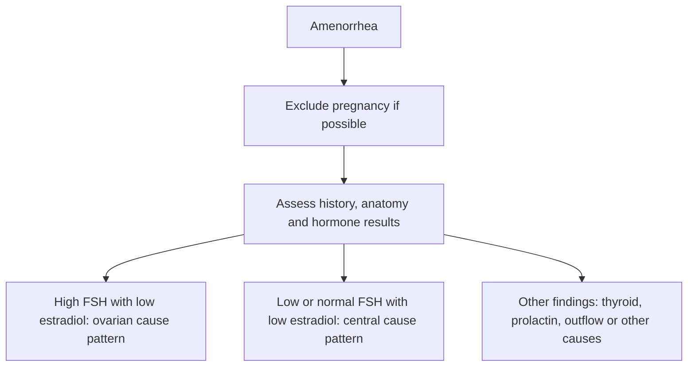

# Amenorrhea and Endocrine Differential Diagnosis — 30 Original MCQs

**Advance-preparation, unattempted.** Yeh original practice questions hain. Inhe official PYQs mat samjho. ASRM 2024 aur Endocrine Society ke named guidance ke hisaab se questions solve karo. Actual patient ki care mein local protocol aur specialist assessment zaroori hai.

[Chapter](../README.md) · [PCOS and ovarian disorders](10-PCOS-Ovarian-Cysts-and-Hormonal-Disorders-20-MCQs.md) · [AUB](12-Abnormal-Uterine-Bleeding-30-MCQs.md)

## Part 1 — Q1–Q5

### Q1. A 15-year-old has normal breast development but has never menstruated. Under ASRM 2024 guidance, what should the nurse arrange?

**Difficulty:** 🟡 Medium · **Priority:** 🟠 HIGH YIELD · **Evidence:** Original practice

- **A.** Routine reassurance until age 20
- **B.** Treatment for secondary amenorrhea without assessment
- **C.** Evaluation for primary amenorrhea
- **D.** A diagnosis of infertility based only on age

✅ Answer aur detailed A–D Hinglish explanation

**Correct: C. Evaluation for primary amenorrhea**

- **A kyun galat hai:** Age 20 tak wait karne se congenital ya hormonal problem ki diagnosis delay ho sakti hai.
- **B kyun galat hai:** Secondary amenorrhea tab hoti hai jab periods pehle aa chuke hon aur baad mein band ho jaayein. Is patient ka menarche nahi hua.
- **C kyun sahi hai:** Primary amenorrhea ka matlab hai ki first period abhi tak nahi aaya. ASRM ke hisaab se normal secondary sexual development ke saath age 15 tak menarche na ho toh evaluation chahiye. Uterus, outflow tract aur hormonal function ko assess karna important hai.
- **D kyun galat hai:** Amenorrhea ki wajah pehle establish karni hai. Fertility outcome sirf age aur absent periods se predict nahi hota.

**Exam clue:** No menarche by age 15 despite secondary sexual development warrants evaluation.

**Clinical reference:** [ASRM 2024 amenorrhea committee opinion](https://www.asrm.org/practice-guidance/practice-committee-documents/current-evaluation-of-amenorrhea/)

**YouTube MCQ practice:** Is question ka specific question-solving video independently verify nahi hua hai. Verification pending hai.

### Q2. A 13-year-old has not started breast development. Which response is appropriate under ASRM guidance?

**Difficulty:** 🟡 Medium · **Priority:** 🟠 HIGH YIELD · **Evidence:** Original practice

- **A.** Arrange evaluation of delayed pubertal development now
- **B.** Wait until age 18 in every case
- **C.** Diagnose complete androgen insensitivity from age alone
- **D.** Start oral contraceptives without investigation

✅ Answer aur detailed A–D Hinglish explanation

**Correct: A. Arrange evaluation of delayed pubertal development now**

- **A kyun sahi hai:** Breast development estrogen action ka important sign hai. Age 13 tak breast development start na ho toh delayed puberty ki evaluation chahiye. Pituitary aur ovarian hormone function assess karne se cause samajhne mein help milti hai.
- **B kyun galat hai:** Evaluation ko 18 years tak delay karna recommended nahi hai, kyunki puberty development already delayed hai.
- **C kyun galat hai:** Androgen insensitivity diagnose karne ke liye anatomy, hormone tests aur genetic assessment ki need ho sakti hai. Sirf age se diagnosis nahi hoti.
- **D kyun galat hai:** Bina evaluation hormone shuru karne se underlying cause miss ho sakta hai. Specialist age-appropriate plan decide karega.

**Exam clue:** Absent breast development at 13 requires assessment.

**Clinical reference:** [ASRM 2024 amenorrhea committee opinion](https://www.asrm.org/practice-guidance/practice-committee-documents/current-evaluation-of-amenorrhea/)

**▶️ [YouTube MCQ practice — JINC E-NURSING, Akki Sir #999](https://www.youtube.com/watch?v=e1j6apaPdJE&t=685s). Description mein 11:25 par primary amenorrhea with absent breast development ka diagnostic test listed hai. Yeh related topic marker hai, exact item aur playback independently verified nahi hain.

### Q3. A nonpregnant woman who previously had irregular cycles has had no menstrual bleeding for six months. Which description is most appropriate under ASRM 2024?

**Difficulty:** 🟡 Medium · **Priority:** 🟠 HIGH YIELD · **Evidence:** Original practice

- **A.** Primary amenorrhea because the current interval is long
- **B.** Normal menopause regardless of age
- **C.** A confirmed diagnosis of PCOS
- **D.** Secondary amenorrhea requiring investigation

✅ Answer aur detailed A–D Hinglish explanation

**Correct: D. Secondary amenorrhea requiring investigation**

- **A kyun galat hai:** Primary amenorrhea mein menarche hua hi nahi hota. Yahan pehle periods aa chuke hain.
- **B kyun galat hai:** Menopause diagnose karne ke liye age aur clinical context important hain. Six months alone se menopause establish nahi hota.
- **C kyun galat hai:** PCOS ek possible cause hai, lekin thyroid, prolactin, ovarian aur other causes bhi assess karne hain.
- **D kyun sahi hai:** Is woman ke periods pehle aa chuke hain. Previously irregular cycles mein six months tak bleeding absent ho toh secondary amenorrhea ki evaluation chahiye. Previously regular cycles mein threshold shorter hota hai.

**Exam clue:** Secondary amenorrhea criteria depend on previous cycle regularity.

**Clinical reference:** [ASRM 2024 amenorrhea committee opinion](https://www.asrm.org/practice-guidance/practice-committee-documents/current-evaluation-of-amenorrhea/)

**YouTube MCQ practice:** Is question ka specific question-solving video independently verify nahi hua hai. Verification pending hai.

### Q4. After pregnancy has been excluded in a patient with secondary amenorrhea and an unremarkable examination, which initial hormonal panel best supports evaluation under ASRM 2024?

**Difficulty:** 🟡 Medium · **Priority:** 🟠 HIGH YIELD · **Evidence:** Original practice

- **A.** Troponin, CK-MB and BNP
- **B.** FSH, estradiol, TSH and prolactin
- **C.** Serum lipase and amylase only
- **D.** Hemoglobin electrophoresis alone

✅ Answer aur detailed A–D Hinglish explanation

**Correct: B. FSH, estradiol, TSH and prolactin**

- **A kyun galat hai:** Troponin aur CK-MB cardiac injury se related markers hain. Ye reproductive hormonal pathway assess nahi karte.
- **B kyun sahi hai:** FSH aur estradiol ko saath dekhne se ovarian function aur brain se aane wale hormonal signals ka pattern samajh aata hai. TSH thyroid aur prolactin pituitary-related causes assess karne mein help karte hain. Is panel ko history ke saath interpret karte hain.
- **C kyun galat hai:** Lipase aur amylase pancreas-related conditions mein useful ho sakte hain. Amenorrhea ka usual endocrine panel nahi hain.
- **D kyun galat hai:** Hemoglobin electrophoresis inherited hemoglobin disorders assess karti hai. Ye ovarian aur pituitary hormonal function directly nahi batati.

**Exam clue:** Pregnancy exclusion is followed by a targeted endocrine assessment.

**Clinical reference:** [ASRM 2024 amenorrhea committee opinion](https://www.asrm.org/practice-guidance/practice-committee-documents/current-evaluation-of-amenorrhea/)

**YouTube MCQ practice:** Is question ka specific question-solving video independently verify nahi hua hai. Verification pending hai.

### Q5. A girl with primary amenorrhea has normal breast development and imaging confirms that the uterus is absent. Which two conditions are particularly important to distinguish?

**Difficulty:** 🔴 Difficult · **Priority:** 🔴 MOST IMPORTANT · **Evidence:** Original practice

- **A.** Müllerian agenesis and complete androgen insensitivity syndrome
- **B.** Primary dysmenorrhea and bacterial vaginosis
- **C.** Stress incontinence and rectocele
- **D.** Endometriosis and acute cystitis

✅ Answer aur detailed A–D Hinglish explanation

**Correct: A. Müllerian agenesis and complete androgen insensitivity syndrome**

- **A kyun sahi hai:** Müllerian agenesis mein uterus aur upper vaginal structures development ke time absent ya underdeveloped ho sakte hain. Complete androgen insensitivity mein bhi uterus absent ho sakta hai aur breast development present ho sakti hai. Isliye targeted hormone aur genetic testing se differentiate karte hain.
- **B kyun galat hai:** Dysmenorrhea painful periods ko kehte hain aur bacterial vaginosis vaginal flora ka disorder hai. Ye congenital absent uterus ki usual differential pair nahi hai.
- **C kyun galat hai:** Stress incontinence urinary leakage aur rectocele pelvic support defect hai. Dono uterus ke congenital absence ko explain nahi karte.
- **D kyun galat hai:** Endometriosis aur cystitis pain ke possible causes hain, lekin confirmed congenital uterine absence ke principal diagnostic alternatives nahi hain.

**Exam clue:** Absent uterus plus breast development requires a specific anatomical differential.

**Clinical reference:** [ASRM 2024 amenorrhea committee opinion](https://www.asrm.org/practice-guidance/practice-committee-documents/current-evaluation-of-amenorrhea/)

**YouTube MCQ practice:** [NORCET 10 Mains OBG MCQ Countdown](https://www.youtube.com/watch?v=zSlArdox-Go). Description primary amenorrhea and AIS case discussion identify karti hai. Exact question coverage aur playback pending hai.

## Part 2 — Q6–Q10

### Q6. An adolescent with primary amenorrhea and confirmed Müllerian agenesis is referred for additional anatomical assessment. Which associated system deserves particular attention?

**Difficulty:** 🟡 Medium · **Priority:** 🟠 HIGH YIELD · **Evidence:** Original practice

- **A.** Auditory canal alone
- **B.** Pancreatic ducts alone
- **C.** Urinary tract and kidneys
- **D.** Coronary arteries in every case

✅ Answer aur detailed A–D Hinglish explanation

**Correct: C. Urinary tract and kidneys**

- **A kyun galat hai:** Ear canal ki isolated assessment associated urinary anomalies detect nahi karegi.
- **B kyun galat hai:** Pancreatic ducts digestive system se related hain aur renal anomaly screening ko replace nahi karte.
- **C kyun sahi hai:** Müllerian structures aur urinary tract embryonic development ke closely related processes se develop hote hain. Isliye Müllerian agenesis ke saath kidney ya urinary tract anomalies ho sakti hain. Specialist indicated renal imaging arrange kar sakta hai.
- **D kyun galat hai:** Cardiac evaluation other indications ke liye ho sakti hai, lekin cited guideline specifically urogenital malformations ka association highlight karti hai.

**Exam clue:** Müllerian agenesis can be associated with renal anomalies.

**Clinical reference:** [ASRM 2024 amenorrhea committee opinion](https://www.asrm.org/practice-guidance/practice-committee-documents/current-evaluation-of-amenorrhea/)

**YouTube MCQ practice:** [NORCET 10 Mains OBG MCQ Countdown](https://www.youtube.com/watch?v=zSlArdox-Go). Description primary amenorrhea and AIS case discussion identify karti hai. Exact question coverage aur playback pending hai.

### Q7. A patient with primary amenorrhea has normal breasts, an absent uterus and very sparse pubic hair. Which condition should be specifically considered?

**Difficulty:** 🔴 Difficult · **Priority:** 🔴 MOST IMPORTANT · **Evidence:** Original practice

- **A.** Typical primary dysmenorrhea
- **B.** Complete androgen insensitivity syndrome
- **C.** Isolated cervical ectropion
- **D.** Functional uterine bleeding from a polyp

✅ Answer aur detailed A–D Hinglish explanation

**Correct: B. Complete androgen insensitivity syndrome**

- **A kyun galat hai:** Primary dysmenorrhea mein menstruation painful hoti hai. Congenitally absent uterus aur sparse pubic hair ko yeh explain nahi karti.
- **B kyun sahi hai:** Complete androgen insensitivity mein body ke tissues androgens ka response nahi de paate. Breast development estrogen effect se ho sakti hai, lekin pubic hair sparse ho sakte hain. Absent uterus ke saath yeh finding differential mein important hai aur specialist testing chahiye.
- **C kyun galat hai:** Ectropion cervical epithelium ka change hai. Absent uterus ke context mein yeh primary cause nahi hai.
- **D kyun galat hai:** Uterine polyp ke liye uterine cavity present honi chahiye. Is patient ka uterus absent hai.

**Exam clue:** Sparse pubic hair helps distinguish complete androgen insensitivity from Müllerian agenesis.

**Clinical reference:** [ASRM 2024 amenorrhea committee opinion](https://www.asrm.org/practice-guidance/practice-committee-documents/current-evaluation-of-amenorrhea/)

**YouTube MCQ practice:** [NORCET 10 Mains OBG MCQ Countdown](https://www.youtube.com/watch?v=zSlArdox-Go). Description primary amenorrhea and AIS case discussion identify karti hai. Exact question coverage aur playback pending hai.

### Q8. When congenital uterine absence is established, which investigations help distinguish Müllerian agenesis from complete androgen insensitivity syndrome?

**Difficulty:** 🔴 Difficult · **Priority:** 🔴 MOST IMPORTANT · **Evidence:** Original practice

- **A.** Serum sodium and potassium only
- **B.** Urine glucose and ketones only
- **C.** Cervical cytology alone
- **D.** Serum testosterone and karyotype

✅ Answer aur detailed A–D Hinglish explanation

**Correct: D. Serum testosterone and karyotype**

- **A kyun galat hai:** Electrolytes metabolic state assess karte hain. Ye chromosomal pattern aur androgen production distinguish nahi karte.
- **B kyun galat hai:** Urine glucose aur ketones glucose metabolism ke clues hain, reproductive anatomy ka underlying cause nahi batate.
- **C kyun galat hai:** Cervical cytology cervix ke cells assess karti hai. Confirmed absent uterus/cervix ke differential ko is test se solve nahi kar sakte.
- **D kyun sahi hai:** Testosterone level aur karyotype se gonadal aur chromosomal context clarify ho sakta hai. Complete androgen insensitivity mein testosterone generally typical male range mein hota hai aur 46,XY karyotype mil sakta hai. Sensitive specialist counseling ke saath tests interpret karne hain.

**Exam clue:** Testosterone and karyotype are targeted tests for this anatomical differential.

**Clinical reference:** [ASRM 2024 amenorrhea committee opinion](https://www.asrm.org/practice-guidance/practice-committee-documents/current-evaluation-of-amenorrhea/)

**YouTube MCQ practice:** [NORCET 10 Mains OBG MCQ Countdown](https://www.youtube.com/watch?v=zSlArdox-Go). Description primary amenorrhea and AIS case discussion identify karti hai. Exact question coverage aur playback pending hai.

### Q9. A 15-year-old has never menstruated, has normal secondary sexual development and reports monthly pelvic pain. Examination by an appropriate clinician identifies a bulging bluish hymenal membrane. What should be suspected?

**Difficulty:** 🔴 Difficult · **Priority:** 🔴 MOST IMPORTANT · **Evidence:** Original practice

- **A.** Premature ovarian insufficiency in every case
- **B.** Uncomplicated physiological leukorrhea
- **C.** Primary hyperthyroidism as the definite diagnosis
- **D.** Imperforate hymen causing outflow obstruction

✅ Answer aur detailed A–D Hinglish explanation

**Correct: D. Imperforate hymen causing outflow obstruction**

- **A kyun galat hai:** Ovarian insufficiency mein estrogen production low ho sakti hai. Is case mein cyclic pain aur obstructing membrane outflow problem ko strongly suggest karte hain.
- **B kyun galat hai:** Physiological leukorrhea normal discharge ho sakti hai. Ye retained menstrual blood aur bulging membrane explain nahi karti.
- **C kyun galat hai:** Thyroid disorder menstrual changes kar sakta hai, lekin visible obstruction ko hyperthyroidism se automatically attribute nahi karna chahiye.
- **D kyun sahi hai:** Hymen mein opening absent ho toh menstrual blood outside nahi nikal pata. Blood vaginal canal mein accumulate ho sakta hai aur monthly pain aur bulging bluish membrane develop ho sakti hai. Specialist assessment aur appropriate treatment chahiye.

**Exam clue:** Cyclic pain without visible menses can indicate obstructed outflow.

**Clinical reference:** [ASRM 2024 amenorrhea committee opinion](https://www.asrm.org/practice-guidance/practice-committee-documents/current-evaluation-of-amenorrhea/)

**YouTube MCQ practice:** Is question ka specific question-solving video independently verify nahi hua hai. Verification pending hai.

### Q10. Imaging in an adolescent with genital outflow obstruction shows blood collected within the vaginal canal. Which term describes this finding?

**Difficulty:** 🟡 Medium · **Priority:** 🟠 HIGH YIELD · **Evidence:** Original practice

- **A.** Hematuria
- **B.** Hematocolpos
- **C.** Hematometra only
- **D.** Hematemesis

✅ Answer aur detailed A–D Hinglish explanation

**Correct: B. Hematocolpos**

- **A kyun galat hai:** Hematuria urine mein blood ko kehte hain. Yahan blood vaginal canal mein collect hua hai.
- **B kyun sahi hai:** Hematocolpos ka matlab vaginal canal mein retained blood hai. Jab menstrual outflow blocked ho, toh blood collect hokar pelvic pressure aur pain cause kar sakta hai. Underlying obstruction ko specialist assess karta hai.
- **C kyun galat hai:** Hematometra uterine cavity mein retained blood ko describe karta hai. Both coexist kar sakte hain, but question vaginal collection specifically pooch raha hai.
- **D kyun galat hai:** Hematemesis vomiting of blood hai aur gastrointestinal tract se related hai. Ye genital blood collection nahi hai.

**Exam clue:** The anatomical site distinguishes hematocolpos from hematometra.

**Clinical reference:** [ASRM 2024 amenorrhea committee opinion](https://www.asrm.org/practice-guidance/practice-committee-documents/current-evaluation-of-amenorrhea/)

**YouTube MCQ practice:** Is question ka specific question-solving video independently verify nahi hua hai. Verification pending hai.

## Part 3 — Q11–Q15

### Q11. A patient with amenorrhea has persistently elevated FSH and low estradiol. Which physiological mechanism best fits this pattern?

**Difficulty:** 🔴 Difficult · **Priority:** 🔴 MOST IMPORTANT · **Evidence:** Original practice

- **A.** Reduced ovarian hormone production removes negative feedback on the pituitary
- **B.** Excess ovarian estrogen suppresses FSH completely
- **C.** The pituitary has stopped producing all gonadotropins
- **D.** The findings alone prove mechanical vaginal obstruction

✅ Answer aur detailed A–D Hinglish explanation

**Correct: A. Reduced ovarian hormone production removes negative feedback on the pituitary**

- **A kyun sahi hai:** Jab ovaries estrogen kam banati hain, toh pituitary ko normal negative feedback kam milta hai. Isliye pituitary FSH zyada release kar sakti hai. High FSH aur low estradiol ovarian insufficiency ka pattern suggest karte hain, jise clinical context mein confirm karna hai.
- **B kyun galat hai:** High estrogen generally FSH feedback ko suppress kar sakta hai. Question mein estradiol low aur FSH high hai.
- **C kyun galat hai:** Pituitary gonadotropin production absent hoti toh FSH high expected nahi hota.
- **D kyun galat hai:** Outflow obstruction normal ovarian hormone function ke saath bhi ho sakta hai. High FSH-low estradiol pattern alone mechanical obstruction diagnose nahi karta.

**Exam clue:** High FSH plus low estradiol suggests an ovarian-level problem.

**Clinical reference:** [ASRM 2024 amenorrhea committee opinion](https://www.asrm.org/practice-guidance/practice-committee-documents/current-evaluation-of-amenorrhea/)

**▶️ [YouTube MCQ practice — JINC E-NURSING, Akki Sir #999](https://www.youtube.com/watch?v=e1j6apaPdJE&t=685s). Description mein 11:25 par primary amenorrhea with absent breast development ka diagnostic test listed hai. Yeh related topic marker hai, exact item aur playback independently verified nahi hain.

### Q12. A patient with amenorrhea has low estradiol and low or inappropriately normal FSH. Which mechanism should be considered?

**Difficulty:** 🔴 Difficult · **Priority:** 🔴 MOST IMPORTANT · **Evidence:** Original practice

- **A.** Normal compensatory FSH elevation from ovarian failure
- **B.** Obligatory estrogen excess from an ovarian tumor
- **C.** Insufficient hypothalamic or pituitary stimulation of the ovaries
- **D.** A confirmed uterine polyp solely from hormone results

✅ Answer aur detailed A–D Hinglish explanation

**Correct: C. Insufficient hypothalamic or pituitary stimulation of the ovaries**

- **A kyun galat hai:** Primary ovarian failure mein low estradiol ki wajah se FSH usually elevated hota hai. Yahan FSH low ya inappropriately normal hai.
- **B kyun galat hai:** Estrogen excess question ke low estradiol finding se match nahi karta.
- **C kyun sahi hai:** Brain ka hypothalamus GnRH se pituitary ko signal deta hai. Pituitary FSH aur LH release karke ovaries ko stimulate karti hai. Jab central signal insufficient ho toh estradiol low hone ke bawajood FSH appropriately rise nahi karta. Cause identify karne ke liye history aur further assessment chahiye.
- **D kyun galat hai:** Polyp structural lesion hai. FSH aur estradiol pattern se polyp confirm nahi hota.

**Exam clue:** Low estradiol with low or normal gonadotropins suggests central hypogonadism.

**Original visual revision:**

Hormone results clues dete hain, lekin diagnosis clinical context aur additional investigations se confirm hoti hai.

**Clinical reference:** [ASRM 2024 amenorrhea committee opinion](https://www.asrm.org/practice-guidance/practice-committee-documents/current-evaluation-of-amenorrhea/)

**▶️ [YouTube MCQ practice — JINC E-NURSING, Akki Sir #999](https://www.youtube.com/watch?v=e1j6apaPdJE&t=685s). Description mein 11:25 par primary amenorrhea with absent breast development ka diagnostic test listed hai. Yeh related topic marker hai, exact item aur playback independently verified nahi hain.

### Q13. A distance runner develops amenorrhea after increasing training and restricting calorie intake. Which additional history is most important when functional hypothalamic amenorrhea is suspected?

**Difficulty:** 🟡 Medium · **Priority:** 🟠 HIGH YIELD · **Evidence:** Original practice

- **A.** Only her preferred sports brand
- **B.** Only the date of her last dental checkup
- **C.** Nutrition, exercise load, weight changes, stress and fracture history
- **D.** Only her blood group

✅ Answer aur detailed A–D Hinglish explanation

**Correct: C. Nutrition, exercise load, weight changes, stress and fracture history**

- **A kyun galat hai:** Sports brand medical energy availability ya fracture risk explain nahi karta.
- **B kyun galat hai:** Dental history general health ke liye useful ho sakti hai, lekin is scenario ki reproductive assessment ka main focus nahi hai.
- **C kyun sahi hai:** Functional hypothalamic amenorrhea mein body ko available energy kam pad sakti hai. Stress aur exercise load bhi reproductive hormone signals affect kar sakte hain. Diet, weight change, mood aur fracture history bone aur general health risk assess karne mein help karte hain.
- **D kyun galat hai:** Blood group transfusion ya pregnancy care mein relevant ho sakta hai. Energy imbalance ka mechanism establish nahi karta.

**Exam clue:** Assess energy availability and psychological stress, not weight alone.

**Clinical reference:** [Endocrine Society FHA guideline](https://www.endocrine.org/clinical-practice-guidelines/hypothalamic-amenorrhea)

**YouTube MCQ practice:** Is question ka specific question-solving video independently verify nahi hua hai. Verification pending hai.

### Q14. A patient has confirmed functional hypothalamic amenorrhea associated with low energy availability. Which management principle addresses the underlying mechanism?

**Difficulty:** 🔴 Difficult · **Priority:** 🔴 MOST IMPORTANT · **Evidence:** Original practice

- **A.** Improve energy balance through individualized nutrition and activity changes
- **B.** Increase exercise while further reducing calorie intake
- **C.** Give a uterine procedure to restore hypothalamic signaling
- **D.** Treat every case with antibiotics

✅ Answer aur detailed A–D Hinglish explanation

**Correct: A. Improve energy balance through individualized nutrition and activity changes**

- **A kyun sahi hai:** Jab body ko daily needs aur exercise ke baad insufficient energy milti hai, toh hypothalamic reproductive signals suppress ho sakte hain. Nutrition improve karna aur excessive exercise adjust karna hormonal recovery mein help kar sakta hai. Dietitian aur mental health support bhi useful ho sakte hain.
- **B kyun galat hai:** Aur calorie restriction aur exercise badhane se energy deficit worsen ho sakta hai.
- **C kyun galat hai:** Uterine procedure central hormone signals ko restore nahi karta. Structural intervention tabhi useful hai jab relevant lesion ho.
- **D kyun galat hai:** Functional hypothalamic amenorrhea bacterial infection nahi hai. Antibiotics underlying energy imbalance treat nahi karti.

**Exam clue:** Correct energy imbalance instead of only inducing bleeding.

**Clinical reference:** [Endocrine Society FHA guideline](https://www.endocrine.org/clinical-practice-guidelines/hypothalamic-amenorrhea)

**YouTube MCQ practice:** Is question ka specific question-solving video independently verify nahi hua hai. Verification pending hai.

### Q15. An adult with functional hypothalamic amenorrhea has had no periods for seven months. Under Endocrine Society guidance, which baseline assessment should be considered?

**Difficulty:** 🟡 Medium · **Priority:** 🟠 HIGH YIELD · **Evidence:** Original practice

- **A.** Routine cervical cone biopsy
- **B.** Chest radiograph as the only bone assessment
- **C.** Monthly abdominal CT indefinitely
- **D.** Bone mineral density measurement by DXA

✅ Answer aur detailed A–D Hinglish explanation

**Correct: D. Bone mineral density measurement by DXA**

- **A kyun galat hai:** Cone biopsy cervical tissue evaluate karti hai. Bone density measure nahi karti.
- **B kyun galat hai:** Chest X-ray selected pathology assess kar sakta hai, lekin hip aur spine bone mineral density ka standard quantitative test nahi hai.
- **C kyun galat hai:** Monthly CT se unnecessary radiation exposure hoga. Routine bone-health assessment ke liye DXA relevant hai.
- **D kyun sahi hai:** Low estrogen aur insufficient energy availability se bone mineral density kam ho sakti hai. Endocrine Society six months ya longer amenorrhea mein baseline DXA suggest karti hai, aur severe nutritional deficiency ya fragility mein earlier assessment consider hota hai.

**Exam clue:** FHA lasting six months or longer warrants consideration of baseline DXA.

**Clinical reference:** [Endocrine Society FHA guideline](https://www.endocrine.org/clinical-practice-guidelines/hypothalamic-amenorrhea)

**YouTube MCQ practice:** Is question ka specific question-solving video independently verify nahi hua hai. Verification pending hai.

## Part 4 — Q16–Q20

### Q16. A patient with functional hypothalamic amenorrhea requests combined oral contraceptives solely to restore natural cycles and improve bone density. Which counseling matches Endocrine Society guidance?

**Difficulty:** 🔴 Difficult · **Priority:** 🔴 MOST IMPORTANT · **Evidence:** Original practice

- **A.** Combined pills always correct the underlying energy deficit
- **B.** Oral contraceptives are not recommended solely for those goals
- **C.** Withdrawal bleeding guarantees restored bone health
- **D.** All contraceptive options are prohibited forever

✅ Answer aur detailed A–D Hinglish explanation

**Correct: B. Oral contraceptives are not recommended solely for those goals**

- **A kyun galat hai:** Pill se calorie intake aur energy expenditure ka imbalance automatically resolve nahi hota.
- **B kyun sahi hai:** Combined pill scheduled withdrawal bleeding de sakti hai, lekin energy imbalance ko automatically correct nahi karti. Endocrine Society pill ko solely natural menses restore karne ya bone mineral density improve karne ke liye recommend nahi karti. Contraceptive need ka decision separately hota hai.
- **C kyun galat hai:** Withdrawal bleeding medication response hai. Isse bone density recovery prove nahi hoti.
- **D kyun galat hai:** Patient ko pregnancy prevention ki zarurat ho sakti hai. Appropriate contraceptive choices individual suitability se discuss hoti hain.

**Exam clue:** Hormonal withdrawal bleeding is not proof of recovery from FHA.

**Clinical reference:** [Endocrine Society FHA guideline](https://www.endocrine.org/clinical-practice-guidelines/hypothalamic-amenorrhea)

**YouTube MCQ practice:** Is question ka specific question-solving video independently verify nahi hua hai. Verification pending hai.

### Q17. A patient with functional hypothalamic amenorrhea starts combined oral contraception for pregnancy prevention. Why should her nutrition and exercise follow-up continue?

**Difficulty:** 🔴 Difficult · **Priority:** 🔴 MOST IMPORTANT · **Evidence:** Original practice

- **A.** Every contraceptive pill immediately restores normal hypothalamic function
- **B.** Scheduled bleeding proves adequate nutrition
- **C.** Hormonal contraception eliminates every bone risk
- **D.** The pill may mask spontaneous menstrual recovery while bone loss can continue if energy deficit persists

✅ Answer aur detailed A–D Hinglish explanation

**Correct: D. The pill may mask spontaneous menstrual recovery while bone loss can continue if energy deficit persists**

- **A kyun galat hai:** Contraception ka main purpose pregnancy prevent karna hai. Ye central reproductive suppression ko necessarily reverse nahi karta.
- **B kyun galat hai:** Scheduled withdrawal bleeding se nutritional adequacy prove nahi hoti. Diet aur clinical status separately assess karna hai.
- **C kyun galat hai:** Bone health estrogen, nutrition, activity aur other factors se related hai. Contraception all risks eliminate nahi karti.
- **D kyun sahi hai:** Pill ke hormone-free interval mein bleeding aa sakti hai even when spontaneous ovarian cycles recover nahi hue hain. Agar energy deficit ab bhi hai toh bone loss continue ho sakta hai. Isliye nutrition, symptoms aur bone-health follow-up important rehta hai.

**Exam clue:** Do not use pill-associated bleeding as a recovery marker.

**Clinical reference:** [Endocrine Society FHA guideline](https://www.endocrine.org/clinical-practice-guidelines/hypothalamic-amenorrhea)

**YouTube MCQ practice:** Is question ka specific question-solving video independently verify nahi hua hai. Verification pending hai.

### Q18. A patient with suspected functional hypothalamic amenorrhea has severe bradycardia, low blood pressure and dizziness on standing. What is the appropriate priority?

**Difficulty:** 🔴 Difficult · **Priority:** 🔴 MOST IMPORTANT · **Evidence:** Original practice

- **A.** Urgent medical assessment for possible inpatient stabilization
- **B.** Routine follow-up in six months only
- **C.** Recommend more endurance exercise immediately
- **D.** Start ovulation induction before vital signs are reviewed

✅ Answer aur detailed A–D Hinglish explanation

**Correct: A. Urgent medical assessment for possible inpatient stabilization**

- **A kyun sahi hai:** Severe bradycardia aur hypotension nutritional deficiency ya physiological instability ke warning signs ho sakte hain. Endocrine Society aise findings mein inpatient treatment ki need assess karne ko kehti hai. Nurse circulation, consciousness aur urgent escalation ko priority de.
- **B kyun galat hai:** Six months ka wait unstable patient ke liye unsafe hai. Current vital signs immediate assessment require karte hain.
- **C kyun galat hai:** Additional exercise energy deficit aur cardiovascular stress worsen kar sakti hai.
- **D kyun galat hai:** Fertility treatment se pehle medical stability aur energy balance assess karna important hai.

**Exam clue:** Severe physiological instability takes priority over cycle restoration.

**Clinical reference:** [Endocrine Society FHA guideline](https://www.endocrine.org/clinical-practice-guidelines/hypothalamic-amenorrhea)

**YouTube MCQ practice:** Is question ka specific question-solving video independently verify nahi hua hai. Verification pending hai.

### Q19. A patient initially thought to have functional hypothalamic amenorrhea reports persistent severe headaches and new visual changes. Which next assessment should be discussed urgently with the clinician?

**Difficulty:** 🔴 Difficult · **Priority:** 🔴 MOST IMPORTANT · **Evidence:** Original practice

- **A.** Routine reassurance because all headaches are caused by exercise
- **B.** A mammogram as the only investigation
- **C.** Pituitary-focused MRI and appropriate neurological assessment
- **D.** Pelvic floor exercises instead of evaluation

✅ Answer aur detailed A–D Hinglish explanation

**Correct: C. Pituitary-focused MRI and appropriate neurological assessment**

- **A kyun galat hai:** Exercise headache ka possible reason hai, lekin new visual changes ke saath central pathology exclude karni hai.
- **B kyun galat hai:** Mammography breast tissue assess karti hai. Pituitary aur optic pathway evaluate nahi karti.
- **C kyun sahi hai:** Pituitary ya brain lesion reproductive signals aur vision ko affect kar sakta hai. Persistent severe headache aur visual change red flags hain. Endocrine Society indicated cases mein pituitary-focused MRI recommend karti hai. Symptoms ki urgency ke hisaab se clinician assessment arrange karo.
- **D kyun galat hai:** Pelvic floor training continence aur support disorders mein useful hai. Neurological red flags ka diagnostic substitute nahi hai.

**Exam clue:** Do not attribute neurological red flags to functional amenorrhea without assessment.

**Clinical reference:** [Endocrine Society FHA guideline](https://www.endocrine.org/clinical-practice-guidelines/hypothalamic-amenorrhea)

**YouTube MCQ practice:** Is question ka specific question-solving video independently verify nahi hua hai. Verification pending hai.

### Q20. A woman with amenorrhea has no milky nipple discharge. Which statement about prolactin assessment is accurate?

**Difficulty:** 🟡 Medium · **Priority:** 🟠 HIGH YIELD · **Evidence:** Original practice

- **A.** Normal nipple appearance excludes all pituitary causes
- **B.** Absence of galactorrhea does not reliably exclude hyperprolactinemia
- **C.** Prolactin should be assessed only during breastfeeding
- **D.** Hyperprolactinemia always causes visible discharge

✅ Answer aur detailed A–D Hinglish explanation

**Correct: B. Absence of galactorrhea does not reliably exclude hyperprolactinemia**

- **A kyun galat hai:** Normal nipple appearance pituitary function ka complete assessment nahi hai. Hormone disorders symptoms ke bina bhi present ho sakte hain.
- **B kyun sahi hai:** Galactorrhea ka matlab nonphysiological milky nipple discharge hai. High prolactin wali sab patients mein discharge nahi hota. Prolactin ovarian hormone signaling disturb karke amenorrhea cause kar sakta hai, isliye indicated endocrine assessment mein level check karna important hai.
- **C kyun galat hai:** Prolactin breastfeeding mein physiological role rakhta hai, lekin nonpregnant patients ke menstrual disorders mein bhi test useful hai.
- **D kyun galat hai:** High prolactin ka symptom pattern vary kar sakta hai. Visible discharge mandatory finding nahi hai.

**Exam clue:** Do not exclude elevated prolactin just because galactorrhea is absent.

**Clinical reference:** [ASRM 2024 amenorrhea committee opinion](https://www.asrm.org/practice-guidance/practice-committee-documents/current-evaluation-of-amenorrhea/)

**YouTube MCQ practice:** Is question ka specific question-solving video independently verify nahi hua hai. Verification pending hai.

## Part 5 — Q21–Q25

### Q21. A patient has a mildly elevated prolactin level from a sample taken after strenuous exercise and breast stimulation. What is a reasonable next step before labeling persistent hyperprolactinemia?

**Difficulty:** 🔴 Difficult · **Priority:** 🔴 MOST IMPORTANT · **Evidence:** Original practice

- **A.** Diagnose a pituitary tumor from this result alone
- **B.** Repeat the measurement in appropriate conditions and review medicines and other causes
- **C.** Begin surgery without additional evaluation
- **D.** Ignore all future prolactin abnormalities

✅ Answer aur detailed A–D Hinglish explanation

**Correct: B. Repeat the measurement in appropriate conditions and review medicines and other causes**

- **A kyun galat hai:** Single mild result se pituitary tumor prove nahi hota. Clinical correlation aur repeat assessment important hain.
- **B kyun sahi hai:** Exercise aur breast stimulation transiently prolactin level raise kar sakte hain. Mild elevation ko appropriate repeat testing aur medicines, thyroid function aur other causes ke review se confirm karna useful hai. Persistent abnormal result further assessment require kar sakta hai.
- **C kyun galat hai:** Pituitary surgery selected diagnosed lesions ke liye ho sakti hai. Unconfirmed mild elevation par surgery appropriate nahi.
- **D kyun galat hai:** Transient elevation possible hai, but persistent abnormal result ko ignore nahi karna chahiye.

**Exam clue:** A mildly elevated prolactin result needs confirmation in context.

**Clinical reference:** [ASRM 2024 amenorrhea committee opinion](https://www.asrm.org/practice-guidance/practice-committee-documents/current-evaluation-of-amenorrhea/)

**YouTube MCQ practice:** Is question ka specific question-solving video independently verify nahi hua hai. Verification pending hai.

### Q22. Laboratory evaluation finds persistently elevated measured prolactin with a substantial macroprolactin component. Why is this distinction useful?

**Difficulty:** 🔴 Difficult · **Priority:** 🔴 MOST IMPORTANT · **Evidence:** Original practice

- **A.** Macroprolactin is identical to estrogen
- **B.** Every macroprolactin elevation proves an invasive tumor
- **C.** Macroprolactin testing replaces pregnancy assessment
- **D.** Macroprolactin is less biologically active and can contribute to measured elevation without explaining amenorrhea

✅ Answer aur detailed A–D Hinglish explanation

**Correct: D. Macroprolactin is less biologically active and can contribute to measured elevation without explaining amenorrhea**

- **A kyun galat hai:** Prolactin aur estrogen different hormones hain. Macroprolactin estrogen ka form nahi hai.
- **B kyun galat hai:** High measured value alone invasive tumor establish nahi karti. Clinician active prolactin fraction aur context review karega.
- **C kyun galat hai:** Pregnancy amenorrhea ka important cause hai. Macroprolactin result pregnancy exclusion ko replace nahi karta.
- **D kyun sahi hai:** Macroprolactin large molecular form hai jo routine assay mein detect ho sakta hai, lekin biological activity generally low hoti hai. Is distinction se unnecessary imaging avoid ho sakti hai aur amenorrhea ke actual cause par evaluation focus reh sakta hai.

**Exam clue:** Measured prolactin and biologically active prolactin may differ.

**Clinical reference:** [ASRM 2024 amenorrhea committee opinion](https://www.asrm.org/practice-guidance/practice-committee-documents/current-evaluation-of-amenorrhea/)

**YouTube MCQ practice:** Is question ka specific question-solving video independently verify nahi hua hai. Verification pending hai.

### Q23. A woman develops amenorrhea after starting a dopamine-blocking antipsychotic. Which nursing action is safest?

**Difficulty:** 🔴 Difficult · **Priority:** 🔴 MOST IMPORTANT · **Evidence:** Original practice

- **A.** Review the timing and prolactin-related adverse effect with the prescribing team without independently stopping the medicine
- **B.** Tell her to abruptly discontinue all psychiatric treatment
- **C.** Assume every antipsychotic permanently destroys ovaries
- **D.** Increase the antipsychotic dose to restore ovulation

✅ Answer aur detailed A–D Hinglish explanation

**Correct: A. Review the timing and prolactin-related adverse effect with the prescribing team without independently stopping the medicine**

- **A kyun sahi hai:** Dopamine normally pituitary prolactin release ko inhibit karta hai. Kuch antipsychotics dopamine action block karte hain, jis se prolactin rise aur menstrual changes ho sakte hain. Prescriber aur gynecology team ke saath coordinated assessment karo. Psychiatric medicine independently stop nahi karni hai.
- **B kyun galat hai:** Abrupt discontinuation se psychiatric symptoms relapse ya withdrawal problems ho sakte hain. Medication changes prescriber-led honi chahiye.
- **C kyun galat hai:** Medicine-related prolactin elevation ovarian destruction ke barabar nahi hai. Cause aur reversibility individual context mein assess hote hain.
- **D kyun galat hai:** Dose increase prolactin effect worsen kar sakta hai. Ovulation restore karne ke liye yeh independent nursing action appropriate nahi.

**Exam clue:** Medication-induced prolactin elevation needs coordinated review.

**Clinical reference:** [ASRM 2024 amenorrhea committee opinion](https://www.asrm.org/practice-guidance/practice-committee-documents/current-evaluation-of-amenorrhea/)

**YouTube MCQ practice:** Is question ka specific question-solving video independently verify nahi hua hai. Verification pending hai.

### Q24. A patient with amenorrhea has persistently elevated active prolactin after pregnancy, medication effects and other reversible causes have been assessed. Which imaging modality is preferred for pituitary evaluation when indicated?

**Difficulty:** 🟡 Medium · **Priority:** 🟠 HIGH YIELD · **Evidence:** Original practice

- **A.** Plain ankle radiography
- **B.** Mammography alone
- **C.** Pituitary MRI
- **D.** Routine abdominal ultrasound alone

✅ Answer aur detailed A–D Hinglish explanation

**Correct: C. Pituitary MRI**

- **A kyun galat hai:** Ankle radiograph bones aur joints assess karta hai, pituitary gland nahi.
- **B kyun galat hai:** Mammography breast tissue ka diagnostic imaging test hai. High prolactin ka central cause locate nahi karti.
- **C kyun sahi hai:** MRI pituitary gland aur surrounding soft tissues ko detailed image mein assess kar sakta hai. Persistent unexplained hyperprolactinemia mein pituitary lesion evaluate karne ke liye preferred imaging hai. Specialist clinical findings se decide karta hai.
- **D kyun galat hai:** Abdominal ultrasound pelvic ya abdominal organs evaluate kar sakta hai. Pituitary brain ke andar hoti hai, isliye is test se directly visualize nahi hoti.

**Exam clue:** Persistent unexplained active prolactin elevation may need pituitary MRI.

**Clinical reference:** [ASRM 2024 amenorrhea committee opinion](https://www.asrm.org/practice-guidance/practice-committee-documents/current-evaluation-of-amenorrhea/)

**YouTube MCQ practice:** Is question ka specific question-solving video independently verify nahi hua hai. Verification pending hai.

### Q25. A woman with amenorrhea has elevated TSH and a low free T4 level. Which endocrine interpretation is most consistent with these results?

**Difficulty:** 🟡 Medium · **Priority:** 🟠 HIGH YIELD · **Evidence:** Original practice

- **A.** Primary hypothyroidism
- **B.** Normal thyroid function proven by the low T4
- **C.** Primary ovarian failure established by thyroid values alone
- **D.** Central hypothyroidism with an appropriately suppressed TSH by definition

✅ Answer aur detailed A–D Hinglish explanation

**Correct: A. Primary hypothyroidism**

- **A kyun sahi hai:** Primary hypothyroidism mein thyroid gland sufficient hormone nahi bana paati. Pituitary feedback ke response mein TSH increase karti hai. High TSH aur low free T4 ka pattern primary hypothyroidism suggest karta hai, jo menstrual irregularity contribute kar sakta hai.
- **B kyun galat hai:** Low free T4 normal thyroid function ka proof nahi. TSH ke saath pattern interpret karna chahiye.
- **C kyun galat hai:** Ovarian function FSH aur estradiol jaise tests aur clinical history se assess hoti hai. Thyroid values ovarian failure establish nahi karti.
- **D kyun galat hai:** Central hypothyroidism mein free T4 low ho sakta hai aur TSH low ya inappropriately normal ho sakta hai. Yahan elevated TSH primary pattern ko support karta hai.

**Exam clue:** In amenorrhea, interpret thyroid hormones as a pattern, not TSH alone.

**Clinical reference:** [ASRM 2024 amenorrhea committee opinion](https://www.asrm.org/practice-guidance/practice-committee-documents/current-evaluation-of-amenorrhea/)

**YouTube MCQ practice:** Is question ka specific question-solving video independently verify nahi hua hai. Verification pending hai.

## Part 6 — Q26–Q30

### Q26. After pregnancy exclusion and evaluation, a prescribed progestin withdrawal test produces bleeding in an amenorrheic patient. What does this response generally support?

**Difficulty:** 🔴 Difficult · **Priority:** 🔴 MOST IMPORTANT · **Evidence:** Original practice

- **A.** A definitive diagnosis of ovarian cancer
- **B.** Complete obstruction of the genital outflow tract
- **C.** An estrogen-responsive endometrium with an outflow pathway and possible anovulation
- **D.** Proof that natural ovulation occurred during the test

✅ Answer aur detailed A–D Hinglish explanation

**Correct: C. An estrogen-responsive endometrium with an outflow pathway and possible anovulation**

- **A kyun galat hai:** Withdrawal bleeding cancer ka diagnostic test nahi. Tissue pathology aur clinical assessment relevant hote hain.
- **B kyun galat hai:** Complete outflow obstruction mein blood bahar nahi nikal paata. Visible withdrawal bleeding us claim ko support nahi karti.
- **C kyun sahi hai:** Agar estrogen ne lining ko grow kiya hai, toh short progestin exposure aur withdrawal ke baad lining shed ho sakti hai. Bleeding se patent outflow aur estrogen exposure ka support milta hai aur anovulation possible hai. Test alone exact underlying cause confirm nahi karta.
- **D kyun galat hai:** Progestin medicine ovulation ko prove nahi karti. Withdrawal bleeding induced response hai.

**Exam clue:** Withdrawal bleeding can support anovulation, not a confirmed etiological diagnosis.

**Clinical reference:** [ASRM 2024 amenorrhea committee opinion](https://www.asrm.org/practice-guidance/practice-committee-documents/current-evaluation-of-amenorrhea/)

**YouTube MCQ practice:** Is question ka specific question-solving video independently verify nahi hua hai. Verification pending hai.

### Q27. An amenorrheic patient has no bleeding after a prescribed progestin withdrawal test. Which interpretation is most appropriate?

**Difficulty:** 🔴 Difficult · **Priority:** 🔴 MOST IMPORTANT · **Evidence:** Original practice

- **A.** Diagnose PCOS in every patient from this result
- **B.** Exclude all structural causes immediately
- **C.** Repeat unsupervised hormones until bleeding occurs
- **D.** Consider insufficient estrogen exposure or endometrial/outflow pathology, and correlate with other tests

✅ Answer aur detailed A–D Hinglish explanation

**Correct: D. Consider insufficient estrogen exposure or endometrial/outflow pathology, and correlate with other tests**

- **A kyun galat hai:** PCOS ke diagnostic criteria separate hain. No withdrawal bleed akela PCOS establish nahi karta.
- **B kyun galat hai:** No bleed structural problem ke possibility ko eliminate nahi karta. Scarring aur outflow pathology consider karni pad sakti hai.
- **C kyun galat hai:** Unsupervised repeated hormones diagnosis delay kar sakte hain aur adverse effects ho sakte hain. Clinician-directed evaluation follow karo.
- **D kyun sahi hai:** Withdrawal bleeding ke liye estrogen-primed endometrium aur functional outflow pathway chahiye. Low estrogen se lining thin ho sakti hai, aur uterine scarring se lining respond nahi kar sakti. Isliye no bleed ke multiple possible explanations hain aur further evaluation chahiye.

**Exam clue:** A negative challenge is not diagnostic by itself.

**Clinical reference:** [ASRM 2024 amenorrhea committee opinion](https://www.asrm.org/practice-guidance/practice-committee-documents/current-evaluation-of-amenorrhea/)

**YouTube MCQ practice:** Is question ka specific question-solving video independently verify nahi hua hai. Verification pending hai.

### Q28. A woman develops marked reduction in menstrual flow after uterine curettage. Ultrasound suggests endometrial scarring. Which investigation may directly assess the suspected intrauterine adhesions?

**Difficulty:** 🔴 Difficult · **Priority:** 🔴 MOST IMPORTANT · **Evidence:** Original practice

- **A.** Routine chest auscultation
- **B.** Diagnostic hysteroscopy through the specialist pathway
- **C.** Serum cholesterol measurement
- **D.** Pap smear as the sole investigation

✅ Answer aur detailed A–D Hinglish explanation

**Correct: B. Diagnostic hysteroscopy through the specialist pathway**

- **A kyun galat hai:** Chest auscultation lungs aur heart ke findings assess kar sakti hai. Uterine cavity visualize nahi karti.
- **B kyun sahi hai:** Uterine instrumentation ke baad kabhi uterine cavity mein scar bands develop ho sakte hain. Hysteroscopy camera se cavity aur adhesions ko directly evaluate karne mein help karti hai. Specialist procedure indication, consent aur further treatment discuss karega.
- **C kyun galat hai:** Cholesterol metabolic risk ka marker hai. Adhesions ka anatomical test nahi hai.
- **D kyun galat hai:** Pap smear cervical cells examine karti hai. Uterine cavity ke scar bands directly detect nahi karti.

**Exam clue:** New scanty or absent menses after instrumentation should raise suspicion of cavity scarring.

**Clinical reference:** [ASRM 2024 amenorrhea committee opinion](https://www.asrm.org/practice-guidance/practice-committee-documents/current-evaluation-of-amenorrhea/)

**YouTube MCQ practice:** Is question ka specific question-solving video independently verify nahi hua hai. Verification pending hai.

### Q29. Months after severe postpartum hemorrhage, a woman reports failure to lactate, persistent amenorrhea and marked fatigue. Which condition should be considered?

**Difficulty:** 🔴 Difficult · **Priority:** 🔴 MOST IMPORTANT · **Evidence:** Original practice

- **A.** Physiological lactational amenorrhea despite failure to lactate
- **B.** Isolated vaginal candidiasis
- **C.** Sheehan syndrome due to postpartum pituitary injury
- **D.** Simple mittelschmerz

✅ Answer aur detailed A–D Hinglish explanation

**Correct: C. Sheehan syndrome due to postpartum pituitary injury**

- **A kyun galat hai:** Physiological lactational amenorrhea breastfeeding ke hormonal effect se hoti hai. Yahan severe hemorrhage ke baad milk production failure aur fatigue pituitary pathology ka concern raise karte hain.
- **B kyun galat hai:** Candidiasis vaginal fungal infection hai. Pituitary hormone deficiency ka typical symptom cluster explain nahi karti.
- **C kyun sahi hai:** Severe postpartum blood loss se pituitary ki blood supply compromise ho sakti hai. Pituitary hormones deficient ho jaayein toh prolactin kam hone se lactation failure aur gonadotropin deficiency se amenorrhea ho sakti hai. Fatigue aur possible adrenal insufficiency ke liye prompt medical assessment chahiye.
- **D kyun galat hai:** Mittelschmerz ovulation-related transient pain hai. Postpartum lactation failure aur persistent amenorrhea ka explanation nahi hai.

**Exam clue:** Postpartum hemorrhage plus lactation failure and amenorrhea suggests pituitary injury.

**Clinical reference:** [ASRM 2024 amenorrhea committee opinion](https://www.asrm.org/practice-guidance/practice-committee-documents/current-evaluation-of-amenorrhea/)

**YouTube MCQ practice:** Is question ka specific question-solving video independently verify nahi hua hai. Verification pending hai.

### Q30. A patient recovering from functional hypothalamic amenorrhea has not yet had her first spontaneous period and asks whether pregnancy is possible. Which advice is accurate?

**Difficulty:** 🟡 Medium · **Priority:** 🟠 HIGH YIELD · **Evidence:** Original practice

- **A.** Ovulation may resume before the first menstrual bleed, so pregnancy prevention or planning should be discussed
- **B.** Pregnancy is impossible until six regular cycles occur
- **C.** Every episode of amenorrhea guarantees permanent sterility
- **D.** A home ovulation calendar alone guarantees contraception

✅ Answer aur detailed A–D Hinglish explanation

**Correct: A. Ovulation may resume before the first menstrual bleed, so pregnancy prevention or planning should be discussed**

- **A kyun sahi hai:** Recovery mein ovulation bleeding se pehle resume ho sakti hai. Agar pregnancy desired nahi hai toh suitable contraception discuss karna important hai. Pregnancy plan kar rahi ho toh nutrition aur medical stability review karna chahiye.
- **B kyun galat hai:** Conception first recovered ovulation par bhi possible ho sakti hai. Six regular cycles compulsory nahi hain.
- **C kyun galat hai:** Amenorrhea symptom hai aur many causes reversible ho sakte hain. Permanent sterility automatically establish nahi hoti.
- **D kyun galat hai:** Irregular recovery cycles mein calendar-based prediction unreliable ho sakti hai. Contraceptive options individualized hone chahiye.

**Exam clue:** Recovery of ovulation can precede the first period.

**Clinical reference:** [Endocrine Society FHA guideline](https://www.endocrine.org/clinical-practice-guidelines/hypothalamic-amenorrhea)

**YouTube MCQ practice:** Is question ka specific question-solving video independently verify nahi hua hai. Verification pending hai.

## Evidence status

ASRM 2024 aur Endocrine Society FHA guidance ke relevant full HTML sections directly retrieve karke questions develop kiye gaye hain. Video descriptions inspect hui hain, lekin exact playback verification pending hai. Original Mermaid source ka rendered view independently check nahi hua hai. Independent full clinical aur semantic audit pending hai.
