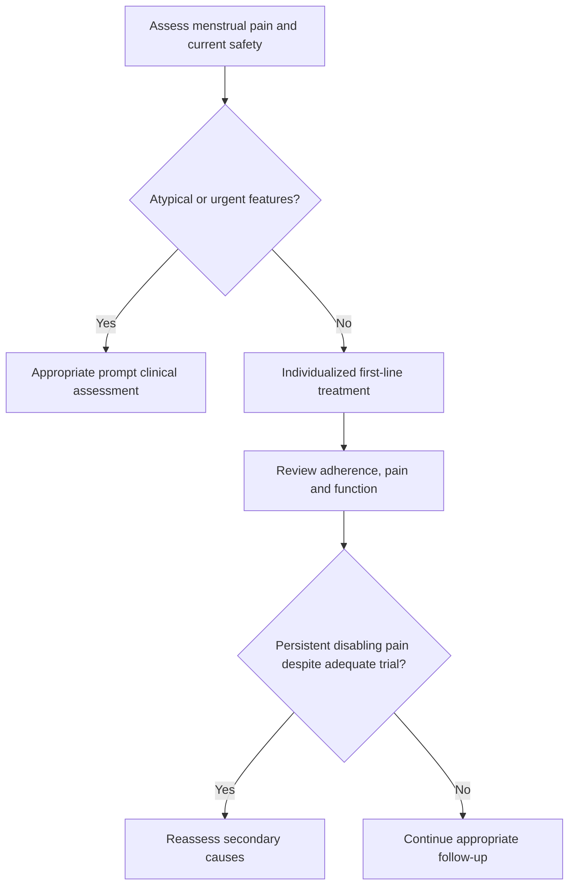

# Dysmenorrhea — 29 New Original MCQs and one retained practice allocation

**Advance-preparation, unattempted.** Yeh 29 naye questions menstrual pain ke distinct clinical learning tasks par based hain. [Preserved combined bank Q15](12-Abnormal-Uterine-Bleeding-Amenorrhea-and-Dysmenorrhea-20-MCQs.md#q15-which-medication-class-is-commonly-first-line-for-primary-dysmenorrhea-if-no-contraindication-exists) ko ek retained first-line medication question ke roop mein allocate kiya gaya hai. Use copy nahi kiya gaya hai. Is tarah 30 allocated practice slots hain, jismein 29 newly authored hain. Existing menstrual mechanism aur secondary pain questions apni original allocation mein safe hain. [Allocation audit](../Revision/Menstrual-Disorders-Question-Allocation-Audit.md).

[Chapter](../README.md) · [Menstrual cycle](01C-Menstrual-Cycle-Advanced-Q31-40.md) · [Previous Year Questions research](../Previous-Year-Questions/Gynecological-and-Reproductive-Nursing-Past-Paper-Research-Register.md)

## Part 1 — Q1–Q5

### Q1. A schoolgirl had menarche nine months ago. Her first few cycles were painless, but she now has recurrent cramps around menstruation. What makes the timing compatible with primary dysmenorrhea?

**Difficulty:** 🟡 Medium · **Priority:** 🟠 HIGH YIELD · **Evidence:** Original practice

- **A.** Ovulation is permanently absent after menarche
- **B.** Menstrual cramps always begin before puberty
- **C.** Ovulatory cycles commonly become established in the months after menarche
- **D.** Menarche immediately causes pelvic adhesions

✅ Answer aur detailed A–D Hinglish explanation

**Correct: C. Ovulatory cycles commonly become established in the months after menarche**

- **A kyun galat hai:** Ovulation menarche ke baad permanently absent nahi hoti. Reproductive hormonal coordination dheere-dheere mature hoti hai.
- **B kyun galat hai:** Primary dysmenorrhea menstrual cycles se related hoti hai. Puberty se pehle start hona usual pattern nahi hai.
- **C kyun sahi hai:** Jab pehli baar periods start hote hain, toh shuru ke kuch cycles mein ovulation regular nahi hoti. Aage chal kar ovulatory cycles establish hone par period-related prostaglandin release aur cramps develop ho sakte hain. Isliye nine months baad pain start hona primary pattern ke saath fit ho sakta hai, lekin history aur other symptoms bhi assess karne hain.
- **D kyun galat hai:** Menarche normal reproductive development hai aur apne aap pelvic scarring cause nahi karti. Adhesions ke liye other causes consider karte hain.

**Exam clue:** Menarche ke kuch months baad ovulatory cycles develop hone par primary cramps start ho sakte hain.

**Clinical reference:** [Adolescent dysmenorrhea clinical review](https://pmc.ncbi.nlm.nih.gov/articles/PMC1459624/)

**YouTube MCQ practice:** Is individual question ka exact MCQ-solving coverage independently verify nahi hua hai. Verification pending hai.

### Q2. A 17-year-old describes cramps beginning on the first day of bleeding, improving by day two and disappearing by day three. Between periods she feels well. Which finding most supports a typical menstrual pain pattern?

**Difficulty:** 🟡 Medium · **Priority:** 🟠 HIGH YIELD · **Evidence:** Original practice

- **A.** The pain is time-limited to the early menstrual days
- **B.** The pain becomes progressively worse after bleeding stops
- **C.** The pain persists throughout the month
- **D.** The pain first appears only at midcycle

✅ Answer aur detailed A–D Hinglish explanation

**Correct: A. The pain is time-limited to the early menstrual days**

- **A kyun sahi hai:** Primary dysmenorrhea mein pain aksar bleeding ke start ke around aata hai aur agle kuch days mein kam hota hai. Yahan pain-free interval bhi hai. Yeh temporal pattern supportive hai, par red flags ko history mein check karna ab bhi important hai.
- **B kyun galat hai:** Bleeding khatam hone ke baad pain badhna usual early cramp pattern se alag hai. Aise symptoms mein secondary cause consider karna chahiye.
- **C kyun galat hai:** Mahine bhar pain rehna chronic pelvic pain ka clue hai. Sirf period cramps bolkar manage karna sufficient nahi hoga.
- **D kyun galat hai:** Midcycle pain ovulation ke around ho sakta hai. Yeh menstruation ke start se linked pain ke pattern se alag hai.

**Exam clue:** Pain ki timing aur pain-free interval ko menstrual history mein note karo.

**Clinical reference:** [RCH adolescent dysmenorrhea guideline](https://www.rch.org.au/clinicalguide/guideline_index/Dysmenorrhoea/)

**YouTube MCQ practice:** Is individual question ka exact MCQ-solving coverage independently verify nahi hua hai. Verification pending hai.

### Q3. A teenager with typical primary dysmenorrhea also has loose stools during the first day of her period, without fever or persistent diarrhea. Which explanation best links these symptoms?

**Difficulty:** 🟡 Medium · **Priority:** 🟠 HIGH YIELD · **Evidence:** Original practice

- **A.** A confirmed bowel infection must accompany every painful period
- **B.** Menstrual blood normally enters the intestinal lumen
- **C.** Ovarian hormones permanently stop intestinal motility
- **D.** Prostaglandins can affect intestinal smooth muscle as well as uterine contractions

✅ Answer aur detailed A–D Hinglish explanation

**Correct: D. Prostaglandins can affect intestinal smooth muscle as well as uterine contractions**

- **A kyun galat hai:** Infection bhi diarrhea cause kar sakti hai, lekin cyclic loose stools alone infection prove nahi karte. Fever, exposure history aur duration se differential assess hota hai.
- **B kyun galat hai:** Normally menstrual blood cervix aur vagina se outside aata hai. Intestinal lumen mein menstrual blood jaana normal physiology nahi hai.
- **C kyun galat hai:** Bowel ki motility period ke dauran permanently stop nahi hoti. Prostaglandin-related gastrointestinal symptoms temporary ho sakte hain.
- **D kyun sahi hai:** Prostaglandins chemical messengers hain jo uterus ki muscle contractions mein role rakhte hain. Inka effect bowel ki smooth muscles par bhi pad sakta hai, isliye cramps ke saath loose stools ya nausea ho sakte hain. Severe ya persistent bowel symptoms ko separately evaluate karna chahiye.

**Exam clue:** Early menstrual cramps ke saath GI symptoms bhi prostaglandin-related ho sakte hain.

**Clinical reference:** [Adolescent dysmenorrhea clinical review](https://pmc.ncbi.nlm.nih.gov/articles/PMC1459624/)

**YouTube MCQ practice:** Is individual question ka exact MCQ-solving coverage independently verify nahi hua hai. Verification pending hai.

### Q4. A patient with recurrent cramps reports pain spreading from the lower abdomen to the lower back and inner thighs only during menstruation. Which interpretation is most appropriate?

**Difficulty:** 🟡 Medium · **Priority:** 🟠 HIGH YIELD · **Evidence:** Original practice

- **A.** Radiation to the thighs proves lumbar disc prolapse
- **B.** This distribution can occur with menstrual pain, while new neurological or noncyclic features need separate assessment
- **C.** Lower back discomfort alone proves renal infection
- **D.** All pelvic pain radiating to the thighs confirms endometriosis

✅ Answer aur detailed A–D Hinglish explanation

**Correct: B. This distribution can occur with menstrual pain, while new neurological or noncyclic features need separate assessment**

- **A kyun galat hai:** Disc prolapse se radiating pain ho sakta hai, lekin usmein neurological symptoms aur posture-related pattern bhi assess karte hain. Sirf location se diagnosis nahi hoti.
- **B kyun sahi hai:** Uterus se aane wale pain signals lower back aur thighs tak referred pain ke roop mein feel ho sakte hain. Period ke saath repeat hona menstrual origin ko support kar sakta hai. Agar numbness, weakness ya noncyclic pain aaye, toh separate assessment chahiye.
- **C kyun galat hai:** Kidney infection mein fever, urinary symptoms aur flank pain ho sakte hain. Cyclic back discomfort se renal infection prove nahi hoti.
- **D kyun galat hai:** Endometriosis ek important secondary cause hai, lekin referred menstrual pain primary dysmenorrhea mein bhi ho sakta hai.

**Exam clue:** Back aur thigh pain ka menstrual timing ke saath relation samjho.

**Clinical reference:** [Adolescent dysmenorrhea clinical review](https://pmc.ncbi.nlm.nih.gov/articles/PMC1459624/)

**YouTube MCQ practice:** Is individual question ka exact MCQ-solving coverage independently verify nahi hua hai. Verification pending hai.

### Q5. A teenager's period pain used to improve after the first two days, but now becomes more severe toward the end of bleeding. Which response is most appropriate?

**Difficulty:** 🔴 Difficult · **Priority:** 🔴 MOST IMPORTANT · **Evidence:** Original practice

- **A.** Increase all analgesics automatically without taking a history
- **B.** Reassess for a secondary pain cause rather than assuming the previous diagnosis still explains the symptoms
- **C.** Classify the change as normal because bleeding is still present
- **D.** Diagnose irritable bowel syndrome solely from the timing

✅ Answer aur detailed A–D Hinglish explanation

**Correct: B. Reassess for a secondary pain cause rather than assuming the previous diagnosis still explains the symptoms**

- **A kyun galat hai:** Dose increase se temporary pain relief mil sakta hai, par underlying new pathology miss ho sakti hai. Pehle change ka clinical assessment zaroori hai.
- **B kyun sahi hai:** Pain ka old pattern badalna important finding hai. RCH guideline ke hisaab se bleeding ke late days mein worsening pain secondary dysmenorrhea ka clue ho sakta hai. Nurse severity, duration aur associated symptoms document karke further review arrange kare.
- **C kyun galat hai:** Bleeding present hona har pain pattern ko normal nahi banata. Pain ki timing aur progression evaluate karni chahiye.
- **D kyun galat hai:** IBS diagnose karne ke liye bowel symptoms aur clinical criteria dekhte hain. Menstrual timing alone IBS prove nahi karti.

**Exam clue:** A changed pain trajectory can justify reassessment even in a previously typical case.

**Clinical reference:** [RCH adolescent dysmenorrhea guideline](https://www.rch.org.au/clinicalguide/guideline_index/Dysmenorrhoea/)

**YouTube MCQ practice:** Is individual question ka exact MCQ-solving coverage independently verify nahi hua hai. Verification pending hai.

## Part 2 — Q6–Q10

### Q6. An adolescent with menstrual pain reports that her mother and sister have diagnosed endometriosis. How should the nurse use this information?

**Difficulty:** 🟡 Medium · **Priority:** 🟠 HIGH YIELD · **Evidence:** Original practice

- **A.** Confirm endometriosis immediately without other assessment
- **B.** Exclude primary dysmenorrhea solely because a relative is affected
- **C.** Ignore the history because endometriosis never clusters in families
- **D.** Record it as a relevant risk clue and assess for secondary features without diagnosing from family history alone

✅ Answer aur detailed A–D Hinglish explanation

**Correct: D. Record it as a relevant risk clue and assess for secondary features without diagnosing from family history alone**

- **A kyun galat hai:** Endometriosis ki diagnosis patient ke clinical findings aur indicated evaluation se hoti hai. Relative ki diagnosis se patient ka disease confirm nahi hota.
- **B kyun galat hai:** Family history ke bawajood patient primary cramps experience kar sakti hai. Dono possibilities assess karte hain.
- **C kyun galat hai:** Family history recognized risk clue hai, isliye menstrual assessment mein ise ignore nahi karna chahiye.
- **D kyun sahi hai:** Close family history endometriosis ki suspicion badha sakti hai. Isliye pain pattern, school impact aur previous treatment response assess karna important hai. Family history diagnosis nahi hai, lekin referral decision mein useful clue hai.

**Exam clue:** First-degree family history ko differential assessment mein include karo.

**Clinical reference:** [RCH adolescent dysmenorrhea guideline](https://www.rch.org.au/clinicalguide/guideline_index/Dysmenorrhoea/)

**YouTube MCQ practice:** Is individual question ka exact MCQ-solving coverage independently verify nahi hua hai. Verification pending hai.

### Q7. A woman developed menstrual pain only after a previous episode of pelvic inflammatory disease. Which implication is most relevant?

**Difficulty:** 🔴 Difficult · **Priority:** 🔴 MOST IMPORTANT · **Evidence:** Original practice

- **A.** Prior pelvic infection raises the possibility of secondary pelvic pathology
- **B.** A previous infection makes primary pain the only possible diagnosis
- **C.** Antibiotics should be repeated every month without evidence of infection
- **D.** All future pelvic pain must be attributed to ovarian torsion

✅ Answer aur detailed A–D Hinglish explanation

**Correct: A. Prior pelvic infection raises the possibility of secondary pelvic pathology**

- **A kyun sahi hai:** Pelvic infection ke baad tissues mein inflammation aur kabhi scarring develop ho sakti hai. Agar menstrual pain us episode ke baad shuru hua ho, toh secondary cause assess karna useful hai. Current infection ke symptoms bhi separately check karte hain.
- **B kyun galat hai:** Previous infection ke baad secondary pain possible hai. History ko primary cramps ke diagnosis se automatically dismiss nahi karna chahiye.
- **C kyun galat hai:** Antibiotics active bacterial infection ke indicated treatment ke liye hain. Scarring ya chronic pain mein bina infection evidence monthly antibiotics appropriate nahi hain.
- **D kyun galat hai:** Torsion usually acute adnexal emergency hai. Recurrent cyclic pain se har episode torsion prove nahi hota.

**Exam clue:** Onset after pelvic infection changes the differential, not automatically the antibiotic plan.

**Clinical reference:** [RCH adolescent dysmenorrhea guideline](https://www.rch.org.au/clinicalguide/guideline_index/Dysmenorrhoea/)

**YouTube MCQ practice:** Is individual question ka exact MCQ-solving coverage independently verify nahi hua hai. Verification pending hai.

### Q8. During a menstrual pain consultation, a 16-year-old becomes quiet when asked sensitive questions in front of relatives. Which nursing approach supports an accurate history?

**Difficulty:** 🟡 Medium · **Priority:** 🟠 HIGH YIELD · **Evidence:** Original practice

- **A.** Insist on answering all sensitive questions in front of the family
- **B.** Avoid the sexual and medication history permanently
- **C.** Offer an age-appropriate private discussion and explain confidentiality and its safety limits
- **D.** Promise absolute secrecy even when safeguarding obligations apply

✅ Answer aur detailed A–D Hinglish explanation

**Correct: C. Offer an age-appropriate private discussion and explain confidentiality and its safety limits**

- **A kyun galat hai:** Family support helpful ho sakta hai, lekin har sensitive question family ke saamne poochne se patient uncomfortable ho sakti hai aur important history miss ho sakti hai.
- **B kyun galat hai:** Sexual history aur medicines clinically relevant ho sakte hain. Inhe permanently skip karne ke bajay respectful private setting mein assess karna chahiye.
- **C kyun sahi hai:** Private aur respectful conversation se adolescent apne symptoms, medicines aur pregnancy possibility ke baare mein honestly bata sakti hai. Nurse age-appropriate consent aur confidentiality explain kare, saath mein safety-related limits bhi clear kare.
- **D kyun galat hai:** Confidentiality important hai, lekin serious safety concern ya safeguarding duty mein applicable law aur professional policy follow karni padti hai.

**Exam clue:** Sensitive adolescent history requires privacy, consent and appropriate safeguarding.

**Clinical reference:** [RCH adolescent dysmenorrhea guideline](https://www.rch.org.au/clinicalguide/guideline_index/Dysmenorrhoea/)

**YouTube MCQ practice:** Is individual question ka exact MCQ-solving coverage independently verify nahi hua hai. Verification pending hai.

### Q9. A 15-year-old has typical recurrent menstrual cramps, a reassuring history and no indication for internal examination. Which assessment approach is appropriate?

**Difficulty:** 🟡 Medium · **Priority:** 🟠 HIGH YIELD · **Evidence:** Original practice

- **A.** Require routine vaginal examination before any supportive care
- **B.** Perform a cervical biopsy because of menstrual pain alone
- **C.** Replace all history taking with a transvaginal scan
- **D.** Begin with history and indicated abdominal examination, reserving vaginal examination for a specific clinical need

✅ Answer aur detailed A–D Hinglish explanation

**Correct: D. Begin with history and indicated abdominal examination, reserving vaginal examination for a specific clinical need**

- **A kyun galat hai:** Har adolescent mein internal exam mandatory nahi hota. Unnecessary invasive exam distress cause kar sakta hai.
- **B kyun galat hai:** Cervical biopsy suspicious cervical pathology assess karti hai. Typical menstrual pain alone biopsy ka indication nahi hai.
- **C kyun galat hai:** Scan useful ho sakta hai when indicated, lekin detailed history se pain ka timing aur risk factors samajh aate hain. Imaging history replace nahi karti.
- **D kyun sahi hai:** Adolescent mein typical cramps ke liye history aur appropriate abdominal assessment se initial evaluation ho sakti hai. RCH guideline internal examination ko rarely needed batati hai. Agar specific indication aaye, toh senior clinician, consent aur patient comfort important hain.

**Exam clue:** Typical adolescent cramps do not require automatic internal examination.

**Clinical reference:** [RCH adolescent dysmenorrhea guideline](https://www.rch.org.au/clinicalguide/guideline_index/Dysmenorrhoea/)

**YouTube MCQ practice:** Is individual question ka exact MCQ-solving coverage independently verify nahi hua hai. Verification pending hai.

### Q10. After an appropriate assessment, a teenager has typical primary dysmenorrhea without atypical features or other clinical concerns. What is the most reasonable initial investigation plan?

**Difficulty:** 🟡 Medium · **Priority:** 🟠 HIGH YIELD · **Evidence:** Original practice

- **A.** Diagnostic laparoscopy is mandatory before the first analgesic trial
- **B.** No routine additional testing is required solely to begin appropriate empiric treatment
- **C.** Obtain CT and MRI in every patient before symptom relief
- **D.** Perform repeated tumor marker tests each cycle

✅ Answer aur detailed A–D Hinglish explanation

**Correct: B. No routine additional testing is required solely to begin appropriate empiric treatment**

- **A kyun galat hai:** Laparoscopy invasive surgery hai. Typical primary cramps mein pehle empirical management aur reassessment reasonable hai.
- **B kyun sahi hai:** Typical symptom pattern aur reassuring assessment mein clinician initial treatment start kar sakta hai without routine extra tests. Pregnancy possibility ya other concerning findings hon toh indicated tests alag se karte hain. Follow-up se treatment response check hota hai.
- **C kyun galat hai:** CT aur MRI every adolescent ke liye routine first-line tests nahi hain. Imaging ka selection symptoms aur findings se hota hai.
- **D kyun galat hai:** Tumor markers menstrual cramps diagnose karne ka routine method nahi hain. Unnecessary testing false alarms aur anxiety cause kar sakti hai.

**Exam clue:** Primary dysmenorrhea may be managed empirically after appropriate assessment.

**Clinical reference:** [RCH adolescent dysmenorrhea guideline](https://www.rch.org.au/clinicalguide/guideline_index/Dysmenorrhoea/)

**YouTube MCQ practice:** Is individual question ka exact MCQ-solving coverage independently verify nahi hua hai. Verification pending hai.

## Part 3 — Q11–Q15

### Q11. An adolescent has atypical menstrual pain requiring pelvic imaging, and an internal scan is not appropriate or acceptable. Which imaging approach is generally considered first?

**Difficulty:** 🟡 Medium · **Priority:** 🟠 HIGH YIELD · **Evidence:** Original practice

- **A.** Transabdominal pelvic ultrasound
- **B.** Routine chest CT
- **C.** Pelvic imaging only after laparotomy
- **D.** Immediate hysteroscopy in every case

✅ Answer aur detailed A–D Hinglish explanation

**Correct: A. Transabdominal pelvic ultrasound**

- **A kyun sahi hai:** Transabdominal ultrasound lower abdomen ke through pelvic organs assess karta hai. Adolescent patient mein atypical symptoms ke evaluation ke liye yeh often useful initial approach hai, especially jab internal scan appropriate nahi ho. Specialist further tests findings ke basis par choose karega.
- **B kyun galat hai:** Chest CT thoracic structures assess karta hai, pelvic pain ka first-line imaging test nahi hai.
- **C kyun galat hai:** Noninvasive imaging surgery ke pehle information de sakti hai. Laparotomy routine prerequisite nahi hai.
- **D kyun galat hai:** Hysteroscopy uterine cavity examine karti hai. Every adolescent with atypical pelvic pain ko direct intrauterine procedure ki zarurat nahi hoti.

**Exam clue:** Adolescent pelvic imaging often starts with a transabdominal scan.

**Clinical reference:** [RCH adolescent dysmenorrhea guideline](https://www.rch.org.au/clinicalguide/guideline_index/Dysmenorrhoea/)

**YouTube MCQ practice:** Is individual question ka exact MCQ-solving coverage independently verify nahi hua hai. Verification pending hai.

### Q12. A patient has predictable cycles and has been prescribed an NSAID for primary dysmenorrhea. Which administration timing generally improves its effect?

**Difficulty:** 🟡 Medium · **Priority:** 🟠 HIGH YIELD · **Evidence:** Original practice

- **A.** Wait until the worst pain has resolved before starting
- **B.** Begin only after menstruation ends
- **C.** Start one to two days before expected bleeding and continue during the early painful days as prescribed
- **D.** Take it continuously all month without reviewing the prescription

✅ Answer aur detailed A–D Hinglish explanation

**Correct: C. Start one to two days before expected bleeding and continue during the early painful days as prescribed**

- **A kyun galat hai:** Worst pain resolve hone tak wait karne se medicine ka preventive timing benefit miss ho sakta hai.
- **B kyun galat hai:** Menstruation khatam hone ke baad start karna early menstrual cramps ko address nahi karta.
- **C kyun sahi hai:** NSAID prostaglandin production kam karta hai. Predictable cycle mein bleeding se pehle prescribed medicine shuru karne se early prostaglandin rise ko better control kiya ja sakta hai. Duration aur dose clinician ke plan ke according follow karni hai.
- **D kyun galat hai:** Long-term continuous use unnecessary adverse effects badha sakta hai. Individual indication aur prescribed duration matter karti hai.

**Exam clue:** Predictable cycles mein early prescribed NSAID timing ka benefit hota hai.

**Clinical reference:** [AAFP dysmenorrhea clinical review](https://www.aafp.org/afp/2021/0800/p164)

**YouTube MCQ practice:** Is individual question ka exact MCQ-solving coverage independently verify nahi hua hai. Verification pending hai.

### Q13. A woman reports that a prescribed NSAID never helps her period pain. On review she takes one dose only after cramps become severe and skips the remaining prescribed doses. What should the nurse do before concluding treatment failure?

**Difficulty:** 🔴 Difficult · **Priority:** 🔴 MOST IMPORTANT · **Evidence:** Original practice

- **A.** Immediately label all NSAIDs ineffective in this patient
- **B.** Tell her to double every future dose
- **C.** Review the prescribed dosing schedule, timing and barriers to adherence
- **D.** Recommend permanent analgesic use without follow-up

✅ Answer aur detailed A–D Hinglish explanation

**Correct: C. Review the prescribed dosing schedule, timing and barriers to adherence**

- **A kyun galat hai:** Incomplete trial se poori drug class ki failure establish nahi hoti. Proper use aur adverse effects check karne chahiye.
- **B kyun galat hai:** Dose double karne se stomach bleeding aur kidney injury jaise adverse effects ka risk badh sakta hai. Dose adjustment prescriber-led hona chahiye.
- **C kyun sahi hai:** Medicine ka effect dose timing aur prescribed intervals par depend kar sakta hai. Agar patient doses skip kar rahi hai, toh pehle reasons samjho, jaise nausea, school timing ya access. Prescribed plan clarify karo aur response reassess karo. Persistent pain par secondary causes bhi evaluate honge.
- **D kyun galat hai:** Bina follow-up lifelong use safe assumption nahi hai. Symptoms aur adverse effects ko regularly review karna chahiye.

**Exam clue:** An inadequate trial can reflect adherence barriers, not true drug failure.

**Clinical reference:** [ACOG Committee Opinion 760 abstract](https://pubmed.ncbi.nlm.nih.gov/30461694/)

**YouTube MCQ practice:** Is individual question ka exact MCQ-solving coverage independently verify nahi hua hai. Verification pending hai.

### Q14. A patient prescribed naproxen for menstrual pain says she also bought ibuprofen because the pain is severe. What should the nurse explain?

**Difficulty:** 🟡 Medium · **Priority:** 🟠 HIGH YIELD · **Evidence:** Original practice

- **A.** Avoid taking the two NSAIDs together unless specifically directed by an appropriate clinician
- **B.** Take both routinely because they belong to different drug classes
- **C.** Use the two together to protect the stomach
- **D.** Replace the prescribed dose with an unknown combination tablet

✅ Answer aur detailed A–D Hinglish explanation

**Correct: A. Avoid taking the two NSAIDs together unless specifically directed by an appropriate clinician**

- **A kyun sahi hai:** Naproxen aur ibuprofen dono NSAIDs hain. Inko saath lene se similar adverse effects add ho sakte hain, especially GI bleeding aur kidney problems. Nurse medication reconciliation kare aur safer pain plan prescriber ke saath discuss kare.
- **B kyun galat hai:** Dono medicine same broad drug class se hain. Isliye unka routine combination additional safety concern create karta hai.
- **C kyun galat hai:** NSAIDs stomach lining ke protective mechanisms ko affect kar sakte hain. Do NSAIDs lene se stomach protection nahi milti.
- **D kyun galat hai:** Unknown combination tablet mein already NSAID present ho sakta hai. Ingredients check kiye bina substitution overdose ya duplication cause kar sakta hai.

**Exam clue:** Medication reconciliation prevents accidental duplicate NSAID exposure.

**Clinical reference:** [NHS naproxen medicine safety](https://www.nhs.uk/medicines/naproxen/)

**YouTube MCQ practice:** Is individual question ka exact MCQ-solving coverage independently verify nahi hua hai. Verification pending hai.

### Q15. A patient recalls wheezing and facial swelling soon after taking aspirin. She is now prescribed an NSAID for menstrual pain. What should the nurse do?

**Difficulty:** 🔴 Difficult · **Priority:** 🔴 MOST IMPORTANT · **Evidence:** Original practice

- **A.** Assume another NSAID is safe because its brand name differs
- **B.** Give the drug and ignore early respiratory symptoms
- **C.** Recommend taking aspirin with the new NSAID to prevent the reaction
- **D.** Withhold routine administration pending urgent prescriber review of the previous reaction and safer alternatives

✅ Answer aur detailed A–D Hinglish explanation

**Correct: D. Withhold routine administration pending urgent prescriber review of the previous reaction and safer alternatives**

- **A kyun galat hai:** Different brand ya molecule hone se cross-reactivity ka risk automatically eliminate nahi hota.
- **B kyun galat hai:** Respiratory symptoms severe reaction mein progress kar sakte hain. Inhe ignore karna unsafe hai.
- **C kyun galat hai:** Aspirin add karna reaction prevent nahi karta aur serious allergy ya bleeding risk badha sakta hai.
- **D kyun sahi hai:** Aspirin ke baad wheezing aur swelling hypersensitivity ke warning signs ho sakte hain. Kuch patients mein related NSAIDs se bhi reaction ho sakta hai. Nurse allergy history clearly document kare aur medicine dene se pehle prescriber review le. Current breathing difficulty ho toh emergency assessment chahiye.

**Exam clue:** Previous aspirin-related respiratory or allergic reaction is a medication-safety clue.

**Clinical reference:** [NHS Specialist Pharmacy Service NSAIDs and asthma](https://sps.nhs.uk/articles/using-nsaids-in-asthma/)

**YouTube MCQ practice:** Is individual question ka exact MCQ-solving coverage independently verify nahi hua hai. Verification pending hai.

## Part 4 — Q16–Q20

### Q16. A patient forgets a scheduled naproxen dose for dysmenorrhea and remembers when her next dose is almost due. Which instruction matches NHS guidance?

**Difficulty:** 🟡 Medium · **Priority:** 🟠 HIGH YIELD · **Evidence:** Original practice

- **A.** Take both doses together to catch up
- **B.** Skip the missed dose and take the next scheduled dose normally
- **C.** Take an additional ibuprofen dose with both doses
- **D.** Restart the entire prescription at twice the strength

✅ Answer aur detailed A–D Hinglish explanation

**Correct: B. Skip the missed dose and take the next scheduled dose normally**

- **A kyun galat hai:** Double dose se missed pain relief safely compensate hona guaranteed nahi hai. Toxicity badh sakti hai.
- **B kyun sahi hai:** Jab next dose ka time close ho, toh missed dose skip karke usual schedule continue karna chahiye. Do doses ek saath lene se medicine exposure aur adverse effects badh sakte hain. Individual label aur prescriber instructions check karo.
- **C kyun galat hai:** Ibuprofen bhi NSAID hai. Saath lene se duplication aur side-effect risk badhta hai.
- **D kyun galat hai:** Dose strength change karna nursing self-care instruction ka part nahi hai. Prescriber approved dose hi follow karna chahiye.

**Exam clue:** Do not double a nearly due missed naproxen dose.

**Clinical reference:** [NHS naproxen medicine safety](https://www.nhs.uk/medicines/naproxen/)

**YouTube MCQ practice:** Is individual question ka exact MCQ-solving coverage independently verify nahi hua hai. Verification pending hai.

### Q17. A woman using naproxen for period cramps develops black tar-like stools and dizziness. Which nursing action is the priority?

**Difficulty:** 🔴 Difficult · **Priority:** 🔴 MOST IMPORTANT · **Evidence:** Original practice

- **A.** Reassure her that dark sticky stools are always normal menstrual symptoms
- **B.** Increase the NSAID dose because dizziness reflects pain
- **C.** Wait until the next menstrual cycle before seeking review
- **D.** Stop further unsupervised NSAID use and arrange urgent assessment for possible gastrointestinal bleeding

✅ Answer aur detailed A–D Hinglish explanation

**Correct: D. Stop further unsupervised NSAID use and arrange urgent assessment for possible gastrointestinal bleeding**

- **A kyun galat hai:** Menstrual blood vagina se aata hai. Tar-like stool gastrointestinal bleeding ka possible sign hai, ise normal period symptom nahi maanna chahiye.
- **B kyun galat hai:** NSAID dose badhane se suspected bleeding worsen ho sakti hai. Pain ke naam par warning sign ignore nahi karna hai.
- **C kyun galat hai:** GI bleeding rapidly serious ho sakti hai. Next cycle tak delay karna unsafe hai.
- **D kyun sahi hai:** Black tar-like stool digested blood ka clue ho sakta hai. NSAIDs stomach ulcer ya bleeding cause kar sakte hain. Dizziness significant blood loss ka sign bhi ho sakti hai, isliye urgent clinical assessment aur vital signs review chahiye. Severe weakness, faintness ya instability mein emergency help arrange karo.

**Exam clue:** Black tar-like stool with dizziness during NSAID use needs urgent review.

**Clinical reference:** [NHS naproxen medicine safety](https://www.nhs.uk/medicines/naproxen/)

**YouTube MCQ practice:** Is individual question ka exact MCQ-solving coverage independently verify nahi hua hai. Verification pending hai.

### Q18. A woman asks whether a selective COX-2 inhibitor must always work better than standard NSAIDs for primary dysmenorrhea. Which explanation is most accurate?

**Difficulty:** 🔴 Difficult · **Priority:** 🔴 MOST IMPORTANT · **Evidence:** Original practice

- **A.** No consistent superiority is established, so selection should account for safety, response and suitability
- **B.** Selective COX-2 inhibition guarantees complete pain relief
- **C.** All conventional NSAIDs lack an effect on prostaglandins
- **D.** The choice depends solely on the medicine's price

✅ Answer aur detailed A–D Hinglish explanation

**Correct: A. No consistent superiority is established, so selection should account for safety, response and suitability**

- **A kyun sahi hai:** COX enzymes prostaglandin production mein involved hote hain. Available evidence har patient mein COX-2 selective medicine ki better pain relief guarantee nahi karta. Drug selection individual risk, previous response aur prescribed plan ke hisaab se hoti hai.
- **B kyun galat hai:** Pain relief individual hoti hai. Selective enzyme effect se complete symptom relief guarantee nahi hoti.
- **C kyun galat hai:** Conventional NSAIDs bhi cyclooxygenase activity reduce karke prostaglandin production kam karte hain.
- **D kyun galat hai:** Cost patient access mein important ho sakta hai, lekin medical suitability aur adverse-effect risk bhi consider karte hain.

**Exam clue:** NSAID selection is individualized rather than based on assumed class superiority.

**Clinical reference:** [Merck Manual dysmenorrhea](https://www.merckmanuals.com/professional/gynecology-and-obstetrics/abnormal-uterine-bleeding/dysmenorrhea)

**YouTube MCQ practice:** Is individual question ka exact MCQ-solving coverage independently verify nahi hua hai. Verification pending hai.

### Q19. A patient asks why combined hormonal treatment can improve menstrual pain even though it is not a conventional analgesic. Which mechanism is most relevant?

**Difficulty:** 🟡 Medium · **Priority:** 🟠 HIGH YIELD · **Evidence:** Original practice

- **A.** It destroys pelvic bacteria in every patient
- **B.** It permanently removes the uterus
- **C.** It reduces ovulatory activity and endometrial proliferation, which can reduce prostaglandin-related contractions
- **D.** It directly increases menstrual prostaglandin release

✅ Answer aur detailed A–D Hinglish explanation

**Correct: C. It reduces ovulatory activity and endometrial proliferation, which can reduce prostaglandin-related contractions**

- **A kyun galat hai:** Hormonal treatment antibiotics nahi hai. Active pelvic infection ke liye appropriate antimicrobial management alag hota hai.
- **B kyun galat hai:** Hormonal treatment reversible pharmacological approach ho sakta hai. Uterus surgically remove nahi hota.
- **C kyun sahi hai:** Combined hormonal medicines ovulation suppress kar sakti hain aur progestin endometrium yani uterus ki inner lining ko relatively thin rakhta hai. Lining kam develop hone par prostaglandin-related menstrual contractions aur pain kam ho sakte hain. Is treatment ki suitability individually assess hoti hai.
- **D kyun galat hai:** Pain kam karne ka expected mechanism prostaglandin-related stimulation reduce karna hai, increase karna nahi.

**Exam clue:** Hormonal therapy targets the menstrual mechanism rather than only masking pain.

**Clinical reference:** [AAFP dysmenorrhea clinical review](https://www.aafp.org/afp/2021/0800/p164)

**YouTube MCQ practice:** Is individual question ka exact MCQ-solving coverage independently verify nahi hua hai. Verification pending hai.

### Q20. A suitable patient takes a combined oral contraceptive in a cyclic schedule for dysmenorrhea. Pain persists mainly during the hormone-free interval. Which option may be discussed with the prescriber?

**Difficulty:** 🔴 Difficult · **Priority:** 🔴 MOST IMPORTANT · **Evidence:** Original practice

- **A.** An additional hormone-free week every month
- **B.** An extended or continuous hormonal regimen that reduces scheduled withdrawal bleeds
- **C.** Stopping all active tablets whenever cramps occur
- **D.** Routine emergency surgery solely because of withdrawal pain

✅ Answer aur detailed A–D Hinglish explanation

**Correct: B. An extended or continuous hormonal regimen that reduces scheduled withdrawal bleeds**

- **A kyun galat hai:** Extra hormone-free days se hormonal suppression disturb ho sakti hai. Contraceptive protection bhi affect ho sakti hai.
- **B kyun sahi hai:** Hormone-free interval mein scheduled withdrawal bleeding aur cramps aa sakte hain. Suitable patient mein extended ya continuous regimen se ye intervals kam ho sakte hain. Prescriber regimen, bleeding changes aur contraindications explain karega.
- **C kyun galat hai:** Active tablets randomly stop karne se bleeding irregular ho sakti hai aur contraception unreliable ho sakti hai. Changes prescribed plan ke according honi chahiye.
- **D kyun galat hai:** Persistent pain ko review karna important hai, lekin withdrawal pain alone emergency operation justify nahi karta.

**Exam clue:** Extended regimens can reduce withdrawal-bleed-associated pain in suitable patients.

**Clinical reference:** [RCH adolescent dysmenorrhea guideline](https://www.rch.org.au/clinicalguide/guideline_index/Dysmenorrhoea/)

**YouTube MCQ practice:** Is individual question ka exact MCQ-solving coverage independently verify nahi hua hai. Verification pending hai.

## Part 5 — Q21–Q25

### Q21. A patient wants hormonal management for menstrual cramps, but the clinician has established that estrogen-containing therapy is unsuitable. What is a reasonable next discussion?

**Difficulty:** 🟡 Medium · **Priority:** 🟠 HIGH YIELD · **Evidence:** Original practice

- **A.** Consider an appropriate progestin-only option after individual eligibility and preference review
- **B.** Assume no hormonal option is possible when estrogen is unsuitable
- **C.** Start a high-dose estrogen-only regimen instead
- **D.** Use a combined hormonal method without reviewing the contraindication

✅ Answer aur detailed A–D Hinglish explanation

**Correct: A. Consider an appropriate progestin-only option after individual eligibility and preference review**

- **A kyun sahi hai:** Progestin-only methods mein estrogen nahi hota aur kuch options menstrual pain ya bleeding ko reduce kar sakte hain. Har method ki benefits, contraindications aur bleeding profile different hoti hai. Patient preferences aur clinical history ke according selection karna chahiye.
- **B kyun galat hai:** Estrogen unsuitable hone par progestin-only option possible ho sakta hai. Sab hormonal therapies ko automatically exclude nahi karna chahiye.
- **C kyun galat hai:** Estrogen contraindication present hone par high-dose estrogen safe solution nahi hai.
- **D kyun galat hai:** Combined method mein estrogen present hota hai. Established contraindication ignore karna patient ko harm kar sakta hai.

**Exam clue:** Estrogen eligibility and progestin-only eligibility are distinct decisions.

**Clinical reference:** [AAFP dysmenorrhea clinical review](https://www.aafp.org/afp/2021/0800/p164)

**YouTube MCQ practice:** Is individual question ka exact MCQ-solving coverage independently verify nahi hua hai. Verification pending hai.

### Q22. A teenager who is not currently sexually active feels embarrassed because a clinician offered hormonal medication for dysmenorrhea. Which response is most supportive?

**Difficulty:** 🟡 Medium · **Priority:** 🟠 HIGH YIELD · **Evidence:** Original practice

- **A.** Tell her that the prescription proves she is sexually active
- **B.** Refuse to discuss hormonal treatment unless she wants contraception
- **C.** Promise that hormonal treatment has no adverse effects
- **D.** Explain its therapeutic use for menstrual symptoms and support her informed choice without assumptions about sexual activity

✅ Answer aur detailed A–D Hinglish explanation

**Correct: D. Explain its therapeutic use for menstrual symptoms and support her informed choice without assumptions about sexual activity**

- **A kyun galat hai:** Medicine ka prescription patient ke sexual behavior ka proof nahi hota. Aisa assumption stigma aur healthcare avoidance badha sakta hai.
- **B kyun galat hai:** Contraceptive need treatment selection ka ek factor hai, lekin menstrual pain khud therapeutic indication ho sakti hai.
- **C kyun galat hai:** Har medicine ke potential adverse effects hote hain. Informed choice ke liye benefits aur risks dono discuss karne chahiye.
- **D kyun sahi hai:** Hormonal medicines pregnancy prevention ke alawa menstrual pain aur bleeding management mein bhi use hoti hain. Patient ko mechanism aur possible adverse effects simple language mein samjhao. Uski sexual activity ke baare mein judgment ya assumption nahi karna chahiye.

**Exam clue:** Hormonal symptom treatment can be discussed without stigmatizing the patient.

**Clinical reference:** [ACOG Committee Opinion 760 abstract](https://pubmed.ncbi.nlm.nih.gov/30461694/)

**YouTube MCQ practice:** Is individual question ka exact MCQ-solving coverage independently verify nahi hua hai. Verification pending hai.

### Q23. A patient wants to use a hot-water bottle alongside prescribed treatment for cramps. Which instruction best balances comfort and safety?

**Difficulty:** 🟡 Medium · **Priority:** 🟠 HIGH YIELD · **Evidence:** Original practice

- **A.** Place a boiling-hot bottle directly on bare skin
- **B.** Use comfortably warm, protected heat and check the skin regularly
- **C.** Sleep on a high-temperature heating device overnight
- **D.** Use heat instead of urgent assessment when new severe symptoms develop

✅ Answer aur detailed A–D Hinglish explanation

**Correct: B. Use comfortably warm, protected heat and check the skin regularly**

- **A kyun galat hai:** Boiling-hot surface direct skin par lagane se burn ho sakta hai. Pain relief ke liye extreme temperature zaroori nahi hai.
- **B kyun sahi hai:** Gentle heat abdominal muscle tension aur discomfort kam karne mein help kar sakti hai. Bottle ko cloth barrier ke saath use karo aur skin redness ya excessive heat check karo. Heat supportive care hai, dangerous new symptoms ka treatment nahi.
- **C kyun galat hai:** Sote waqt temperature aur skin injury monitor karna difficult hota hai. Prolonged high heat burn risk badha sakti hai.
- **D kyun galat hai:** New severe pain, faintness ya fever par underlying cause assess karna important hai. Heat se urgent care delay nahi honi chahiye.

**Exam clue:** Heat may complement treatment, but safe temperature and skin protection matter.

**Clinical reference:** [RCH period pain patient information](https://www.rch.org.au/kidsinfo/fact_sheets/Period_pain_%28dysmenorrhoea%29/)

**YouTube MCQ practice:** Is individual question ka exact MCQ-solving coverage independently verify nahi hua hai. Verification pending hai.

### Q24. A stable patient with primary dysmenorrhea asks whether she should avoid all exercise throughout her menstrual cycle. Which advice is supported by evidence?

**Difficulty:** 🟡 Medium · **Priority:** 🟠 HIGH YIELD · **Evidence:** Original practice

- **A.** Prescribe complete bed rest during every cycle
- **B.** Recommend intense exercise despite dizziness and acute severe pain
- **C.** Encourage tolerable regular physical activity as an adjunct, with adjustments during severe symptoms
- **D.** Guarantee that exercise eliminates the need for every medical treatment

✅ Answer aur detailed A–D Hinglish explanation

**Correct: C. Encourage tolerable regular physical activity as an adjunct, with adjustments during severe symptoms**

- **A kyun galat hai:** Har cycle mein complete bed rest beneficial nahi hai. Isse school, work aur general fitness bhi affect ho sakti hai.
- **B kyun galat hai:** Dizziness ya acute severe pain mein strenuous exercise se fall ya medical deterioration ka risk ho sakta hai. Pehle safety assess karo.
- **C kyun sahi hai:** Regular physical activity kuch patients mein menstrual pain ki intensity aur duration kam karne mein help kar sakti hai. Activity patient ki comfort aur health ke hisaab se adjust karo. Severe ya unusual symptoms mein assessment chahiye.
- **D kyun galat hai:** Exercise supportive intervention hai. Har patient ko medicines ya diagnostic review ki zarurat kabhi nahi hogi, aisi guarantee nahi de sakte.

**Exam clue:** Regular tolerable movement can be a useful adjunct to symptom care.

**Clinical reference:** [AAFP dysmenorrhea clinical review](https://www.aafp.org/afp/2021/0800/p164)

**YouTube MCQ practice:** Is individual question ka exact MCQ-solving coverage independently verify nahi hua hai. Verification pending hai.

### Q25. A woman asks about transcutaneous electrical nerve stimulation (TENS) for primary dysmenorrhea. What is the appropriate explanation?

**Difficulty:** 🟡 Medium · **Priority:** 🟠 HIGH YIELD · **Evidence:** Original practice

- **A.** It removes uterine fibroids by electrical surgery
- **B.** It may help reduce pain through surface electrical stimulation and can be considered as an adjunct
- **C.** It confirms endometriosis through tissue sampling
- **D.** It reliably prevents pregnancy

✅ Answer aur detailed A–D Hinglish explanation

**Correct: B. It may help reduce pain through surface electrical stimulation and can be considered as an adjunct**

- **A kyun galat hai:** TENS external pain-modulation technique hai. Fibroid surgically remove nahi karta.
- **B kyun sahi hai:** TENS mein skin par electrodes ke through controlled electrical stimulation diya jaata hai. Isse pain signals modulate ho sakte hain aur kuch patients ko relief mil sakta hai. Device instructions, contraindications aur individual advice follow karni chahiye.
- **C kyun galat hai:** Endometriosis diagnosis tissue assessment ya specialist evaluation se related hai. TENS diagnostic biopsy nahi karta.
- **D kyun galat hai:** TENS reproductive hormones ya fertility ko reliably suppress nahi karta. Yeh contraception nahi hai.

**Exam clue:** TENS is an adjunctive pain-management method, not diagnostic or contraceptive therapy.

**Clinical reference:** [AAFP dysmenorrhea clinical review](https://www.aafp.org/afp/2021/0800/p164)

**YouTube MCQ practice:** Is individual question ka exact MCQ-solving coverage independently verify nahi hua hai. Verification pending hai.

## Part 6 — Q26–Q29

### Q26. A student reports a pain score improvement from 8/10 to 5/10 after treatment, but still misses classes during every period. Which evaluation best reflects meaningful nursing outcomes?

**Difficulty:** 🔴 Difficult · **Priority:** 🔴 MOST IMPORTANT · **Evidence:** Original practice

- **A.** Record complete success because the numerical score fell
- **B.** Ignore attendance because only pain intensity matters
- **C.** Increase medicines automatically until the score is zero
- **D.** Assess pain, attendance, daily function, adverse effects and the student's own treatment goals

✅ Answer aur detailed A–D Hinglish explanation

**Correct: D. Assess pain, attendance, daily function, adverse effects and the student's own treatment goals**

- **A kyun galat hai:** Score improve hona partial benefit dikha sakta hai, complete success nahi. Function ab bhi affected hai.
- **B kyun galat hai:** Menstrual pain ka school aur social life par impact clinically relevant hai. Attendance ko ignore nahi karna chahiye.
- **C kyun galat hai:** Zero pain har patient mein possible ya necessary target nahi hai. Automatic dose increase adverse effects badha sakta hai.
- **D kyun sahi hai:** Pain score useful measure hai, lekin treatment ka goal daily activities restore karna bhi hai. Agar student classes miss kar rahi hai, toh symptom burden ab bhi significant hai. Nurse side effects, medication timing aur patient goals review karke treatment reassessment facilitate kare.

**Exam clue:** Pain scores should be interpreted together with meaningful functional outcomes.

**Clinical reference:** [RCH adolescent dysmenorrhea guideline](https://www.rch.org.au/clinicalguide/guideline_index/Dysmenorrhoea/)

**YouTube MCQ practice:** Is individual question ka exact MCQ-solving coverage independently verify nahi hua hai. Verification pending hai.

### Q27. A school health nurse sees a student who repeatedly leaves class because of menstrual cramps. Which plan best supports participation while clinical care continues?

**Difficulty:** 🟡 Medium · **Priority:** 🟠 HIGH YIELD · **Evidence:** Original practice

- **A.** Tell her to stay home for the entire menstrual week every month
- **B.** Require public disclosure of her menstrual symptoms to classmates
- **C.** Agree on a confidential symptom-management and medication-access plan within school policy, with referral and follow-up
- **D.** Withhold access to already prescribed treatment solely to discourage absences

✅ Answer aur detailed A–D Hinglish explanation

**Correct: C. Agree on a confidential symptom-management and medication-access plan within school policy, with referral and follow-up**

- **A kyun galat hai:** Routine full-week absence educational participation ko affect karegi. Symptom control aur safe return to activity par focus karna better hai.
- **B kyun galat hai:** Personal menstrual history private health information hai. Classmates ko public disclosure ki need nahi hai.
- **C kyun sahi hai:** School-based support mein patient ki privacy preserve karte hue rest breaks, safe access to prescribed medicine aur appropriate referral arrange ki ja sakti hai. Isse treatment timely mil sakta hai aur student ki attendance improve karne mein help hoti hai.
- **D kyun galat hai:** Prescribed treatment access block karna pain aur absences worsen kar sakta hai. School medication policy aur individualized care follow karni chahiye.

**Exam clue:** School absenteeism is a nursing support and follow-up issue, not a reason for stigma.

**Clinical reference:** [RCH period pain patient information](https://www.rch.org.au/kidsinfo/fact_sheets/Period_pain_%28dysmenorrhoea%29/)

**YouTube MCQ practice:** Is individual question ka exact MCQ-solving coverage independently verify nahi hua hai. Verification pending hai.

### Q28. An adolescent has persistent disabling cramps after four months of appropriately used first-line treatment, with no meaningful improvement. What is the next appropriate action?

**Difficulty:** 🔴 Difficult · **Priority:** 🔴 MOST IMPORTANT · **Evidence:** Original practice

- **A.** Arrange gynecology reassessment for possible secondary causes while reviewing adherence and treatment suitability
- **B.** Repeat the same ineffective regimen indefinitely without review
- **C.** Assume the pain is exaggerated because treatment should always work
- **D.** Escalate directly to definitive hysterectomy

✅ Answer aur detailed A–D Hinglish explanation

**Correct: A. Arrange gynecology reassessment for possible secondary causes while reviewing adherence and treatment suitability**

- **A kyun sahi hai:** Adequate treatment trial ke baad bhi disabling pain rahe toh secondary causes, including endometriosis, consider karne chahiye. ACOG 3–6 months mein improvement na hone par adherence aur possible pathology assess karne ko kehta hai. New red flags present hon toh is duration ka wait nahi karna hai.
- **B kyun galat hai:** Same ineffective plan indefinitely repeat karne se diagnosis delay aur quality of life impairment continue ho sakta hai.
- **C kyun galat hai:** Pain response patient to patient vary karta hai. Treatment failure se pain imaginary prove nahi hota.
- **D kyun galat hai:** Adolescent mein definitive hysterectomy disproportionate first response hai. Specialist evaluation aur individualized options important hain.

**Exam clue:** An adequate unsuccessful trial should prompt reassessment rather than indefinite repetition.

**Original visual revision:**

Yeh flow pain ke change aur treatment response ko connect karta hai. Acute red flags mein routine follow-up interval ka wait nahi karna hai.

**Clinical reference:** [ACOG Committee Opinion 760 abstract](https://pubmed.ncbi.nlm.nih.gov/30461694/)

**YouTube MCQ practice:** Is individual question ka exact MCQ-solving coverage independently verify nahi hua hai. Verification pending hai.

### Q29. A woman has ongoing pelvic pain despite improvement in menstrual cramps. She also reports pain linked to bowel movements and bladder filling at other times of the cycle. Which assessment principle is most appropriate?

**Difficulty:** 🔴 Difficult · **Priority:** 🔴 MOST IMPORTANT · **Evidence:** Original practice

- **A.** Attribute every remaining symptom to primary dysmenorrhea
- **B.** Diagnose a gastrointestinal disorder solely because bowel symptoms exist
- **C.** Consider gynecologic and nongynecologic contributors to chronic pelvic pain
- **D.** Continue only menstrual analgesics without reviewing the new pattern

✅ Answer aur detailed A–D Hinglish explanation

**Correct: C. Consider gynecologic and nongynecologic contributors to chronic pelvic pain**

- **A kyun galat hai:** Primary dysmenorrhea usually menstrual timing se closely related hoti hai. Noncyclic bowel ya bladder symptoms ko separately assess karna chahiye.
- **B kyun galat hai:** Bowel symptoms endometriosis ya other pelvic conditions mein bhi ho sakte hain. Sirf ek symptom se GI diagnosis establish nahi hoti.
- **C kyun sahi hai:** Chronic pelvic pain multiple organs aur mechanisms se related ho sakta hai. Bowel, bladder, pelvic muscles aur gynecologic conditions sab assessment mein relevant ho sakte hain. Nurse symptom timing aur impact document kare aur clinician ke coordinated evaluation ko support kare.
- **D kyun galat hai:** Menstrual cramps improve hone ke bawajood remaining pain ka cause identify karna important hai. Same analgesic alone har contributor address nahi karega.

**Exam clue:** Persistent pelvic pain may have more than one contributing system.

**Clinical reference:** [AAFP dysmenorrhea clinical review](https://www.aafp.org/afp/2021/0800/p164)

**YouTube MCQ practice:** Is individual question ka exact MCQ-solving coverage independently verify nahi hua hai. Verification pending hai.

## Evidence and remaining checks

RCH adolescent guidance, AAFP review, Merck Manual and NHS medicine information directly retrieve ki gayi hain. ACOG committee opinion ka indexed abstract aur additional clinical review excerpts check hue hain. [Nursing Wallah by PW / Aarogyam Prime OBG Part 6](https://www.youtube.com/watch?v=c-OrM_mDIZQ) ka published description menstrual disorders aur dysmenorrhea mention karta hai, par listed question chapters se exact dysmenorrhea item establish nahi hua. Isko mixed-topic lead ke roop mein rakha gaya hai, verified item-specific practice ke roop mein count nahi kiya hai. [AIIMS Bhubaneswar 2019 reported Q85](https://proudofnurses.com/aiims-bhubaneswar-sno-question-paper-2019/) painful menstruation terminology test karta hai. Yeh concept already existing bank mein hai, isliye additional historical adaptation count nahi kiya gaya hai. Official HPRCA [archive](https://hprca.hp.gov.in/DownloadCategory.aspx) aur all-India source verification pending hai. Complete independent clinical/semantic audit aur diagram rendering abhi pending hain.

[Chapter](../README.md) · [Allocation audit](../Revision/Menstrual-Disorders-Question-Allocation-Audit.md)
