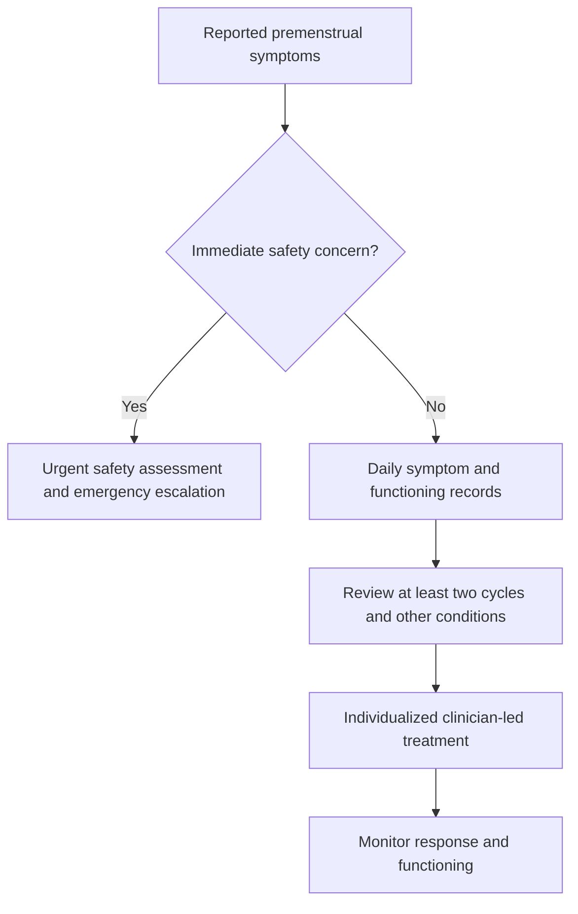

# PMS and PMDD — 30 original nursing MCQs

> Advance-preparation, not marked studied. Original questions, not official PYQs. Difficulty and priority are editorial labels. Follow local clinical protocols and clinician instructions.

[Chapter index](../README.md) · [Dysmenorrhea practice](15-Dysmenorrhea-29-New-MCQs.md)

## Part 1 — Q1–Q5

### Q1. Which diary pattern most strongly supports a premenstrual disorder?

**Difficulty:** 🟡 Medium | **Priority:** 🟠 High

**A.** Symptoms begin only after the period ends

**B.** Symptoms recur before menstruation and improve within days after bleeding begins

**C.** Symptoms occur only around ovulation

**D.** Symptoms remain unchanged all month

Show answer and Hinglish explanation

**Correct answer: B. Symptoms recur before menstruation and improve within days after bleeding begins**

**A kyun correct nahi hai:** Period ke baad hi onset usual PMS pattern nahi hai.

**B kyun correct hai:** PMS mein symptoms late luteal phase mein recur karte hain aur period shuru hone ke baad kam hote hain. Is cyclical relation ko repeated daily records se confirm karna important hai.

**C kyun correct nahi hai:** Ovulation-only symptoms late luteal pattern ko establish nahi karte.

**D kyun correct nahi hai:** Constant symptoms kisi persistent condition ko suggest kar sakte hain.

**Clinical reference:** [AAFP 2025](https://www.aafp.org/afp/2025/0400/premenstrual-syndrome-premenstrual-dysphoric-disorder)

**YouTube MCQ practice:** Exact item-specific verification pending.

### Q2. A patient remembers severe symptoms but cannot identify their timing. Which assessment strategy is most useful?

**Difficulty:** 🟡 Medium | **Priority:** 🟠 High

**A.** One retrospective questionnaire only

**B.** A diary restricted to bleeding days

**C.** Daily serum progesterone in place of symptom records

**D.** Daily prospective symptom ratings for at least two cycles

Show answer and Hinglish explanation

**Correct answer: D. Daily prospective symptom ratings for at least two cycles**

**A kyun correct nahi hai:** Retrospective screen suspicion raise kar sakta hai lekin definitive timing confirm nahi karta.

**B kyun correct nahi hai:** Sirf bleeding days likhne se premenstrual onset miss ho sakta hai.

**C kyun correct nahi hai:** Hormone measurements daily symptom severity aur disability ka substitute nahi hain.

**D kyun correct hai:** Aaj ke symptoms aaj record karne se memory bias kam hota hai. Do cycles ke records se onset, remission aur functional impact compare kar sakte hain.

**Clinical reference:** [RCOG](https://www.rcog.org.uk/for-the-public/browse-our-patient-information/managing-premenstrual-syndrome-pms)

**YouTube MCQ practice:** Exact item-specific verification pending.

### Q3. Which structured instrument is specifically useful for prospective daily premenstrual symptom tracking?

**Difficulty:** 🟢 Easy | **Priority:** 🟠 High

**A.** Daily Record of Severity of Problems

**B.** Apgar score

**C.** Bishop score

**D.** Glasgow Coma Scale

Show answer and Hinglish explanation

**Correct answer: A. Daily Record of Severity of Problems**

**A kyun correct hai:** DRSP daily emotional symptoms, physical symptoms aur functioning ko rate karta hai. Isse clinician cycle-related variation evaluate karta hai.

**B kyun correct nahi hai:** Apgar newborn assessment hai.

**C kyun correct nahi hai:** Bishop score induction se pehle cervical readiness assess karta hai.

**D kyun correct nahi hai:** GCS consciousness assess karta hai, cyclical symptoms nahi.

**Clinical reference:** [Endotext](https://www.ncbi.nlm.nih.gov/books/NBK279045/)

**YouTube MCQ practice:** Exact item-specific verification pending.

### Q4. A patient experiences marked irritability before menses but feels well in the following week. Which finding is especially valuable for differentiating a core premenstrual disorder from persistent depression?

**Difficulty:** 🟡 Medium | **Priority:** 🟠 High

**A.** Severe symptoms throughout the follicular phase

**B.** Progressive noncyclical mood deterioration

**C.** A relatively symptom-free postmenstrual interval

**D.** Identical symptom scores every day

Show answer and Hinglish explanation

**Correct answer: C. A relatively symptom-free postmenstrual interval**

**A kyun correct nahi hai:** Follicular phase mein severe ongoing symptoms alternate ya coexisting diagnosis suggest kar sakte hain.

**B kyun correct nahi hai:** Cycle se unrelated worsening classic premenstrual timing nahi hai.

**C kyun correct hai:** Postmenstrual interval mein symptoms minimal hona core PMS ya PMDD ke cyclic pattern ko support karta hai. Persistent symptoms mein underlying disorder ka assessment zaroori hai.

**D kyun correct nahi hai:** Identical daily scores cycle-related variation nahi dikhate.

**Clinical reference:** [DSM-5 criteria in Endotext](https://www.ncbi.nlm.nih.gov/books/NBK279045/table/premenstrual-syndrom.table1diag/)

**YouTube MCQ practice:** Exact item-specific verification pending.

### Q5. A woman with major depression has symptoms throughout the cycle, with worsening before menstruation. What is the most appropriate interpretation?

**Difficulty:** 🔴 Difficult | **Priority:** 🔴 Very High

**A.** PMDD confirmed by worsening alone

**B.** Possible premenstrual exacerbation of the underlying disorder

**C.** Normal PMS that requires no assessment

**D.** Primary dysmenorrhea as the complete explanation

Show answer and Hinglish explanation

**Correct answer: B. Possible premenstrual exacerbation of the underlying disorder**

**A kyun correct nahi hai:** Sirf existing depression ki worsening se PMDD confirm nahi hota. Separate PMDD coexist kar sakta hai, par criteria assess karne padenge.

**B kyun correct hai:** Premenstrual exacerbation mein existing condition ke symptoms period se pehle badhte hain. Baaki cycle mein bhi depression present hai, isliye underlying disorder aur prospective records dono review karo.

**C kyun correct nahi hai:** Persistent depression significant distress aur risk create kar sakta hai.

**D kyun correct nahi hai:** Dysmenorrhea menstrual pain hai aur persistent depression ko automatically explain nahi karta.

**Clinical reference:** [AAFP 2025](https://www.aafp.org/afp/2025/0400/premenstrual-syndrome-premenstrual-dysphoric-disorder)

**YouTube MCQ practice:** Exact item-specific verification pending.

## Part 2 — Q6–Q10

### Q6. Two cycles document four qualifying premenstrual symptoms including marked irritability and disability. What is correct regarding DSM-5 PMDD symptom count?

**Difficulty:** 🔴 Difficult | **Priority:** 🔴 Very High

**A.** The minimum five-symptom criterion is not met

**B.** One core affective symptom is enough regardless of count

**C.** Four symptoms always suffice if severe

**D.** Physical symptoms cannot be counted

Show answer and Hinglish explanation

**Correct answer: A. The minimum five-symptom criterion is not met**

**A kyun correct hai:** PMDD ke liye kam se kam paanch qualifying symptoms aur kam se kam ek core affective symptom chahiye. Chaar severe symptoms bhi care deserve karte hain, lekin count criterion meet nahi hua.

**B kyun correct nahi hai:** Core symptom necessary hai par total symptom count bhi required hai.

**C kyun correct nahi hai:** Severity aur functional impairment count ko replace nahi karte.

**D kyun correct nahi hai:** Breast tenderness ya bloating jaise qualifying physical symptoms count mein include ho sakte hain.

**Clinical reference:** [DSM-5 criteria in Endotext](https://www.ncbi.nlm.nih.gov/books/NBK279045/table/premenstrual-syndrom.table1diag/)

**YouTube MCQ practice:** Exact item-specific verification pending.

### Q7. Five qualifying-type premenstrual complaints are recorded, but none is a core affective symptom. Which criterion is missing?

**Difficulty:** 🔴 Difficult | **Priority:** 🔴 Very High

**A.** At least one episode of heavy bleeding

**B.** A positive pregnancy test

**C.** A documented high progesterone concentration

**D.** At least one core affective symptom

Show answer and Hinglish explanation

**Correct answer: D. At least one core affective symptom**

**A kyun correct nahi hai:** Heavy bleeding PMDD ka required diagnostic feature nahi hai.

**B kyun correct nahi hai:** Pregnancy test alternate causes evaluate karne mein useful ho sakta hai, par PMDD criterion nahi hai.

**C kyun correct nahi hai:** High progesterone PMDD diagnosis ki requirement nahi hai.

**D kyun correct hai:** Marked mood swings, irritability, depressed mood ya anxiety mein se kam se kam ek core symptom PMDD criteria ke liye chahiye. Sirf physical aur cognitive complaints ka count enough nahi hai.

**Clinical reference:** [DSM-5 criteria in Endotext](https://www.ncbi.nlm.nih.gov/books/NBK279045/table/premenstrual-syndrom.table1diag/)

**YouTube MCQ practice:** Exact item-specific verification pending.

### Q8. A student reports mild premenstrual bloating without distress or missed activities. Which additional finding raises concern for a clinically significant disorder?

**Difficulty:** 🟡 Medium | **Priority:** 🟠 High

**A.** A regular 28-day cycle alone

**B.** Normal hemoglobin

**C.** Repeated interference with academic or social functioning

**D.** Ovulation preceding the luteal phase

Show answer and Hinglish explanation

**Correct answer: C. Repeated interference with academic or social functioning**

**A kyun correct nahi hai:** Cycle length alone symptom impact nahi batati.

**B kyun correct nahi hai:** Hemoglobin anemia assess karta hai, PMS-related disability nahi.

**C kyun correct hai:** Common mild premenstrual changes aur clinical disorder mein functional impact important hai. Repeated class absence, relationship problems ya significant distress structured assessment ki need dikhate hain.

**D kyun correct nahi hai:** Ovulation ke baad luteal phase normal physiology hai.

**Clinical reference:** [AAFP 2025](https://www.aafp.org/afp/2025/0400/premenstrual-syndrome-premenstrual-dysphoric-disorder)

**YouTube MCQ practice:** Exact item-specific verification pending.

### Q9. A patient requests a definitive PMDD diagnosis at the first consultation based on memory. Which approach is appropriate?

**Difficulty:** 🔴 Difficult | **Priority:** 🔴 Very High

**A.** Provide indicated support while prospective daily records confirm a provisional assessment

**B.** Withhold all care until two cycles finish

**C.** Confirm PMDD with one estrogen test

**D.** Confirm PMDD using pelvic ultrasound alone

Show answer and Hinglish explanation

**Correct answer: A. Provide indicated support while prospective daily records confirm a provisional assessment**

**A kyun correct hai:** History se provisional suspicion ho sakti hai. Appropriate symptom care aur urgent safety intervention delay nahi karna chahiye, jabki prospective records diagnosis confirm karne mein help karte hain.

**B kyun correct nahi hai:** Significant distress ya safety risk ko diary complete hone tak ignore karna unsafe hai.

**C kyun correct nahi hai:** Ek estrogen value PMDD diagnose nahi karti.

**D kyun correct nahi hai:** Ultrasound structural abnormalities evaluate karta hai, PMDD criteria nahi.

**Clinical reference:** [DSM-5 criteria in Endotext](https://www.ncbi.nlm.nih.gov/books/NBK279045/table/premenstrual-syndrom.table1diag/)

**YouTube MCQ practice:** Exact item-specific verification pending.

### Q10. Why can severe premenstrual symptoms occur in a patient with normal routine ovarian hormone levels?

**Difficulty:** 🟡 Medium | **Priority:** 🟠 High

**A.** PMDD always requires excess estrogen

**B.** Altered sensitivity to normal cyclical hormonal changes may contribute

**C.** Normal progesterone rules out all premenstrual disorders

**D.** Prolactin elevation defines PMDD

Show answer and Hinglish explanation

**Correct answer: B. Altered sensitivity to normal cyclical hormonal changes may contribute**

**A kyun correct nahi hai:** Estrogen excess required laboratory criterion nahi hai.

**B kyun correct hai:** Har patient mein hormone concentration abnormal hona zaroori nahi. Normal cyclical hormonal changes par brain aur body ka response different ho sakta hai. Diagnosis clinical pattern par based hai.

**C kyun correct nahi hai:** Normal progesterone cyclical symptoms ko negate nahi karta.

**D kyun correct nahi hai:** Hyperprolactinemia separate endocrine condition hai aur PMDD ka defining cause nahi hai.

**Clinical reference:** [Endotext](https://www.ncbi.nlm.nih.gov/books/NBK279045/)

**YouTube MCQ practice:** Exact item-specific verification pending.

## Part 3 — Q11–Q15

### Q11. A patient has persistent fatigue, constipation and cold intolerance throughout the month. What should the nurse facilitate?

**Difficulty:** 🔴 Difficult | **Priority:** 🔴 Very High

**A.** Assume PMDD because the patient menstruates

**B.** Begin ovarian suppression before evaluating persistent symptoms

**C.** Diagnose PMDD solely from fatigue

**D.** Assessment for thyroid disease along with the menstrual symptom history

Show answer and Hinglish explanation

**Correct answer: D. Assessment for thyroid disease along with the menstrual symptom history**

**A kyun correct nahi hai:** Menstruation hona diagnosis ke liye enough nahi hai.

**B kyun correct nahi hai:** Underlying persistent symptoms ka assessment pehle important hai.

**C kyun correct nahi hai:** Fatigue nonspecific hai aur single symptom PMDD establish nahi karta.

**D kyun correct hai:** Cold intolerance aur constipation hypothyroidism ke clues ho sakte hain. Clinician-directed evaluation aur daily symptom timing se alternate ya coexisting cause samajh sakte hain.

**Clinical reference:** [Merck Manual](https://www.merckmanuals.com/professional/gynecology-and-obstetrics/abnormal-uterine-bleeding/premenstrual-syndrome-pms)

**YouTube MCQ practice:** Exact item-specific verification pending.

### Q12. A patient reports current suicidal intent during a premenstrual assessment. What is the immediate nursing priority?

**Difficulty:** 🔴 Difficult | **Priority:** 🔴 Very High

**A.** Wait until the period begins

**B.** Give only a diary and schedule next month's review

**C.** Urgent safety assessment and emergency mental-health escalation

**D.** Reassure her that cyclical suicidal thoughts are harmless

Show answer and Hinglish explanation

**Correct answer: C. Urgent safety assessment and emergency mental-health escalation**

**A kyun correct nahi hai:** Menstruation ka wait karna unsafe hai.

**B kyun correct nahi hai:** Diary acute safety intervention replace nahi karti.

**C kyun correct hai:** Current suicidal intent immediate safety concern hai. Patient ko safe setting mein support karo aur local emergency protocol ke according urgent mental-health assessment arrange karo. Cycle timing risk ko kam nahi karti.

**D kyun correct nahi hai:** Suicidal thoughts ko cyclical hone ke basis par dismiss nahi karna chahiye.

**Clinical reference:** [Queensland Health referral criteria](https://www.health.qld.gov.au/cpc/gynaecology/known-of-suspected-endometriosis)

**YouTube MCQ practice:** Exact item-specific verification pending.

### Q13. Sertraline is prescribed for clinically significant PMDD. Which medication class is it?

**Difficulty:** 🟢 Easy | **Priority:** 🟠 High

**A.** GnRH agonist

**B.** Selective serotonin reuptake inhibitor

**C.** Combined hormonal contraceptive

**D.** NSAID

Show answer and Hinglish explanation

**Correct answer: B. Selective serotonin reuptake inhibitor**

**A kyun correct nahi hai:** GnRH agonists ovarian cycling suppress karte hain aur selected refractory cases mein use hote hain.

**B kyun correct hai:** Sertraline SSRI hai jo serotonin reuptake inhibit karta hai. SSRIs PMDD mood symptoms ke evidence-supported treatments hain. Prescribed regimen aur adverse effects samjhana zaroori hai.

**C kyun correct nahi hai:** Combined hormonal contraceptives hormonal cycling modify kar sakte hain lekin sertraline contraceptive nahi hai.

**D kyun correct nahi hai:** NSAIDs pain aur prostaglandin production ko target karte hain.

**Clinical reference:** [AAFP 2025](https://www.aafp.org/afp/2025/0400/premenstrual-syndrome-premenstrual-dysphoric-disorder)

**YouTube MCQ practice:** Exact item-specific verification pending.

### Q14. A patient has a prescribed luteal-phase SSRI regimen. Which instruction is appropriate?

**Difficulty:** 🟡 Medium | **Priority:** 🟠 High

**A.** Follow the clinician-defined premenstrual dosing schedule

**B.** Double the dose whenever menstruation starts

**C.** Take it only during the symptom-free week

**D.** Switch independently between daily and intermittent treatment

Show answer and Hinglish explanation

**Correct answer: A. Follow the clinician-defined premenstrual dosing schedule**

**A kyun correct hai:** Luteal regimen ka exact start aur stop prescriber define karta hai. Patient ko cycle tracking aur prescribed timing samjhani chahiye. Random dose changes avoid karo.

**B kyun correct nahi hai:** Double dose adverse effects badha sakti hai.

**C kyun correct nahi hai:** Symptom-free week usual luteal treatment target nahi hai.

**D kyun correct nahi hai:** Different schedules possible hain, par change clinician ke saath decide karna hai.

**Clinical reference:** [Merck Manual](https://www.merckmanuals.com/professional/gynecology-and-obstetrics/abnormal-uterine-bleeding/premenstrual-syndrome-pms)

**YouTube MCQ practice:** Exact item-specific verification pending.

### Q15. A woman with PMDD also needs treatment for persistent depression. What should be reviewed before selecting intermittent SSRI therapy?

**Difficulty:** 🔴 Difficult | **Priority:** 🔴 Very High

**A.** Whether all medicines can stop when bleeding begins

**B.** Whether analgesia can replace depression treatment

**C.** Whether continuous treatment is necessary for noncyclical depression

**D.** Whether intermittent dosing guarantees control of persistent depression

Show answer and Hinglish explanation

**Correct answer: C. Whether continuous treatment is necessary for noncyclical depression**

**A kyun correct nahi hai:** Existing psychiatric treatment abruptly stop karne se relapse ya withdrawal risk ho sakta hai.

**B kyun correct nahi hai:** Analgesia pain manage kar sakti hai lekin depression ka indicated treatment replace nahi karti.

**C kyun correct hai:** Baaki cycle mein bhi depression present ho toh sirf premenstrual treatment inadequate ho sakta hai. Prescriber dono conditions aur medication history ko review karke schedule choose karega.

**D kyun correct nahi hai:** Intermittent PMDD regimen persistent depression control karne ki guarantee nahi hai.

**Clinical reference:** [AAFP 2025](https://www.aafp.org/afp/2025/0400/premenstrual-syndrome-premenstrual-dysphoric-disorder)

**YouTube MCQ practice:** Exact item-specific verification pending.

## Part 4 — Q16–Q20

### Q16. A patient asks whether an SSRI can improve PMDD symptoms within the first treated cycle. Which response is accurate?

**Difficulty:** 🟡 Medium | **Priority:** 🟠 High

**A.** SSRIs immediately suppress all ovarian hormones

**B.** Early benefit proves symptoms were imaginary

**C.** All antidepressant indications have identical onset of benefit

**D.** A relatively rapid response is possible in premenstrual disorders

Show answer and Hinglish explanation

**Correct answer: D. A relatively rapid response is possible in premenstrual disorders**

**A kyun correct nahi hai:** SSRI directly ovarian hormones suppress nahi karta.

**B kyun correct nahi hai:** Early response genuine symptoms ko invalidate nahi karti.

**C kyun correct nahi hai:** Depression aur PMDD ke therapeutic onset alag ho sakte hain.

**D kyun correct hai:** PMDD mein SSRI effect comparatively rapid ho sakta hai. Ye intermittent schedules ki ek rationale hai, lekin individual response vary karta hai aur follow-up chahiye.

**Clinical reference:** [Merck Manual](https://www.merckmanuals.com/professional/gynecology-and-obstetrics/abnormal-uterine-bleeding/premenstrual-syndrome-pms)

**YouTube MCQ practice:** Exact item-specific verification pending.

### Q17. A patient taking an SSRI reports nausea and reduced sexual desire. What is the appropriate response?

**Difficulty:** 🟡 Medium | **Priority:** 🟠 High

**A.** Assess possible adverse effects and facilitate prescriber review

**B.** Diagnose ovarian failure immediately

**C.** Advise abrupt discontinuation

**D.** Dismiss the symptoms as unrelated to SSRIs

Show answer and Hinglish explanation

**Correct answer: A. Assess possible adverse effects and facilitate prescriber review**

**A kyun correct hai:** Nausea aur sexual adverse effects SSRIs ke saath ho sakte hain. Timing, severity aur patient preferences assess karke treatment review facilitate karo.

**B kyun correct nahi hai:** Ye symptoms ovarian failure establish nahi karte.

**C kyun correct nahi hai:** Continuous therapy suddenly stop karne se withdrawal ya recurrence ho sakti hai.

**D kyun correct nahi hai:** Sexual function par effect possible hai aur concern ko respectfully address karna chahiye.

**Clinical reference:** [NHS antidepressants](https://www.nhs.uk/medicines/antidepressants/)

**YouTube MCQ practice:** Exact item-specific verification pending.

### Q18. A patient on continuous SSRI therapy wants to discontinue because symptoms improved. Which advice is safest?

**Difficulty:** 🟡 Medium | **Priority:** 🟠 High

**A.** Stop immediately regardless of duration

**B.** Take double doses on alternate days

**C.** Discuss a supervised dose-reduction plan with the prescriber

**D.** Replace the drug with an unreviewed herbal antidepressant

Show answer and Hinglish explanation

**Correct answer: C. Discuss a supervised dose-reduction plan with the prescriber**

**A kyun correct nahi hai:** Sudden stopping withdrawal ya symptom return ka risk badhata hai.

**B kyun correct nahi hai:** Alternate-day double dosing safe taper nahi hai.

**C kyun correct hai:** Continuous SSRI abruptly stop karne se dizziness, anxiety aur other withdrawal symptoms ho sakte hain. Drug aur duration ke according supervised taper discuss karo.

**D kyun correct nahi hai:** Herbal preparations bhi interactions cause kar sakte hain.

**Clinical reference:** [NHS antidepressants](https://www.nhs.uk/medicines/antidepressants/)

**YouTube MCQ practice:** Exact item-specific verification pending.

### Q19. A patient receiving PMDD medication plans pregnancy. What should the nurse advise?

**Difficulty:** 🔴 Difficult | **Priority:** 🔴 Very High

**A.** Stop every medicine independently

**B.** Arrange individualized preconception medication and mental-health review

**C.** Continue every medicine without informing maternity care

**D.** Avoid medication review if current symptoms are controlled

Show answer and Hinglish explanation

**Correct answer: B. Arrange individualized preconception medication and mental-health review**

**A kyun correct nahi hai:** Abrupt self-directed cessation withdrawal ya relapse cause kar sakti hai.

**B kyun correct hai:** Pregnancy planning mein medication benefits, potential fetal risks aur untreated symptoms ke risks balance karne chahiye. Prescriber aur maternity team ke saath individualized plan banayein.

**C kyun correct nahi hai:** Maternity team ko current treatment maloom hona safe care ke liye zaroori hai.

**D kyun correct nahi hai:** Current control pregnancy-specific review ko replace nahi karta.

**Clinical reference:** [MHRA antidepressant safety](https://www.gov.uk/government/publications/antidepressants-use-and-safety/selective-serotonin-reuptake-inhibitors-ssris-and-serotonin-and-noradrenaline-reuptake-inhibitors-snris-use-and-safety)

**YouTube MCQ practice:** Exact item-specific verification pending.

### Q20. A patient wants a nonpharmacological intervention addressing thoughts, reactions and coping with cyclical irritability. Which is most appropriate?

**Difficulty:** 🟡 Medium | **Priority:** 🟠 High

**A.** Pelvic floor electrical stimulation

**B.** Endometrial sampling

**C.** Ovulation induction

**D.** Cognitive behavioral therapy

Show answer and Hinglish explanation

**Correct answer: D. Cognitive behavioral therapy**

**A kyun correct nahi hai:** Pelvic floor stimulation selected continence problems mein use ho sakti hai, mood coping ke liye nahi.

**B kyun correct nahi hai:** Endometrial sampling selected bleeding indications ka procedure hai.

**C kyun correct nahi hai:** Ovulation induction infertility treatment hai aur coping intervention nahi.

**D kyun correct hai:** CBT thoughts, emotional reactions aur behaviors identify karke practical coping skills develop karne mein help karti hai. Isse distress aur functioning improve ho sakte hain.

**Clinical reference:** [RCOG](https://www.rcog.org.uk/for-the-public/browse-our-patient-information/managing-premenstrual-syndrome-pms)

**YouTube MCQ practice:** Exact item-specific verification pending.

## Part 5 — Q21–Q25

### Q21. A patient with PMS has stopped physical activity. What advice is most appropriate?

**Difficulty:** 🟡 Medium | **Priority:** 🟠 High

**A.** Strict bed rest throughout the luteal phase

**B.** Encourage achievable regular activity adjusted to symptoms

**C.** Guarantee that exercise alone cures severe PMDD

**D.** Recommend exhausting exercise despite dizziness

Show answer and Hinglish explanation

**Correct answer: B. Encourage achievable regular activity adjusted to symptoms**

**A kyun correct nahi hai:** Strict bed rest routine treatment nahi hai.

**B kyun correct hai:** Regular exercise wellbeing aur PMS symptoms mein help kar sakti hai. Individual tolerance ke hisaab se routine choose karo. Severe PMDD mein exercise multimodal care ka part hai.

**C kyun correct nahi hai:** Exercise se guaranteed cure establish nahi hai.

**D kyun correct nahi hai:** Dizziness mein exhausting activity unsafe ho sakti hai.

**Clinical reference:** [ACOG guideline abstract](https://pubmed.ncbi.nlm.nih.gov/37973069/)

**YouTube MCQ practice:** Exact item-specific verification pending.

### Q22. An advertisement promises that high-dose calcium and multiple supplements cure PMDD. What should the nurse explain?

**Difficulty:** 🟡 Medium | **Priority:** 🟠 High

**A.** High-dose calcium cures every patient

**B.** All prescribed treatment should be replaced with supplements

**C.** Evidence varies and supplement intake and safety should be reviewed

**D.** Natural products never interact with medicines

Show answer and Hinglish explanation

**Correct answer: C. Evidence varies and supplement intake and safety should be reviewed**

**A kyun correct nahi hai:** Calcium ka benefit possible hai lekin universal cure proven nahi hai.

**B kyun correct nahi hai:** Prescribed treatment unverified supplements se independently replace nahi karna chahiye.

**C kyun correct hai:** Balanced nutrition important hai, lekin supplement evidence product aur outcome ke according vary karta hai. Excessive doses unnecessary risks create kar sakte hain. Diet aur medication interactions review karo.

**D kyun correct nahi hai:** Natural products bhi side effects aur interactions cause kar sakte hain.

**Clinical reference:** [AAFP 2025](https://www.aafp.org/afp/2025/0400/premenstrual-syndrome-premenstrual-dysphoric-disorder)

**YouTube MCQ practice:** Exact item-specific verification pending.

### Q23. A suitable patient with premenstrual symptoms also desires contraception. Which counseling point is correct?

**Difficulty:** 🔴 Difficult | **Priority:** 🔴 Very High

**A.** A suitable combined hormonal contraceptive may address both goals, with review of mood response

**B.** Every combined pill guarantees full mood relief

**C.** PMS universally contraindicates combined contraception

**D.** Mood monitoring is unnecessary

Show answer and Hinglish explanation

**Correct answer: A. A suitable combined hormonal contraceptive may address both goals, with review of mood response**

**A kyun correct hai:** Suitable patient mein combined hormonal contraception pregnancy prevention aur premenstrual symptoms dono ke management ka option ho sakti hai. Eligibility aur individual mood response assess karo.

**B kyun correct nahi hai:** Formulations aur response vary karte hain, complete mood relief guaranteed nahi hai.

**C kyun correct nahi hai:** PMS alone universal contraindication nahi hai.

**D kyun correct nahi hai:** Mood worsening ya persistent impairment follow-up mein assess karna zaroori hai.

**Clinical reference:** [AAFP 2025](https://www.aafp.org/afp/2025/0400/premenstrual-syndrome-premenstrual-dysphoric-disorder)

**YouTube MCQ practice:** Exact item-specific verification pending.

### Q24. Which combined oral contraceptive regimen has specific evidence for PMDD in appropriately selected patients?

**Difficulty:** 🟡 Medium | **Priority:** 🟠 High

**A.** Monthly emergency contraception

**B.** Copper IUD alone

**C.** Unreviewed high-dose estrogen without progestogen

**D.** Drospirenone with ethinyl estradiol in a 24-active-day and 4-placebo-day regimen

Show answer and Hinglish explanation

**Correct answer: D. Drospirenone with ethinyl estradiol in a 24-active-day and 4-placebo-day regimen**

**A kyun correct nahi hai:** Emergency contraception routine long-term PMDD treatment nahi hai.

**B kyun correct nahi hai:** Copper IUD hormonal cycling suppress nahi karta.

**C kyun correct nahi hai:** Unreviewed high-dose estrogen appropriate therapy nahi hai aur unopposed estrogen se uterine risks ho sakte hain.

**D kyun correct hai:** Drospirenone aur ethinyl estradiol ka 24/4 regimen PMDD mein studied option hai. Prescriber contraindications aur thromboembolic risk evaluate karta hai.

**Clinical reference:** [Merck Manual](https://www.merckmanuals.com/professional/gynecology-and-obstetrics/abnormal-uterine-bleeding/premenstrual-syndrome-pms)

**YouTube MCQ practice:** Exact item-specific verification pending.

### Q25. Severe symptoms persist after first-line treatment. What should precede specialist escalation to ovarian suppression?

**Difficulty:** 🔴 Difficult | **Priority:** 🔴 Very High

**A.** Proceed immediately to permanent ovarian removal

**B.** Exclude PMDD because one treatment failed

**C.** Reassess diagnosis, daily ratings, adherence, comorbidity and preferences

**D.** Repeat ineffective care indefinitely

Show answer and Hinglish explanation

**Correct answer: C. Reassess diagnosis, daily ratings, adherence, comorbidity and preferences**

**A kyun correct nahi hai:** Permanent surgery irreversible hai aur selected refractory cases mein detailed review ke baad consider hoti hai.

**B kyun correct nahi hai:** Ek treatment failure diagnosis automatically exclude nahi karta.

**C kyun correct hai:** Persistent symptoms mein diagnostic pattern, correct use, adverse effects aur coexisting mental-health conditions review karna important hai. Isse specialist next treatment individualize karta hai.

**D kyun correct nahi hai:** Ineffective treatment without reassessment distress prolong kar sakta hai.

**Clinical reference:** [RCOG](https://www.rcog.org.uk/for-the-public/browse-our-patient-information/managing-premenstrual-syndrome-pms)

**YouTube MCQ practice:** Exact item-specific verification pending.

## Part 6 — Q26–Q30

### Q26. What is the rationale for a monitored GnRH agonist trial in selected severe refractory premenstrual disorders?

**Difficulty:** 🔴 Difficult | **Priority:** 🔴 Very High

**A.** Permanent increase in ovulation frequency

**B.** Temporary suppression of ovarian cyclical activity

**C.** Direct serotonin replacement

**D.** Treatment of bacterial pelvic infection

Show answer and Hinglish explanation

**Correct answer: B. Temporary suppression of ovarian cyclical activity**

**A kyun correct nahi hai:** Treatment ka intended effect ovulation badhana nahi hai.

**B kyun correct hai:** Sustained GnRH agonist treatment pituitary gonadotropin signaling downregulate karke ovarian cycling suppress kar sakta hai. Specialist symptom response aur hypoestrogenic adverse effects monitor karta hai.

**C kyun correct nahi hai:** Ye serotonin replacement nahi karta.

**D kyun correct nahi hai:** Premenstrual disorder bacterial infection nahi hai.

**Clinical reference:** [RCOG](https://www.rcog.org.uk/for-the-public/browse-our-patient-information/managing-premenstrual-syndrome-pms)

**YouTube MCQ practice:** Exact item-specific verification pending.

### Q27. A patient believes hysterectomy alone will necessarily abolish severe PMDD. Which explanation is accurate?

**Difficulty:** 🔴 Difficult | **Priority:** 🔴 Very High

**A.** Retained functioning ovaries can continue hormonal cycling despite absence of uterine bleeding

**B.** Uterus removal always stops ovarian cycling

**C.** Hysterectomy is identical to bilateral oophorectomy

**D.** No bleeding proves cyclical mood symptoms cannot recur

Show answer and Hinglish explanation

**Correct answer: A. Retained functioning ovaries can continue hormonal cycling despite absence of uterine bleeding**

**A kyun correct hai:** Hysterectomy uterus remove karti hai, ovaries zaroori nahi ki remove hon. Functioning ovaries retained ho toh hormonal cycling aur cyclical symptoms persist kar sakte hain.

**B kyun correct nahi hai:** Uterus removal ovarian function immediately aur universally stop nahi karta.

**C kyun correct nahi hai:** Bilateral oophorectomy dono ovaries removal hai, jo separate procedure hai.

**D kyun correct nahi hai:** Bleeding absence se ovarian hormone fluctuations absent hona prove nahi hota.

**Clinical reference:** [Merck Manual](https://www.merckmanuals.com/professional/gynecology-and-obstetrics/abnormal-uterine-bleeding/premenstrual-syndrome-pms)

**YouTube MCQ practice:** Exact item-specific verification pending.

### Q28. Bilateral oophorectomy is being discussed as a last-resort treatment. Which information is essential for consent?

**Difficulty:** 🔴 Difficult | **Priority:** 🔴 Very High

**A.** Ovarian function reliably returns within weeks

**B.** Spontaneous ovulation remains unchanged

**C.** Long-term bone and hormone counseling is unnecessary

**D.** It is irreversible and causes surgical menopause and loss of natural ovarian fertility

Show answer and Hinglish explanation

**Correct answer: D. It is irreversible and causes surgical menopause and loss of natural ovarian fertility**

**A kyun correct nahi hai:** Removed ovaries spontaneously function resume nahi karti.

**B kyun correct nahi hai:** Bilateral ovarian removal ke baad natural ovulation continue nahi hoti.

**C kyun correct nahi hai:** Surgical menopause ke liye bone health aur individualized hormone management counseling important hai.

**D kyun correct hai:** Dono ovaries remove karne se natural ovarian hormone production aur ovulation end hoti hai. Premenopausal patient mein surgical menopause hoti hai. Fertility goals aur long-term health specialist ke saath discuss karo.

**Clinical reference:** [Merck Manual](https://www.merckmanuals.com/professional/gynecology-and-obstetrics/abnormal-uterine-bleeding/premenstrual-syndrome-pms)

**YouTube MCQ practice:** Exact item-specific verification pending.

### Q29. A patient starts PMS treatment. Which follow-up method best measures sustained improvement?

**Difficulty:** 🟡 Medium | **Priority:** 🟠 High

**A.** Assess only one symptom on the first day

**B.** Replace daily records with repeated serum hormone tests

**C.** Continue daily ratings for subsequent cycles and compare symptom impact with baseline

**D.** Stop monitoring after the first period

Show answer and Hinglish explanation

**Correct answer: C. Continue daily ratings for subsequent cycles and compare symptom impact with baseline**

**A kyun correct nahi hai:** Single-day improvement sustained overall benefit establish nahi karti.

**B kyun correct nahi hai:** Hormone testing patient-reported impairment replace nahi karta.

**C kyun correct hai:** Treatment ke baad diary continue karne se baseline aur subsequent cycles compare ho sakte hain. RCOG subsequent two to three months ki recording ko useful batata hai. Functioning bhi assess karo.

**D kyun correct nahi hai:** Early monitoring stop karne se recurrence ya incomplete response miss ho sakti hai.

**Clinical reference:** [RCOG](https://www.rcog.org.uk/for-the-public/browse-our-patient-information/managing-premenstrual-syndrome-pms)

**YouTube MCQ practice:** Exact item-specific verification pending.

### Q30. A patient with suspected PMDD has occupational impairment and poorly controlled anxiety outside the premenstrual phase. Which care plan is most appropriate?

**Difficulty:** 🔴 Difficult | **Priority:** 🔴 Very High

**A.** Treat breast tenderness only

**B.** Coordinate gynecologic and mental-health assessment with individualized follow-up

**C.** Require a choice between gynecology and psychiatric care

**D.** Delay all care until every symptom has one diagnosis

Show answer and Hinglish explanation

**Correct answer: B. Coordinate gynecologic and mental-health assessment with individualized follow-up**

**A kyun correct nahi hai:** Breast tenderness alone treat karne se major functional concerns unaddressed reh jaate hain.

**B kyun correct hai:** Physical aur emotional symptoms dono ko address karna important hai. Coordinated gynecologic aur mental-health care cycle pattern, anxiety, functioning aur safety ko assess kar sakti hai. Plan patient ke goals ke according individualize karo.

**C kyun correct nahi hai:** Dono specialties complementary care provide kar sakti hain.

**D kyun correct nahi hai:** Diagnostic clarification ongoing ho sakti hai, par distress aur safety needs delay nahi karni chahiye.

**Clinical reference:** [ACOG guideline abstract](https://pubmed.ncbi.nlm.nih.gov/37973069/)

**YouTube MCQ practice:** Exact item-specific verification pending.

## Original revision flow

Urgent symptoms mein diary complete hone ka wait nahi karna chahiye.

**Video search:** [MDK Nursing Classes, PR Yadav OBG MCQs #04](https://www.youtube.com/watch?v=N8kLkc4HmNo) is a general menstruation MCQ lead, not an established PMS/PMDD item match. [Topic 49 PMS/PMDD](https://www.youtube.com/watch?v=ZtrynEEffMw) is an indexed teaching lead, not verified MCQ practice. Playback and question mapping remain pending for all 30 questions.
