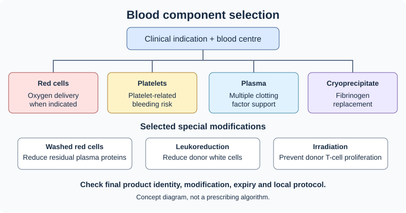

# Blood components and special products

**Study-ready, not studied.** Is guide mein hum blood component selection ko basic se clinical application tak samjhenge. Ye nurse education ke liye hai, independent prescription ke liye nahi.

[Chapter](../README.md) · [30 MCQs](../MCQs/16-Blood-Components-and-Special-Products-30-MCQs.md) · [Evidence register](../Previous-Year-Questions/06-Blood-Component-Evidence-and-Research.md) · [Inventory](../MCQs/Hematology-Question-Inventory.md)

## Patient blood management

Blood ke andar red cells, platelets, plasma aur doosre cells hote hain. Har part ka alag role hota hai. Red cells oxygen pahunchate hain, platelets injured blood vessel par initial plug banane mein help karti hain aur plasma mein kai clotting proteins hote hain. Blood centre whole blood se in components ko separate kar sakta hai. Iska fayda ye hai ki patient ko poora blood dene ke bajay uski clinical need ke hisaab se component choose kiya ja sakta hai.

Patient blood management ka matlab hai patient ki apni blood health ko improve karna, bleeding kam karna aur donor blood sirf tab use karna jab expected benefit risk se zyada ho. Stable hospitalized adults mein 2023 AABB guideline generally 7 g/dL se neeche hemoglobin par red cell transfusion consider karne ko kehti hai. Cardiac surgery, orthopedic surgery, cardiovascular disease aur active hemorrhage ki circumstances alag ho sakti hain. Nurse ko number ke saath symptoms, hemodynamic status, bleeding aur prescribed plan dekhna hai. Iron deficiency agar safely iron replacement se treat ho sakti hai toh routine transfusion avoid ki ja sakti hai. Stable nonbleeding patient mein ek unit ke baad response reassess karna useful hai.

[Practice Q1–Q4](../MCQs/16-Blood-Components-and-Special-Products-30-MCQs.md#q1-a-blood-centre-has-separated-a-whole-blood-donation-into-red-cells-plasma-and-platelets-what-is-the-main-patient-care-advantage-of-this-approach) · [AABB red cell guideline](https://pubmed.ncbi.nlm.nih.gov/37824153/)

## Platelet components

Platelets ki kami ya unki function mein problem hone se patient ko bleeding ka risk ho sakta hai. Lekin har low platelet count transfusion ka automatic reason nahi hota. Patient ki bleeding, underlying disease aur planned procedure ka risk dekhna zaroori hai. Misal ke liye 2025 AABB/ICTMG guideline dengue mein major bleeding na hone par routine prophylactic platelet transfusion recommend nahi karti. Lumbar puncture ke liye specified threshold 20,000/µL hai. Major surgery aur doosre procedures ke thresholds alag ho sakte hain. Local protocol aur prescriber ki decision ko follow karo.

Conventional whole-blood-derived platelets ko India ke national standards ke mutabik 22 ± 2°C aur gentle continuous agitation par controlled blood-centre storage mein rakhte hain. Approved cold-stored products ek separate category ho sakte hain. Agar routine platelet bag galat temperature par rakha gaya ho ya visible clumps dikhein, toh blood centre se clarify karo. Nurse ward mein unit ko khud warm, shake ya release nahi karegi. Apheresis platelets commonly ek donor se collect hote hain. Pooled platelets multiple donors se ban sakte hain, isliye har donation ki traceability preserve karte hain. Open pooling mein expiry short ho sakti hai. Final product label hi follow karo.

Kabhi-kabhi platelet transfusion ke baad count expected tareeke se nahi badhta. Isko platelet refractoriness kehte hain jab repeated doses ka response unsatisfactory ho. Sepsis mein platelets consume ho sakti hain aur enlarged spleen unko retain kar sakta hai. Kuch patients mein HLA antibodies donor platelets ko recognize karti hain. Specialist immune cause establish karke HLA-compatible product select kar sakta hai. Har poor increment ko antibody problem maan lena theek nahi hai.

[Practice bank](../MCQs/16-Blood-Components-and-Special-Products-30-MCQs.md) · [2025 platelet guideline](https://www.aabb.org/news-resources/news/article/2025/05/29/aabb-develops-new-platelet-transfusion-guidelines) · [Indian standards](https://clinicalestablishments.mohfw.gov.in/sites/default/files/2023-03/1491_0.pdf) · [HLA/HPA-compatible platelets](https://www.lifeblood.com.au/health-professionals/products/blood-components/modifications/hla-hpa-compatible-platelets)

## Plasma and cryoprecipitate

Fresh frozen plasma mein multiple clotting proteins hote hain. Jab patient mein clinically significant coagulopathy aur bleeding ya suitable procedure risk ho aur targeted therapy appropriate na ho, toh FFP consider ki ja sakti hai. Sirf mild INR elevation ya fluid volume badhane ke liye routine FFP dena appropriate nahi hai. Plasma ka volume significant ho sakta hai, isliye nurse prescribed dose aur fluid status check karti hai. Agar 60 kg patient ke liye 15 mL/kg authorized prescription hai, toh 60 × 15 = 900 mL total volume verify karna hoga. Actual unit volumes aur clinical tolerance alag se check hote hain.

Cryoprecipitate frozen plasma ko controlled cold temperature par thaw karke milne wala concentrated protein fraction hai. Isme fibrinogen aur kuch selected clotting proteins hote hain. Fibrinogen fibrin banane mein help karta hai, jo clot ko stabilize karta hai. Severe bleeding ke saath low fibrinogen ho toh clinician cryoprecipitate ya appropriate fibrinogen replacement choose kar sakta hai. Nurse bleeding aur serial fibrinogen response monitor karti hai. Thawed product ki expiry cross ho jaaye toh ward par refreeze karke dobara use nahi karna hai. Hemophilia A ke historical exam questions cryoprecipitate ko factor VIII se relate karte hain, lekin available appropriate specific factor concentrate modern targeted treatment mein preferred ho sakta hai.

[Practice bank](../MCQs/16-Blood-Components-and-Special-Products-30-MCQs.md) · [FFP guidance](https://www.lifeblood.com.au/health-professionals/clinical-practice/use-of-blood-components/use-of-fresh-frozen-plasma) · [Cryoprecipitate guidance](https://www.lifeblood.com.au/health-professionals/clinical-practice/use-of-blood-components/use-of-cryoprecipitate)

## Modified and special components

Washing mein residual donor plasma proteins ko kam kiya jaata hai. Isse selected patients mein recurrent severe allergic reactions ke risk ko reduce karne mein madad mil sakti hai. Washing blood group antigens nahi hataati. Leukoreduction donor white cells ki sankhya kam karti hai. Irradiation ka role alag hai. Ye viable donor T lymphocytes ko multiply karne se rokne ke liye use hoti hai, taaki transfusion-associated graft-versus-host disease ka risk kam ho. Is disease mein donor immune cells recipient tissues par attack kar sakti hain. Hodgkin lymphoma, selected T-cell suppressing therapies, related-donor cellular components aur kuch transplant settings mein special irradiation indications hoti hain. Exact duration patient ke specialist protocol ke hisaab se decide hoti hai. Frozen plasma aur cryoprecipitate ko normally irradiate karne ki zaroorat nahi hoti. Irradiation sterilization nahi hai.

Rare red cell units ko glycerol ki help se freeze kiya ja sakta hai. Thawing ke baad validated blood-centre processing cryoprotectant ko remove karti hai. Granulocytes selected profound neutropenia aur severe infection cases mein specialist-directed adjunct ho sakte hain. Unka short labelled shelf life aur irradiation important hai. Har modification ke baad final product label, expiry aur patient requirement verify karna hai. Ward mein product processing nahi karni hai.

[Practice bank](../MCQs/16-Blood-Components-and-Special-Products-30-MCQs.md) · [Irradiation guidance](https://www.lifeblood.com.au/health-professionals/products/blood-components/modifications/irradiated) · [Indian standards](https://clinicalestablishments.mohfw.gov.in/sites/default/files/2023-03/1491_0.pdf)

## Videos and evidence

| Topic | Teaching | Dedicated MCQ practice |
|---|---|---|
| Component therapy and modifications | [Ivo Sales nursing lesson](https://www.youtube.com/watch?v=XymERcidNEM) — indexed description only | Specific mapping pending |
| Cryoprecipitate and hemophilia | Teaching verification pending | [Nursing Wallah by PW countdown MCQ session, 10:14](https://www.youtube.com/watch?v=RpMSsU42K4o&t=614s) — indexed topic marker only |
| Platelet storage, thresholds and plasma selection | Separate teaching verification pending | Specific mapping pending |

Video playback aur exact question verification abhi complete nahi hui hai. Current local protocols ko video se upar priority do.

[30 MCQs](../MCQs/16-Blood-Components-and-Special-Products-30-MCQs.md) · [Evidence and research](../Previous-Year-Questions/06-Blood-Component-Evidence-and-Research.md) · [Chapter](../README.md)
