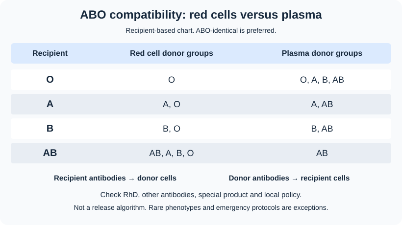

# Blood grouping and transfusion compatibility

**Study-ready, not studied.** Hum samjhenge ki blood group ka result kaise banta hai aur blood centre compatible component kaise choose karta hai. Ye independent product release authorization nahi hai.

[Chapter](../README.md) · [30 original MCQs](../MCQs/17-Blood-Grouping-and-Transfusion-Compatibility-30-MCQs.md) · [Reported exam evidence](../Previous-Year-Questions/07-Blood-Grouping-RRB-2018-and-Research.md) · [Inventory](../MCQs/Hematology-Question-Inventory.md)

## Grouping and discrepancies

Red cells ki surface par special molecules hote hain, jinhe antigens kehte hain. Immune system unfamiliar antigen ko identify karke antibody bana sakta hai. ABO system mein group A cells par A antigen aur plasma mein expected anti-B hoti hai. Group B mein B antigen aur anti-A hoti hai. AB mein dono antigens aur normally na anti-A na anti-B hoti hai. O mein A/B antigens absent aur plasma mein expected anti-A aur anti-B hoti hain. Iska matlab AB patient ke plasma mein har possible antibody absent nahi hai. Other blood group antibodies develop ho sakti hain.

Forward grouping mein patient red cells ko anti-A aur anti-B reagents ke saath test karte hain. Agglutination ka matlab cells ka clump hona hai. Reverse grouping mein patient plasma known A aur B cells ke saath test hoti hai. Adult mein dono tests normally ek doosre ko confirm karte hain. Sirf anti-B forward reaction aur sirf reagent A cells reverse reaction group B suggest karte hain. Agar results disagree karein toh elective group-specific issue se pehle cause investigate karna zaroori hai. Newborns mein reverse grouping different hoti hai, kyunki early antibodies maternal origin ki ho sakti hain. Recent transfusion mixed donor cells introduce kar sakti hai, isliye transfusion history useful hai.

## Component compatibility

Red cells dene ke waqt recipient antibodies donor cells par attack na karein, yeh main concern hai. Plasma dene ke waqt donor antibodies recipient cells par attack na karein, yeh concern hai. Isi wajah se ABO selection ki direction opposite hai.

| Recipient | Compatible ABO red cell groups | Compatible ABO plasma groups |
|---|---|---|
| O | O | O, A, B, AB |
| A | A, O | A, AB |
| B | B, O | B, AB |
| AB | AB, A, B, O | AB |

ABO-identical product generally preferred hai. RhD-negative patient ko routine mein RhD-negative red cells prefer karte hain. D-positive exposure anti-D formation ka risk create kar sakta hai, jo future transfusions aur pregnancies ko affect kar sakta hai. Emergency exceptions authorized protocol se decide hoti hain. Ordinary group O whole blood mein donor plasma bhi hoti hai, isliye usko group O red cells ke equivalent nahi samjho. Selected low-titre whole blood emergency programmes separate policies follow karte hain.

Platelet dose ke saath donor plasma transfer hoti hai. Incompatible ABO antibodies recipient red cells ko damage kar sakti hain. Platelets khud RhD express nahi karti, lekin residual red cells D sensitization ka concern create kar sakti hain. Selected RhD-negative patients mein Rh immune globulin prophylaxis specialist consider kar sakta hai. Indian standards section 8.12 component selection separately describe karti hai. Section 8.12.3 routine cryoprecipitate ABO/Rh grouping require nahi karti, lekin product-specific aur neonatal policy confirm karo. Granulocyte product mein red cells ho sakti hain, isliye compatibility aur irradiation dono relevant hain.

## Pretransfusion testing

Type-and-screen patient ka ABO, RhD aur unexpected red cell antibody status assess karta hai. Antibody milne par specialist specificity identify karke antigen-negative compatible unit select kar sakta hai. Anti-K ho toh K-negative cells example hain. Negative screen rare antigens se related har possible antibody exclude nahi karti. Electronic crossmatch validated system aur eligibility rules ke through hota hai. Major serological crossmatch mein recipient plasma donor red cells ke saath test hoti hai. Indian standard 8.11.3 routine minor crossmatch necessary nahi maanti, kyunki donor unexpected antibody tests mandatory hain.

Sample galat patient ka ho toh accurate laboratory test bhi wrong patient ke naam se report ho sakta hai. Isko wrong blood in tube kehte hain. Nurse approved identifiers bedside par check karti hai aur sample ko local policy ke according turant label karti hai. Identity mismatch wali routine tube recollect karte hain. Independent confirmatory sample required ho toh pehli tube split karna independent collection ka substitute nahi hai. Attached donor segment se tested cells issued unit ke saath traceable rehti hain.

Indian standard 8.11.4 earlier transfusion ke 48 hours baad repeat transfusion ke liye fresh crossmatch specimen request karti hai. Yeh sample retention se different hai. Australian guidance recent transfusion ya pregnancy mein generally 72-hour specimen validity describe karti hai. In rules ko universal ek hi cutoff mat samjho. Local validated policy follow karo.

Direct antiglobulin test (DAT) sampled red cells par pehle se attached antibody ya complement detect karta hai. Indirect antiglobulin test (IAT) plasma antibodies ko test cells ke saath laboratory mein react karwa kar assess karta hai. Result patient symptoms aur other reports ke saath interpret hota hai.

## Rare groups and antigen typing

Classical Bombay phenotype mein H antigen absent hota hai. H antigen normally A aur B antigens ke formation ka precursor hota hai. Anti-H ordinary group O cells ke saath bhi react kar sakti hai. Rare compatible Bombay units aur specialist crossmatch needed hote hain. Recent transfusion donor cells ki wajah se extended serological phenotype confuse kar sakti hai. Specialist molecular genotyping ko suitable context mein use kar sakta hai.

## Emergency release

Life-threatening hemorrhage mein complete testing ke liye wait harmful ho sakta hai. Treating team aur blood centre emergency release activate karte hain. Unknown group aur childbearing potential ke patient mein O RhD-negative red cells generally prioritized hote hain. Other groups ke liye local stock policy different ho sakti hai. Feasible ho aur resuscitation delay na ho toh donor cells dene se pehle sample collect karo. Group-specific uncrossmatched issue aur complete crossmatch-compatible issue different stages hain.

Emergency issue ke baad testing continue hoti hai. Agar infused unit ki clinically significant incompatibility report ho toh implicated transfusion stop karo, patient assess karo aur urgent reaction protocol follow karo. Critical bleeding aur complex antibodies mein specialist team risk-benefit assess karke safest feasible support authorize karti hai.

## References and practice

- [Indian National Standards, sections 8.11–8.12](https://clinicalestablishments.mohfw.gov.in/sites/default/files/2023-03/1491_0.pdf).
- [Canadian Blood Services pretransfusion testing](https://professionaleducation.blood.ca/en/transfusion/clinical-guide/pre-transfusion-testing).
- [Lifeblood component compatibility](https://www.lifeblood.com.au/health-professionals/products/component-compatibility) and [emergency release](https://www.lifeblood.com.au/health-professionals/inventory-management/emergency-provision-of-red-cells).
- [Teaching video — Nurse Cheung blood groups](https://www.youtube.com/watch?v=2zwfQ88y2vM), indexed description only.
- [Dedicated MCQ session — VS Nursing Academy, Ritika Mam](https://www.youtube.com/watch?v=btQJrICJh_M), indexed grouping and crossmatching description, exact playback pending.

[Original MCQs](../MCQs/17-Blood-Grouping-and-Transfusion-Compatibility-30-MCQs.md) · [Reported evidence](../Previous-Year-Questions/07-Blood-Grouping-RRB-2018-and-Research.md) · [Chapter](../README.md)
