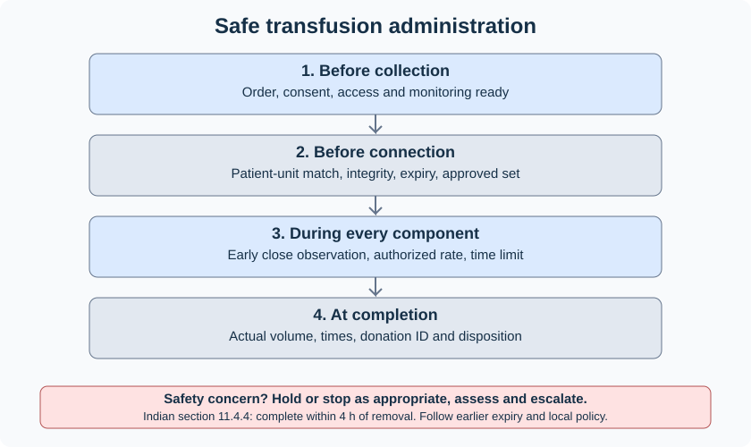

# Safe transfusion administration

**Study-ready, not studied.** Is guide mein hum patient readiness se lekar component completion aur hemovigilance tak ka nursing workflow samjhenge. Ye independent prescribing ya blood issue authorization nahi hai.

[Chapter](../README.md) · [30 original MCQs](../MCQs/18-Safe-Transfusion-Administration-30-MCQs.md) · [Research evidence](../Previous-Year-Questions/08-Transfusion-Administration-Evidence-and-Research.md)

## Readiness and consent

Blood transfusion shuru karne se pehle nurse prescription, clinical indication, documented informed consent aur patient ki readiness verify karti hai. Consent ka matlab patient ko reason, expected benefit, material risks aur alternatives samajhne ka chance milna hai. Agar competent patient consent withdraw kar de toh routine transfusion start nahi karni hai. Treating team ko inform karo aur blood centre se unused unit ki safe disposition coordinate karo.

Patient ke approved identifiers, unit number, component, compatibility label, special modification, expiry aur bag integrity ko local bedside verification process se match karo. Unit collect karne se pehle appropriate access, monitoring equipment aur trained staff ready hone chahiye. Patient imaging ke liye away ho toh nonurgent blood collection delay karke controlled storage maintain karo.

## Time limits and cold chain

Controlled blood storage aur transport component quality maintain karte hain. Temperature excursion, bag leak, abnormal appearance ya uncertain expiry ho toh unit hold karke blood centre se disposition clarify karo. Ward medication refrigerator, improvised ice storage ya bedside repair validated component handling replace nahi karte.

Indian National Standards for Blood Centres, second edition 2022, section 11.4.4 mein controlled storage se removal ke four hours ke andar transfusion complete karne ki requirement di gayi hai. Earlier labelled expiry ya stricter local rule bhi apply ho sakta hai. Agar blood 09:10 par remove hua aur 09:35 par start hua, toh cited rule ka latest time 13:10 hai. Interruption original clock reset nahi karti. Fluid-sensitive patient ka prescribed slow rate four-hour limit se conflict kare toh treating clinician aur blood centre se smaller aliquots ya revised plan arrange karo.

## Equipment and access

Indian section 11.4.3 mein sterile disposable blood administration set ka integral mesh usually 170–260 micrometres describe hota hai. Filter large clots aur debris ko retain karta hai. Pre-storage leukoreduction standard administration filter ka substitute nahi hai. Manufacturer aur local policy follow karo, aur cited Indian standard blood set ko six hours se zyada use na karne ko kehti hai. Individual blood component ki four-hour limit separate hai. Red cells ke baad platelets dene ke liye fresh appropriate set use karna recommended hai.

Infusion devices blood administration ke liye validated hone chahiye. Wrong mechanical pressure red cells damage kar sakti hai. Rapid massive transfusion mein approved blood warmer hypothermia prevent karne mein help kar sakta hai. Routine stable transfusion mein every unit warm karna necessary nahi hai. Device alarm aaye toh unsafe device ko bypass mat karo aur team ke saath safe replacement urgently arrange karo.

Blood ke saath routine compatible IV fluid sterile 0.9% sodium chloride hota hai. Dextrose ya calcium-containing solution ko same red-cell line mein mix mat karo. Medication blood bag mein add nahi hoti. Agar critical vasoactive medication chal rahi hai toh independently interrupt mat karo. Suitable separate lumen ya authorized access plan arrange karo.

## Observation and rate

Baseline clinical status aur vital signs document karna important hai. Indian standards har component ke start se pehle, 15 minutes baad aur completion par observations specify karti hain. Lifeblood guidance first 15 minutes of each pack mein close observation aur at least hourly observation recommend karti hai. Local hospital stricter schedule rakh sakta hai. Patient pehla unit tolerate kar le toh bhi second unit ka early monitoring repeat karo.

Patient ko chills, pain, rash, sudden breathlessness ya unwell feeling turant report karne ko bolo. Sedated patient verbal symptoms nahi bata sakta, isliye objective clinical observation aur bhi important hai. Nonurgent transfer monitoring ko compromise nahi karna chahiye.

Initial slow phase ke baad rate prescription, patient tolerance aur time limit se guide hoti hai. Agar 240 mL remaining hai aur approved rate 80 mL/hr hai toh mathematically three hours lagenge. Available window 2.5 hours ho toh clinician se review karna hai, independently rate accelerate nahi karna. New reaction concern ho toh local emergency reaction protocol activate karo. Reaction classification next separate bank mein cover hogi.

## Completion and traceability

Transfusion complete hone par clinical response aur relevant laboratory assessment plan ke according document karo. Authorized compatible saline flush ka volume bhi fluid balance mein count karo. Patient record mein component, donation number, actual volume, start, interruption aur stop times, responsible staff aur observations record karo. Issued unit ka final disposition blood centre ko communicate karna traceability ka part hai. Agar near-miss detect ho aur patient ko harm na hua ho toh bhi local incident reporting system follow karo. Outpatient ko delayed warning symptoms aur urgent contact instructions samjhao.

## Important prior-source discrepancy

Isi 2022 Indian standards PDF ke section 8.11.4 mein repeat transfusion ke liye 48-hour fresh specimen wording hai, jabki section 8.15.2.3 mein 72-hour wording hai. Isliye kisi ek number ko universal clinical specimen-validity rule mat samjho. Previous compatibility package Q21 specifically section 8.11.4 par based hai. Clinical use ke liye current validated blood-centre SOP verify karna zaroori hai. Previous package identity unchanged hai.

## References

- [Indian National Standards 2022, sections 11.3–11.10](https://clinicalestablishments.mohfw.gov.in/sites/default/files/2023-03/1491_0.pdf)
- [Canadian Blood Services blood administration](https://professionaleducation.blood.ca/en/transfusion/clinical-guide/blood-administration)
- [Lifeblood administration](https://www.lifeblood.com.au/health-professionals/clinical-practice/transfusion-process/administration-blood-components) and [monitoring](https://www.lifeblood.com.au/health-professionals/clinical-practice/transfusion-process/monitoring-observation)
- [ISBT blood administration teaching](https://www.isbtweb.org/communities/transfusion-practitioners/essentials-of-blood-transfusion-teaching/3-blood-administration.html)
- [Dedicated MCQ session, Nursing Wallah by PW](https://www.youtube.com/watch?v=RpMSsU42K4o) — indexed description and monitoring marker only, exact playback pending.

[MCQ bank](../MCQs/18-Safe-Transfusion-Administration-30-MCQs.md) · [Evidence register](../Previous-Year-Questions/08-Transfusion-Administration-Evidence-and-Research.md) · [Chapter](../README.md)
