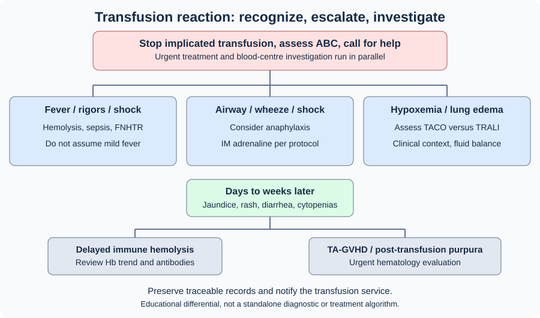

# Transfusion reactions and hemovigilance

**Study-ready, not studied.** Blood transfusion ke baad adverse event ka exact cause hamesha turant clear nahi hota. Nursing priority patient safety, prompt escalation, observation aur traceable investigation hai. Classification ke liye emergency care delay mat karo.

[Chapter](../README.md) · [32 original MCQs](../MCQs/19-Transfusion-Reactions-and-Hemovigilance-32-MCQs.md) · [Source-linked practice and evidence](../Previous-Year-Questions/09-Transfusion-Reactions-SCTIMST-2015-and-Research.md)

## Hemolytic reactions

Hemolysis ka matlab red cells ka destruction hai. Acute immune hemolytic reaction mein incompatible donor cells ke against recipient antibodies react kar sakti hain. ABO antibodies complement activate karke intravascular destruction produce kar sakti hain. Fever, pain, hypotension, hemoglobinuria aur kidney injury possible hain. Severe reaction coagulation activation aur DIC ke saath bhi present ho sakti hai.

Blood centre pretransfusion aur postreaction samples compare kar sakta hai. Repeat grouping, antibody screen, direct antiglobulin test (DAT), hemoglobin, LDH, bilirubin, haptoglobin, kidney tests aur coagulation tests clinical situation ke hisaab se useful hain. DAT immune coating assess karta hai, lekin isolated positive result active hemolysis prove nahi karta. Nonimmune hemolysis physical ya chemical injury se bhi ho sakti hai, jaise overheating. Equipment aur component handling investigation mein include karo.

Delayed hemolytic transfusion reaction commonly transfusion ke 24 hours se 28 days ke interval mein recognize ho sakti hai. Patient initially improve karke baad mein Hb fall, jaundice aur new antibody show kar sakta hai. Earlier antibody undetectable level tak decline ho sakti hai, but antigen re-exposure ke baad memory response rise kar sakta hai. New antibody without hemolysis delayed serologic event ho sakti hai. Blood centre classification aur future compatible selection plan karta hai.

## Febrile and allergic reactions

FNHTR mein fever inflammatory mediators ya leukocyte antigen-related response se ho sakti hai. Acute fever ko automatically FNHTR mat bolo. Bacterial sepsis, hemolysis aur other serious reactions bhi fever cause kar sakte hain. Prestorage leukoreduction risk reduce kar sakti hai, but zero risk guarantee nahi karti.

Isolated itching aur hives mild allergy suggest kar sakte hain, lekin worsening respiratory symptoms, stridor, wheeze ya hypotension severe reaction ka warning hai. Anaphylaxis mein skin rash absent bhi ho sakti hai. Local emergency protocol ke under IM adrenaline first-line treatment hai. Oxygenation aur circulation support urgently coordinate karo. Severe allergic reaction ke baad transfusion specialist future product strategy assess karta hai. IgA deficiency alone anti-IgA prove nahi karti.

Selected mild reactions mein complete resolution aur clinician/protocol authorization ke baad viable component ka carefully monitored restart possible ho sakta hai. Severe reactions mein implicated unit restart mat karo. Local product deadline continue apply hoti hai.

## Respiratory reactions

TACO aur TRALI dono acute respiratory distress aur pulmonary edema produce kar sakte hain. Mechanism alag hai. TACO hydrostatic pressure/circulatory overload se related hai. TRALI inflammatory capillary permeability injury se associated hai.

| Finding | TACO supporting pattern | TRALI supporting pattern |
|---|---|---|
| Onset window | During or up to 12 hours | During or within 6 hours |
| Mechanism | Hydrostatic overload | Increased permeability |
| Fluid/cardiac assessment | Positive balance, elevated filling-pressure evidence | Overload not primary explanation |
| Blood pressure | Often elevated, but variable | May be low, but variable |
| BNP/NT-proBNP | May support overload, not definitive | Cannot rule out by biomarker alone |
| Management emphasis | Oxygen, fluid review, prescribed diuresis as appropriate | Oxygen/ventilatory and circulatory support, no routine diuresis solely for TRALI |

Both syndromes coexist bhi kar sakte hain. Chest image alone diagnosis decide nahi karti. TRALI donor HLA/HNA antibody testing supportive ho sakti hai, but negative test clinically supported TRALI exclude nahi karta. Stable high-risk nonbleeding patients mein minimum indicated volume, individualized rate aur reassessment overload prevention ke important parts hain.

## Bacterial contamination

High fever, severe rigors aur shock during or soon after transfusion se transfusion-associated sepsis suspect ho sakti hai. Conventional platelet storage conditions bacteria ki growth support kar sakti hain. Refrigerated red cells bhi contamination se completely protected nahi hain. Patient blood cultures aur implicated component culture arrange karo through local blood-centre procedure. Urgent resuscitation aur antimicrobial treatment cultures ke liye unnecessarily delay nahi honi chahiye. Same donation ke other products quarantine aur trace karne ke liye supplying service ko prompt alert chahiye.

## Delayed immune reactions

TA-GVHD mein viable donor T cells recipient tissues attack kar sakti hain. Fever, widespread rash, diarrhea aur progressive pancytopenia days to weeks later appear kar sakte hain. Ye rare but potentially fatal complication hai. Specialist-selected irradiation of indicated cellular components prevention mein important hai. Leukoreduction irradiation ka substitute nahi hai.

Post-transfusion purpura (PTP) generally 5–10 days later profound thrombocytopenia ke saath present ho sakti hai. Platelet alloimmune response involved hota hai. Mucosal bleeding ya severe thrombocytopenia urgent specialist review demand karti hai. IVIG commonly used treatment hai, additional blood component support individual bleeding situation se decide hota hai.

## Clinical response and hemovigilance

Suspected reaction mein implicated transfusion stop karo, patient ka ABC aur vital signs assess karo, urgent medical help aur blood centre notify karo. Existing vascular access ko local approved compatible-fluid/new-tubing procedure se maintain karo. Remaining implicated blood ko patient mein flush mat karo. Unit aur required samples investigation ke liye safe traceable manner mein preserve/send karo.

Indian standards section 13.3 nursing staff ko suspected reaction promptly report karne, patient aur unit details document karne, required samples/component blood centre ko bhejne aur investigation report patient record mein retain karne ki responsibility describe karta hai. Severity aur imputability alag concepts hain: severity harm ki degree hai, imputability transfusion se causal link ki likelihood hai. Hospital transfusion committee aur national hemovigilance pathway local reporting rules ke according involve ho sakte hain.

### Prior specimen validity clarification

Indian 2022 standards section 8.11.4 explicitly 48 hours after prior transfusion ke baad fresh sample wording deta hai, whereas section 8.15.2.3 mein 72 hours likha hai. Dono passages rechecked. Earlier compatibility Q21 specifically first section cite karta hai. Current validated local blood-centre SOP govern karti hai. Do not memorize one timing as universal. Previous bank and attempt identity unchanged.

## Practice and references

- [Indian National Standards, sections 8.11.4, 8.15.2.3 and 13.3](https://clinicalestablishments.mohfw.gov.in/sites/default/files/2023-03/1491_0.pdf)
- [Lifeblood reaction management](https://www.lifeblood.com.au/health-professionals/clinical-practice/adverse-events/management-of-suspected-reactions)
- [ISBT adverse effects education](https://www.isbtweb.org/resources/educational-modules-on-clinical-use-of-blood/adverse-effects-of-transfusion.html)
- [CDC NHSN Hemovigilance module](https://www.cdc.gov/nhsn/biovigilance/blood-safety/index.html)
- [Nursing Star dedicated Top 25 blood transfusion MCQs](https://www.youtube.com/watch?v=znP9DL53hRU) — indexed description confirms topic groups, exact playback and timestamps unverified.
- [TheScrubElite reaction teaching/revision](https://www.youtube.com/watch?v=-md43XuOaqo) — indexed description, not certified question-level practice.

[Original questions](../MCQs/19-Transfusion-Reactions-and-Hemovigilance-32-MCQs.md) · [Historical evidence](../Previous-Year-Questions/09-Transfusion-Reactions-SCTIMST-2015-and-Research.md) · [Chapter](../README.md)
