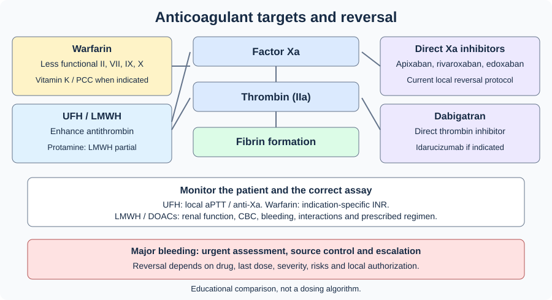

# Anticoagulation and safe nursing management

**Study-ready, not studied.** Anticoagulant treatment clotting risk kam karta hai, lekin bleeding risk badha sakta hai. Isliye indication, dose, route, monitoring aur patient ki clinical condition ko saath mein samajhna zaroori hai. Ye education hai, independent prescribing ya reversal algorithm nahi.

[Chapter](../README.md) · [32 original MCQs](../MCQs/20-Anticoagulation-and-Safe-Nursing-Management-32-MCQs.md) · [Research evidence](../Previous-Year-Questions/10-Anticoagulation-Reported-Evidence-and-Research.md) · [Inventory](../MCQs/Hematology-Question-Inventory.md)

## Heparins and monitoring

Blood clot banane ke liye coagulation factors ek sequence mein activate hote hain. Factor Xa thrombin formation mein help karta hai. Thrombin fibrinogen ko fibrin mein convert karta hai. Fibrin clot ka stable mesh banata hai. Anticoagulants coagulation reactions ko slow karte hain. Existing clot directly dissolve nahi hota, but extension aur new clot risk reduce ho sakta hai. Thrombolytics fibrin breakdown promote karte hain, aur antiplatelets platelet activation ko target karte hain.

UFH antithrombin ka action enhance karke thrombin aur factor Xa inhibit karta hai. IV UFH rapid onset aur short offset ke kaaran selected acute situations mein useful hai. Therapeutic infusion monitor karne ke liye local aPTT ya calibrated anti-Xa protocol follow karo. CBC, platelet count, coagulation profile aur renal function baseline par relevant hain. Order units/hour mein ho sakta hai, pump mL/hour mein. Agar concentration change ho toh authorized dose ke liye rate independently recalculate karo. Actual interruption, restart aur sample timing document karne se lab result correctly interpret hota hai.

Recent apixaban, rivaroxaban ya edoxaban ka residual effect UFH-calibrated anti-Xa assay interfere kar sakta hai. ISTH 2025 communication is issue ko address karta hai. Last dose aur lab monitoring strategy share karo. Abnormal baseline aPTT ke causes previous coagulation diagnostics bank mein covered hain.

LMWH jaise enoxaparin ka antithrombin-mediated factor Xa inhibition relatively predominant hai. Severe renal impairment mein elimination slow ho sakti hai. Cited enoxaparin label CrCl below 30 mL/min par dose adjustment specify karta hai. ASH selected renal VTE context mein routine anti-Xa-guided adjustment ke against suggest karta hai aur label-based adjustment ya alternative anticoagulant review consider karta hai. Selected assay use specialist decide karega. Routine INR LMWH monitoring tool nahi hai. Very low-weight patient mein fixed prophylaxis exposure badha sakti hai. CBC, platelet count, renal function, weight aur bleeding signs review karo. Approved subcutaneous injection procedure follow karo aur site ko rub mat karo. Protamine UFH neutralize karta hai, but LMWH anti-Xa activity incompletely reverse hoti hai. Major bleeding mein clinical monitoring aur specialist management continue hoti hai.

Active bleeding ki wajah se drug VTE prophylaxis contraindicated ho toh suitable intermittent pneumatic compression aur risk reassessment discuss karo. Mechanical methods bhi patient-specific suitability require karte hain.

## Heparin-induced thrombocytopenia

Immune HIT mein antibodies platelet factor 4 (PF4) aur heparin complex ko target kar sakti hain. Platelets activate hoti hain aur thrombosis risk badhta hai, despite platelet count decline. Low platelet count ko sirf bleeding disease mat samjho.

4Ts platelet fall, timing, thrombosis aur other causes ka pretest probability score hai. Har domain 0–2 points deta hai. Total 0–3 low, 4–5 intermediate, 6–8 high hai. Example: count 160,000 se 104,000 hua toh 35% fall hai, one point. Clear day 6 timing two points, no thrombosis zero, possible alternate cause one point. Total four hai. Complete exposure history se score verify karo.

Reliable low score mein ASH usually empiric HIT treatment ke against recommend karti hai. Intermediate/high probability mein urgent team assessment, all heparin sources including locks and flushes review, laboratory testing aur authorized non-heparin anticoagulant plan needed ho sakta hai. Argatroban, bivalirudin, fondaparinux ya selected DOACs specialist clinical situation ke hisaab se choose kar sakta hai. PF4 immunoassay antibody presence detect karta hai. Functional assay platelet activation assess kar sakta hai. Acute HIT mein warfarin platelet recovery se pehle start karna dangerous ho sakta hai. ASH generally recovery at least 150,000/µL describe karti hai. Exact decision hematology team leti hai.

## Warfarin

Warfarin vitamin K recycling inhibit karta hai. Liver ko functional factors II, VII, IX, X aur proteins C/S banane ke liye vitamin K chahiye. Already circulating factors turant disappear nahi hote. Isliye full anticoagulant effect delayed hai. Acute VTE mein appropriate initial parenteral overlap generally at least five days plus therapeutic INR criterion ke basis par complete hota hai. Exact local protocol follow karo. Early INR rise alone sufficient protection prove nahi karta.

INR standardized PT measure hai. Ordinary VTE target commonly 2–3 hota hai, but indication-specific target verify karo. Mechanical valves ke targets different ho sakte hain. Patient ko balanced diet aur consistent vitamin K intake maintain karna sikhana chahiye, vegetables permanently ban nahi karni hain. Significant dietary change, new OTC medicines, herbal supplements, illness aur missed dose service ko communicate karo.

ASH 2018 selected VTE patient with INR above 4.5 and below 10 without clinically relevant bleeding mein temporary VKA withholding without routine vitamin K suggest karta hai. Patient-specific bleeding risk aur follow-up matter karte hain. Critical bleeding mein four-factor PCC when available aur IV vitamin K complementary role play karte hain. PCC thrombotic risk bhi carry karta hai, isliye clinician-directed use zaroori hai.

## Direct oral anticoagulants

Dabigatran direct thrombin inhibitor hai. Apixaban, rivaroxaban aur edoxaban direct factor Xa inhibitors hain. Routine INR titration nahi hoti, lekin CBC, renal/liver function, adherence, interactions aur clinical bleeding monitoring needed hai. Drug-specific dose, indication aur treatment phase verify karo.

Cited adult rivaroxaban label 15/20 mg tablets food ke saath lene ko kehta hai. Dabigatran capsule ko intact swallow karna hai because opening exposure increase kar sakti hai. Cited capsule label mein missed dose skip karo agar next dose se six hours se kam gap hai, dose double mat karo. Other DOAC rules differ karte hain. Adult acute DVT/PE dabigatran regimen preceding 5–10 days parenteral anticoagulation specify karta hai. Apixaban aur rivaroxaban initial schedules different hain. Rifampicin jaise strong P-gp/CYP3A4 inducers apixaban exposure reduce kar sakte hain. Indian NAMS 2024 report triple-positive thrombotic APS mein VKA preference describe karta hai. Mechanical valve distinction Cardiovascular Master Guide mein already covered hai.

## Periprocedural safety

Elective procedure se pehle actual drug, last dose, renal function, procedure bleeding risk aur anesthesia plan team ko communicate karo. Universal interruption timing nahi hoti. CHEST 2022 routine elective DOAC interruption mein heparin bridging ke against suggest karta hai. Neuraxial procedures ke separate anesthesia rules hote hain. New severe back pain, bilateral weakness, sensory change aur bladder dysfunction spinal hematoma ke urgent warning signs ho sakte hain.

## Bleeding reversal and restart

Major bleeding mein urgent clinical stabilization, escalation, drug interruption as authorized aur source control parallel chalne chahiye. Last dose, renal function, other antithrombotics aur indication document karo. Drug-specific assays useful ho sakte hain if available without delaying emergency treatment.

| Agent | Mechanism | Reversal consideration |
|---|---|---|
| UFH | Antithrombin-mediated IIa/Xa inhibition | Protamine |
| LMWH | Predominantly anti-Xa | Protamine incomplete |
| Warfarin | Vitamin K antagonism | Vitamin K and 4F-PCC in indicated major bleeding |
| Dabigatran | Direct IIa inhibition | Idarucizumab if indicated |
| Apixaban/rivaroxaban | Direct Xa inhibition | Current local reversal protocol, PCC may be considered |

Andexanet alfa historical specific Xa reversal association rakhta hai. FDA December 2025 safety communication serious thromboembolic risks aur U.S. sales end on 22 December 2025 report karti hai. Yeh Indian availability ya approval ka proof nahi hai. Current local authorization and specialist protocol verify karo. Older ACC 2020 guidance ko current availability ke saath reconcile karna zaroori hai. Reversal routine minor bruising ke liye automatically required nahi hoti. OTC NSAIDs platelet function aur GI mucosa affect karke bleeding risk add kar sakti hain. Bleeding control ke baad explicit restart assessment needed hai because recurrent thrombosis risk bhi important ho sakta hai.

## Clinical references and videos

- [ASH HIT](https://pmc.ncbi.nlm.nih.gov/articles/6258919/) and [optimal anticoagulation management](https://pmc.ncbi.nlm.nih.gov/articles/PMC6258922/).
- [Indian NAMS VTE report, 2024](https://www.nams-india.in/anams/2024/NAMS%20task%20force%20report%20on%20Venous%20thromboembolism.pdf), Annexure 2.
- [ISTH 2025 UFH assay interference](https://pubmed.ncbi.nlm.nih.gov/40056991/).
- [ACC bleeding guidance](https://www.acc.org/latest-in-cardiology/ten-points-to-remember/2020/07/10/11/26/2020-acc-expert-consensus-decision-pathway-on-bleeding) and [FDA December 2025 update](https://www.fda.gov/safety/medical-product-safety-information/update-safety-andexxa-astrazeneca-fda-safety-communication).
- [CHEST perioperative guidance](https://journal.chestnet.org/article/S0012-3692%2822%2901359-9/fulltext?dgcid=raven_jbs_etoc_email) and [reversal review](https://pmc.ncbi.nlm.nih.gov/articles/PMC11862798/).
- [Enoxaparin](https://dailymed.nlm.nih.gov/dailymed/drugInfo.cfm?setid=20635579-c92d-4f6c-a332-1096d51002f2), [warfarin](https://dailymed.nlm.nih.gov/dailymed/drugInfo.cfm?setid=51e98fb6-ba76-497e-95d8-fe895ef0b7ed), [dabigatran](https://dailymed.nlm.nih.gov/dailymed/drugInfo.cfm?setid=3c24e235-218b-438e-9456-42c18ff01913), [rivaroxaban](https://www.dailymed.nlm.nih.gov/dailymed/fda/fdaDrugXsl.cfm?setid=10db92f9-2300-4a80-836b-673e1ae91610&type=display), [apixaban](https://dailymed.nlm.nih.gov/dailymed/drugInfo.cfm?setid=e9481622-7cc6-418a-acb6-c5450daae9b0) prescribing information. Cited US labels are source-specific, not certification of Indian availability.
- [Heparin versus warfarin teaching](https://www.youtube.com/watch?v=l5eK7Z5GtEc), indexed lecture description only.
- [Dedicated anticoagulant MCQ practice](https://www.youtube.com/watch?v=3TV0TiXshLo), indexed description specifies INR and HIT. Exact playback and question coverage pending.

[Original bank](../MCQs/20-Anticoagulation-and-Safe-Nursing-Management-32-MCQs.md) · [Research evidence](../Previous-Year-Questions/10-Anticoagulation-Reported-Evidence-and-Research.md) · [Chapter](../README.md)
