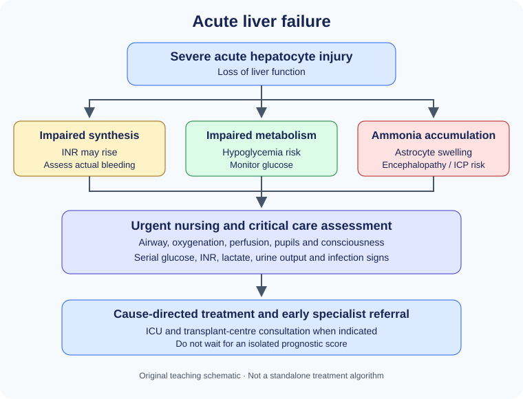

# Acute Liver Failure — Nursing Concepts

**Study-ready candidate, not studied.** Original teaching guide for NORCET, AIIMS, PGIMER and HP Staff Nurse practice. Independent clinical and navigation review pending.

[Chapter](../README.md) · [20 original MCQs](../MCQs/06-Acute-Liver-Failure-20-MCQs.md) · [Topic map](Hepatobiliary-and-Pancreatic-System-Topic-Coverage-Map.md)

## 1. Acute liver injury aur acute liver failure mein difference

Liver ko body ka processing centre samjho. Ye glucose ko store aur release karta hai, blood clotting mein kaam aane wale proteins banata hai aur harmful substances ko process karta hai. Jab liver cells bahut jaldi damage hote hain, toh in functions mein dikkat aa sakti hai.

Acute liver injury mein recent liver damage hota hai. Adult acute liver failure (ALF) mein severe acute injury ke saath clotting abnormality (typically INR 1.5 ya zyada) aur hepatic encephalopathy hoti hai, usually pehle se known cirrhosis ke bina. Encephalopathy ka matlab brain function mein badlav hai. Patient confused ho sakta hai, unusual behavior dikha sakta hai ya consciousness kho sakta hai. Acute liver injury mein encephalopathy abhi absent ho sakti hai, lekin deterioration ka risk phir bhi urgent hai.

| Finding | Iska simple matlab |
|---|---|
| INR badhna | Liver ki clotting proteins banane ki ability kam ho sakti hai. |
| Glucose girna | Liver body ki glucose requirement ko maintain nahi kar pa raha ho sakta hai. |
| Confusion ya drowsiness | Brain function affect ho raha hai. Doosre reversible causes bhi assess karne hote hain. |
| Lactate badhna | Tissue perfusion aur liver clearance dono ki dikkat ka clue ho sakta hai. |
| Urine output girna | Kidney perfusion ya kidney function kharab ho raha ho sakta hai. |

## 2. Causes aur medicine history

Acetaminophen ko paracetamol bhi kehte hain. Ye kai cold medicines aur pain medicines mein hota hai. Kabhi patient alag brands ko alag medicines samajhkar le leta hai. Isliye sirf prescription ki list mat dekho. Family se actual products, strength, quantity, dose timing aur herbal supplements ki information lo, especially jab patient history nahi de sakta.

Viral hepatitis, autoimmune hepatitis, drug-induced injury, ischemia (blood supply aur oxygen kam hona), Wilson disease aur pregnancy-related disorders bhi possible causes hain. Immunosuppressed patient mein severe HSV hepatitis ko specialist consider kar sakta hai, even jab jaundice prominent na ho. Wilson disease mein copper processing ka inherited disorder hota hai. Severe jaundice ke saath nonimmune hemolysis aur disproportionately low ALP ek useful clue hai, lekin diagnosis confirm karne ke liye specialist assessment chahiye.

## 3. N-acetylcysteine aur toxicology assessment

Paracetamol ka ek toxic metabolite liver ko damage kar sakta hai jab protective glutathione kam pad jaata hai. N-acetylcysteine (NAC) glutathione replenish karne mein help karti hai. Suspected paracetamol toxicity mein clinician-directed NAC ko timely start karna important hai. Selected early non-paracetamol ALF mein bhi team NAC consider kar sakti hai. Ye underlying cause ki investigation ya transplant assessment ka replacement nahi hai.

Agar ek known time par single acute ingestion hui ho, toh toxicology team appropriate nomogram use kar sakti hai. Lekin multiple days tak repeated doses ya unclear timing wale case mein ek single timed concentration ko nomogram par plot karna reliable nahi hai. Treatment decision history, relevant labs aur toxicology advice par depend karta hai.

Infusion ke dauran prescribed rate, IV access, vital signs aur possible hypersensitivity reactions monitor karo. Nurse independent dose changes na kare. Reaction ya deterioration par local emergency protocol follow karo aur team ko alert karo.

## 4. Brain swelling ka mechanism aur nursing priorities

Ammonia gut aur body ke metabolism se banta hai. Normally liver isko process karne mein madad karta hai. ALF mein ammonia accumulate ho sakta hai. Brain ke support cells, jinhe astrocytes kehte hain, swell kar sakte hain. Rapid swelling se intracranial pressure (skull ke andar pressure) badh sakta hai.

Nurse serial consciousness level, pupils, airway protection, oxygenation aur circulation assess karti hai. Hemodynamically suitable patient mein head elevation about 30 degrees aur neutral neck venous drainage mein help kar sakte hain. Position ko treating ICU team ke plan aur perfusion ke according adjust karo. Sudden unequal pupils, abrupt consciousness drop, seizure ya respiratory compromise emergency findings hain.

Agar patient secretions handle nahi kar pa raha hai, toh oral feeding ya water challenge aspiration ka risk badha sakte hain. Critical care team airway protection aur possible intubation assess karti hai. Severe hyperammonemia mein continuous renal replacement therapy (CRRT) specialist-directed ammonia clearance aur organ support ke liye consider ki ja sakti hai, even jab conventional dialysis indication abhi absent ho.

## 5. Circulation, glucose, bleeding aur infection

**Glucose:** Confused patient apni hypoglycemia ke symptoms nahi bata paata. Prescribed dextrose infusion ke bawajood bedside glucose ko ordered frequency par monitor karo. Abnormal result par local treatment protocol follow karo.

**Coagulation:** INR liver synthetic function ko follow karne mein useful hai, lekin bleeding risk ko akela perfectly predict nahi karta. Active bleeding ya high-risk procedure absent ho toh sirf INR normalize karne ke liye routine plasma transfusion generally avoid ki jaati hai. Actual bleeding, procedure requirements aur individualized specialist plan alag baat hain.

**Infection:** Fever absent hone par bhi infection possible hai. New hypotension, vasopressor requirement ya organ dysfunction par sepsis assessment delay mat karo. Cultures aur antimicrobials treating team ke protocol ke according arrange karo.

**Trends:** ALT liver cell injury ka marker hai. ALT girne ka matlab har baar recovery nahi hota. Agar INR, lactate aur neurological status worsen ho rahe hain, toh overall trajectory urgently review karni chahiye.

## 6. Diagnostic workup aur transfer

Hepatic Doppler ultrasound liver ki blood vessels ka flow assess kar sakta hai. Unstable patient mein bedside imaging useful ho sakti hai. Unclear cause mein specialist-directed biopsy kabhi necessary ho sakti hai. Significant coagulopathy mein transjugular route consider kiya ja sakta hai.

ALF rapidly progress kar sakta hai. Transplant centre se early consultation important hai, even jab patient abhi kisi prognostic score ki exact threshold meet nahi karta. Transfer handover mein serial INR, lactate, glucose, renal function, neurological assessment, medicine administration times aur current organ support include karo. Safe transport ka decision airway aur circulation stability aur specialist team ke saath hota hai.

## 7. Exam application

A patient ka ALT kal 5,000 U/L tha aur aaj 2,100 U/L hai. Lekin INR 2.0 se 3.6 ho gaya hai aur patient pehle se zyada drowsy hai. Sirf ALT dekhkar recovery declare mat karo. Clotting function aur brain status worsen ho rahe hain, isliye urgent specialist reassessment chahiye.

### High-yield recall

- Acute liver injury without encephalopathy aur established ALF alag terms hain.
- Paracetamol toxicity mein NAC time-sensitive treatment hai.
- Airway compromise aur neurological red flags ko routine lab review ke liye postpone nahi karna chahiye.
- INR, glucose, circulation, infection aur mental status ke trends saath mein assess karo.
- Early transplant consultation aur safe specialist transfer important hain.

## Source and video evidence

- [AASLD, Defining and Managing Acute Liver Failure, January 2025](https://www.aasld.org/liver-fellow-network/core-series/back-basics/defining-and-managing-acute-liver-failure), indexed source and earlier direct review recorded.
- [Acute liver failure: A practical update, 2024](https://doi.org/10.1016/j.jhepr.2024.101131), indexed clinical review.
- [INASL consensus Part 2, management](https://inasl.org.in/wp-content/uploads/2025/12/2020-ALF-Part-2-Anand.pdf), indexed Indian consensus text, not a newly completed full PDF or screenshot audit.
- [Merck Manual Professional, acute liver failure](https://www.merckmanuals.com/professional/hepatic-and-biliary-disorders/approach-to-the-patient-with-liver-disease/acute-liver-failure), indexed guidance.

Specific teaching and dedicated nursing MCQ-solving video evidence remains pending. No verified timestamp or playback is claimed. Study this guide with the linked original practice bank. No historical exam appearance is claimed.
