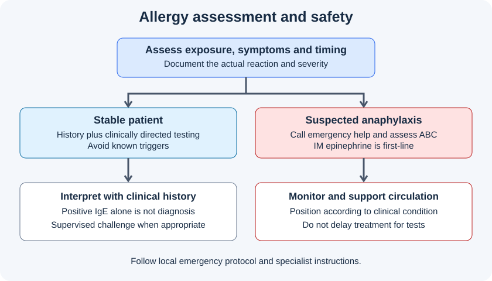

# Allergy assessment, testing and exposure safety

**Study-ready candidate, not studied.** Companion to [20 original MCQs](../MCQs/01-Allergy-Assessment-Diagnostic-Testing-and-Exposure-Safety-20-MCQs.md). Independent release review pending.

## Allergy aur intolerance mein fark

Allergy mein immune system kisi substance ko threat samajhkar react karta hai. IgE ek antibody hai jo immediate allergy mein mast cells ko activate kar sakti hai. Mast cells se histamine jaise chemicals nikalte hain, jisse itching, hives, swelling aur kabhi breathing problem ho sakti hai. Har adverse drug reaction allergy nahi hoti.

Lactose intolerance mein milk sugar ko todne wala lactase enzyme kam ho sakta hai. Isse gas, bloating aur diarrhoea ho sakte hain. Ye milk protein ke against allergic immune response nahi hai. Nurse ko reaction ka mechanism bina proper assessment assume nahi karna chahiye.

## History aur documentation

Patient se medicine ya food ka exact naam, dose, route, symptoms, onset ka time, severity aur previous exposure poochho. Agar reaction ki details unclear hain toh uncertainty document karo. Bina confirmation ke allergy label remove mat karo aur anaphylaxis ka label invent mat karo. Patient ki allergy status medication administration se pehle check karo.

## Allergy tests

Skin prick test immediate skin response assess karta hai. Serum allergen-specific IgE blood mein sensitization ka clue deta hai. Positive result se clinical allergy automatically confirm nahi hoti. Symptoms aur exposure history bhi assess karni hoti hai.

Patch testing delayed contact allergy ke assessment mein use hoti hai. Panel aur skin markings clinic ke instructions ke mutabik dry rakho. Agar panel detach ho jaaye toh testing clinic ko inform karo. Active eczema interpretation ko difficult bana sakta hai.

Diagnostic oral food challenge trained clinical team ki supervision mein hota hai, jahan emergency treatment available ho. Active poorly controlled wheezing ho toh test start karne se pehle specialist review chahiye. Food IgG panels clinical food allergy establish karne ke liye recommended nahi hain.

## Latex safety

Natural rubber latex mein proteins allergic reaction trigger kar sakte hain. Confirmed allergy mein appropriate synthetic gloves aur non-latex catheter use karo. Sirf gloves nahi, procedure ke saare contacting products verify karo. Patient ke care team ko allergy information communicate karo.

## Anaphylaxis mein nursing priorities

Anaphylaxis ek serious systemic reaction hai. Airway swelling, breathing difficulty, low blood pressure ya sudden collapse ho sakta hai. Skin rash har case mein present nahi hota. Emergency help bulao, trigger exposure stop karo jab safe ho, airway, breathing aur circulation assess karo. Intramuscular epinephrine first-line treatment hai. Local emergency protocol ke mutabik repeat treatment, oxygen, monitoring aur circulatory support mein madad karo.

Hypotension wale patient ko aam taur par supine rakha jaata hai. Patient ko achanak khada mat karo. Breathing distress, pregnancy aur reduced consciousness mein positioning individual condition ke mutabik adjust karo. Agar beta-blocker lene wale patient mein initial management ke baad refractory shock rahe, expert team glucagon ko adjunct ke roop mein consider kar sakti hai. Ye epinephrine ka replacement nahi hai.

Tryptase mast cell activation ka supporting marker hai. Normal result anaphylaxis ko akela exclude nahi karta. Sampling se emergency treatment delay nahi hona chahiye.

## Revision map

## Clinical sources and evidence limits

- [NICE CG183 drug allergy recommendations](https://www.nice.org.uk/guidance/cg183/chapter/Recommendations) — structured history and documentation.
- [NIDDK lactose intolerance](https://www.niddk.nih.gov/health-information/digestive-diseases/lactose-intolerance/symptoms-causes) — mechanism and symptoms.
- [AAAAI food IgG testing](https://www.aaaai.org/tools-for-the-public/conditions-library/allergies/igg-food-test) — inappropriate diagnostic use.
- [ASCIA hospital latex precautions](https://www.allergy.org.au/hp/papers/management-of-latex-allergic-patients/hospital-management?highlight=WyJsYXRleCJd) — catheter and glove precautions.
- [WAO anaphylaxis guidance](https://pmc.ncbi.nlm.nih.gov/articles/PMC7607509/) — emergency principles, positioning, tryptase and adjunct glucagon.

Sources retrieved as indexed text on 28 November 2026. Dedicated teaching and MCQ-solving video verification pending. No authenticated historical exam attribution claimed.

[Practice bank](../MCQs/01-Allergy-Assessment-Diagnostic-Testing-and-Exposure-Safety-20-MCQs.md)
