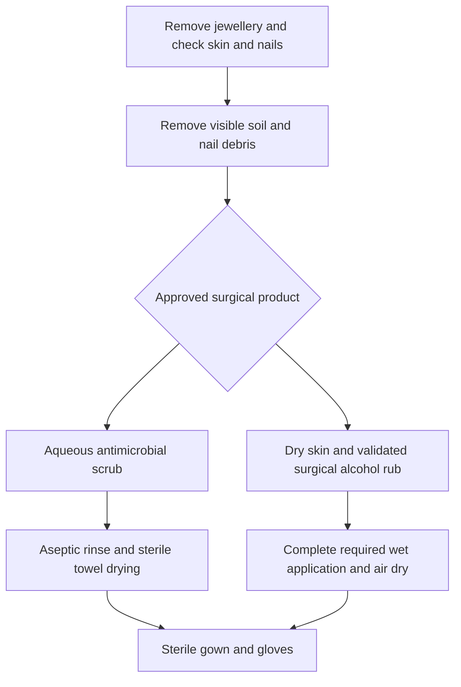

# Surgical hand preparation — individual topic expansion

**Study-ready, unattempted.** [30 additional original questions](../MCQs/01A-Surgical-Hand-Preparation-30-MCQs.md) · [Historical examination evidence](../Previous-Year-Questions/01A-Surgical-Hand-Preparation-Reported-PYQs.md)

## Purpose

Surgical hand preparation ko routine ward hand hygiene se confuse mat karo. Operation mein gloves barrier provide karte hain, lekin microscopic damage ya perforation possible hai. Surgical preparation skin par microbial load kam karti hai aur suitable sustained-activity product operation ke dauran bacterial regrowth limit kar sakta hai. Living skin completely sterile nahi ban jaati. Sterile gown, gloves, instruments aur surgical field ki asepsis bhi essential hai.

## Preparation and product choice

Scrub team rings, watch aur bracelets remove karti hai. Artificial nails allowed nahi hain. Visible soil ko wash karo aur nails ke neeche debris suitable nail cleaner se remove karo. Routine stiff brush se skin abrade mat karo. WHO surgical antisepsis ke liye suitable antimicrobial soap ya validated alcohol-based surgical handrub recommend karta hai. Ordinary ward hand rub ko automatically surgical product mat samjho. Water quality uncertain ho toh suitable alcohol-based surgical preparation preferred ho sakti hai, with safe preliminary cleaning as needed.

## Two approved pathways

| Aqueous surgical scrub | Alcohol-based surgical handrub |
|---|---|
| Suitable antimicrobial soap use karo | Surgical use ke liye validated formulation use karo |
| Hands aur forearms cover karo | Dry hands aur forearms par apply karo |
| Manufacturer ka time follow karo, WHO typically 2–5 minutes | Product-specific application time aur sufficient wet coverage maintain karo |
| Approved rinsing aur sterile towel drying technique follow karo | Required application complete karke thoroughly air dry karo |

CDC aqueous scrub ke liye usual 2–6 minutes describe karta hai. Fixed ten-minute scrub necessary nahi hai. Historical exam answers ko clinical product-specific instructions ke saath confuse mat karo. WHO complete surgical soap scrub aur complete alcohol surgical rub sequentially combine karne ko recommend nahi karta. Visible soil remove karne ke liye plain soap preliminary wash alag cheez hai.

## Maintaining the prepared state

Aqueous scrub mein approved rinsing technique use karo. Traditional method mein hands elbows se upar rakhe jaate hain taaki water fingers se elbows ki taraf flow kare. Sterile towel se protocol-directed drying karo. Alcohol method mein towel se prematurely wipe mat karo. Thorough drying ke baad hi sterile gloves don karo.

Example: scrub complete karne ke baad nurse accidentally door handle touch kar leti hai. Earlier preparation future contamination ko prevent nahi karti. Sterile task stop karo aur facility breach protocol ke according required preparation repeat karo. Har product ke liye fixed one-minute extension rule assume mat karo. Glove perforation mein safe glove change aur exposure assessment required hain.

## Skin safety and quality improvement

Painful fissures, weeping lesions ya antiseptic allergy ko occupational health aur IPC team se assess karwao. Approved alternative product aur compatible skin-care formulation select karo. Unapproved cream, excessive brushing aur chemical mixing avoid karo. Malfunctioning dispenser ya unlabelled product ko resolve kiye bina use mat karo. Audit sirf timer nahi, coverage, product choice, aseptic sequence, observed breaches aur clinical outcomes bhi review kare. New operation ke liye appropriate surgical preparation repeat karo.

## Clinical references and videos

- [WHO consensus surgical hand preparation recommendations](https://www.ncbi.nlm.nih.gov/books/NBK144035/)
- [CDC clinical safety hand hygiene guidance](https://www.cdc.gov/clean-hands/hcp/clinical-safety/)
- [WHO SSI prevention evidence](https://www.ncbi.nlm.nih.gov/books/NBK536431/)
- Concept demonstration: [Surgical Technologist — Correct Technique Of Hands Scrub](https://www.youtube.com/watch?v=Krb-kSNOJLk), 14 March 2026. Indexed channel and description cover surgical scrub technique.
- Practice lead: [Hand Hygiene Techniques, Fundamentals of Nursing MCQ, RRB Staff Nurse, AIIMS NORCET, CHO, NHM](https://www.youtube.com/watch?v=n_uxCEsfozg). Indexed title identifies nursing MCQs. Channel attribution and exact surgical scrub question coverage not independently retrieved.
- [Nursing classes — Hand Washing Procedure for Nursing Students](https://www.youtube.com/watch?v=H_kTAGh66U0), 30 March 2021. Retrieved description discusses surgical scrub, but includes historical brushing and fixed one-minute breach advice. Use current WHO guidance instead of those shortcuts.

Full video playback and answer accuracy were not independently verified. Dedicated surgical-hand-preparation-only MCQ video remains pending. Do not treat historical teaching techniques as universally recommended.
