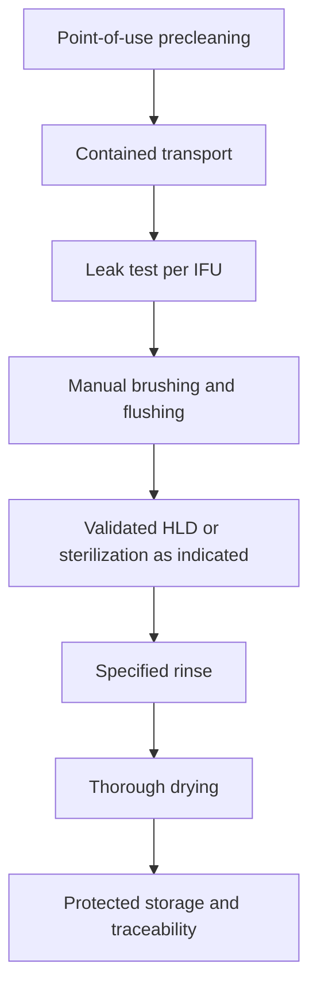

# Equipment disinfection and endoscope reprocessing

**Priority High. Study-ready, not studied.** [30 original MCQs](../MCQs/02B-Equipment-Disinfection-and-Endoscope-Reprocessing-30-MCQs.md)

## Risk-based disinfection

Spaulding framework device intended contact par based hai. Critical sterile tissue/vascular entry requires sterilization. Semicritical mucous membrane or nonintact skin contact generally at least HLD after cleaning. Noncritical intact skin contact generally appropriate low-level disinfection. Examples: laryngoscope blade and endocavity ultrasound probe semicritical, intraoperative probe contacting sterile tissue critical, blood pressure cuff noncritical. Disposable sheath contamination risk reduce kar sakti hai but does not replace required processing. Ophthalmic devices require validated specific instructions, because efficacy, residue and corneal safety matter.

| Level | Key principle |
|---|---|
| Low-level | Many vegetative bacteria and selected fungi/viruses, not reliably mycobacteria or spores |
| Intermediate | Tuberculocidal activity, not reliable sporicidal sterilization |
| High-level | Eliminates microorganisms except potentially small numbers of bacterial spores under specified conditions |
| Sterilization | Validated destruction of viable microbial life including spores |

Alcohol does not reliably destroy bacterial spores. Chemical HLD formulation, concentration, required contact time and temperature all product-specific hain. Minimum effective concentration pass alone expired maximum reuse life override nahi karta. Label identity, ventilation, compatible PPE and safety data follow karo. Glutaraldehyde vapors respiratory or skin irritation/sensitization cause kar sakte hain. Never mix unapproved chemicals. Lumen air pockets disinfectant contact block kar sakte hain, use approved channel filling/connection methods.

## Endoscope reprocessing

Flexible endoscope complex channels contain kar sakta hai. Immediately point-of-use precleaning soil drying reduce karti hai. Leak test as instructed damage identify karta hai. Failed leak test means device remove from clinical use and follow manufacturer handling/repair instructions. Manual cleaning required unless specific validated alternative instructions apply. Correct brush dimensions and channel adapters essential hain. Automated reprocessor does not automatically compensate for missed manual cleaning or connector setup. Rinse after HLD removes chemical residue with specified water quality. Dry channels according to approved methods. Residual moisture microbial growth support kar sakti hai. Use clean dry storage designed for scope, not automatically shipping case. Follow facility validated maximum storage policy where used.

## Nursing safety and investigation

Incorrect processing level detected before use means hold and repeat correct full process. Unexplained residue assess karo. Conflicting IFUs resolve through manufacturers and qualified reprocessing leadership. Do not improvise concentration or exposure. Document patient/procedure, scope identifier, cycle and process records. Credible outbreak risk mein IPC team exposure review, justified restrictions and safe alternatives coordinate kare. Direct competency assessment and nonpunitive feedback practical gaps detect karte hain.

## References and videos

[CDC disinfection and sterilization recommendations](https://www.cdc.gov/infection-control/hcp/disinfection-sterilization/summary-recommendations.html) · [CDC sterilizing practices](https://www.cdc.gov/infection-control/hcp/disinfection-sterilization/sterilizing-practices.html) · [CDC healthcare equipment](https://www.cdc.gov/infection-control/hcp/disinfection-sterilization/healthcare-equipment.html) · [CDC core IPC practices](https://www.cdc.gov/infection-control/hcp/core-practices/index.html)

- Practice: [Disinfection & Sterilization MCQ — Infection Control B.Sc Nursing 3rd Semester](https://www.youtube.com/watch?v=HnNcukJt3Go), indexed topic-specific MCQ session. Search metadata mentions Bhushan Science Nursing, channel not independently opened.
- Mixed NORCET practice: [JINC E-Nursing — Akki Sir #1024](https://www.youtube.com/watch?v=SIeQMZXh59A&t=2316s), indexed plasma sterilization segment around 38:36. Not an endoscopy-specific MCQ session.
- Dedicated endoscope-only MCQ video and independent teaching video not confirmed. Full playback not reviewed. [Historical evidence and gaps](../Previous-Year-Questions/02A-02B-Reprocessing-Evidence.md).
