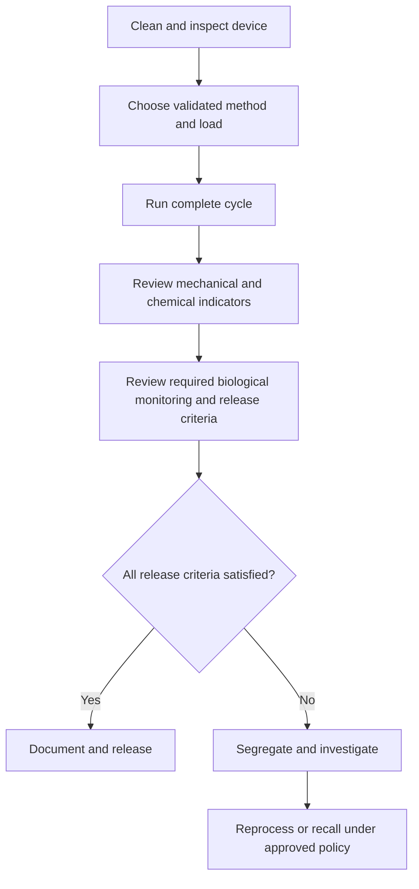

# Sterilization methods and monitoring — individual-topic guide

**Study-ready, unattempted.** [Original grouped bank](../MCQs/02-Sterilization-Disinfection-and-CSSD-40-MCQs.md), questions 7, 9–27, 31–34 and 40, plus [15 new questions](../MCQs/02C-Sterilization-Methods-and-Monitoring-15-MCQs.md). This gives 40 allocated questions including method contrasts. Allocation is an editorial count and not proof of full semantic uniqueness.

## Principle

Sterilization validated process hai jiska goal viable microorganisms including bacterial spores ko eliminate karna hai. Sterility assurance level (SAL) process validation ke baad viable microorganism occurrence ki theoretical probability describe karta hai. SAL 10^-6 ko absolute guarantee mat samjho. Cleaning aur device preparation essential hain. Blood, protein residue aur trapped air sterilant contact compromise kar sakte hain.

## Methods

| Method | Working principle | Important limitation |
|---|---|---|
| Saturated steam | Condensation releases heat, protein denaturation | Heat and moisture incompatible devices |
| Dry heat | Thermal damage at validated high temperature and time | Longer exposure and appropriate load compatibility |
| Ethylene oxide | Chemical alkylation of microbial components | Toxic residues, validated aeration and occupational safeguards |
| Vaporized hydrogen peroxide | Oxidative damage | Specific lumen, material and packaging restrictions |
| Industrial ionizing radiation | Molecular and nucleic acid damage | Validated industrial dose and product configuration |
| Sterilizing-grade filtration | Removes organisms from suitable fluids | Does not sterilize the receiving vessel or guarantee removal of every virus |

Autoclave pressure steam ko required high temperature achieve karne mein help karta hai. Pressure alone kill mechanism nahi hai. Gravity displacement aur dynamic air removal different methods se air remove karte hain. Trapped air porous load mein direct steam contact affect kar sakti hai. Chamber temperature sahi dikhne par bhi local conditions inadequate ho sakti hain. Textbook 121°C and 134°C examples ko every load ka universal cycle mat samjho. Actual temperature, holding time, load configuration aur packaging manufacturer-validated process se decide hote hain. Warm-up aur exposure time different ho sakte hain.

Boiling aur pasteurization reliable instrument sterilization methods nahi hain. UV room treatment suitable packaged instruments ki validated industrial ionizing radiation sterilization ke equivalent nahi hai.

## Monitoring and release

Mechanical monitoring time, temperature aur applicable pressure records assess karti hai. External chemical indicator process exposure identify karti hai. Internal indicator pack ke andar specified conditions assess karti hai. Biological indicators resistant spores se process challenge karte hain. Geobacillus stearothermophilus steam aur suitable hydrogen peroxide systems ke liye commonly used hai. Bacillus atrophaeus ethylene oxide aur dry heat ke liye commonly used hai. Always cycle-specific indicator choose karo.

CDC baseline biological monitoring at least weekly recommend karta hai. Implant loads aur applicable facility policies mein additional monitoring aur quarantine required ho sakti hai. A process challenge device validated difficult-to-penetrate load conditions represent karti hai. Rapid-readout BI ka incubation program aur controls product instructions ke according hone chahiye.

Bowie-Dick test dynamic-air-removal steam sterilizers ki air removal aur steam penetration performance assess karta hai. Ye biological sterility test nahi hai. Failed test par equipment use stop karke investigation aur required satisfactory testing arrange karo. Mechanical failure ko chemical indicator color change se override mat karo.

## Applied scenario and special cases

Imagine cycle 134°C reach karta hai but required exposure time complete nahi hota. Nurse load ko release nahi karti. Temperature aur time dono validated limits mein hone chahiye. Interrupted cycle ke baad separate drying alone reliable recovery nahi hai. Full process failure investigate karo.

Positive BI serious process warning hai. Negative chemical result ya normal printout ko substitute mat banao. Quarantine, investigation, affected load review, repeat testing aur recall decisions applicable method, findings and facility policy se determine karo. A single positive steam BI aur nonsteam process failure ke recall rules identical nahi hote. Prion exposure suspected ho toh routine negative BI sufficient assurance nahi hai. Devices isolate karo aur specialist prion-specific policy follow karo.

## Sources and videos

- [CDC steam sterilization](https://www.cdc.gov/infection-control/hcp/disinfection-sterilization/steam-sterilization.html)
- [CDC sterilizing practices](https://www.cdc.gov/infection-control/hcp/disinfection-sterilization/sterilizing-practices.html)
- [CDC disinfection and sterilization recommendations](https://www.cdc.gov/infection-control/hcp/disinfection-sterilization/summary-recommendations.html)
- [FDA device sterilization overview](https://www.fda.gov/medical-devices/general-hospital-devices-and-supplies/sterilization-medical-devices)
- Concept: [NURSING NOTES — Sterilization & Disinfection Complete Nursing Study Guide](https://www.youtube.com/watch?v=pv6pe57Icgo), published 24 February 2026. Retrieved channel and description cover steam, dry heat and monitoring. Its fixed cycle examples and simplified disinfection classifications require current guideline checks.
- Dedicated MCQ practice: [Bhushan Science - Nursing — Disinfection & Sterilization MCQ](https://www.youtube.com/watch?v=HnNcukJt3Go), published 20 September 2026. Retrieved description identifies 15 expected MCQs covering autoclave, hot air oven, chemical agents and spores for nursing exams including NORCET. Full playback and each answer are not independently verified.

[Reported examination evidence and overlap notes](../Previous-Year-Questions/02C-Sterilization-Methods-Reported-Evidence.md). Official keys and comprehensive question-level research remain pending.
