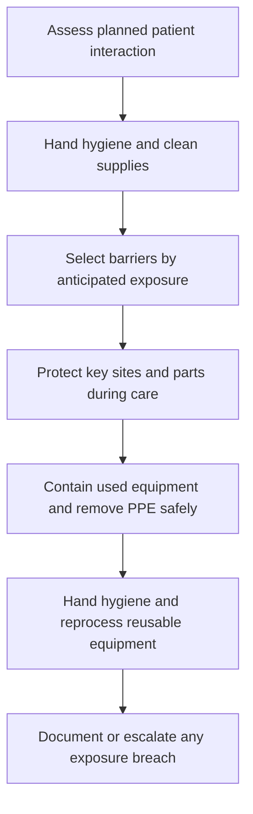

# Standard precautions and safe patient care

**Study-ready, unattempted.** [30 additional original MCQs](../MCQs/03A-Standard-Precautions-and-Safe-Patient-Care-30-MCQs.md) · [Reported exam evidence](../Previous-Year-Questions/03A-Standard-Precautions-Reported-Evidence.md)

## 1. Basic concept

Standard precautions har patient ki care mein apply hoti hain, chahe infection known ho ya nahi. Patient ka negative screening result bhi every transmissible pathogen exclude nahi karta. Inka purpose patient, staff aur healthcare environment ko preventable transmission se protect karna hai. Universal precautions historically bloodborne exposure prevention par focused thi. Modern standard precautions broader hain, including respiratory hygiene, safe injection and equipment handling.

Blood, body fluids, secretions and excretions except sweat, mucous membranes aur nonintact skin ko potential infection sources samjho. Iska matlab every patient ko infectious label karna nahi hai. PPE task ke actual exposure risk ke according choose karo. Routine intact skin contact mein gloves automatically necessary nahi hote. Hand hygiene indications phir bhi apply hoti hain.

| Component | Practical nursing action |
|---|---|
| Hand hygiene | Patient contact aur clean procedure ke appropriate moments par perform karo |
| Exposure protection | Blood, body fluid, mucosa aur splash risk ke according gloves, gown, eye and face protection select karo |
| Medication safety | Clean area, sterile injection equipment and uncontaminated medication |
| Respiratory hygiene | Early recognition, tissues, source control and appropriate separation |
| Equipment handling | Reusable equipment ko intended use ke according between patients reprocess karo |
| Linen and sharps | Safe containment aur approved disposal pathway follow karo |

## 2. Safe injections and medication preparation

Injection ko clean designated area mein prepare karo, sink splash, used devices aur specimen containers se away. Needle aur syringe sterile single-use items hain. Used syringe ko new needle laga kar safe nahi bana sakte. Blood microscopic amount mein syringe ya medication device mein reflux kar sakta hai. Vial mein entry ke liye new sterile needle and syringe use karo. Rubber septum approved antiseptic se disinfect karke dry hone do.

Single-dose vial normally one patient and one procedure ke liye hai. Ward mein leftovers pool ya share mat karo. Pharmacy-level sterile compounding exceptions separate regulated procedures hain, bedside sharing ka justification nahi. Multidose vial ko whenever possible single patient dedicate karo. Shared multidose stock designated clean medication area mein maintain hota hai. Patient treatment area mein le jaane par vial ko that patient ke liye dedicate karo. Manufacturer instructions aur applicable beyond-use policy se opening date aur disposal determine karo. Vaccination open-vial policy separate product-specific protocol hai.

IV fluid bags, tubing aur flush equipment patient-specific use ke liye hain. Insulin pens single patient ke liye use karo even if needle replaced. Assisted fingerstick testing mein single-use auto-disabling lancet devices use karo. Shared professional glucose meters ko each patient ke baad manufacturer-compatible method se clean aur disinfect karo. Suitable validated reprocessing instructions na hon toh meter share mat karo.

Spinal or epidural catheter placement ya injection mein proceduralist surgical mask use karta hai alongside required aseptic technique. Oral flora contamination serious central nervous system infection cause kar sakti hai.

## 3. Clean-to-dirty care and protection of key parts

Imagine nurse ek hi patient ka soiled pad change karti hai, phir IV connector access karna hai. Same gloves se IV touch nahi karna hai. Contaminated gloves remove karo, hand hygiene karo aur aseptic access prepare karo. Same patient ke different sites bhi cross-contamination ka source ho sakte hain.

Aseptic non-touch technique mein key part aur key site ko contamination se protect karo. Sterile syringe tip, wound-contact dressing surface aur prepared IV connector important examples hain. Touch contamination par appropriate replacement ya re-preparation karo. Gloves hand hygiene replace nahi karte.

Used suction containers aur soiled linen securely contain karo. Clean supplies dirty trolley par mat rakho. Reusable equipment manufacturer instructions se each patient ke baad clean/disinfect karo. Environmental cleaning mein required contact time aur compatibility check karo.

## 4. Early recognition and system safety

Respiratory symptoms wale patient ko first contact par risk assess karo. Appropriate source control, tissue disposal aur separation facilitate karo. If specific infection suspected, additional transmission-based precautions initiate karo according to clinical presentation and local guidance. Standard precautions continue rehti hain.

Supply shortages unsafe shortcuts ka reason ho sakte hain but unko acceptable nahi banate. Charge nurse safe package sizes, clean workflow and staffing support arrange karti hai. Injection reuse discover hone par unsafe practice stop karo, records preserve karo aur IPC leadership ke through exposure investigation and appropriate notification arrange karo. Training ke saath observed competency assessment essential hai. Infection prevention ko punishment-only exercise mat banao.

## Sources and videos

- [CDC standard precautions](https://www.cdc.gov/infection-control/hcp/basics/standard-precautions.html)
- [CDC core IPC practices](https://www.cdc.gov/infection-control/hcp/core-practices/)
- [CDC injection safety clinical guidance](https://www.cdc.gov/injection-safety/hcp/clinical-guidance/)
- [CDC preventing unsafe injection practices](https://www.cdc.gov/injection-safety/hcp/clinical-safety/)
- [CDC standard precautions table](https://www.cdc.gov/infection-control/hcp/isolation-precautions/appendix-a-table-4.html)
- Concept: [nursing class by nidhi mam — Infection Control in Hindi](https://www.youtube.com/watch?v=Cg8UtxrBVzg&t=610s), 20 December 2025. Retrieved channel and chapter list. Standard precautions at 10:10, PPE at 11:51, asepsis at 12:49.
- Concept alternative: [Bhushan Science - Nursing — Infection Control Including Safety](https://www.youtube.com/watch?v=dYcmY_L_5pQ), 13 August 2026. Channel and description retrieved, standard precautions included.
- MCQ practice: [Nursing & Medical Exam Success — Assistant Nurse Exam Preparation Questions, Test 1](https://www.youtube.com/watch?v=c1BTy_tplDM&t=457s), 18 July 2026. Retrieved channel and question markers include standard precautions at 7:37, sharps at 9:39, cross-contamination at 14:44. Lower-level international practice, not NORCET-specific.
- NORCET MCQ lead: [Infection Control MCQ for NORCET 11](https://www.youtube.com/watch?v=GC1eAkjnqOg). Search-indexed description explicitly lists standard precautions, but full page failed to reopen and channel could not be verified.

Full playback and individual answers not independently verified. Dedicated safe-injection NORCET MCQ video remains pending. Follow current clinical guidance over coaching shortcuts.
