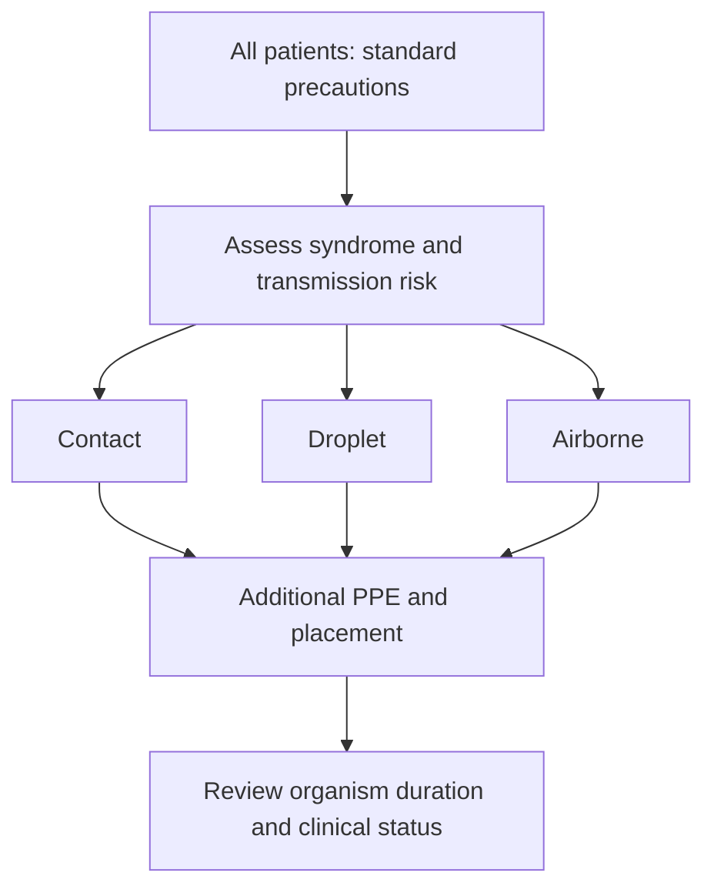

# Transmission-based precautions and isolation

**Priority High. Study-ready, not studied.** [20 new MCQs](../MCQs/03B-Transmission-Based-Precautions-and-Isolation-20-MCQs.md). Earlier group 03 Q2–4, 8–13, 19, 21, 23–25, 31, 34–35, 37–38, 40 contribute 20 allocated slots. Total 40 allocated, no old questions copied or counted twice.

Standard precautions every patient ke liye base layer hain. Transmission-based precautions suspected or confirmed transmission risk ke according additional layer hain. Clinical suspicion par precautions start kar sakte hain. Confirmation ka wait unnecessarily exposure create kar sakta hai. Contact direct touch or contaminated object, droplet respiratory mucosal exposure, airborne suspended infectious particles risk address karte hain. Real respiratory transmission continuum hai. Exam categories disease-specific clinical policies ka substitute nahi.

| Condition | Typical CDC additional precautions / endpoint |
|---|---|
| RSV in infants/young children | Contact for illness duration, mask per standard risk and local policy |
| Pertussis | Droplet until 5 days effective treatment |
| Mumps | Droplet through 5 days after parotid swelling onset |
| Acquired rubella | Droplet through 7 days after rash onset |
| Typical varicella | Airborne + contact until lesions dry/crust |
| Localized zoster, immunocompetent, fully covered lesions | Standard, until lesions dry/crust |
| Localized zoster, immunocompromised | Airborne + contact until dissemination excluded |
| Scabies | Contact until 24 hours after effective treatment |
| Norovirus outbreak | Contact at least 48 hours after symptom resolution, longer where indicated |
| Respiratory diphtheria | Droplet, culture-based clearance per protocol |
| Cutaneous diphtheria | Contact, culture-based clearance per protocol |

Hepatitis A diapered/incontinent patients may need contact with age-specific duration. HIV alone standard precautions, no isolation solely for status. Pulmonary anthrax not ordinarily person-to-person, standard for clinical care unless other indication. Environmental spore contamination different hazard. Small contained abscess standard, major uncontained drainage contact as indicated.

Airborne infection isolation room negative pressure contains infectious particles. Pressure alarm loss requires immediate notification and safe alternative plan. Patient leaves toh room instantly safe nahi hota. Ventilation air changes and clearance interval determine entry without respiratory protection. Essential surgery or imaging postpone unnecessarily mat karo. Receiving unit notify, source control when tolerated, PPE and engineering coordination arrange karo. Cohorting same confirmed organism and compatible risk profile under IPC assessment, not simply same precaution category. Protective environment is different: selected allogeneic HSCT patients need filtered supply air and protective pressure to reduce airborne fungal exposure. Coexisting airborne disease needs specialist room placement.

## References and videos

[CDC standard precautions](https://www.cdc.gov/infection-control/hcp/basics/standard-precautions.html) · [CDC isolation precautions](https://www.cdc.gov/infection-control/hcp/isolation-precautions/precautions.html) · [CDC disease-specific Appendix A](https://www.cdc.gov/infection-control/hcp/isolation-precautions/appendix-a-type-duration.html) · [CDC core IPC practices](https://www.cdc.gov/infection-control/hcp/core-practices/)

- [CDC norovirus outbreak recommendations](https://www.cdc.gov/infection-control/hcp/norovirus-guidelines/summary-recommendations.html).
- Concept: [RegisteredNurseRN — Standard & Isolation Precautions Nursing](https://www.youtube.com/watch?v=vLq6B3Qjy98). Search description identifies contact, droplet, airborne and mnemonics. International NCLEX supplement.
- Practice: [Infection Control MCQ for NORCET 11](https://www.youtube.com/watch?v=GC1eAkjnqOg). Indexed description confirms standard precautions and PPE, channel name not independently confirmed.
- Practice: [NCLEX Infection Control Made Easy](https://www.youtube.com/watch?v=8uiMSnMblXA), indexed case review at 19:25. Channel and full playback not verified. Not NORCET-specific.
- [Reported exam evidence](../Previous-Year-Questions/03B-03C-Isolation-and-PPE-Reported-Evidence.md).
