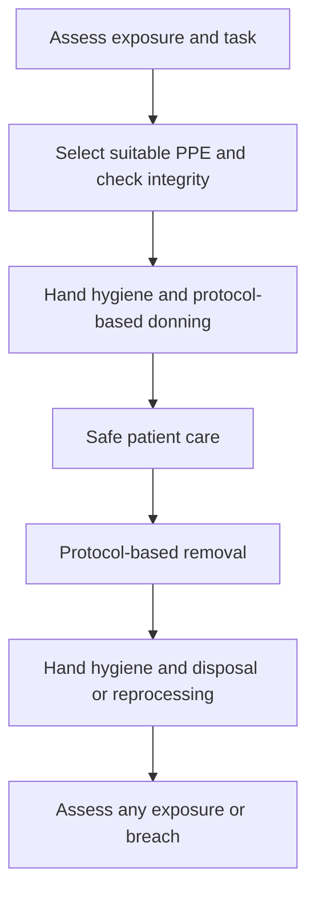

# PPE selection and safe removal

**Priority High. Study-ready, not studied.** [20 new MCQs](../MCQs/03C-PPE-Selection-and-Safe-Removal-20-MCQs.md). Earlier group 03 Q5–7, 14–18, 27–29, 33 contribute 12 allocated slots. Total 32 allocated. No reused items counted as new.

PPE last barrier hai, not substitute for engineering controls, hand hygiene and safe practices. Task risk assessment determines gloves, gown, mask/respirator and eye protection. Ordinary venipuncture clean examination gloves, aseptic urinary catheter insertion sterile gloves. Latex allergy mein suitable nonlatex alternative use karo. Chemical hazards (e.g. antineoplastic drugs) require chemical-specific rated protection, not merely sterile gloves. Gown fluid-barrier performance and coverage exposure ke according choose karo. Gloves size and integrity check karo. Dirty task ke gloves clean task ke liye use nahi karne.

## Respiratory protection

Medical mask nose and mouth cover karti hai, droplet/source control use as indicated. Tight-fitting respirator requires appropriate selection, formal fit testing and user seal check each donning. Fit test and seal check different hain. Facial hair at sealing surface can compromise seal. Occupational health and respiratory protection programme assess suitable alternatives, potentially loose-fitting PAPR where indicated. Damaged straps or low-flow alarm means do not enter hazardous area until equipment works or suitable alternative provided.

Conventional example donning: gown, mask/respirator, goggles/face shield, gloves, with hand hygiene before. Doffing sequence varies by ensemble and protocol. Outer glove surface and gown front/sleeves potentially contaminated. Glove-in-glove technique avoids bare fingers touching outside. Goggles remove by strap/earpieces. Gown contaminated surface inward roll as directed. Respirator removal after airborne room exit and door closure according to protocol. Do not touch front. Hand hygiene immediately after PPE removal and whenever hands become contaminated during sequence. Enhanced high-consequence ensembles need designated procedures and trained observer where indicated, not generic sequence. Compromised barrier requires safe interruption, replacement and exposure assessment.

Single-use PPE follows approved use instructions. Exceptional shortage conservation must follow authorized guidance and manufacturer limits, never improvised washing, sharing or indefinite reuse. Reusable eye protection goes to approved processing. Competency assessment actual selection, donning, care, doffing and hand hygiene observe karti hai, not just speed or memorization.

## References and videos

[CDC standard precautions](https://www.cdc.gov/infection-control/hcp/basics/standard-precautions.html) · [CDC isolation precautions](https://www.cdc.gov/infection-control/hcp/isolation-precautions/precautions.html) · [CDC disease-specific Appendix A](https://www.cdc.gov/infection-control/hcp/isolation-precautions/appendix-a-type-duration.html) · [CDC core IPC practices](https://www.cdc.gov/infection-control/hcp/core-practices/)

- [CDC isolation guideline resources including safe donning/removal](https://www.cdc.gov/infection-control/hcp/isolation-precautions/index.html).
- Concept demonstration: [Level Up RN — Donning/Doffing PPE and Isolation/Transmission Precautions](https://www.youtube.com/watch?v=a-NE9aXONbE). Indexed channel and title retrieved.
- Practice: [Infection Control MCQ for NORCET 11](https://www.youtube.com/watch?v=GC1eAkjnqOg), indexed PPE and hospital infection control coverage. Channel name not independently confirmed.
- Practice: [NCLEX Infection Control Made Easy](https://www.youtube.com/watch?v=8uiMSnMblXA), indexed PPE sequences and clinical practice. Dedicated PPE-only Indian recruitment MCQ video remains unconfirmed. Full playback not reviewed.
- [Reported exam evidence](../Previous-Year-Questions/03B-03C-Isolation-and-PPE-Reported-Evidence.md).
