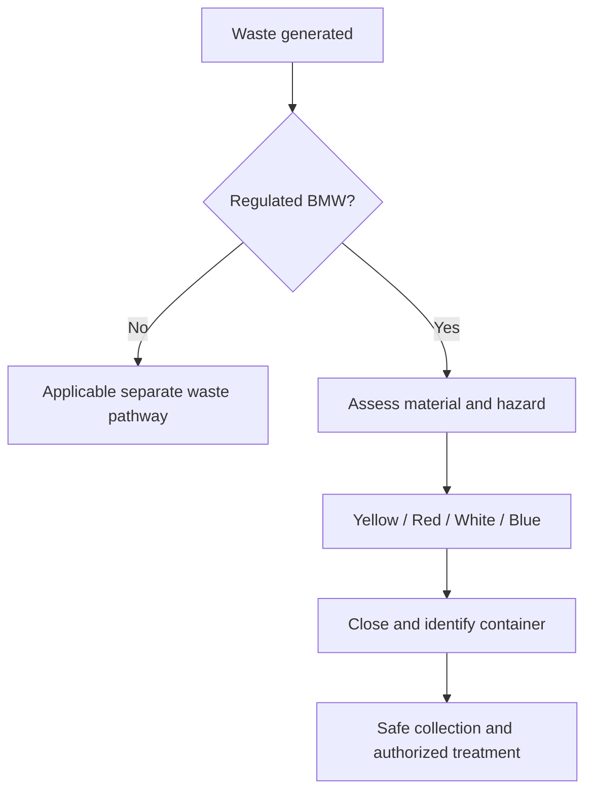

# Biomedical waste segregation in India

**Study-ready, unattempted.** [15 new MCQs](../MCQs/04A-Biomedical-Waste-Segregation-15-MCQs.md) and original group 04 Q1–19, 34–36, 38–40 give 40 working allocated questions. [Reported examination evidence](../Previous-Year-Questions/04A-04B-BMW-Reported-Evidence.md).

## Concept

Biomedical waste (BMW) healthcare activities se generate hone wala regulated waste hai. Har hospital item biomedical waste nahi hota. Segregation ka matlab waste ko generation point par hazard aur material ke according correct container mein separate karna hai. Agar nurse contaminated plastic ko anatomical waste ke saath mix karti hai toh treatment aur recycling dono difficult ho sakte hain. Needle wrong bag mein jaaye toh downstream worker ko injury ho sakti hai.

| Colour | Major examples | Container principle |
|---|---|---|
| Yellow | Human and animal anatomical waste, blood-soiled absorbent material, discarded contaminated linen, specified pharmaceutical and microbiological waste | Appropriate non-chlorinated bag or suitable category-specific container |
| Red | Contaminated recyclable tubing, catheters, gloves, syringe barrels without needles, dialyzers | Non-chlorinated red bag or suitable container |
| White translucent | Contaminated metal sharps, including fixed-needle syringes | Puncture-proof, leak-proof, tamper-proof container |
| Blue | Specified contaminated glassware except cytotoxic-contaminated glass and metallic body implants | Appropriate blue-marked puncture-proof and leak-proof container |

Colour alone enough nahi hai. Cytotoxic drug residues special disposal pathway require karte hain. Radioactive waste aur mercury-containing devices separate regulatory and safety procedures require karte hain. Clean uncontaminated packaging ordinary solid waste rules ke according segregate karo. India's Solid Waste Management Rules 2026 came into force on 1 April 2026. BMW covered under separate biomedical waste rules must not be mixed with ordinary solid waste.

## Nursing workflow

Point of generation par bins accessible rakho. Waste ko compact mat karo aur used sharps manually bend ya recap mat karo. Composite assemblies ko safely separate karna sirf approved technique se appropriate hai. Unknown product ke liye facility waste officer se classification confirm karo. Misplaced sharp ya leaking bag par handling stop karo aur trained incident response arrange karo. Used reusable linen laundry pathway mein jaati hai, automatically waste nahi hai. Patient diagnosis ke basis par all waste ko yellow mein mat daalo.

## Sources and videos

- [MPCB rules, amendments and CPCB guidance](https://mpcb.gov.in/index.php/en/waste-management/biomedical-waste)
- [Government of India four-category framework](https://www.pib.gov.in/PressReleasePage.aspx?PRID=1805789&lang=2&reg=48)
- [2026 general solid waste rules](https://swm.cpcb.gov.in/)
- Concept: [Bhushan Science - Nursing — Color Coding System in Nursing](https://www.youtube.com/watch?v=hdLAKRAOrF8&t=400s), 10 November 2026. Retrieved channel and chapter markers, BMW segment starts 06:40.
- Dedicated MCQ practice: [GS India Nursing — Biomedical Waste & Management MCQ & CHN Questions For OSSC, KGMU, RML, AIIMS NORCET Nursing Officer](https://www.youtube.com/watch?v=RchFTbNp6gQ), 27 July 2026. Retrieved title, channel and description. Full playback and every answer not independently verified.

Historical exam answers may use superseded category schemes or overbroad explanations. Use current Schedule I and facility-approved disposal procedure.
