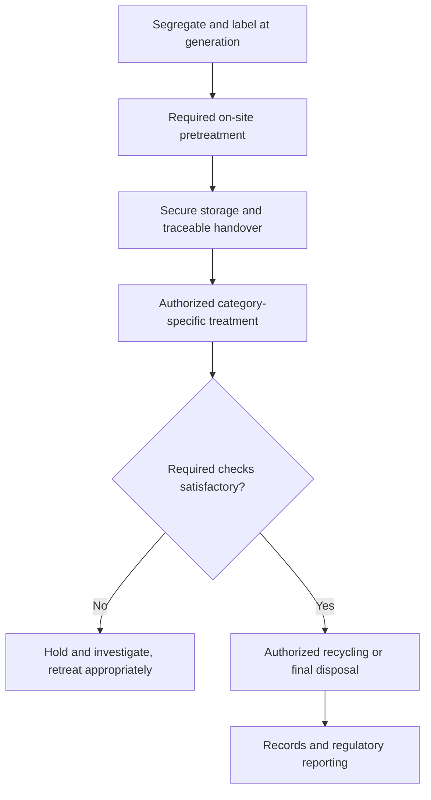

# Biomedical waste treatment and regulation in India

**Study-ready, unattempted.** [25 new original MCQs](../MCQs/04B-Biomedical-Waste-Treatment-and-Regulation-25-MCQs.md) plus group 04 Q20–33 and Q37 give 40 working allocated slots. [Segregation concepts](04A-Biomedical-Waste-Segregation.md) · [Reported exam evidence](../Previous-Year-Questions/04A-04B-BMW-Reported-Evidence.md)

## 1. Treatment versus disposal

Treatment ka purpose infectious ya chemical hazard reduce karna hai. Disposal ka matlab treated material ko authorized final destination tak pahunchana hai. Dono same step nahi hain. Schedule I category-specific treatment options describe karta hai aur Schedule II process standards describe karta hai. Waste handling staff ko approved equipment aur PPE use karna chahiye. Unvalidated chemical mixtures ya improvised burning avoid karo.

| Method | Main concept |
|---|---|
| Autoclave | Validated moist heat process suitable waste ke microbial burden ko reduce karta hai |
| Microwave and hydroclave | Approved equipment and compatible waste stream required |
| Incineration | Authorized controlled combustion for specified waste streams, with emission standards |
| Chemical treatment | Validated concentration, exposure time and appropriate waste compatibility |
| Shredding or mutilation | Physical destruction after prescribed treatment where applicable, not a microbial treatment by itself |
| Authorized recycling | Treated eligible recyclable materials only, with traceable records |

Yellow ke different subcategories ke treatment pathways different ho sakte hain. Cytotoxic pharmaceuticals ke liye special authorized treatment or return pathway follow karo. Ordinary contaminated recyclable plastics ko routinely incinerate nahi karna chahiye. Red stream treatment ke baad applicable shredding aur authorized recycling hoti hai. White sharps stream mein prescribed treatment aur destruction or encapsulation options apply hote hain. Blue glassware ka approved treatment aur recycling pathway follow karo. Incinerator ash ko applicable characterization aur authorized disposal requirements ke according manage karo.

## 2. Common treatment facility and pretreatment

CBWTF common biomedical waste treatment facility hai. Rule 7 ke under available common service within 75 km hone par occupier ko captive on-site treatment and disposal facility establish nahi karni chahiye. Mandatory on-site pretreatment is restriction se different hai. Common service unavailable ho toh prescribed authority ki authorization ke according requisite compliant equipment arrange hota hai.

Specified laboratory and highly infectious waste ka required pretreatment before transport important hai. Rule 8(8) microbiology and clinical laboratory waste ke liye sterilization to log 6 or disinfection to log 4 as applicable describes karta hai. Log reduction microbial burden reduction ko express karti hai. Actual process verified operating conditions, load aur validation se guide hota hai. Pretreatment final disposal aur correct labeling replace nahi karti.

Untreated specified anatomical, soiled and biotechnology waste ke liye 48-hour storage restriction yaad rakho. Exceptional delay mein protective measures lo aur prescribed authority ko reasons inform karo. Operator intended collection time miss kare toh prescribed authority ko promptly inform karo. Uncontrolled accumulation ya municipal waste mixing safe solution nahi hai.

## 3. Regulatory responsibilities

Occupier healthcare facility ke administrative control wale responsible person se linked role hai. Operator common treatment facility ka responsible entity hai. State Pollution Control Board or Pollution Control Committee prescribed authority hoti hai in applicable jurisdiction. Applicable central and state guidance check karo.

| Rule or form | Exam focus |
|---|---|
| Form I | Major accident reporting and remedial measures |
| Form II | Authorization application |
| Form III | Authorization issuance |
| Form IV | Annual report, preceding calendar year, by 30 June |
| Rule 14 | Authorized waste handling records generally retained five years |
| Rule 4 | Training at induction and at least annually thereafter, immunization and occupational safety |
| Rule 4 monitoring | Committee meeting once every six months, less than 30 beds may designate a qualified person |

Bedded healthcare units daily category-wise register maintain karte hain aur required monthly website disclosure aur annual report provide karte hain. Treatment facility equipment logs mein category, weight, date, time, duration and operating details record hote hain. Authorization quantity se independent applicable hoti hai, including non-bedded clinics under applicable procedure. Barcodes bag traceability support karte hain aur CBWTF GPS transport tracking applicable guidance se maintain karta hai.

2026 update: G.S.R. 293(E), dated 17 April and published 20 April 2026, rules 11(1) and 12(6) mein Ayush representation add karta hai. Is amendment ne fifth colour category introduce nahi ki. General Solid Waste Management Rules 2026 separate framework hai. Current applicable notified amendments and local authorization conditions verify karo.

## 4. Applied nursing scenario

A hospital ka yellow waste weight decrease hua but red bags mein sharps mil rahe hain. Isko success mat samjho. Segregation observations, category-wise weight, injury records aur treatment compliance review karo. Workers ko induction and annual training, appropriate PPE, hepatitis B and tetanus immunization under applicable health guidance, and occupational health assessment chahiye. Major accident mein emergency care pehle initiate karo, records preserve karo aur regulatory reporting arrange karo.

## References and videos

- [State pollution control board compilation of rules and CPCB guidelines](https://mpcb.gov.in/index.php/en/waste-management/biomedical-waste)
- [Amended rules text, rules 4–8](https://indiankanoon.org/doc/103509590/)
- [Rules and statutory forms](https://indiankanoon.org/doc/159820889/)
- [Gazette transcription, G.S.R. 293(E), April 2026](https://gazettetracker.com/g/CG-DL-E-20042026-271923)
- Concept: [Biomedical Waste Management Explained, Community Medicine](https://www.youtube.com/watch?v=TY26qMkV8u0), search-indexed description covers autoclaving, hydroclaving, incineration and disposal. Channel metadata not independently retrieved.
- MCQ practice: [GS India Nursing — Biomedical Waste & Management MCQ & CHN Questions](https://www.youtube.com/watch?v=RchFTbNp6gQ), 27 July 2026, retrieved channel and topic description. Shared resource across the two waste topics, not a separate unique video count.

Full playback and answer verification remain pending. Dedicated regulatory forms MCQ video and distinct historical treatment/regulation question pages not retrieved. Current statutory requirements take priority over old coaching answers.
