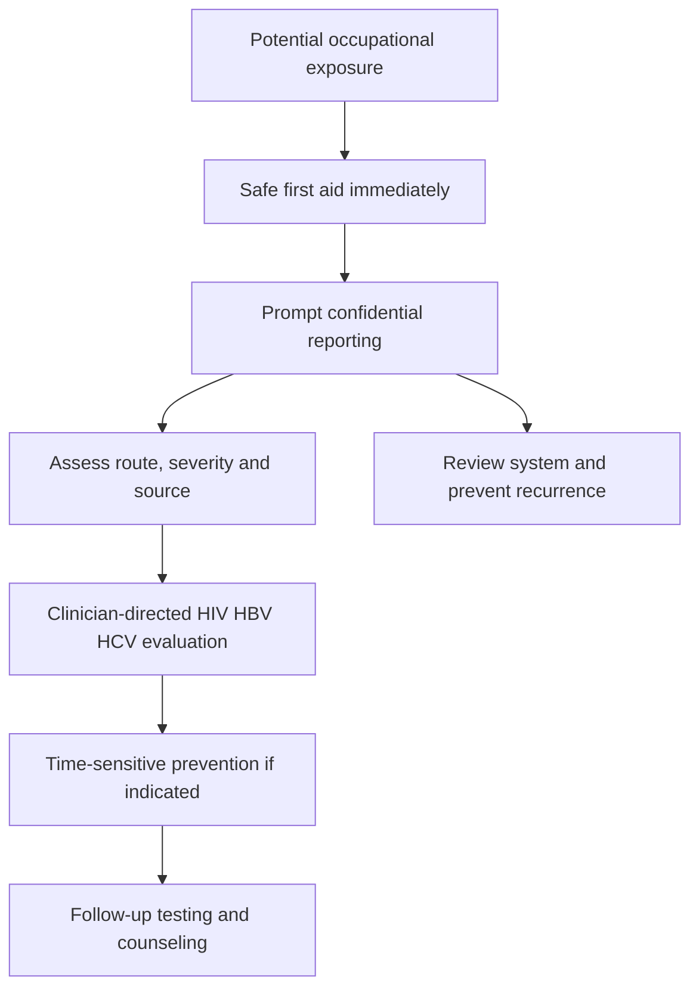

# Sharps injury prevention and occupational exposure response

**Study-ready, unattempted.** [23 new original questions](../MCQs/05A-Sharps-Injury-Prevention-and-Exposure-Response-23-MCQs.md) plus group 05 Q1–6, 17, 29–35 and 38–40 give 40 allocated slots. [Reported exam evidence](../Previous-Year-Questions/05A-Occupational-Exposure-Reported-Evidence.md).

## 1. Exposure ka matlab

Occupational exposure ka matlab duty ke dauran potentially infectious material ka worker ke body mein enter hone ka chance hai. Used needle skin puncture kar sakti hai. Blood aankh, mouth ya damaged skin par bhi contact kar sakta hai. Intact skin aur damaged skin ka risk same nahi hota. HIV, hepatitis B aur hepatitis C important bloodborne infection concerns hain. Risk source status, material, route aur severity par depend karta hai. Hollow-bore needle mein blood retain ho sakta hai, isliye deep injury with a blood-filled needle important concern hai.

## 2. Prevention hierarchy

Sabse pehle unnecessary sharp use eliminate karo. Needleless access suitable ho toh use karo. Engineering controls device design ya physical barrier se exposure reduce karte hain. Safety-engineered needles aur accessible puncture-resistant containers examples hain. Administrative controls training, staffing, incident reporting aur safe workflow provide karte hain. PPE additional protection deta hai lekin har puncture ko prevent nahi kar sakta.

| Risk | Prevention |
|---|---|
| Unnecessary sampling | Review indication |
| Needle activation injury | Evaluate safe device design with frontline workers |
| Patient movement | Prepare patient and arrange trained assistance |
| Exposed surgical sharp | Use neutral zone and clear communication where appropriate |
| Disposal injury | Place stable sharps container near point of use |
| Hidden sharp in linen | Keep others away and arrange trained safe retrieval |
| Delayed reporting | Provide confidential round-the-clock exposure care |

Used sharp ko routine recap, bend ya manually dismantle mat karo. Rare procedure-specific exceptions mein approved one-handed technique ya mechanical device required ho sakta hai. Activated safety needle bhi used sharp hai. Isko proper sharps container mein discard karo. Surgical team suitable tissue mein blunt-tip suture needles consider kar sakti hai. Double gloving inner glove perforation aur some blood exposure reduce kar sakti hai, but injury risk remains.

## 3. Immediate response

Needlestick ke baad procedure safely stop karo. Wound ko soap aur running water se wash karo. Wound ko cut, suck, aggressively squeeze ya caustic disinfectant se treat mat karo. Eye exposure mein clean water, saline ya suitable irrigant se promptly flush karo. Contact lens removal ke liye irrigation delay mat karo. Mouth splash mein water se rinse karo. Occupational health or emergency service ko promptly report karo. Paperwork ki wajah se clinical assessment delay nahi hona chahiye.

## 4. Assessment and follow-up

Source testing authorized consent and applicable rules se arrange karo. Baseline worker testing earlier infection identify karne mein help karti hai, but current exposure ko instantly rule out nahi karti. Sterile unused needle injury mein infectious exposure ordinarily nahi hoti if contamination absent hai. Wound assessment and reporting policy still apply. Suspected high-risk exposure mein delay avoid karo. Pathogen-specific management clinician decides.

Worker ki confidentiality maintain karo. Incident record mein device, procedure phase, exposure route, timing and relevant circumstances include karo. Near miss actual injury nahi hai, but future injury prevention ke liye important warning hai. Injury trends interpret karte waqt reporting completeness bhi check karo. Staff ko blame karne ke bajaye system hazards identify karo.

## References and videos

- [NIOSH bloodborne infectious disease prevention](https://www.cdc.gov/niosh/healthcare/risk-factors/bloodborne-infectious-diseases.html)
- [CDC occupational health and infection safety](https://www.cdc.gov/infection-control/hcp/safety/)
- [2025 US PHS occupational HIV guideline](https://stacks.cdc.gov/view/cdc/258795)
- Concept lead: [Needle Stick Injury Explained — Prevention, PEP & First Aid](https://www.youtube.com/watch?v=oForeWvJnlA). Indexed title retrieved, full page returned cache miss, channel not confirmed.
- MCQ practice: [Nursing MCQ Hub — Day 8 Microbiology & Infection Control Top 20 MCQs, RRB Nursing Superintendent 2026](https://www.youtube.com/watch?v=HQrdBId87B0), 10 January 2026. Channel and description retrieved, specifically includes needlestick prevention.
- Supplementary lower-level practice: [Nursing & Medical Exam Success — Assistant Nurse Exam Preparation Test 1](https://www.youtube.com/watch?v=c1BTy_tplDM&t=579s), sharps disposal at 09:39. Mixed international practice, not NORCET-specific.

Full playback and every answer not independently verified. Dedicated needlestick-only NORCET MCQ video remains pending.
