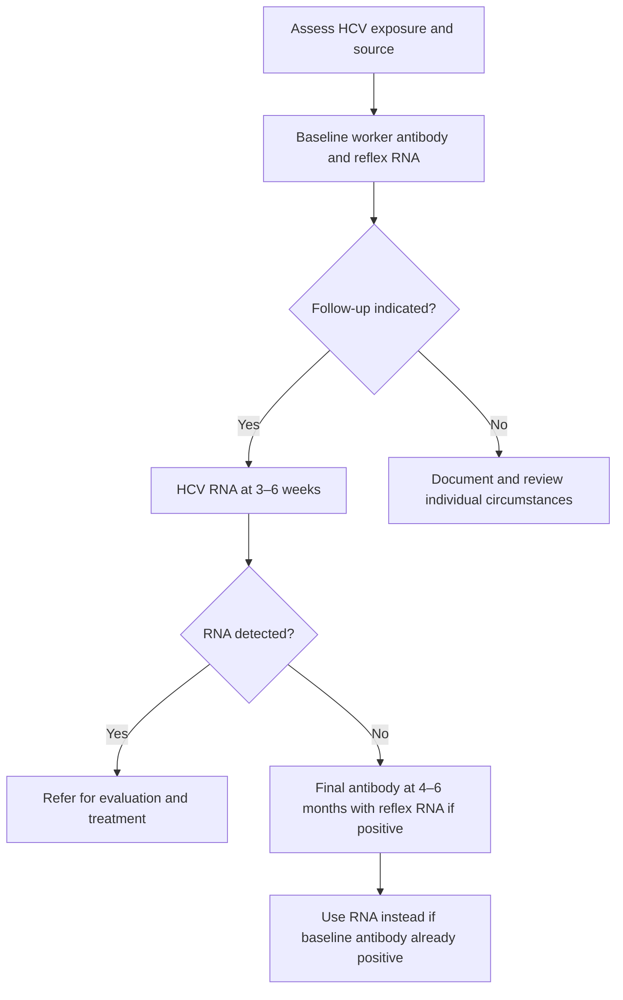

# Pathogen-specific post-exposure management

**Study-ready, unattempted.** [17 additional questions](../MCQs/05B-Pathogen-Specific-Post-Exposure-Management-17-MCQs.md) and group 05 Q7–16, 18–28, 36–37 provide 40 allocated questions across HIV, HBV and HCV. Separate individual-pathogen expansion remains pending. [Sharps prevention and first aid](05A-Sharps-Injury-Prevention-and-Exposure-Response.md) · [Historical examination evidence](../Previous-Year-Questions/05A-Occupational-Exposure-Reported-Evidence.md).

## 1. Why different viruses require different management

Needlestick ke baad har virus ke liye same medicine nahi di jaati. HIV ke liye antiretroviral post-exposure prophylaxis (PEP) infection establish hone ka risk kam karne ke liye di ja sakti hai. Hepatitis B ke liye vaccine aur hepatitis B immune globulin (HBIG) ka decision worker ki vaccination history, documented antibody response aur source status par depend karta hai. Hepatitis C ke liye routine antiviral prophylaxis recommend nahi hoti. Early detection aur confirmed infection ka timely treatment important hai.

Source testing aur baseline worker testing consent, confidentiality aur applicable national/facility protocol ke according arrange karo. Significant exposure mein urgent clinician assessment delay mat karo. HIV ke liye indicated PEP source result ka wait karte hue bhi start ho sakti hai.

## 2. HIV post-exposure management

WHO 2024 guideline ke according PEP ideally 24 hours ke andar start karni chahiye aur 72 hours se late nahi. Three-drug regimen preferred hai aur usual course 28 days ka hai. Indian healthcare facilities applicable NACO and occupational health protocol follow karti hain. 72 hours ke baad high-risk occupational exposure ho toh urgent expert assessment chahiye. US PHS 2025 guideline specifically expert consultation recommend karti hai if late initiation is being considered. Nurse independently medicines choose ya adjust nahi karti.

Regimen choose karte waqt kidney function, pregnancy, breastfeeding, drug interactions aur source resistance history important hain. Agar source resistance suspected hai, toh expert consultation initial indicated PEP ko delay nahi karni chahiye. Dolutegravir jaise medicines ke absorption ko some mineral-containing antacids affect kar sakte hain. Pharmacist se exact formulation-specific timing verify karo. Missed dose ya severe vomiting par clinician se timely advice lo. Existing PrEP ko automatically sufficient protection mat samjho. Sustained undetectable source viral load mein 2025 US guideline shared clinical decision-making support karti hai. Sexual transmission ka U=U evidence every occupational percutaneous exposure ka absolute guarantee nahi hai.

### US PHS 2025 testing update — specifically US occupational guidance

| Assessment | Timing and principle |
|---|---|
| Baseline | Prompt HIV antigen-antibody testing and indicated renal and liver assessment |
| Early review | Within 72 hours for tolerability and counseling |
| Interim HIV testing | Week 4–6 with laboratory Ag/Ab and NAT for a single exposure if PEP started after 24 hours or any PEP doses were missed |
| Final HIV testing | Week 12 after exposure with laboratory Ag/Ab and diagnostic NAT |
| Repeat toxicity testing | Abnormal baseline tests or clinical indication, not routine repetition for everyone |

NAT nucleic acid test hai. Ye virus ka genetic material detect kar sakta hai. Ag/Ab test viral antigen aur antibodies detect karta hai. Final testing ka time exposure date se count karo, course finish hone ki date se nahi. Long-acting cabotegravir PrEP history mein additional expert-directed testing required ho sakti hai. Acute HIV-like illness develop ho toh scheduled follow-up ka wait mat karo. US schedule ko India's NACO schedule ke identical mat assume karo.

## 3. Hepatitis B exposure

Anti-HBs vaccine response ka marker hai. Documented complete vaccine series ke baad anti-HBs at least 10 mIU/mL protective response indicate karta hai. Immunocompetent documented responders mein antibody level years later decline karne ke bawajood immune memory persist kar sakti hai. HBsAg source infection assessment mein useful hai. Total anti-HBc natural HBV exposure/infection ka marker hai, vaccine-only response ka nahi.

| Worker history | Source HBsAg positive or unknown | Source HBsAg negative |
|---|---|---|
| Documented responder after complete series | No HBV PEP generally needed | No HBV PEP generally needed |
| One complete series, response unknown, current anti-HBs below 10 | HBIG once plus revaccination | Additional vaccine dose and response reassessment |
| Documented nonresponder after two complete series | HBIG twice, one month apart | No HBV prophylaxis required |
| Unvaccinated or incomplete series | HBIG once and initiate/complete vaccine course | Complete vaccine course |

This table summarizes CDC healthcare exposure guidance. Actual vaccine product, documented doses, immunocompromising conditions and local protocol guide care. HBIG ready-made antibodies deta hai, isliye rapid passive protection provide karta hai. Vaccine own immune response develop karwati hai. Dono indicated hon toh separate anatomical sites use kiye jaate hain. HBIG recent administration anti-HBs testing interpretation affect kar sakti hai. Susceptible worker with positive/unknown source ke liye CDC baseline total anti-HBc and follow-up HBsAg plus total anti-HBc around six months recommend karta hai. Vaccine-response assessment separate hai.

## 4. Hepatitis C exposure

HCV vaccine ya routine antiviral PEP available/recommended nahi hai. Source aur worker testing as soon as possible, preferably within 48 hours, CDC recommends. Source RNA testing preferred hai, or anti-HCV with reflex RNA if positive. Worker baseline anti-HCV with reflex RNA test if positive hota hai. Source RNA positive, antibody positive with RNA unknown, ya source untestable ho toh follow-up indicated hai.

RNA detected below quantification limit ko negative mat samjho. Detectable RNA needs clinical assessment. Immunocompromised workers mein negative antibody ke bawajood RNA testing consider ki ja sakti hai. Jaundice ya other acute symptoms develop hon toh immediate evaluation chahiye. Confirmed acute infection ke liye treatment referral karo, prophylactic antiviral use ko treatment se confuse mat karo.

## References and learning resources

- [WHO 2024 HIV PEP guidance](https://www.who.int/publications/i/item/9789240095137)
- [US PHS 2025 occupational HIV guidance](https://stacks.cdc.gov/view/cdc/258795)
- [Full guideline article](https://doi.org/10.1017/ice.2025.10254)
- [CDC HBV healthcare exposure guidance](https://www.cdc.gov/hepatitis-b/hcp/infection-control/index.html)
- [CDC HCV healthcare exposure guidance](https://www.cdc.gov/hepatitis-c/hcp/infection-control/index.html)
- [NACO National HIV Counselling and Testing Guidelines 2024, indexed document](https://naco.mohfw.gov.in/wp-content/uploads/2026/11/NACO_HCTS-Guideline-2024_02.11.2026.pdf). Full local schedule not independently checked in this run. Do not substitute the US schedule for it.
- Concept lead: [Needle Stick Injury Explained — Prevention, PEP & First Aid](https://www.youtube.com/watch?v=oForeWvJnlA). Indexed title, page retrieval failed and channel unavailable.
- Exam practice: [HEALTHCARE HUB — Most Expected HIV/AIDS Questions, AIIMS CRE 2025 Nursing](https://www.youtube.com/watch?v=O4V0H_KGGTg&t=1341s), 8 December 2025. Retrieved channel and chapter metadata. PEP initiation 22:21, duration 23:50, risk 26:10, follow-up 27:22 and PEP drugs 50:35. Compare any schedule or regimen stated in the video against the named current guideline.
- Supplementary international practice: [Manual Of Nursing — Can You Pass These NCK Questions? HIV & PMTCT Quiz](https://www.youtube.com/watch?v=3e7VFBWuG4w&t=1830s), 8 January 2026. PEP window at 30:30 and duration at 38:00. Kenya-focused, not an Indian official exam source.

Full playback and all video answers remain unverified. Dedicated HBV/HCV occupational exposure MCQ sessions and distinct pathogen-specific historical question evidence remain pending. Current clinical guidelines and local occupational health protocols take priority over coaching shortcuts.
