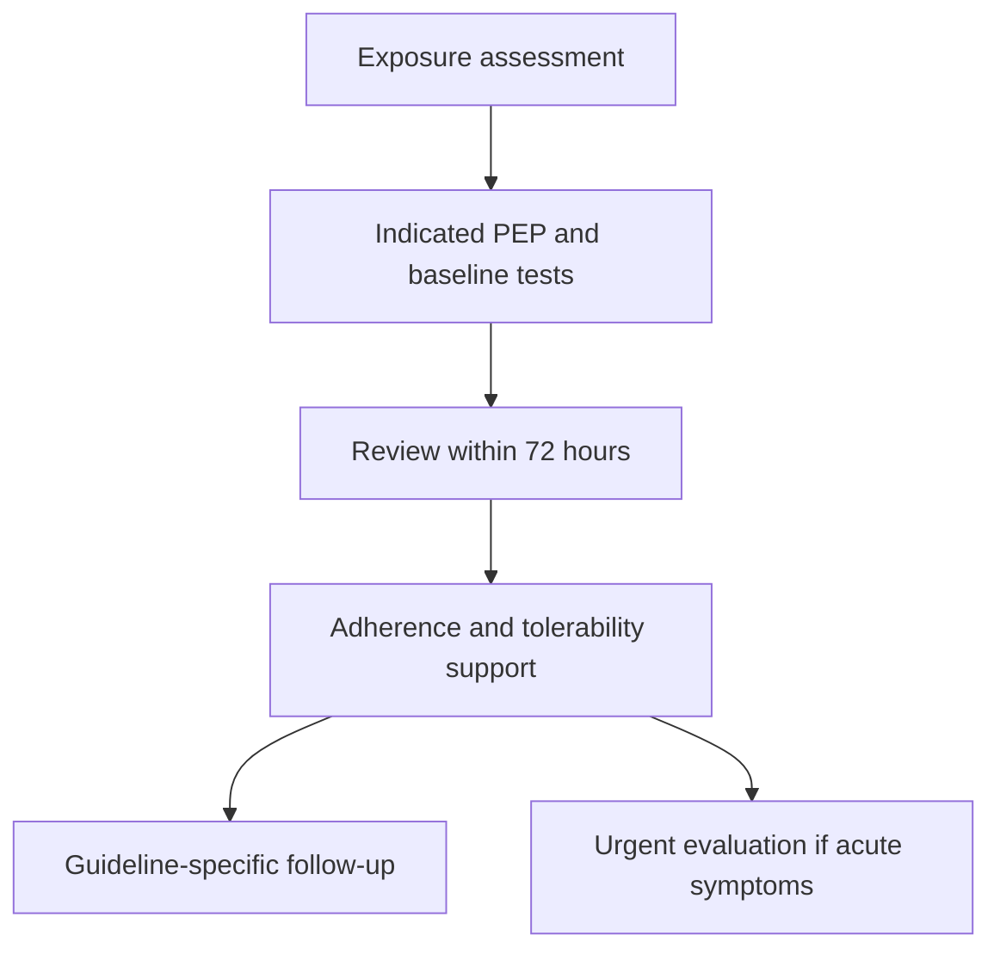

# Occupational HIV PEP — individual-topic top-up

**Study-ready, not studied.** Group 05 Q7–16 and 36–37 (12), group 05B Q1–8 (8) and [10 new questions](../MCQs/05C-Occupational-HIV-PEP-Top-Up-10-MCQs.md) = 30 working HIV occupational slots. No copied questions or double-counted authorship. Group 16 disease-level HIV content remains distinct.

## Clinical review and testing

Potentially significant exposure needs prompt risk assessment, source and worker baseline testing and indicated PEP without delay, usually within 72 hours. Typical 28-day course. Named 2025 US occupational guideline recommends reevaluation within 72 hours for counselling and tolerability. Baseline renal/liver tests support medication selection. In workers with cabotegravir-based PrEP within past 12 months, additional baseline NAT with specialist consultation is recommended. Acute HIV-compatible symptoms require timely lab evaluation regardless of scheduled testing. A negative source screen with suspected acute infection requires expert review. Final US occupational testing at 12 weeks with Ag/Ab and NAT, interim 4–6 weeks for specified delayed start or missed doses. India mein local NACO protocol follow karo, US schedule is not India's universal schedule.

Counselling includes prevention of possible secondary exposure and avoidance of donation during follow-up. Breastfeeding workers need expert individualized counselling without delaying indicated prophylaxis. New exposures need fresh evaluation. PEP is combination antiretroviral prevention, not vaccination. Round-the-clock access and prevention of workplace hazards matter.

## Evidence and video links

- [2025 US PHS occupational HIV guideline](https://www.cambridge.org/core/journals/infection-control-and-hospital-epidemiology/article/2025-us-public-health-service-guidelines-for-the-management-of-occupational-exposures-to-human-immunodeficiency-virus-and-recommendations-for-postexposure-prophylaxis-in-healthcare-settings/A410E90C8C13C8B9FB417C7F42051D2A).
- [National HIV Curriculum](https://www.hiv.uw.edu/go/prevention/occupational-postexposure-prophylaxis/core-concept/all).
- [NACO India](https://naco.mohfw.gov.in/), full current national schedule verification pending.
- Practice [Most Expected HIV/AIDS Questions — AIIMS CRE 2025](https://www.youtube.com/watch?v=O4V0H_KGGTg&t=1341s), indexed needle-stick PEP section 22:21.
- Concept [Tripura Santiniketan Medical College, Dr Debjani Das, Needle Stick Injury Protocol](https://www.youtube.com/watch?v=_B-UR30DC5I&t=597s), indexed HIV section 9:57 and clinical quiz 15:21. Full playback not reviewed. Historical percentages in description not universal.
- [Existing reported exam evidence](../Previous-Year-Questions/05A-Occupational-Exposure-Reported-Evidence.md), NORCET 2020 and JIPMER 2013. Additional recurring [NORCET 2022](https://testbook.com/question-answer/the-nurse-had-a-needle-stick-injury-with-a-hepatit--6321794cf8fc6b464a1108f6) and [Safdarjung 2019](https://testbook.com/question-answer/the-nurse-neeta-had-a-needle-stick-injury-with-a-h--6267910afc35d31c7a1a24d8/amp) sources cover first aid, not counted again. Specific historical questions on 2025 follow-up changes unconfirmed.
