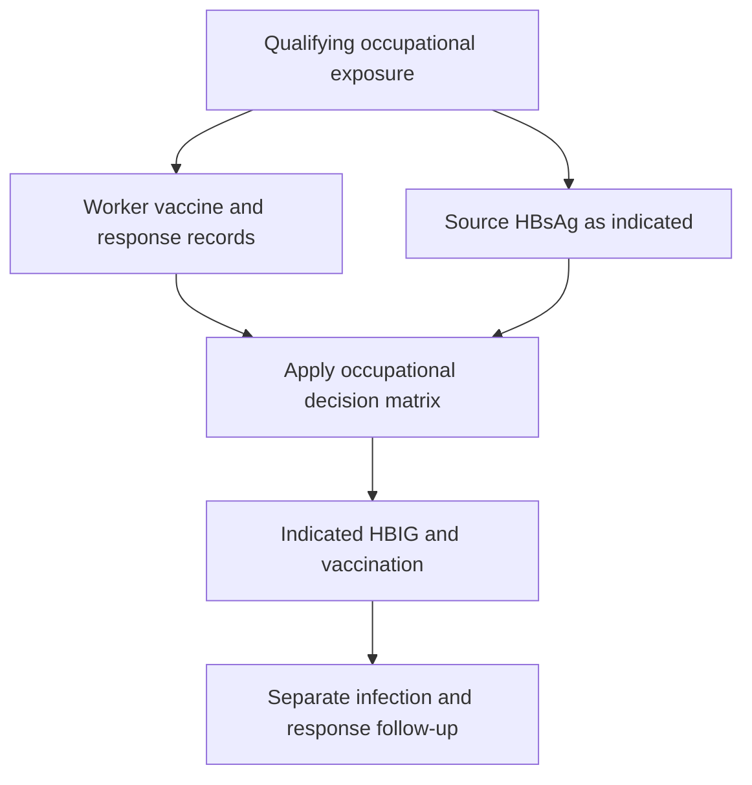

# Occupational hepatitis B exposure — individual-topic top-up

**Study-ready, not studied.** Earlier group 05 Q18–24 and group 05B Q9–13 contribute 12 allocated questions. [18 new questions](../MCQs/05D-Occupational-HBV-Top-Up-18-MCQs.md) give 30 working slots. Previous questions linked, not copied.

## Decision-making and follow-up

Source HBsAg, worker vaccination record and documented response guide HBV postexposure management. If response unknown after completed series, arrange worker anti-HBs and source HBsAg concurrently. Current anti-HBs ≥10 mIU/mL with documented complete series generally means no HBV PEP for that branch. Documented nonresponders after two complete series need HBIG twice one month apart for a positive or unknown source, but no HBV prophylaxis for negative source. Unvaccinated or incomplete-series workers with positive or unknown source generally need HBIG once and vaccine initiation/completion. Negative source generally needs vaccination completion without HBIG. These are named CDC healthcare occupational pathways, not all nonoccupational or Indian protocols.

Do not restart an interrupted vaccine series routinely. Give indicated vaccine and HBIG at separate sites according to approved formulation. HBIG should be arranged promptly, effectiveness beyond seven days is uncertain. Late exposure still requires clinical evaluation. Anti-HBs after incomplete series alone does not establish the documented complete-series responder category. Prior natural infection requires clinical interpretation of markers. Infection follow-up uses appropriate markers, vaccine-response testing measures anti-HBs. Recent vaccination may produce transient HBsAg positivity. Newly positive antigen requires qualified assessment, not automatic diagnosis of chronic infection. Nonresponse does not prove infectiousness. Respect consent and confidentiality. Vaccine completion and documented response are distinct safety programme indicators.

## References and resources

- [CDC healthcare HBV exposure decision table](https://www.cdc.gov/hepatitis-b/hcp/infection-control/table-1.html)
- [CDC occupational HBV guidance](https://www.cdc.gov/mmwr/preview/mmwrhtml/rr6210a1.htm)
- [CDC Pink Book hepatitis B](https://www.cdc.gov/pinkbook/hcp/table-of-contents/chapter-10-hepatitis-b.html)
- [CDC responding to HBV exposures](https://www.cdc.gov/hepatitis-b/hcp/infection-control/index.html)
- Teaching: [Tripura Santiniketan Medical College, Dr Debjani Das — Needlestick Injury Protocol, HBV section](https://www.youtube.com/watch?v=_B-UR30DC5I&t=646s), 5 October 2026.
- Practice: [Clinical quiz from 15:21](https://www.youtube.com/watch?v=_B-UR30DC5I&t=921s), indexed applied quiz, supplementary MBBS format. Dedicated HBV occupational NORCET MCQ session not verified. Full playback not reviewed.
- Historical evidence: [NORCET 2022 reported first-aid question](https://testbook.com/question-answer/the-nurse-had-a-needle-stick-injury-with-a-hepatit--6321794cf8fc6b464a1108f6) and [Safdarjung Staff Nurse 2019 related source](https://testbook.com/question-answer/the-nurse-neeta-had-a-needle-stick-injury-with-a-h--6267910afc35d31c7a1a24d8/amp). Repeated first-aid concept, not counted again. Do not assume every HBV exposure requires HBIG. Specific verified HBV decision-matrix exam questions remain pending.
