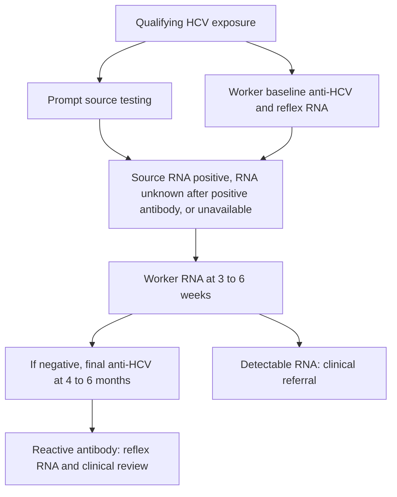

# Occupational hepatitis C exposure — individual-topic top-up

**Priority High. Study-ready, not studied.** Earlier group 05 Q25–28 and group 05B Q14–17 provide 8 allocated questions. [22 new questions](../MCQs/05E-Occupational-HCV-Top-Up-22-MCQs.md) give 30 working occupational HCV slots, distinct from disease-level group 16 allocation. No earlier question counted twice.

## HCV risk and why follow-up matters

Hepatitis C bloodborne virus hai. Needlestick or relevant blood splash exposure mein immediate first aid and prompt confidential risk assessment important hain. HCV vaccine or routine DAA post-exposure prophylaxis recommended nahi hai. Exposure infection prove nahi karti. HIV and HBV decisions independently urgent hain. HCV follow-up early infection identify karke timely treatment assessment enable karti hai.

## Named CDC occupational testing pathway

Source and worker specimens promptly collect karo, preferably within 48 hours. Source RNA NAT preferred, especially recent acquisition risk or risk history unavailable. Alternative source anti-HCV followed by reflex RNA if reactive. Worker baseline antibody with reflex RNA if positive. Baseline infection status helps distinguish pre-existing findings from subsequent acquisition. It does not by itself establish causation.

If source reliably RNA negative after positive antibody, follow-up generally unnecessary unless specimen concern or other clinical reason. If source unavailable or antibody positive with RNA unknown, indicated follow-up continue. Early RNA negative alone is not final clearance due to possible intermittent viremia. If baseline worker antibody positive but RNA negative, indicated follow-up uses RNA instead of antibody seroconversion. Immunocompromised workers or those with liver disease may need additional RNA testing even if final antibody negative. Suspected acute hepatitis symptoms require prompt RNA testing, not wait for appointment. Normal ALT does not exclude HCV. Repeat testing if specimen validity concern. Detectable RNA or seroconversion warrants clinical evaluation and linkage to care. Source patient with confirmed infection also needs referral. These are CDC 2020 guidance summarized in 2024 web resource, not universal Indian schedule. Follow applicable local protocol.

## Nursing support and exam traps

No automatic work exclusion solely from occupational exposure. Standard precautions remain essential. Secure reporting and flexible follow-up prevent missed tests. Missing follow-up is not negative test. Risk percentage is a population estimate, not an individual guarantee. For a hypothetical study with 2 infections in 1000 exposures, crude risk is 0.2%. Treatment of detected infection and universal prophylaxis are different. DAA effectiveness for treatment does not establish routine PEP efficacy. Protect privacy, arrange care and track completion.

## Sources and practice

- [CDC HCV occupational exposure management](https://www.cdc.gov/hepatitis-c/hcp/infection-control/index.html)
- [CDC 2020 occupational HCV guidance](https://www.cdc.gov/mmwr/volumes/69/rr/rr6906a1.htm)
- [CDC occupational viral hepatitis risk](https://www.cdc.gov/hepatitis/hcp/populations-settings/health-care-providers.html)
- Concept: [Tripura Santiniketan Medical College, Dr Debjani Das — Needlestick Injury Protocol, HCV section](https://www.youtube.com/watch?v=_B-UR30DC5I&t=814s), indexed chapter at 13:34, 5 October 2026.
- Practice: [TSMC clinical quiz at 15:21](https://www.youtube.com/watch?v=_B-UR30DC5I&t=921s), supplementary clinical MCQ practice, description confirms quiz.
- Practice: [PR YADAV MCQs Solution — Hepatitis, MSN, NORCET 11](https://www.youtube.com/watch?v=JjIIhXMyPeg), indexed hepatitis practice, channel name and individual HCV occupational questions not independently confirmed. Full playback pending. Historical numerical claims in videos should be checked against current evidence.
- [AIIMS Delhi Nursing Officer 2019 reported bloodborne exposure question](https://testbook.com/question-answer/needle-stick-injury-can-result-in-all-of-following--62c08286a5324d942a026e32) repeats HIV/HBV/HCV association, already covered in group 05. Historical exception wording is not proof malaria can never spread through infected blood. No additional counted PYQ. Specific HCV occupational follow-up recruitment paper evidence not confirmed.
