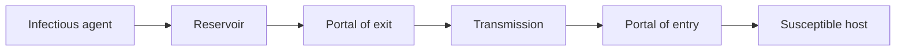
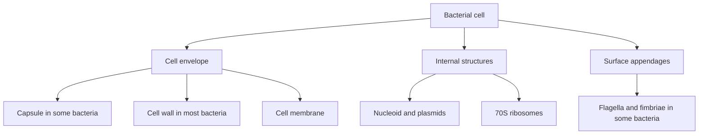

# Chain of infection, bacterial structure and growth — concepts in simple Hinglish

**Priority: High.** Study-ready, not yet attempted. Ye notes topic 6 aur 7 ke MCQs se linked hain.

## 1. Chain of infection ko aasaan language mein samjho

Socho ek patient ke wound mein bacteria hain. Jab nurse wound care karti hai, toh bacteria contaminated gloves ya hands par aa sakte hain. Agar nurse same gloves se doosre patient ke catheter ko touch karti hai, toh bacteria doosre patient ki body mein enter kar sakte hain. Is poore process ko chain of infection ki help se samajhte hain.

- **Infectious agent:** Ye woh germ hai jo infection cause kar sakta hai. Bacteria, virus, fungus aur parasite examples hain.
- **Reservoir:** Ye germ ka ghar samajh lo. Yahan germ normally survive karta hai aur kuch cases mein multiply bhi karta hai. Human body, animals ya water system reservoir ho sakte hain.
- **Portal of exit:** Ye woh raasta hai jahan se germ apne source se bahar aata hai. Cough, stool, blood aur wound discharge examples hain.
- **Transmission:** Ye woh tarika hai jisse germ ek source se doosre person tak pahunchta hai. Hands, equipment, respiratory particles aur contaminated food examples hain.
- **Portal of entry:** Ye naye patient ki body mein enter karne ka raasta hai. Eyes ki mucosa, respiratory tract aur damaged skin examples hain.
- **Susceptible host:** Ye woh person hai jiske body mein germ infection establish kar sakta hai. Immunity kam ho, skin damage ho ya invasive device laga ho toh risk badh sakta hai.

### Nursing application

Agar tum patient ki dressing kar rahi ho, toh clean dressing drainage ko contain karne mein help karti hai. Ye portal of exit ko control karne ka example hai. Jab tum gloves remove karke hands clean karti ho, toh contact transmission interrupt hoti hai. Jab patient ko vaccine milti hai, toh specific infection ke against uski susceptibility reduce ho sakti hai.

| Term | Aasaan meaning | Example |
|---|---|---|
| Endogenous | Germ patient ke apne body se aata hai. | Intestinal bacteria urinary tract mein enter kar sakte hain. |
| Exogenous | Germ patient ke bahar se aata hai. | Contaminated shared equipment se infection ho sakti hai. |
| Fomite | Nonliving object germs transfer karta hai. | Contaminated BP cuff. |
| Biological vector | Living carrier ke andar pathogen ka development ya multiplication hota hai. | Malaria parasite aur Anopheles mosquito. |
| Mechanical vector | Living carrier germs ko physically transfer karta hai. | Fly germs ko stool se food tak le ja sakti hai. |
| Vertical | Mother se fetus ya infant tak infection transmit ho sakti hai. | Some infections during pregnancy or delivery. |

**Exam trap:** Colonization ka matlab germ body par ya body mein present hai, lekin clinical infection ke symptoms zaroori nahi hain. Colonized patient bhi germ transfer kar sakta hai. Infection aur colonization ko automatically same mat samjho. Sepsis infection ki wajah se serious organ dysfunction ka clinical syndrome hai, sirf positive blood culture nahi.

## 2. Bacterial cell structure

Bacterium ek prokaryotic cell hai. Iska matlab hai ki DNA present hai, lekin human cell ki tarah membrane-bound nucleus nahi hota. Bacteria ke kuch structures unhe survive karne, attach hone aur multiply karne mein help karte hain.

**Cell wall:** Peptidoglycan cell ko shape aur support deta hai. Beta-lactam drugs bacterial wall synthesis ko interfere karti hain. Mycoplasma mein wall absent hoti hai, isliye usual wall-targeting medicines effective nahi hoti hain.

**Capsule:** Socho bacteria ne protective outer coat pehna hua hai. Kuch capsules immune cells ke liye bacteria ko engulf karna difficult bana deti hain. Har bacterium mein capsule nahi hoti.

**Flagella aur fimbriae:** Flagellum movement mein help kar sakta hai. Fimbriae kisi surface par chipakne mein help karti hain. Catheter surface par attachment biofilm development mein contribute kar sakta hai.

**Ribosomes:** Ye bacteria ki protein banane wali machinery hai. Bacterial 70S ribosome mein 30S aur 50S subunits hoti hain. Kuch antibiotics in subunits ko target karti hain.

**Plasmid:** Ye chromosome se alag genetic material ho sakta hai. Kuch plasmids resistance genes carry karte hain. Isliye bacteria ke beech DNA transfer antibiotic resistance spread mein contribute kar sakta hai.

| Feature | Typical Gram-positive | Typical Gram-negative |
|---|---|---|
| Peptidoglycan | Thick layer | Thin layer |
| Outer membrane | Absent | Present |
| LPS | Typical outer-membrane LPS absent | Commonly present |
| Gram stain | Purple | Pink/red |

LPS ka Lipid A component endotoxin activity ke liye important hai. Gram staining se initial identification mein help milti hai, lekin final treatment organism, susceptibility aur clinical assessment se decide hota hai.

## 3. Bacterial reproduction and growth curve

Most bacteria binary fission se reproduce karte hain. Ek cell DNA copy karta hai aur do cells mein divide hota hai. Agar favorable conditions mein ye process repeat ho toh population rapidly increase kar sakti hai.

Ye diagram phases ka sequence dikhata hai, actual measured curve nahi.

**Lag phase:** Jab bacteria new environment mein aate hain, toh pehle available nutrients use karne ke liye adjust karte hain. Cell number immediately increase nahi hota.

**Log phase:** Ab bacteria actively divide karte hain. Is phase mein growth exponential hoti hai. Cell-wall synthesis ko target karne wali drugs actively growing susceptible organisms par often more effective hoti hain.

**Stationary phase:** Closed culture mein nutrients limited ho sakte hain aur waste products accumulate hote hain. New cell formation aur cell death roughly balance ho sakti hain.

**Death phase:** Viable population kam hoti hai. Ye complete sterilization ka proof nahi hai, kyunki survivors bhi ho sakte hain.

**Calculation example:** Agar 100 bacteria har 30 minutes mein double hote hain aur uninterrupted log phase 90 minutes tak chalti hai, toh three doublings hongi. 100 → 200 → 400 → 800. General formula N = N0 × 2^n hai, jahan n number of doublings hai. Ye ideal theoretical calculation hai, patient ke actual infection growth ka prediction nahi hai.

### Oxygen aur temperature

Obligate aerobes ko oxygen chahiye. Obligate anaerobes oxygen se inhibited ho sakte hain. Facultative anaerobes oxygen ke saath ya bina grow kar sakte hain. Microaerophiles ko atmospheric oxygen se lower concentration chahiye hoti hai. Mesophiles moderate temperature prefer karte hain aur many human pathogens body temperature ke aas-paas grow karte hain.

### Genetic transfer aur biofilm

Conjugation mein direct bacterial contact se DNA transfer ho sakta hai. Transformation mein bacterium environment se free DNA leta hai. Transduction mein bacteriophage genetic material transfer karta hai. In teenon ko binary fission se confuse mat karna, kyunki binary fission reproduction hai.

Biofilm surface se attached microorganisms ki community hoti hai jo apni matrix bana sakti hai. Catheter ya other device mein biofilm infection ko treat karna difficult bana sakti hai. Isliye nurse device ki ongoing need assess karti hai aur current infection prevention policy follow karti hai.

**Exam trap:** Bacterial endospore reproduction ke liye nahi, survival ke liye hota hai. Bacillus aur Clostridium groups mein endospore-forming species milti hain. Dormant spore suitable conditions mein phir vegetative cell ban sakta hai.

## Practice and references

[40 chain of infection MCQs](../MCQs/06-Chain-of-Infection-and-Microbial-Transmission-40-MCQs.md) · [40 bacterial growth MCQs](../MCQs/07-Bacterial-Structure-Classification-and-Growth-40-MCQs.md) · [Reported PYQs](../Previous-Year-Questions/Infection-Control-and-Microbiology-Transmission-and-Growth-Reported-PYQs.md)

[Hindi bacterial growth lecture](https://www.youtube.com/watch?v=AC33NmL9q7E) · [Alternative Hindi growth lecture](https://www.youtube.com/watch?v=-P4iBxUeJlg) · [NORCET mixed microbiology practice](https://www.youtube.com/watch?v=hmrn2m4ak0s). Titles and descriptions checked, full videos not reviewed.

[CDC chain](https://www.cdc.gov/niosh/learning/safetyculturehc/module-2/3.html) · [OpenStax bacterial cell](https://openstax.org/books/microbiology/pages/3-3-unique-characteristics-of-prokaryotic-cells) · [OpenStax growth curve](https://openstax.org/books/microbiology/pages/9-1-how-microbes-grow) · [National IPC guideline](https://www.ncdc.mohfw.gov.in/wp-content/uploads/2024/03/83538105781625557301.pdf)
