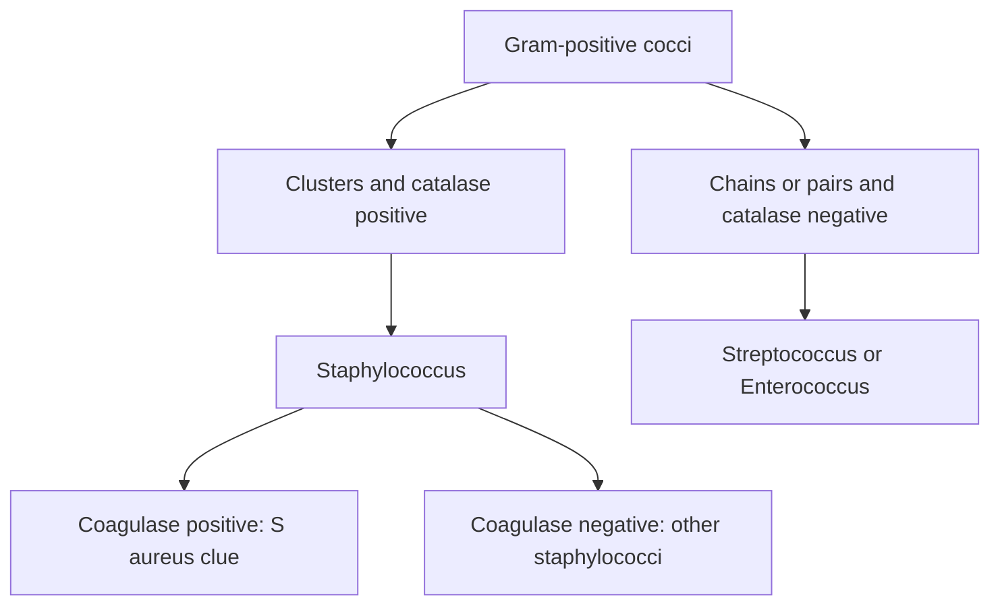

# Gram-positive cocci and bacilli — clinical microbiology

**Priority: High. Study-ready, not studied.** [Chapter](../README.md) · [40 MCQs](../MCQs/09-Gram-Positive-Cocci-and-Bacilli-40-MCQs.md)

## Gram stain aur identification

Gram-positive bacteria ki cell wall mein thick peptidoglycan layer hoti hai. Isliye classical Gram staining mein ye crystal violet complex retain karke purple dikhte hain. Cocci round cells aur bacilli rods hain. Shape se sirf initial clue milta hai, final organism identify karne ke liye laboratory tests chahiye.

## Staphylococcus

S. aureus skin aur nose par colonize kar sakta hai. Skin barrier break hone par wound infection, abscess ya bloodstream infection ho sakti hai. Catalase aur coagulase classical identification clues hain. MRSA mein altered penicillin-binding protein ki wajah se many beta-lactam antibiotics ka effect kam hota hai. Resistance report ke hisaab se treatment team select karti hai. Colonization aur actual infection alag hain. Nurse hand hygiene, wound drainage containment, dedicated clean equipment aur facility MDRO precautions follow karti hai.

S. epidermidis prosthetic devices par biofilm bana sakta hai. Biofilm ko protective microbial layer samjho. Is layer ke andar organisms immune response aur antibiotic treatment se bach sakte hain. S. saprophyticus UTI se associated hai. Classical lab clue novobiocin resistance hai. S. aureus food mein toxin bana sakta hai. Preformed toxin khane ke baad rapid vomiting ho sakti hai. Toxic shock mein superantigen excessive immune activation trigger karta hai.

## Streptococcus aur Enterococcus

| Organism | Exam clue | Clinical relevance |
|---|---|---|
| S. pyogenes | Group A, beta hemolysis | Pharyngitis, skin infection, invasive disease, rheumatic fever aur poststreptococcal glomerulonephritis |
| S. agalactiae | Group B, CAMP positive classical clue | Maternal colonization aur neonatal sepsis |
| S. pneumoniae | Lancet-shaped diplococci, optochin susceptible, bile soluble | Pneumonia, meningitis, encapsulated pathogen |
| Viridans streptococci | Often alpha hemolytic | Oral flora, susceptible valves mein endocarditis |
| Enterococcus | Bile esculin and salt tolerance classical clues | UTI, device-associated infection, VRE concern |

Alpha hemolysis mein partial green discoloration milti hai. Beta mein complete clearing hoti hai. Gamma ka matlab no visible hemolysis hai. Hemolysis alone species prove nahi karti. Group A pharyngitis ke baad immune complications ho sakte hain. Group B prevention pregnancy screening aur indicated prophylaxis local protocol ke according hoti hai. Pneumococcus ki capsule phagocytosis se protection deti hai. Asplenia wale patient mein serious encapsulated infection ka risk high hota hai. Vaccination aur urgent fever assessment important hain.

## Gram-positive rods

Corynebacterium diphtheriae ka toxin host protein synthesis inhibit kar sakta hai. Pharyngeal membrane, myocarditis aur neurological complications important hain. Suspected respiratory diphtheria mein droplet precautions, urgent airway assessment aur public health notification chahiye. Membrane forcefully remove mat karo. Listeria foodborne infection pregnancy, newborn aur immunocompromised patients mein serious ho sakti hai. Pasteurized food aur appropriate food storage prevention mein important hain. Bacillus cereus emetic food poisoning se associated hai. Bacillus endospores survival structures hain. Anaerobic spore-forming pathogens ka detailed coverage topic 13 mein hoga.

Nocardia branching weakly acid-fast bacteria hain aur immunocompromised patients mein infection de sakti hain. Actinomyces chronic draining sinus aur sulfur granules se classically associated hai. Morphology clue ko culture aur clinical context ke saath interpret karo.

## Nursing scenario

Agar patient ka MRSA wound drain kar raha hai aur transfer planned hai, nurse dressing secure karti hai, hand hygiene karti hai aur receiving team ko isolation requirements batati hai. Agar same patient suddenly hypotensive ho ya mental status change ho toh sepsis escalation priority hai. Colonization ke label ki wajah se active deterioration ignore nahi karna chahiye.

## Videos

- [Bhushan Science — Bacteria morphology and classification, nursing lecture](https://www.youtube.com/watch?v=4tWi--cLUss). Gram-positive/negative overview, exact organism-specific segments not reviewed.
- [NORCET 11 Microbiology Complete Episode 1 — mixed-topic MCQ practice](https://www.youtube.com/watch?v=hmrn2m4ak0s). Indexed description identifies nursing MCQ practice. Full video not independently watched and exact topic coverage pending.

## References

[OpenStax gram-positive bacteria](https://openstax.org/books/microbiology/pages/4-4-gram-positive-bacteria) · [CDC MRSA](https://www.cdc.gov/mrsa/hcp/infection-control/index.html) · [CDC isolation precautions](https://www.cdc.gov/infection-control/hcp/isolation-precautions/appendix-a-type-duration.html) · [CDC GAS](https://www.cdc.gov/group-a-strep/hcp/clinical-guidance/)
