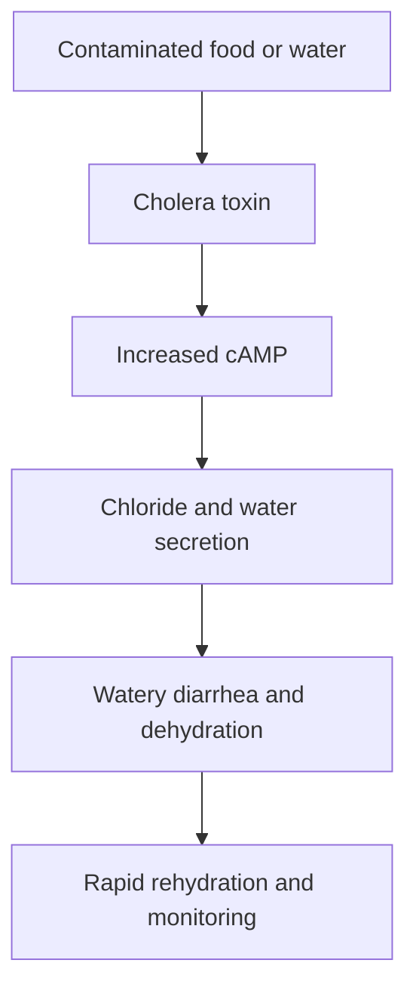

# Gram-negative cocci and enteric bacilli — detailed concepts

**Study-ready, not studied. Priority: High.** [Chapter](../README.md) · [40 original MCQs](../MCQs/10-Gram-Negative-Cocci-and-Enteric-Bacilli-40-MCQs.md)

## Gram-negative wall and endotoxin

Gram-negative bacteria ki thin peptidoglycan layer ke bahar outer membrane hoti hai. Outer membrane mein lipopolysaccharide yani LPS present ho sakta hai. Lipid A iska endotoxin component hai. Jab immune system bacterial infection detect karta hai, inflammatory response activate hota hai. Severe infection mein blood vessels dilate aur fluid leak ho sakta hai. Isse BP aur organ perfusion gir sakti hai. Sepsis sirf gram-negative infection se nahi hota. Nurse confusion, low BP, reduced urine output aur respiratory deterioration identify karke urgent response activate karti hai.

## Neisseria — meningococcus versus gonococcus

Dono gram-negative diplococci hain. Diplococci ka matlab pairs mein round bacterial cells hain. N. meningitidis respiratory secretions ke close contact se spread kar sakta hai aur meningitis ya bloodstream infection cause kar sakta hai. Fever, headache, neck stiffness aur altered consciousness possible hain. Nonblanching rash aur shock urgent warning signs hain. Neck stiffness absent hone par bhi meningococcal sepsis possible hai. Prompt treatment, droplet precautions aur public health notification important hain. Direct unprotected secretion exposure ke baad occupational health indicated chemoprophylaxis assess karti hai.

N. gonorrhoeae sexually transmitted infection cause karta hai. Dysuria, discharge, pelvic pain ya asymptomatic infection possible hain. Untreated infection pelvic inflammatory disease aur reproductive complications de sakti hai. NAAT common diagnostic method hai. Suspected treatment failure mein culture aur susceptibility testing important ho sakti hai. Nurse nonjudgmental sexual health counselling, partner evaluation, adherence aur follow-up support karti hai. Classical carbohydrate exam clue: gonococcus glucose only, meningococcus glucose plus maltose.

## Enteric gram-negative bacteria

Enteric bacteria intestine mein present ho sakte hain, lekin urinary tract ya blood jaise sites par infection cause kar sakte hain. MacConkey agar selective aur differential medium hai. Lactose fermenters acid produce karke pink colonies de sakte hain. Nonfermenters usually pale colonies dete hain. Colony appearance final identification nahi hai.

| Organism | Classical lab clue | Clinical association |
|---|---|---|
| E. coli | Lactose positive, usually indole positive | UTI, bacteremia, diarrheal pathotypes |
| Klebsiella pneumoniae | Lactose positive, mucoid, nonmotile | Pneumonia, urinary and hospital infections |
| Proteus mirabilis | Urease positive, swarming | UTI and struvite stones |
| Salmonella | Usually lactose negative, often motile | Enteric fever or gastroenteritis |
| Shigella | Usually lactose negative, nonmotile | Inflammatory diarrhea and dysentery |

Proteus urease urea break karke ammonia release karti hai. Urine alkaline ho sakta hai aur struvite stone formation support hoti hai. Klebsiella capsule mucoid colonies ka clue hai. E. coli ya Klebsiella ESBL produce kar sakte hain. ESBL enzymes many beta-lactam antibiotics ko inactive kar sakte hain. Resistance ka decision organism name se nahi, susceptibility report aur infection site se hota hai.

## Typhoid and nontyphoidal Salmonella

Salmonella Typhi contaminated food/water se body mein enter karti hai. Intestinal barrier cross karke systemic infection kar sakti hai. Prolonged fever, headache aur abdominal symptoms possible hain. Blood culture diagnosis mein central role rakhta hai. Single Widal test endemic setting mein acute disease prove nahi karta. Prescribed antibiotics local resistance pattern aur culture ke according select hote hain. Sudden severe abdominal pain, guarding aur shock intestinal perforation ka concern hai. Recovery ke baad some patients organisms shed kar sakte hain. Food handlers ke liye public health follow-up local rules se hota hai.

Nontyphoidal Salmonella commonly contaminated eggs, poultry ya other foods se gastroenteritis cause kar sakti hai. Hydration main supportive intervention hai. Severe disease ya invasive risk wale patients mein antibiotics indicated ho sakti hain. Har uncomplicated diarrhea mein antibiotic routine nahi hai.

## Shigella, diarrheagenic E. coli and HUS

Shigella low infectious dose ke saath spread kar sakti hai. Colon inflammation ki wajah se blood/mucus stools, cramps aur tenesmus ho sakta hai. Tenesmus ka matlab bowel empty karne ki repeated urge hai even when little stool passes. Stool culture aur resistance evaluation clinical decisions guide karte hain. Bloody diarrhea mein routine antimotility agents avoid karne chahiye.

ETEC enterotoxin se watery diarrhea karti hai. EPEC intestinal surface damage se absorption disturb kar sakti hai. STEC Shiga toxin produce karti hai. HUS yani hemolytic uremic syndrome mein red cell destruction, low platelets aur acute kidney injury develop ho sakti hai. Bloody diarrhea ke baad pallor, reduced urine aur bruising urgent clues hain. Suspected STEC mein routine antibiotics aur antimotility agents avoid kiye jaate hain because complication risk badh sakta hai. Clinical assessment aur fluid monitoring zaroori hain.

## Cholera — mechanism and priority

Vibrio cholerae toxin intestinal cells mein cAMP signaling badhata hai. Chloride aur water lumen mein secrete hone lagte hain. Patient rapidly fluid lose kar sakta hai. Rice-water stool classic clue hai, lekin diagnosis laboratory and clinical context se hoti hai. Sodium-glucose cotransport usually functional rehta hai. Isi wajah se ORS sodium aur water absorption improve kar sakti hai. Severe dehydration mein urgent prescribed IV rehydration chahiye. Culture confirmation ka wait karke rehydration delay mat karo.

## Other curved and enteric bacilli

Campylobacter jejuni poultry exposure aur inflammatory diarrhea se associated hai. Postinfectious Guillain-Barré syndrome ka classical trigger hai. Helicobacter pylori urease produce karke gastric environment mein survive kar sakta hai. Peptic ulcer association important hai. Urea breath test aur stool antigen active infection assess kar sakte hain. Antibiotic aur acid-suppressant timing test accuracy affect kar sakti hai. Yersinia enterocolitica terminal ileitis aur mesenteric lymphadenitis ke through appendicitis-like symptoms de sakti hai.

## Community nursing

Safe water, handwashing, sanitation, food cooking, raw/cooked food separation aur diarrheal case referral prevention ka base hain. Dehydration mein thirst, pulse, perfusion, mental state aur urine output assess karo. Outbreak suspicion ko local surveillance programme ke through report karo. Antibiotics blindly use mat karo. Prescriber aur public health protocol follow karo.

## Videos and sources

- Teaching: [Bhushan Science — Bacteria morphology and classification](https://www.youtube.com/watch?v=4tWi--cLUss). Description identifies Gram-positive and Gram-negative comparison.
- Practice: [NORCET 11 Microbiology Complete, episode 1](https://www.youtube.com/watch?v=hmrn2m4ak0s). Search listing identifies nursing MCQ practice. Mixed-topic resource, not a dedicated enteric-bacteria video. Full recordings and exact segments not reviewed.

[OpenStax: Proteobacteria](https://openstax.org/books/microbiology/pages/4-2-proteobacteria) · [CDC meningococcal guidance](https://www.cdc.gov/meningococcal/hcp/clinical-guidance/index.html) · [CDC Salmonella](https://www.cdc.gov/salmonella/hcp/clinical-overview/) · [CDC typhoid](https://www.cdc.gov/typhoid-fever/hcp/clinical-guidance/index.html) · [CDC Shigella](https://www.cdc.gov/shigella/hcp/clinical-overview/index.html) · [CDC STEC](https://www.cdc.gov/ecoli/hcp/guidance/index.html) · [CDC cholera](https://www.cdc.gov/cholera/treatment/)

[DSSSB Nursing Officer microbiology syllabus](https://dsssb.delhi.gov.in/sites/default/files/DSSSB/universal-tab/nursing_officer_in_h_fw_deptt.pdf) explicitly names Neisseria, enteric bacteria and Vibrio. Other listed organisms will be covered in their relevant upcoming groups.
