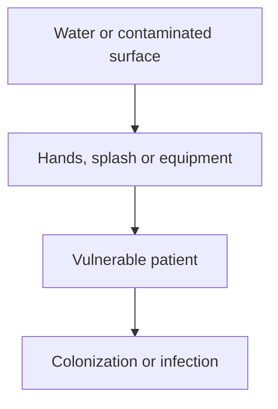

# Nonfermenters and hospital bacterial pathogens

**Study-ready, unattempted. Priority High.** [40 MCQs](../MCQs/11-Nonfermenters-and-Hospital-Bacterial-Pathogens-40-MCQs.md)

## Basic mechanism

Nonfermenters glucose fermentation nahi karte. Kuch organisms oxidative metabolism se glucose use karte hain. Hospital water, surfaces aur devices reservoirs ho sakte hain. Jab skin barrier burn ya invasive device se break hoti hai, bacteria vulnerable tissue mein enter kar sakte hain. Colonization ka matlab organism present hai lekin clinical infection establish nahi hua. Positive culture alone antibiotics ka indication nahi hai.

| Organism | Identification clue | Clinical risk |
|---|---|---|
| Pseudomonas aeruginosa | Oxidase positive, pyocyanin, motile | Burns, keratitis, CF, invasive external otitis |
| Acinetobacter baumannii | Oxidase negative, nonmotile coccobacillus | ICU, ventilator, wounds, resistant bloodstream infection |
| Burkholderia cepacia complex | Species confirmation needed | CF, aqueous product contamination |
| Stenotrophomonas maltophilia | Intrinsic carbapenem resistance | Opportunistic device and respiratory infection |

Pseudomonas exotoxin A host EF-2 inhibit karta hai. Alginate chronic biofilm ka component ho sakta hai. Biofilm attached microbes ki protective matrix hai. Burn patient mein necrosis, hypotension aur reduced perfusion urgent sepsis clues hain. Contact lens user mein painful photophobic eye urgent keratitis evaluation maangti hai. Acinetobacter dry surfaces par persist kar sakta hai. CRAB ka matlab carbapenem-resistant Acinetobacter baumannii hai. Receiving ward ko resistance result timely communicate karna important hai.

## Water and related organisms

Legionella water aerosols se infection cause kar sakti hai. BCYE culture medium classical hai. Urine antigen commonly L. pneumophila serogroup 1 detect karta hai. Negative result all species exclude nahi karta. Pontiac fever nonpneumonic illness hai. H. influenzae X and V growth factors require kar sakti hai. Hib vaccine severe type b disease prevent karne mein help karti hai. Moraxella COPD exacerbation se related hai. Bordetella pertussis infant apnea cause kar sakti hai even without whoop. Ye related respiratory bacteria hain, typical nonfermenters ke saath confuse mat karo.

Nurse hand hygiene, equipment disinfection, splash-zone control, daily device necessity review aur IPC-directed precautions follow karti hai. Cluster mein case definition, exposures aur lab evidence team investigate karti hai. Resistance result and clinical site se treatment select hota hai.

## Research and practice

[CDC water management](https://www.cdc.gov/healthcare-associated-infections/php/toolkit/water-management.html) · [WHO resistant gram-negative IPC](https://www.who.int/publications/i/item/9789241550178) · [CDC Acinetobacter](https://www.cdc.gov/acinetobacter/about/) · [CDC MDRO containment](https://www.cdc.gov/healthcare-associated-infections/php/preventing-mdros/mdro-containment-strategy.html)

[Adda247 NORCET 11 microbiology MCQs](https://www.youtube.com/watch?v=hmrn2m4ak0s) and [NORCET microbiology and IPC practice](https://www.youtube.com/watch?v=VIes9-YHn_w) are indexed mixed-topic videos. Exact nonfermenter segment and full video not reviewed. A [NORCET 2021 Pseudomonas lead](https://www.exampyq.com/Nursing/Questions/Topic-Microbiology-21/Part-20.html) failed to open. Dedicated video and question-level recruitment evidence remain pending.

## Beginner-friendly clinical reasoning supplement

Glucose fermentation ko aise samjho. Kuch bacteria oxygen ke bina bhi glucose se energy nikal sakte hain. Nonfermenters mein glucose fermentation nahi hoti, lekin kuch oxygen ki presence mein glucose use kar sakte hain. MacConkey agar par colorless colony sirf lactose fermentation na hone ka clue deti hai. Isse glucose nonfermentation confirm nahi hoti. Isliye lab organism ki pehchan ke liye alag tests aur validated identification system use karti hai.

Pseudomonas ka pyocyanin blue pigment hai. Pyoverdine yellow-green fluorescent siderophore hai, yani ye bacteria ko iron paane mein madad karta hai. Cetrimide agar ek selective medium hai jo Pseudomonas ki identification mein madad karta hai. Pigment ka na dikhna infection ko exclude nahi karta. Culture ko patient ki condition aur lab identification ke saath interpret karo.

Acinetobacter aur Pseudomonas ko reservoir ke through compare karo. Pseudomonas moist environments mein mil sakta hai. Acinetobacter dry high-touch surfaces par bhi persist kar sakta hai. Dono organisms equipment ya staff ke contaminated hands ke through vulnerable patients tak pahunch sakte hain. Isliye sirf room clean dikhne se safety confirm nahi hoti. Nurse device instructions ke hisaab se cleaning aur disinfection karwati hai, clean supplies ko sink splash se door rakhti hai aur IPC team ke protocol ko follow karti hai.

### Clinical example: positive aspirate versus pneumonia

Maan lo ek ventilated patient ke endotracheal aspirate mein Acinetobacter mila. Agar patient stable hai aur koi naya clinical sign nahi hai, toh culture colonization represent kar sakta hai. Agar oxygen requirement badh rahi hai, respiratory symptoms worsen ho rahe hain ya patient unstable ho raha hai, toh clinical infection ka urgent assessment chahiye. Nurse culture report, vital signs aur respiratory changes communicate karti hai. Prescriber infection site, susceptibility, severity aur patient factors ke basis par treatment decide karta hai. Nurse independently antibiotic start ya change nahi karti.

### Antibiotic resistance aur exam traps

Bacteria ke outer membrane mein porins chhote channels hote hain. Porin changes drug entry kam kar sakte hain. Efflux pumps drug ko cell se bahar nikal sakte hain. Kuch enzymes antibiotic ko inactive karte hain. Isliye har gram-negative isolate ke liye same antibiotic effective nahi hota. Stenotrophomonas mein carbapenems generally unreliable hote hain. Resistant Pseudomonas aur Acinetobacter ke liye susceptibility-guided clinician review zaroori hai. Deteriorating patient mein escalation delay mat karo.

## Additional source research — 27 November 2026

- [CDC gram-negative bacteria](https://www.cdc.gov/gram-negative-bacteria/about/) and [IDSA antimicrobial-resistant gram-negative guidance](https://www.idsociety.org/practice-guideline/amr-guidance/). Indexed current references for prevention and resistance interpretation.
- [KVV Pseudomonas teaching module](https://emodules.kvv.edu.in/e-modules/bacterial-infections-2pseudimonas/). Indexed organism identification and pigment practice.
- Concept video: [Nonfermenters: Pseudomonas and Acinetobacter, ASCP MLS/MLT Microbiology](https://www.youtube.com/watch?v=Xa_Yo6fSwZA). Topic-specific indexed title. Full playback and channel metadata could not be confirmed.
- Concept video: [Lecture on Pseudomonas aeruginosa: Microbiology, Infections, Diagnosis & Treatment](https://www.youtube.com/watch?v=FPEmMFxSen4). Indexed topic-specific title. Full playback not verified.
- Mixed-topic MCQ practice: [Microbiology Previous Year Questions, RRB, KGMU, RML, SGPGI and CHO](https://www.youtube.com/watch?v=G2hpeBFm10E). Indexed title only. Exact nonfermenter coverage and channel remain unverified.
- Topic-specific text MCQ practice: [Medical Biochemist — Pseudomonas and Acinetobacter](https://www.medicalbiochemist.com/2019/01/medical-microbiology-pseudomonas-acinetobacters-mcq.html). Indexed practice page. This is not a recruitment PYQ or YouTube video.

### PYQ evidence gap

[RRB Nursing Superintendent, 29 April 2025, shift 2 — Testbook reported identification question](https://testbook.com/question-answer/the-primary-test-to-identify-pseudomonas-aeruginos--681c82fb99ed7f6194df3efa/amp). The indexed title and exam metadata identify a Pseudomonas laboratory identification question. Full page retrieval failed. Original options and official answer key are not verified. Do not count this as an authenticated PYQ. The related original practice question Q2 in the linked bank can be used for revision without claiming it is the original exam item.

Dedicated topic-specific YouTube MCQ-solving video, official paper and key authentication remain pending. No invented video ID or original exam options have been added.
