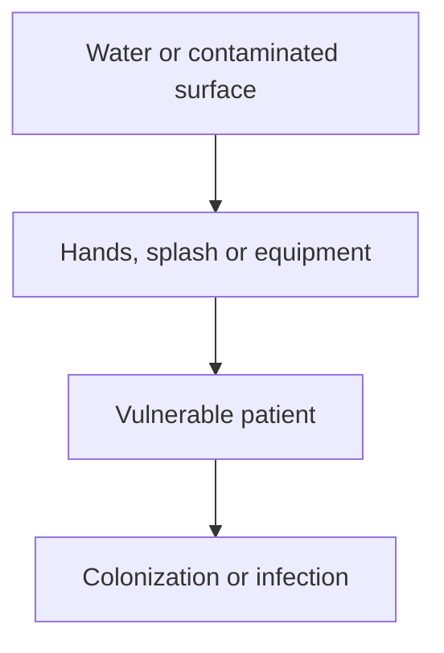

# Nonfermenters and hospital bacterial pathogens

**Study-ready, unattempted. Priority High.** [40 MCQs](../MCQs/11-Nonfermenters-and-Hospital-Bacterial-Pathogens-40-MCQs.md)

## Basic mechanism

Nonfermenters glucose fermentation nahi karte. Kuch organisms oxidative metabolism se glucose use karte hain. Hospital water, surfaces aur devices reservoirs ho sakte hain. Jab skin barrier burn ya invasive device se break hoti hai, bacteria vulnerable tissue mein enter kar sakte hain. Colonization ka matlab organism present hai lekin clinical infection establish nahi hua. Positive culture alone antibiotics ka indication nahi hai.

| Organism | Identification clue | Clinical risk |
|---|---|---|
| Pseudomonas aeruginosa | Oxidase positive, pyocyanin, motile | Burns, keratitis, CF, invasive external otitis |
| Acinetobacter baumannii | Oxidase negative, nonmotile coccobacillus | ICU, ventilator, wounds, resistant bloodstream infection |
| Burkholderia cepacia complex | Species confirmation needed | CF, aqueous product contamination |
| Stenotrophomonas maltophilia | Intrinsic carbapenem resistance | Opportunistic device and respiratory infection |

Pseudomonas exotoxin A host EF-2 inhibit karta hai. Alginate chronic biofilm ka component ho sakta hai. Biofilm attached microbes ki protective matrix hai. Burn patient mein necrosis, hypotension aur reduced perfusion urgent sepsis clues hain. Contact lens user mein painful photophobic eye urgent keratitis evaluation maangti hai. Acinetobacter dry surfaces par persist kar sakta hai. CRAB ka matlab carbapenem-resistant Acinetobacter baumannii hai. Receiving ward ko resistance result timely communicate karna important hai.

## Water and related organisms

Legionella water aerosols se infection cause kar sakti hai. BCYE culture medium classical hai. Urine antigen commonly L. pneumophila serogroup 1 detect karta hai. Negative result all species exclude nahi karta. Pontiac fever nonpneumonic illness hai. H. influenzae X and V growth factors require kar sakti hai. Hib vaccine severe type b disease prevent karne mein help karti hai. Moraxella COPD exacerbation se related hai. Bordetella pertussis infant apnea cause kar sakti hai even without whoop. Ye related respiratory bacteria hain, typical nonfermenters ke saath confuse mat karo.

Nurse hand hygiene, equipment disinfection, splash-zone control, daily device necessity review aur IPC-directed precautions follow karti hai. Cluster mein case definition, exposures aur lab evidence team investigate karti hai. Resistance result and clinical site se treatment select hota hai.

## Research and practice

[CDC water management](https://www.cdc.gov/healthcare-associated-infections/php/toolkit/water-management.html) · [WHO resistant gram-negative IPC](https://www.who.int/publications/i/item/9789241550178) · [CDC Acinetobacter](https://www.cdc.gov/acinetobacter/about/) · [CDC MDRO containment](https://www.cdc.gov/healthcare-associated-infections/php/preventing-mdros/mdro-containment-strategy.html)

[Adda247 NORCET 11 microbiology MCQs](https://www.youtube.com/watch?v=hmrn2m4ak0s) and [NORCET microbiology and IPC practice](https://www.youtube.com/watch?v=VIes9-YHn_w) are indexed mixed-topic videos. Exact nonfermenter segment and full video not reviewed. A [NORCET 2021 Pseudomonas lead](https://www.exampyq.com/Nursing/Questions/Topic-Microbiology-21/Part-20.html) failed to open. Dedicated video and question-level recruitment evidence remain pending.
