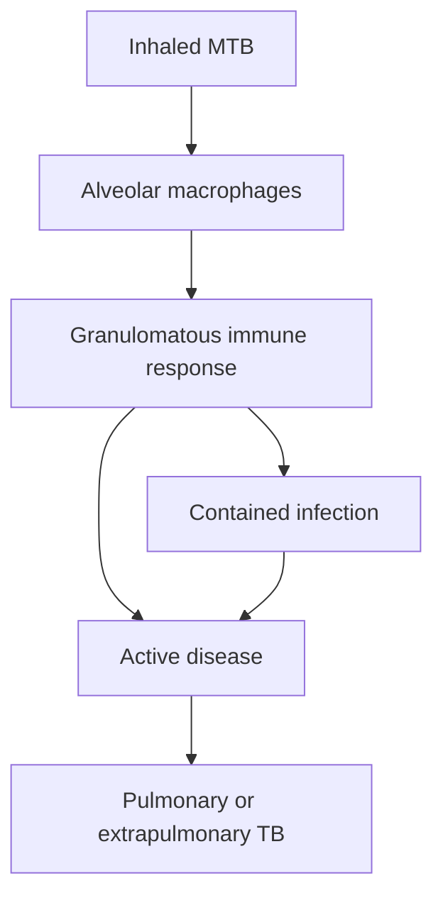

# Mycobacteria and tuberculosis

**Study-ready, unattempted. Priority High.** [40 MCQs](../MCQs/12-Mycobacteria-and-Tuberculosis-40-MCQs.md)

## Pathogenesis and symptoms

MTB ki waxy wall mein mycolic acids hote hain. Isliye bacilli acid-fast stain retain karte hain. Infectious airborne particles inhale karne par bacilli alveoli tak ja sakte hain. Macrophages unko engulf karte hain. Cell-mediated immunity granuloma bana sakti hai, jo organized immune cells ka collection hai. Infection contained reh sakti hai ya active TB develop ho sakti hai. HIV, malnutrition aur immunosuppression progression risk badhate hain.

Pulmonary TB mein prolonged cough, fever, night sweats, weight loss aur hemoptysis possible hain. Miliary TB bloodstream dissemination hai. Pott disease spine involvement hai. New leg weakness ya bladder dysfunction emergency compression assessment maangta hai. TB meningitis CSF circulation disturb karke hydrocephalus cause kar sakti hai.

## Diagnosis

ZN microscopy AFB detect karti hai, species, viability aur drug resistance prove nahi karti. Auramine fluorescence alternative screening method hai. LJ solid medium aur liquid culture viable organisms detect kar sakte hain. Programme-approved rapid molecular NAAT MTB DNA and selected resistance markers identify kar sakti hai. Current WHO and NTEP algorithm follow karo. Negative smear alone disease exclude nahi karta. Proper lower respiratory sputum collect karo, saliva nahi. Mantoux 48–72 hours par palpable induration measure karta hai, redness nahi. IGRA aur skin test immune sensitization detect karte hain, active disease independently establish nahi karte. Preventive treatment se pehle active disease exclude karna important hai.

## Drug mechanisms and monitoring

| Drug | Main point |
|---|---|
| Isoniazid | Mycolic acid synthesis inhibition, neuropathy and liver injury. Prescribed B6 indicated cases mein helpful hai. |
| Rifampicin | RNA polymerase inhibition, orange secretions, enzyme induction and drug interactions. |
| Pyrazinamide | Hyperuricemia, arthralgia and liver injury. |
| Ethambutol | Arabinosyl transferase inhibition and optic toxicity. Visual acuity and color discrimination monitor karo. |
| Linezolid | Selected DR regimens, cytopenia and neuropathy concern. |
| Bedaquiline | Selected DR regimens, QT monitoring as indicated. |

Drug susceptible regimens often HRZE-based hoti hain but exact regimen duration and eligibility current NTEP guidelines and DST determine karte hain. Historical intermittent DOTS categories ko current universal regimen mat samjho. Jaundice, persistent vomiting, visual change aur syncope urgently report karo. Nurse independently drugs alter nahi karti. MDR at least INH and rifampicin resistance hai. Pre-XDR MDR/RR plus fluoroquinolone resistance hai. Current WHO XDR definition mein additional Group A drug (bedaquiline or linezolid) resistance bhi hoti hai.

## Nursing and public health

Early triage, separation, ventilation, staff fit-tested particulate respirator and patient source-control mask transmission reduce karte hain. Essential transport receiving team ko inform karke plan karo. Household contacts screen karo and active disease exclude karke TPT eligibility assess karo. BCG severe childhood TB se protection provide karti hai, all infection prevent nahi karti. Ni-kshay case notification and follow-up support karta hai. Missed doses ke reasons identify karo without stigma. NTM environment mein mil sakti hain. Isolation alone disease prove nahi karta. Symptoms, imaging and repeated microbiology specialist assessment guide karte hain.

## Sources and videos

[WHO TB fact sheet](https://www.who.int/en/news-room/fact-sheets/detail/tuberculosis/) · [WHO 2025 diagnosis](https://www.ncbi.nlm.nih.gov/sites/books/NBK614638/) · [India NTEP guidelines](https://tbcindia.mohfw.gov.in/guidelines/) · [NTEP overview](https://dghs.mohfw.gov.in/national-tuberculosis-elimination-programme.php)

- Dedicated MCQ practice: [VS Nursing Academy, Ritika Mam — TB MCQ sessions NORCET 10, RML, KGMU, SGPGI](https://www.youtube.com/watch?v=8kUoq-2nUvs), 19 March 2026 as indexed. Description covers TB tests, treatment, IPC and MCQs.
- Concept and practice: [TB & HIV Complete Theory & MCQ Questions](https://www.youtube.com/watch?v=2d1zyD1yOWk), indexed as AIIMS CRE Nursing Officer class. Full recordings not reviewed. Use current NTEP guidance over outdated coaching statements.
