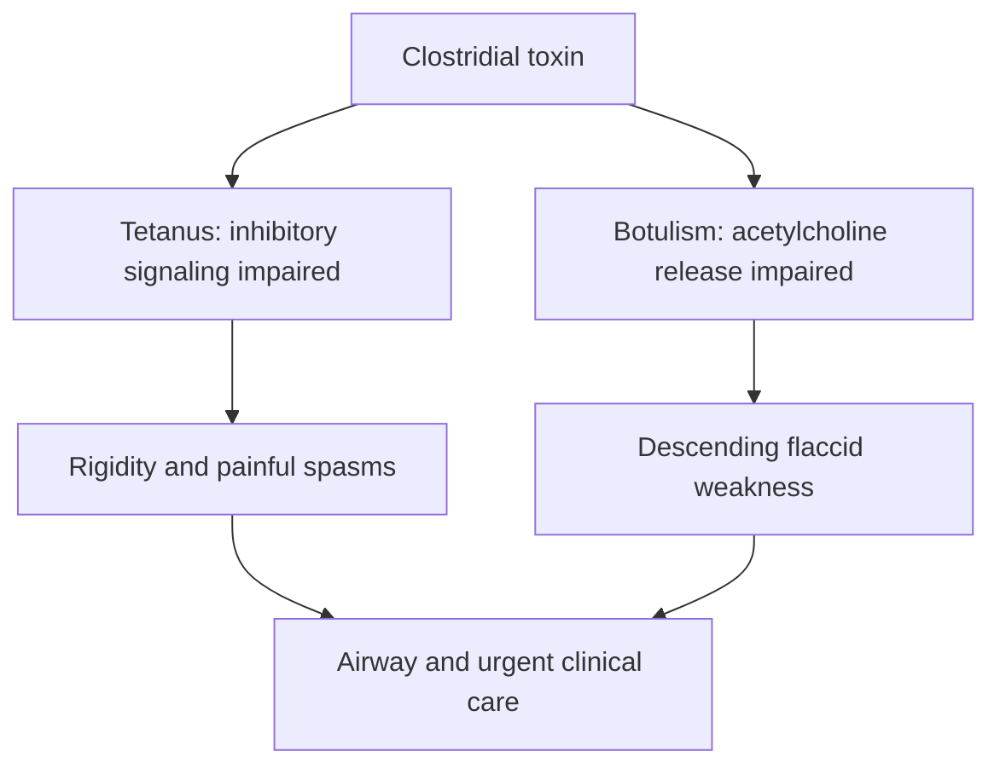

# Anaerobes and spore-forming pathogens

**Priority High. Study-ready, not studied.** [40 MCQs](../MCQs/13-Anaerobes-and-Spore-Forming-Pathogens-40-MCQs.md)

## Anaerobes and clinical significance

Obligate anaerobes oxygen-rich conditions mein grow nahi karte. Kuch oxygen-derived reactive molecules detoxify nahi kar paate. Normal gut and oral flora mein anaerobes present ho sakte hain. Jab perforation, trauma ya tissue necrosis se normal barrier break hoti hai, ye sterile sites mein abscess ya invasive infection cause kar sakte hain. Deep aspirate ya tissue usually superficial swab se more informative hota hai. Specimen collection and transport lab protocol follow karta hai. Endospore survival structure hai, reproductive structure nahi. Spores unfavorable environmental conditions tolerate kar sakte hain, isliye routine disinfection aur sterilization ka difference important hai.

## Tetanus: pathophysiology and nursing

C. tetani spores wound ke through enter kar sakte hain. Devitalized tissue low oxygen environment create kar sakta hai. Tetanospasmin inhibitory neurotransmission impair karta hai. Normally GABA aur glycine motor activity control karne mein help karte hain. Inhibition remove hone par painful muscle spasms and rigidity ho sakti hai. Trismus jaw stiffness hai. Risus sardonicus facial spasm ka appearance hai. Opisthotonus severe back arching describe karta hai. Autonomic instability BP and pulse fluctuations cause kar sakti hai. Diagnosis mainly clinical hai, negative wound culture tetanus exclude nahi karta.

Nurse airway, breathing and hemodynamics monitor karti hai, unnecessary stimulation reduce karti hai aur prescribed spasm control, nutrition and wound management coordinate karti hai. Severe disease critical care require kar sakti hai. TIG unbound toxin neutralize karta hai. Existing toxin-mediated neurological injury instantly reverse nahi hoti. Recovery reliable lifelong immunity nahi deti, so immunization assessment remains important.

Prevention mein clean wound care, vaccination history aur wound type assessment important hai. CDC guidance mein completed primary series with last dose under five years par no booster is needed for any wound. Clean minor wounds mein ten-year threshold aur dirty/major wounds mein five-year threshold use hote hain for fully immunized people. Unknown or incomplete history mein vaccine indicated ho sakti hai. TIG dirty/major wounds mein selected risk groups ke liye indicated hai, clean minor wounds mein nahi. India/local protocol and clinician assessment follow karo. Antibiotics tetanus prevention ke sole substitute nahi hain. Neonatal prevention includes antenatal immunization, hygienic delivery and cord care. Maternal antibodies protection support karte hain, disease mother se direct transmit hona required nahi hai.

## Botulism: clinical difference

Botulinum neurotoxin peripheral cholinergic transmission impair karta hai by blocking acetylcholine release. Isse cranial nerve symptoms such as diplopia, dysphagia aur descending flaccid weakness develop ho sakti hai. Foodborne disease preformed toxin exposure se associated hai. Infant and wound botulism different clinical forms hain. Under one year honey avoid karna infant prevention ka important point hai. Suspected botulism respiratory emergency hai. Antitoxin and public health assessment urgent hain, confirmatory test ka wait karke delay mat karo. Aspiration precautions, ventilatory monitoring and supportive care important hain.

## C. difficile and antibiotic-associated colitis

Antibiotics normal intestinal microbiota disturb kar sakti hain. Toxigenic C. difficile proliferate karke colonic inflammation and diarrhea cause kar sakta hai. Asymptomatic colonization active infection nahi hai. Symptomatic patients mein suitable unformed stool sample and lab algorithm follow karo. Contact precautions early start karo as indicated. Gloves and gown, hand hygiene, dedicated equipment and facility-approved sporicidal cleaning important hain. Soap-water visibly soiled hands ke liye necessary hai. Alcohol spores reliably inactivate nahi karta. Severe abdominal distension, hypotension, ileus ya toxic megacolon concern urgent escalation maangte hain. Treatment review and recurrence management clinician-directed hain. Routine test of cure asymptomatic recovery mein appropriate nahi hai.

## Other anaerobic infections

C. perfringens alpha toxin phospholipase activity tissue injury contribute kar sakti hai. Rapidly progressive painful wound, crepitus and systemic toxicity possible myonecrosis ke warning signs hain. Emergency surgery and sepsis care priority hain. Foodborne C. perfringens illness cramps and diarrhea de sakti hai. Bacteroides fragilis group intra-abdominal abscess mein relevant hai. Fusobacterium necrophorum pharyngeal infection ke baad Lemierre syndrome se associated hai. Source control, suitable antibiotics and clinical monitoring specialist-directed hote hain.

## Sources and video practice

[CDC tetanus wound guidance](https://www.cdc.gov/tetanus/hcp/clinical-guidance/) · [CDC botulism clinical overview](https://www.cdc.gov/botulism/hcp/clinical-overview/index.html) · [CDC C. diff clinical overview](https://www.cdc.gov/c-diff/hcp/clinical-overview/) · [CDC CDI prevention](https://www.cdc.gov/c-diff/hcp/clinical-guidance/)

- [PW Nursing Wallah: RRB Nursing Superintendent important MCQs part 3](https://www.youtube.com/watch?v=e3E44rDhtgY&t=1529s), indexed chapter marker 25:29 identifies neonatal tetanus practice. Mixed-topic session, not a full anaerobe course.
- [NORCET 2026–27 Microbiology and Infection Control MCQs](https://www.youtube.com/watch?v=VIes9-YHn_w), indexed mixed-topic practice. Dedicated full anaerobe video remains pending. Full videos not independently reviewed.

## Dedicated learning and question practice — additional research

- Concept: [Med in 5 — Clostridium Made Simple](https://www.youtube.com/watch?v=cIdc3AxgDM4). Indexed description covers tetanus, botulism, gas gangrene and CDI.
- Concept: [Dr G Bhanu Prakash — Clostridium Species, NEET PG Core Revision](https://www.youtube.com/watch?v=AOOuG_MybmY). Medical entrance-level mechanism review, not a substitute for nursing guidelines.
- MCQ practice: [Clostridium MCQ Questions](https://www.youtube.com/watch?v=l7UAudwai4o). Indexed description specifically identifies four-option questions with answers. Channel metadata and full playback remain unverified.
- NORCET quick revision: [Tetanus — High-Yield NORCET Points](https://www.youtube.com/watch?v=yy_TRnukkkI). Indexed Vandana Nursing Classes tag, channel and full playback remain unverified.
- Additional clinical references: [ICMR gas gangrene](https://amrtg.icmr.org.in/section-info/10/3), [IDSA skin and soft tissue infections](https://www.idsociety.org/practice-guideline/skin-and-soft-tissue-infections/), [WHO tetanus](https://www.who.int/news-room/fact-sheets/detail/tetanus).

Search results confirm these titles and URLs, not playback or every answer. Topic-specific full-length nursing video for non-spore-forming anaerobes remains pending.

### Practical clinical example

Maan lo kisi patient ke crush injury ke baad wound pain bahut jaldi badh raha hai aur BP gir raha hai. Skin par gas feel na bhi ho, toh early myonecrosis exclude nahi hoti. Nurse emergency team ko jaldi inform karti hai aur prescribed resuscitation aur urgent surgical assessment coordinate karti hai. Culture confirmation ka wait karke source control delay nahi karna chahiye. Source control ka matlab infection ke focus ko remove ya drain karna hai. C. septicum ki spontaneous invasive infection mein clinician underlying colorectal ya hematologic disease bhi evaluate kar sakta hai.

[Additional reported HPSSC and UPPSC exam evidence](../Previous-Year-Questions/Anaerobes-and-Rickettsiae-Reported-PYQ-Adaptations.md)
