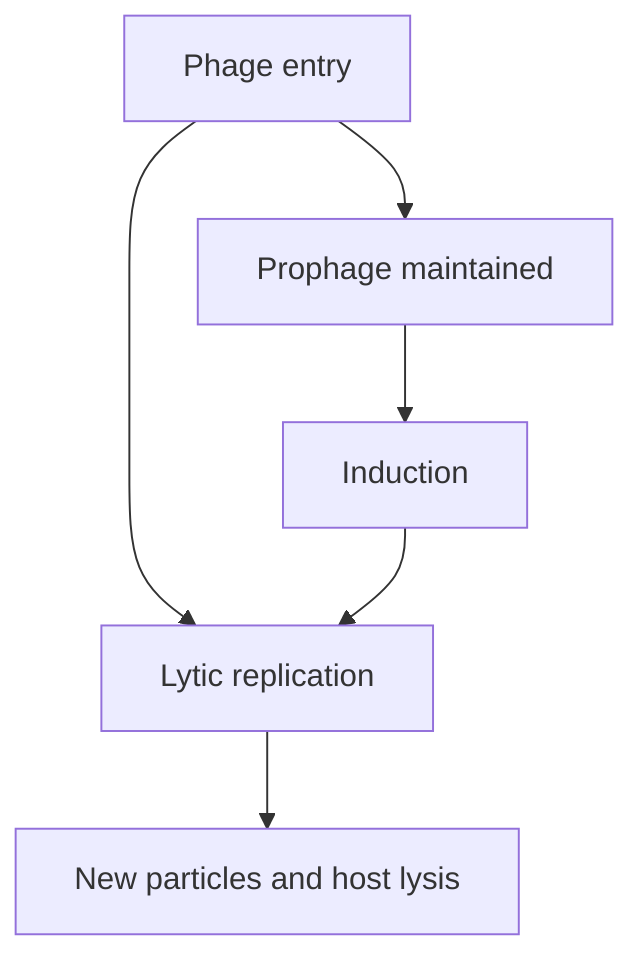

# Viruses and viral replication

**Study-ready, unattempted. Priority high.** [40 original MCQs](../MCQs/15-Viruses-and-Viral-Replication-40-MCQs.md) · [Reported PYQs](../Previous-Year-Questions/Viral-Structure-and-Replication-Reported-PYQs.md)

## 1. Basic structure

Virus ko ek genetic instruction packet samjho. Iske andar DNA ya RNA genome hota hai. Genome ko protein coat protect karta hai jise capsid kehte hain. Capsid ki structural subunits capsomeres kehlati hain. Kuch viruses ke bahar lipid envelope bhi hota hai. Ye envelope host cell ki membrane se acquire ho sakta hai. Viral glycoproteins host cell ke receptor ko recognize karne aur entry mein help karte hain.

Virus apne aap normal nutrient agar par multiply nahi kar sakta. Iske paas apne ribosomes nahi hote. Isliye virus ko living host cell ki protein-making machinery chahiye. Antibacterial drugs bacterial wall aur ribosomes jaise targets par kaam karti hain, jo virus mein absent hote hain. Viral illness mein bacterial coinfection ho toh antibiotic ka decision separately clinician karta hai.

| Genome | Examples | Important clue |
|---|---|---|
| Double-stranded DNA | Herpesvirus, adenovirus, poxvirus | Poxvirus cytoplasmic replication ka classic exception hai |
| Single-stranded DNA | Parvovirus B19 | DNA virus hone ke bawajood genome single-stranded hai |
| Positive-sense RNA | Poliovirus, coronavirus | Genome generally mRNA ki tarah translate ho sakta hai |
| Negative-sense RNA | Influenza, rabies | Viral RNA polymerase se mRNA banana padta hai |
| Double-stranded RNA | Rotavirus | Segmented genome |
| RNA with DNA intermediate | HIV | Reverse transcriptase RNA se DNA banata hai |
| Partially double-stranded DNA with RNA intermediate | HBV | Reverse transcription ke bawajood DNA virus hai |

## 2. Replication step by step

Attachment mein virus compatible receptor se bind karta hai. Receptor distribution tissue tropism ko influence karti hai, yani virus kis cell type ko prefer karta hai. Receptor hona alone replication guarantee nahi karta. Cell ke internal factors bhi suitable hone chahiye.

Penetration mein virus ya uska genome cell mein enter karta hai. Kuch enveloped viruses fusion se entry karte hain. Kuch endocytosis use karte hain. Uncoating ke baad genome gene expression ke liye accessible ho jaata hai. Biosynthesis mein genome copies aur viral proteins bante hain. Assembly mein new viral components combine hote hain. Release budding, lysis ya other mechanisms se ho sakti hai.

Positive-sense RNA ko readable instruction samjho. Negative-sense RNA ko pehle complementary readable mRNA mein convert karna hota hai. Typical negative-sense RNA viruses required polymerase virion mein carry karte hain. Most DNA viruses nucleus use karte hain, poxvirus cytoplasm mein replicate kar sakta hai. Influenza RNA virus hai par nuclear steps use karta hai. Retrovirus DNA intermediate banata hai.

## 3. Bacteriophage, lytic and lysogenic cycles

Bacteriophage bacteria infect karne wala virus hai. Lytic cycle mein new phage particles bante hain aur bacterial cell rupture ho sakta hai. Temperate phage bacterial genome ke saath persist kar sakta hai. Integrated phage DNA ko prophage kehte hain. Induction ke baad lytic cycle start ho sakti hai. Phage genes kabhi bacterial phenotype change karte hain, jise lysogenic conversion kehte hain. Generalized transduction mein accidental bacterial DNA packaging hoti hai. Specialized transduction mein integration site ke near selected bacterial genes transfer ho sakte hain.

## 4. Latency, persistence and variation

Latency ko dormant instruction samjho. Varicella-zoster infection ke baad genome sensory ganglia mein latent reh sakta hai. Reactivation par shingles ho sakta hai. Persistent infection mein viral genome ya ongoing replication extended duration tak present ho sakti hai. Dono terms har case mein interchangeable nahi hain.

Influenza mein antigenic drift small accumulating mutations se related hai. Antigenic shift influenza A mein major antigen changes describe karta hai, jo reassortment se ho sakte hain. Reassortment ka matlab segmented viral genomes ke segments new combination mein aana hai. Major shift automatically pandemic guarantee nahi karta.

## 5. Diagnostic reasoning

NAAT viral nucleic acid detect karta hai. RNA testing ke liye reverse transcription PCR RNA ko complementary DNA mein convert karke amplify karti hai. Positive result residual nucleic acid bhi represent kar sakta hai. Ye alone infectiousness establish nahi karta. Rapid antigen test viral protein detect kar sakta hai. Early negative result mein timing aur sensitivity consider karo. Serology host antibodies detect karti hai. Window period mein antibodies detectable level tak nahi pahunchi ho sakti hain. Vaccine history aur test-specific interpretation important hain.

Cell culture living cells mein viral growth assess karti hai. Cytopathic effect infected cells ka observable structural change hai. Culture routine test har viral infection ke liye nahi hota.

## 6. Nursing and infection prevention

Virus ka DNA ya RNA classification isolation decision alone determine nahi karta. Transmission route aur disease-specific policy follow karo. Enveloped viruses lipid-disrupting agents ke liye generally susceptible ho sakte hain. Nonenveloped viruses environmental disinfection ke liye more resistant ho sakte hain. Product ki organism-specific claim, concentration aur contact time follow karna zaroori hai. Visible soil ke baad soap-water handwashing karo.

Clinical example: patient ka rapid antigen test negative hai lekin breathing difficult hai aur confusion badh raha hai. Nurse pehle airway, breathing, oxygenation aur urgent escalation par focus karti hai. Test confirmation ke liye emergency assessment delay nahi karti. Vaccine protection pathogen-specific hai. Severe immunocompromise mein live vaccine contraindications check karo. Passive immunoglobulin immediate temporary antibodies provide karta hai.

## Sources and videos

- [OpenStax viral structure](https://openstax.org/books/microbiology/pages/6-1-viruses)
- [OpenStax viral life cycle](https://openstax.org/books/microbiology/pages/6-2-the-viral-life-cycle)
- [OpenStax acellular pathogens summary](https://openstax.org/books/microbiology/pages/6-summary)
- Concept: [Level Up RN — Viral Replication in an Animal Host](https://www.youtube.com/watch?v=-9zPjKor1BM). Nursing-focused attachment, entry, uncoating, biosynthesis, assembly, release and quiz at 2:56.
- Concept: [Rajeev Ranjan Gupta — Virus Basic Details Masterclass](https://www.youtube.com/watch?v=sZRwUEWmQPU). Indexed chapter markers include structure at 4:40, replication at 14:00 and genome types. Medical-level enrichment.
- MCQ practice: [Microbial Concepts — MCQ's on Viruses | Virology](https://www.youtube.com/watch?v=L9Svpmisamo). Dedicated indexed virology question session.
- Nursing mixed theory and MCQ practice: [Bacteria + Virus Nursing Theory Class](https://www.youtube.com/watch?v=QhNCLHV0X94). Indexed NORCET, RRB and SGPGI preparation tags. Channel and exact virus segment not independently confirmed.

Video metadata retrieved from search results. Full playback and every answer not independently reviewed. Dedicated NORCET-only replication question session remains an evidence gap.
