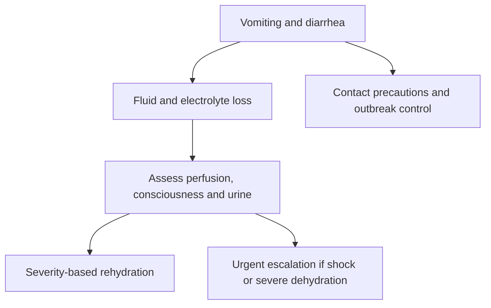

# Respiratory, enteric and vaccine-preventable viruses

**Priority High. Study-ready, not studied.** [40 original MCQs](../MCQs/17-Respiratory-Enteric-and-Vaccine-Preventable-Viruses-40-MCQs.md)

## Febrile rash illnesses

Measles respiratory airborne infection hai. Prodrome mein fever, cough, coryza and conjunctivitis ho sakte hain. Koplik spots buccal mucosa par classic clue hain. Rash usually face se start karke downward spread karta hai. Suspected case ko promptly separate karo, airborne precautions and public health notification coordinate karo. Pneumonia, otitis, encephalitis and rare delayed SSPE complications possible hain. Vitamin A in indicated children clinician-prescribed age-specific dosing se diya jaata hai, vaccine replacement nahi.

Rubella often mild illness with rash and posterior auricular/suboccipital lymphadenopathy cause karti hai. Pregnancy exposure serious hai because fetal congenital rubella syndrome mein hearing loss, cataracts and congenital heart disease possible hain. Live rubella-containing vaccine pregnancy mein generally contraindicated hai. Susceptible postpartum patients vaccination assessment receive kar sakte hain.

Mumps parotid gland swelling cause kar sakta hai. Orchitis, meningitis and other complications possible hain. Droplet precautions and local public health guidance follow karo. Varicella lesions successive crops mein appear ho sakte hain. Hospitalized varicella generally airborne and contact precautions require karti hai. VZV ganglia mein latent reh sakta hai. Reactivation herpes zoster cause karti hai. Disseminated or immunocompromised cases enhanced precautions and clinical evaluation require karte hain. Child with viral illness mein aspirin routine use avoid karo because Reye syndrome concern hai.

| Disease | Key clue | Priority |
|---|---|---|
| Measles | 3 Cs and Koplik spots | Airborne isolation and respiratory assessment |
| Rubella | Posterior auricular nodes | Pregnancy exposure assessment |
| Mumps | Parotitis | Pain, hydration and complications |
| Varicella | Vesicles in different stages | Airborne/contact precautions |
| Zoster | Painful dermatomal lesions | Assess dissemination and immune status |

## Influenza and respiratory viruses

Influenza hemagglutinin attachment facilitate karta hai aur neuraminidase release mein help karta hai. Antigenic drift gradual mutations hain. Antigenic shift influenza A mein major change, often reassortment, se related hai. Severe hospitalized or high-risk influenza cases antiviral assessment even after 48 hours require kar sakte hain. Secondary bacterial pneumonia mein initial improvement ke baad fever and worsening respiratory status ho sakta hai.

RSV infants mein bronchiolitis and apnea cause kar sakta hai. Small airway swelling and mucus breathing difficulty produce karte hain. Retractions, oxygenation, hydration and feeding assess karo. Routine antibiotics or steroids uncomplicated bronchiolitis mein generally recommended nahi hain. Severe distress needs escalation. Parainfluenza croup ka classical cause hai. Barking cough and stridor at rest severity clues hain. Adenovirus pharyngoconjunctival fever and outbreaks cause kar sakta hai. SARS-CoV-2 precautions current local guidance ke according apply karo.

## Gastroenteritis and community nursing

Norovirus rapid vomiting/diarrhea outbreaks cause kar sakta hai. Early case isolation, appropriate contact precautions, soap-water hand hygiene during outbreak according to protocol, and approved effective disinfection important hain. Vomitus cleanup PPE and contact time follow kare. Rotavirus segmented dsRNA virus hai, young children mein dehydration concern hai. Oral rotavirus vaccine age-specific programme ke according administer hoti hai. Intussusception rare concern hai, severe intermittent pain, vomiting or bloody stool urgently assess karo.

Enteroviruses HFMD, meningitis and other syndromes cause kar sakte hain. Poliovirus anterior horn cells damage karke acute flaccid paralysis cause kar sakta hai. AFP reporting and specimen collection local surveillance programme coordinate karti hai. OPV live attenuated oral and IPV inactivated injectable vaccine hai. Rabies exposure mein wound washing and urgent PEP assessment essential hai, symptoms ka wait mat karo. Detailed arbovirus and rabies disease management communicable diseases chapter mein expand karna hai. Vaccine schedule current national guidance se verify karo.

## References and video resources

[CDC measles clinical overview](https://www.cdc.gov/measles/hcp/clinical-overview/) · [CDC measles IPC](https://www.cdc.gov/infection-control/hcp/measles/) · [CDC RSV](https://www.cdc.gov/rsv/hcp/clinical-overview/) · [CDC norovirus IPC](https://www.cdc.gov/infection-control/hcp/norovirus-guidelines/summary-recommendations.html) · [CDC influenza](https://www.cdc.gov/flu/) · [WHO immunization](https://www.who.int/health-topics/vaccines-and-immunization)

- [RRB Nursing Superintendent general science one shot, part 7](https://www.youtube.com/watch?v=_OYQ9sXW2DI). Indexed description includes viral diseases such as measles and polio and MCQs. Mixed-topic session, not a dedicated respiratory/enteric viral bank.
- [NORCET community health nursing MCQs with rationales](https://www.youtube.com/watch?v=ICx3rh_PAso), indexed broad practice resource. Exact virus-specific sections and full playback not verified. Dedicated virus-specific video research remains open.
