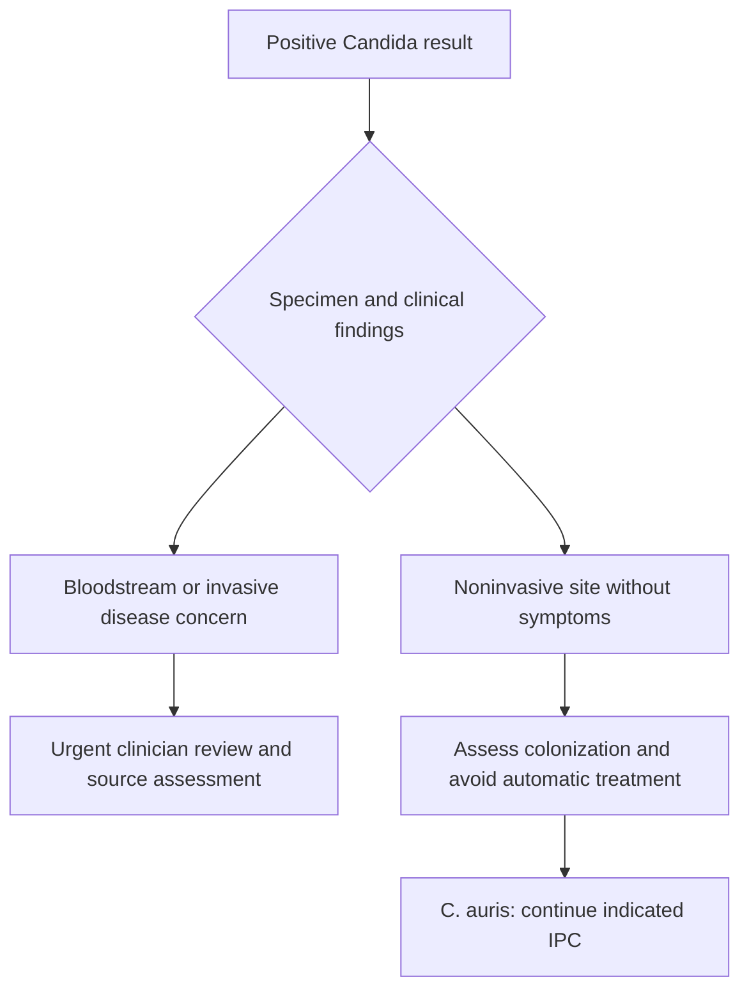

# Medical mycology and opportunistic fungi

**Study-ready, unattempted.** [40 original MCQs](../MCQs/18-Medical-Mycology-and-Opportunistic-Fungi-40-MCQs.md) · [Reported recruitment exam practice](../Previous-Year-Questions/Mycology-Reported-Recruitment-PYQs.md)

## Basic structure and classification

Fungi living eukaryotic organisms hain. Eukaryotic ka matlab cell ke andar organized nucleus aur cellular organelles hote hain. Ye bacteria se different hote hain. Fungal cell wall mein chitin aur glucan jaise components hote hain. Fungal membrane mein ergosterol important sterol hai. Isliye antifungal drugs ke targets antibacterial drugs se alag ho sakte hain.

Yeast generally single cells ke form mein grow karta hai aur budding se multiply kar sakta hai. Mold thread-like hyphae banata hai. Hyphae ka collection mycelium kehlata hai. Dimorphic fungi conditions ke according morphology change kar sakte hain. Histoplasma environmental mold aur host tissue mein yeast form ka classic example hai. Har fungus dimorphic nahi hota.

| Category | Examples | Clinical focus |
|---|---|---|
| Superficial and cutaneous | Malassezia, dermatophytes | Skin, hair, nail |
| Subcutaneous | Sporothrix | Skin inoculation, nodules |
| Endemic systemic | Histoplasma | Inhalation and lung disease, possible dissemination |
| Opportunistic | Candida, Aspergillus, Mucorales, Cryptococcus, Pneumocystis | Immunosuppression, invasive disease, healthcare risk |

## Dermatophytes and superficial infection

Dermatophytes keratin ko use karte hain. Keratin skin ki outer layer, hair aur nail mein hota hai. Tinea corporis body ki skin ko affect karta hai. Active edge raised aur scaly ho sakta hai. Tinea pedis foot mein hota hai. Tinea capitis scalp aur hair involve karta hai, jisme systemic antifungal treatment usually chahiye. Tinea unguium nails ki dermatophyte infection hai. Onychomycosis nail fungal infection ka broader term hai.

Patient ko skin dry rakhne, personal towels aur footwear use karne aur prescribed course complete karne ki teaching do. Topical steroid alone fungal infection ko mask aur worsen kar sakta hai. Tinea incognito steroid-modified tinea ko describe karta hai. Pityriasis versicolor Malassezia yeast se linked hai aur superficial pigmented scaly patches de sakta hai.

KOH microscopy mein skin scrapings ka keratin clear hota hai aur fungal elements visible ho sakte hain. Specimen active scaly edge se clinician ya trained staff local protocol ke according collect karte hain. Sabouraud dextrose agar fungal culture ka traditional medium hai.

## Candida: colonization versus invasive infection

Candida body ke kuch sites par normal colonizer ho sakta hai. Jab normal defenses disturb hoti hain, overgrowth ya invasive infection ho sakta hai. Oral thrush mein white plaques aur erythematous mucosa ho sakti hai. Inhaled corticosteroid ke baad mouth rinse karna useful preventive teaching hai. Painful swallowing immunocompromised patient mein esophageal disease ka clue ho sakta hai.

Vulvovaginal candidiasis itching aur discharge cause kar sakti hai, lekin ye generally sexually transmitted infection classify nahi hoti. Recurrent symptoms mein repeated self-treatment ke bajay clinician evaluation useful hai.

Candidemia mein Candida bloodstream mein detect hota hai. ICU admission, central catheter, parenteral nutrition aur immunosuppression important risks hain. Nurse positive blood culture promptly communicate karti hai aur sepsis monitoring, prescribed treatment aur source-control review coordinate karti hai. Respiratory secretion mein Candida growth commonly colonization hoti hai. Culture site aur clinical condition dono ko consider karo.

Candida auris (Candidozyma auris) healthcare settings mein spread kar sakta hai aur antifungal resistance dikha sakta hai. Asymptomatic skin colonization ko routine antifungal treatment se eradicate karne ki recommendation nahi hai. Colonized aur infected patients ke liye appropriate facility IPC measures zaroori hain. Screening ke liye CDC bilateral axillae aur groin composite swab recommend karta hai. Transfer par receiving facility ko colonization ya infection status inform karo. Shared equipment par organism-effective compatible disinfectant aur label contact time follow karo.

## Invasive molds: Aspergillus and Mucorales

Aspergillus spores environment se inhale ho sakte hain. Neutropenia aur transplant mein invasive pulmonary disease ka risk badhta hai. Fever, pleuritic pain, hemoptysis ya breathing deterioration urgent assessment maangte hain. Construction dust exposure reduce karne ke liye protective environment measures follow karo. Asthma mein allergic bronchopulmonary aspergillosis hypersensitivity syndrome hai, invasive fungal disease nahi. Old lung cavity mein aspergilloma fungal ball form ho sakta hai.

Mucormycosis uncontrolled diabetes, ketoacidosis ya immunosuppression mein serious invasive disease cause kar sakti hai. Angioinvasion ka matlab fungus blood vessels mein invade karta hai. Thrombosis se tissue blood supply kam ho sakti hai aur necrosis develop ho sakti hai. Facial swelling, severe pain, visual change ya neurological symptoms urgent ENT, ophthalmology and medical evaluation maangte hain. Black eschar ka wait mat karo. Galactomannan aur beta-D-glucan tests negative hone se mucormycosis exclude nahi hoti. Tissue sampling, imaging, antifungal therapy aur surgical assessment clinician-directed hote hain.

| Feature | Aspergillus | Mucorales |
|---|---|---|
| Classical tissue microscopy | Narrow septate hyphae, often acute-angle branching | Broad pauciseptate hyphae, irregular branching |
| Important risk | Neutropenia, transplant | DKA, neutropenia |
| Diagnostic caveat | Morphology alone may not identify species | Negative galactomannan does not exclude disease |

## Other important fungi

Cryptococcus encapsulated yeast hai. Inhalation ke baad pulmonary disease aur immunocompromised patients mein CNS dissemination possible hai. Headache, confusion, visual symptoms aur raised intracranial pressure serious clues hain. Cryptococcal antigen blood ya CSF mein useful ho sakta hai. Intracranial pressure evaluation aur therapeutic interventions clinician-directed hain.

Histoplasma soil enriched with bird ya bat droppings se associated hai. Inhaled exposure pulmonary disease cause kar sakta hai. Advanced immunosuppression mein dissemination possible hai. Sporothrix traumatic skin inoculation ke baad lymphatic route mein nodules cause kar sakta hai. Pneumocystis jirovecii fungus hai jo advanced HIV ya other immunosuppression mein hypoxemic pneumonia cause kar sakta hai. Dry cough, progressive dyspnea aur desaturation par oxygenation assess karo. TMP-SMX commonly treatment aur indicated prophylaxis mein use hota hai.

## Antifungal monitoring

| Drug class | Mechanism clue | Nursing priority |
|---|---|---|
| Polyene, amphotericin B | Ergosterol binding | Kidney function, potassium, magnesium and infusion reaction monitoring |
| Azoles | Ergosterol synthesis inhibition | Drug interactions and liver monitoring as indicated |
| Echinocandins | Beta-1,3-D-glucan synthesis inhibition | Prescribed IV therapy and liver monitoring as indicated |
| Flucytosine | Fungal nucleic acid metabolism interference | Blood count, renal dosing review and toxicity monitoring |

Clinical example: chemotherapy patient ko prolonged fever, pleuritic pain aur oxygen requirement badhne lagi. Nurse negative initial bacterial culture se fungal disease exclude nahi karti. Respiratory assessment, vital signs aur urgent clinician escalation karti hai. Antifungal selection suspected organism, infection site, severity, susceptibility aur patient factors ke basis par clinician karta hai.

## Clinical references

- [CDC fungal diseases overview](https://www.cdc.gov/fungal/about/index.html)
- [CDC invasive candidiasis](https://www.cdc.gov/candidiasis/hcp/clinical-overview/)
- [CDC C. auris infection control](https://www.cdc.gov/candida-auris/hcp/infection-control/index.html)
- [CDC C. auris colonization and invasive infection prevention](https://www.cdc.gov/candida-auris/hcp/infection-control/invasive-infection-prevention.html)
- [CDC Aspergillosis](https://www.cdc.gov/aspergillosis/hcp/clinical-overview/)
- [CDC mucormycosis](https://www.cdc.gov/mucormycosis/hcp/clinical-overview/)
- [CDC cryptococcosis](https://www.cdc.gov/cryptococcosis/hcp/clinical-overview/index.html)
- [Global cryptococcosis guideline](https://www.idsociety.org/practice-guideline/Diagnosis-and-Management-of-Cryptococcosis/)

## Concept videos and practice resources

- Concept: [Indian Medical Lecture — Fungi introduction and classification in Hindi](https://www.youtube.com/watch?v=4MQGnITBnrE). Indexed channel and title.
- Concept: [Indian Medical Lecture 2.0 — Fungi classification and introduction](https://www.youtube.com/watch?v=70vHi_or0tg). Indexed 23 October 2026, includes morphology and classification.
- MCQ video lead: [Pathology tak by Raman Kumar — Microbiology and Mycology MCQS Question for paramedical and nursing officer exams](https://www.youtube.com/watch?v=Qtd4R-nBlA8). Indexed 22 April 2025. Title mentions mycology but description emphasizes virology, so actual fungal question coverage is uncertain. Do not treat as a verified dedicated mycology session.
- Topic-specific text MCQ practice: [Microbe Online — Mycology MCQs with answers and explanations](https://microbeonline.com/multiple-choice-questions-mcq-microbiology-mycology/). Ten indexed questions, medical microbiology level. Not an official PYQ or video.

Full playback and question accuracy were not independently verified. A dedicated human mycology nursing MCQ video with confirmed content remains pending. Veterinary-only questions were not included.
