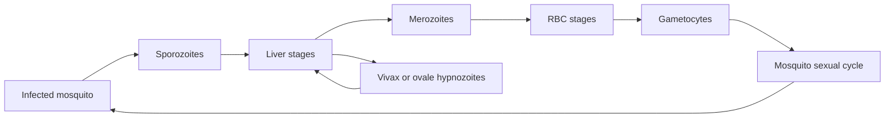

# Protozoa and malaria — detailed concepts

**Priority High. Study-ready, not studied.** [40 MCQs](../MCQs/19-Protozoa-and-Malaria-40-MCQs.md)

## Basic classification

Protozoa unicellular eukaryotic parasites hain. Trophozoite active feeding or replicating form ho sakta hai. Cyst protective environmental form ho sakta hai, but all protozoa cyst nahi banate. Parasite life stage, clinical syndrome and specimen type diagnosis guide karte hain.

## Malaria life cycle and pathophysiology

Female Anopheles sporozoites inoculate karti hai. Sporozoites liver cells tak jaate hain. Hepatic multiplication ke baad merozoites release hote hain jo RBC infect karte hain. RBC multiplication and rupture anemia, fever and inflammatory response contribute karte hain. Some parasites gametocytes bante hain, jo mosquito ingest karti hai. Sexual reproduction mosquito mein hoti hai. Isliye mosquito definitive host aur human intermediate host hai.

| Species | Classical clue |
|---|---|
| P. falciparum | Sequestration and severe disease risk, crescent gametocytes |
| P. vivax and P. ovale | Dormant hepatic hypnozoites and relapse |
| P. malariae | Classical quartan fever periodicity |
| P. knowlesi | Zoonotic species, can progress severely |

Fever periodicity alone diagnosis nahi hai. Early and severe malaria irregular fever de sakti hai. Falciparum infected RBC microvascular endothelium adhere kar sakte hain. Organ perfusion impair ho sakti hai. Altered consciousness, seizures, respiratory distress, shock, severe anemia, hypoglycemia and renal injury urgent warning signs hain. Pregnancy and children higher-risk groups ho sakte hain.

## Diagnosis, treatment and nursing care

Thick film sensitive parasite detection support karta hai. Thin film species and parasitemia assessment mein useful hai. RDT antigens detect karta hai, some antigens therapy ke baad persist kar sakte hain. High suspicion mein initial negative test repeat evaluation require kar sakta hai. Severe malaria mein emergency treatment diagnostic confirmation ke liye delay nahi hona chahiye. WHO parenteral artesunate followed by complete appropriate oral treatment recommend karta hai. Uncomplicated regimen species, resistance, pregnancy and local guidelines par depend karta hai. Vivax and ovale radical cure G6PD and eligibility assessment require kar sakti hai. Primaquine pregnancy mein generally contraindicated hai. Nurse ABC, blood glucose, perfusion, consciousness, urine output, anemia and respiratory status monitor karti hai. Prescriber medication plan decide karta hai.

## Community prevention

Insecticide-treated nets, indoor residual spraying as programme-directed, vector surveillance and prompt diagnosis/treatment important hain. API annual confirmed cases per 1000 population at risk hai. Example 120/60000 × 1000 = 2. Programme definition and reporting follow karo.

## Other protozoa

| Parasite | Transmission and clinical clue |
|---|---|
| Giardia | Cysts ingested, greasy stool and malabsorption |
| E. histolytica | Fecal-oral spread, dysentery and liver abscess |
| Cryptosporidium | Oocysts, watery diarrhea especially immunosuppression |
| Trichomonas | Sexual transmission, trophozoite without cyst stage |
| Toxoplasma | Undercooked meat and contaminated environment, pregnancy/CNS risks |
| Leishmania | Sandfly vector, visceral fever and splenomegaly |
| Naegleria | Rare nasal freshwater exposure, fulminant CNS disease |

Giardia intermittent shedding se multiple stool samples useful ho sakte hain. Entamoeba tissue invasion liver abscess cause kar sakti hai. Routine microscopy E. dispar distinction reliably nahi karti. Invasive disease tissue-active therapy followed by luminal treatment require kar sakti hai. Cryptosporidium relatively chlorine tolerant hai. Hydration and severe immunosuppression risk assess karo. Trichomoniasis partner management reinfection reduce karta hai. Toxoplasmosis pregnancy mein safe food and soil hygiene important hain. Advanced HIV mein CNS reactivation possible hai. Visceral leishmaniasis macrophage amastigotes and pancytopenia se associated hai. Suspected Naegleria with rapid neurological decline emergency hai.

## Sources and videos

[WHO malaria guidance](https://www.who.int/publications/i/item/guidelines-for-malaria) · [WHO vivax field guide](https://www.who.int/publications/i/item/9789240120808) · [CDC parasite diagnosis](https://www.cdc.gov/parasites/testing-diagnosis/index.html) · [CDC Giardia](https://www.cdc.gov/dpdx/giardiasis/)

- [TSL Tarun Saini Lectures: infectious disease MCQs, episode 106](https://www.youtube.com/watch?v=AefUcwK5c4M), 11 February 2026 as indexed, description explicitly covers malaria species, smears and treatment.
- [Nursing Wallah by PW: NORCET 10 Mains marathon](https://www.youtube.com/watch?v=5hK10sc7bTc&t=3700s), indexed malaria control section around 1:01:40. Full playback not reviewed. Dedicated nonmalaria protozoa MCQ video remains pending.

## Additional clinical and video references — 27 November 2026

[India NCVBDC programme guidelines](https://ncvbdc.mohfw.gov.in/index1.php?lang=1&level=1&lid=3686&sublinkid=5899) and [WHO malaria guidelines](https://www.who.int/teams/global-malaria-programme/guidelines-for-malaria) should guide India-specific study. [CDC severe malaria guidance](https://www.cdc.gov/malaria/hcp/clinical-guidance/iv-artesunate-us.html) provides additional clinical context, not a substitute for Indian dosing policy. Delayed hemolysis after IV artesunate is a follow-up concern. Nurse new pallor, dark urine aur fatigue ko promptly report karti hai. Relapse dormant liver parasites se aur recrudescence incompletely cleared blood-stage parasites se ho sakti hai.

- Concept: [Malaria In Hindi — BSc Nursing life cycle and treatment](https://www.youtube.com/watch?v=-SyZ79Tvjh8), indexed title and description. Channel metadata not retrieved.
- MCQ practice: [RRB Nursing Superintendent General Science One Shot, Part 7](https://www.youtube.com/watch?v=_OYQ9sXW2DI), indexed chapter at 21:30 covers malaria and kala-azar causative organisms. Channel metadata not retrieved. Full playback remains unverified.
- [CDC Giardia diagnosis](https://www.cdc.gov/giardia/hcp/diagnosis-testing/), [CDC amebiasis](https://www.cdc.gov/amebiasis/about/index.html), [CDC Crypto water safety](https://www.cdc.gov/cryptosporidium/prevention/crypto-home-boil-water.html), [CDC trichomoniasis](https://www.cdc.gov/std/treatment-guidelines/trichomoniasis.htm), [CDC toxoplasmosis prevention](https://www.cdc.gov/toxoplasmosis/prevention/) and [WHO India leishmaniasis](https://www.who.int/india/health-topics/leishmaniasis) provide organism-specific clinical context.

[Canonical exam evidence](../Previous-Year-Questions/19-20-Malaria-and-Helminths-Reported-PYQ-Adaptations.md). Dedicated nonmalaria nursing MCQ videos remain pending.
